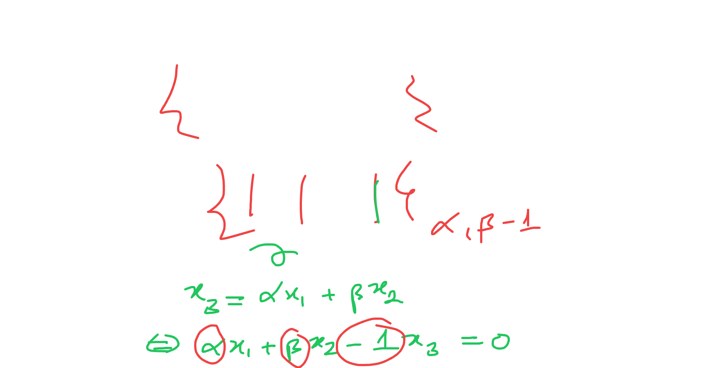
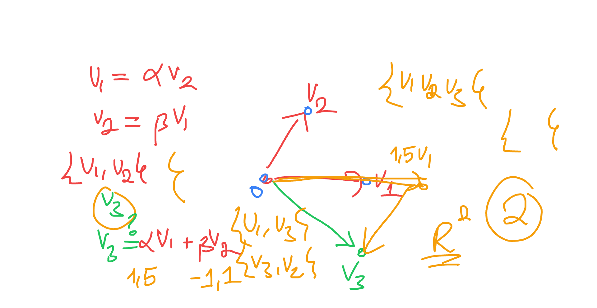
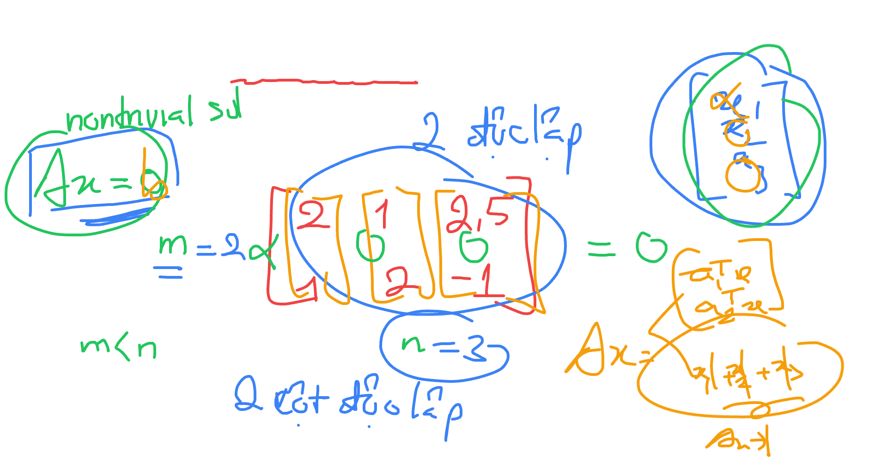
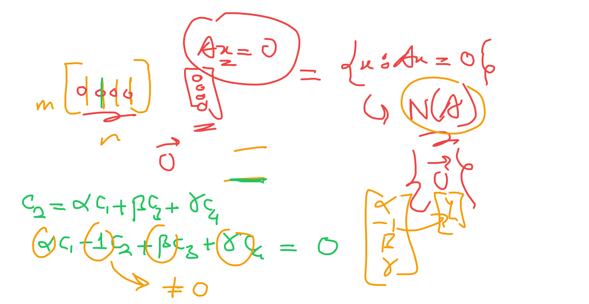
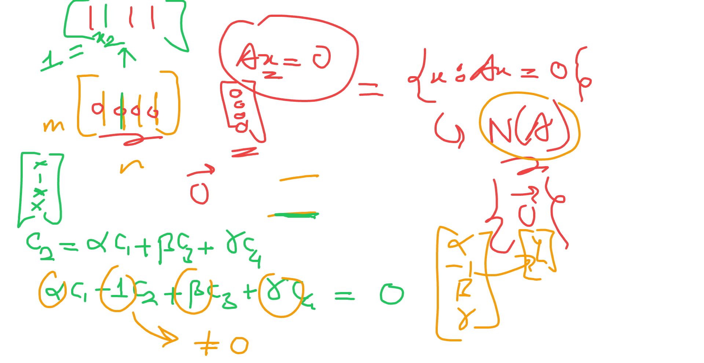
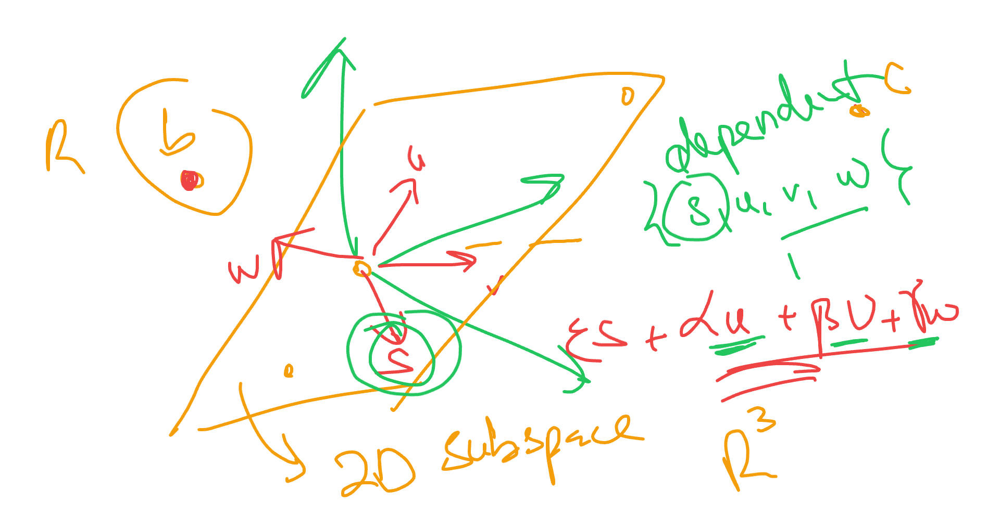

# Lecture 9: Independece, Basis, And Dimension

📊 **Progress:** `35` Notes | `43` Screenshots | `12` AI Reviews

---

 

## Linear Independence, Basis and Dimension

<kbd></kbd>

 

### Nonzero Solutions to Ax = 0

<kbd></kbd>

> [!NOTE]
> đầu tiên gs giả sử ta có matrix A với **số hàng ít hơn số
> cột**. Thì ta có thể kết luận rằng hệ phương trình **Ax=0
> SẼ CÓ SOLUTION KHÁC 0**. Câu hỏi là, vì sao ta có
> thể kết luận như vậy?

📹 [Xem video trên YouTube](https://www.youtube.com/watch?v=OeiSCA8vnoU)

> [!TIP]
> 🤖 **AI Check** — 🟢 Pass — ✅ **100/100** · ✓ Move on
>
> Ghi chú đã tóm tắt hoàn toàn chính xác định lý được nêu trên bảng: khi số hàng ít hơn số cột (m < n) thì hệ thuần nhất Ax = 0 luôn có nghiệm phi tầm thường (khác 0).
>
> **✓ Strengths**
> - Nắm bắt chính xác điều kiện m < n (số phương trình ít hơn số ẩn) và kết luận tồn tại nghiệm khác 0 của hệ Ax = 0.
> - Đặt câu hỏi đúng trọng tâm bài học để tìm hiểu bản chất đại số tuyến tính đằng sau định lý.
>
> **💡 Deeper notes**
> - Để trả lời cho câu hỏi 'vì sao': Hạng của ma trận r = rank(A) luôn nhỏ hơn hoặc bằng số hàng m (r ≤ m). Vì m < n nên r < n, điều này đảm bảo luôn có ít nhất n - r ≥ n - m > 0 biến tự do (free variables), do đó không gian hạt nhân (nullspace) N(A) có số chiều ít nhất là 1, dẫn đến luôn tồn tại nghiệm x ≠ 0.

 

#### Nonzero Solutions to Homogeneous Systems

<kbd></kbd>

> [!NOTE]
> thế thì ta **có thể lập luận dựa trên những gì đã biết** về
> việc ta có một giải thuật **elimination** giúp đưa system
> of equation về dạng **Row Echelon**, 
>
>
>
> để từ đó, ta **xác định các pivot**, cũng như pivot column
> và nếu có **free column**, ta sẽ **assign giá trị tùy ý cho 
> free variable** để back-substitution, tính ra các **special 
> solution** (và nhờ free variable có thể chọn giá trị tùy
> ý nên đương nhiên special solution khác 0)
>
>
>
> Vậy nhìn lại đây, vì m < n, số hàng < số cột, nên **kiểu
> gì cũng chỉ có tối đa m pivot variable/column**, thành ra
> **luôn có n-m > 0 các free variable/column**.
>
>
>
> Vậy ta có thể kết luận Ax=0 **chắc chắn có solution khác 0**

> [!TIP]
> 🤖 **AI Check** — 🟢 Pass — ✅ **95/100** · ✓ Move on
>
> Ghi chú lập luận rất chính xác và logic, liên kết chặt chẽ giữa phép khử Gauss, số lượng pivot và biến tự do để giải thích sự tồn tại của nghiệm khác không.
>
> **✓ Strengths**
> - Giải thích bản chất rất rõ ràng bằng cách kết nối với quy trình khử hàng (Row Echelon), vị trí pivot và biến tự do.
> - Hiểu đúng rằng số pivot r bị chặn trên bởi số hàng m (r <= m), dẫn đến luôn có biến tự do khi m < n.
>
> **💡 Deeper notes**
> - Cần chính xác hơn về mặt từ ngữ: số biến tự do thực tế là n - r >= n - m > 0 (nghĩa là có 'ít nhất' n - m biến tự do, vì nếu xuất hiện hàng toàn số 0 thì số pivot r còn nhỏ hơn m).

 

##### Definition of Linear Independence

<kbd></kbd>

<kbd></kbd>

> [!NOTE]
> Qua khái niệm **independent**, gs định nghĩa là, đám vector x1, x2....xn independent (có thể nói dài dòng là linear independent) **NẾU KHÔNG CÓ LINEAR COMBINATION NÀO CỦA CHÚNG BẰNG 0**, **NGOẠITRỪ** một trường hợp được phép, là khi **MỌI COEFFICIENT c_i ĐỀU BẰNG 0**
>
>
>
> Suy nghĩ một chút có thể hiểu vì sao lại vậy, là bởi vì **nếu tồn tại một linear combination (non trivial) của chúng bằng 0** thì chuyển vế đổi dấu một vector một cái qua ta sẽ thấy ngay **vector đó là linear combination của các vector còn lại**, tức là nó **phụ thuộc tuyến tính với đám kia.**
>
>
>
> Như vậy thì **cả đám không độc lập tuyến tính nhau,**

📹 [Xem video trên YouTube](https://www.youtube.com/watch?v=OpXy96ENApE)

> [!TIP]
> 🤖 **AI Check** — 🟢 Pass — ✅ **95/100** · ✓ Move on
>
> Ghi chú nắm rất chắc định nghĩa độc lập tuyến tính trên bảng và diễn giải trực quan chính xác lý do vì sao định nghĩa này tương đương với việc không vector nào biểu diễn được qua các vector còn lại.
>
> **✓ Strengths**
> - Hiểu và diễn đạt chính xác định nghĩa độc lập tuyến tính thông qua tổ hợp tuyến tính triệt tiêu (chỉ có nghiệm tầm thường c_i = 0).
> - Nêu bật được trực giác bản chất: nếu có nghiệm không tầm thường thì có thể rút một vector ra biểu diễn tuyến tính qua các vector còn lại.
>
> **💡 Deeper notes**
> - Về mặt biến đổi chi tiết: khi chuyển vế và chia hệ số để biểu diễn vector đó theo các vector còn lại, ta cần chọn vector có hệ số c_k khác 0 (điều này luôn khả thi vì đây là tổ hợp không tầm thường).

 

###### Linear Independence of Vectors

<kbd></kbd>

> [!NOTE]
> Thầy lấy ví dụ v1 và v2 = 2v1. Đương nhiên ta biết nó
> dependence, chỉ là soi chiếu theo định nghĩa thì ta thấy có
> thể kiếm được một linear combination giữa chúng để tạo
> vector zero: 2v1 - v2 = 0

> [!TIP]
> 🤖 **AI Check** — 🟡 Minor issues — ✅ **95/100** · ✓ Move on
>
> Ghi chú nắm rất chính xác ví dụ minh họa và bản chất đại số của tính phụ thuộc tuyến tính từ bài giảng.
>
> **🟡 Minor issues**
>
> **1.** *"kiếm được một linear combination giữa chúng để tạo vector zero: 2v1 - v2 = 0"*
>
> Định nghĩa phụ thuộc tuyến tính yêu cầu các hệ số không đồng thời bằng 0 (ở đây là 2 và -1). Cần lưu ý điều này vì tổ hợp tuyến tính với các hệ số đều bằng 0 luôn luôn tạo ra vector 0 với bất kỳ vector nào.
>
>
> **✓ Strengths**
> - Hiểu đúng bản chất hình học và đại số của ví dụ: hai vector cùng phương dẫn đến sự phụ thuộc tuyến tính.
> - Liên hệ chính xác ví dụ trên bảng với định nghĩa tổ hợp tuyến tính bằng vector không.
>
> **💡 Deeper notes**
> - Về thuật ngữ, nên dùng tính từ 'linearly dependent' (hoặc 'phụ thuộc tuyến tính') thay vì danh từ 'dependence' khi mô tả quan hệ giữa các vector.

 

###### Sự phụ thuộc tuyến tính

<kbd></kbd>

<kbd></kbd>

> [!NOTE]
> Ví dụ khác, v1 và v2 = 0. Cũng là dependence. Vì có thể
> có 0 × v1 + 100 × v2 = 0 + 0 = 0. Vẫn thỏa điều kiện là **tồn tại
> bộ non-zero coefficients để tạo linear combination = zero**

📹 [Xem video trên YouTube](https://www.youtube.com/watch?v=GCwrn_86Gos)

> [!TIP]
> 🤖 **AI Check** — 🟡 Minor issues — ✅ **95/100** · ✓ Move on
>
> Ghi chú rất chính xác về bản chất: bất kỳ tập hợp vector nào chứa vector 0 đều phụ thuộc tuyến tính, kèm ví dụ minh họa trực quan và đúng định nghĩa.
>
> **🟡 Minor issues**
>
> **1.** *"tồn tại bộ non-zero coefficients"*
>
> Thuật ngữ chuẩn xác hơn nên là 'tồn tại các hệ số không đồng thời bằng 0' (not all zero coefficients) thay vì 'bộ non-zero', vì trong ví dụ hệ số của v1 vẫn bằng 0, chỉ cần ít nhất một hệ số khác 0 (ở đây là 100).
>
>
> **✓ Strengths**
> - Nắm vững định nghĩa sự phụ thuộc tuyến tính thông qua việc tìm ra một tổ hợp tuyến tính triệt tiêu có hệ số khác 0.
> - Ví dụ cụ thể (0*v1 + 100*v2 = 0) giúp chứng minh trực tiếp và trực quan tại sao tập hợp chứa vector 0 luôn phụ thuộc tuyến tính.
>
> **💡 Deeper notes**
> - Quy tắc tổng quát hữu ích: Bất kỳ họ vector nào chứa vector zero đều tự động phụ thuộc tuyến tính (linearly dependent), vì luôn có thể gán hệ số khác 0 cho vector zero và hệ số 0 cho tất cả các vector còn lại.

 

###### Linear Independence of Vectors

<kbd></kbd>

> [!NOTE]
> đúng là như vậy, và ta có thể kết luân **NẾU TRONG
> SET CÁC VECTOR CÓ MỘT ZERO VECTOR**, thì coi
> như không có chuyện linear independence nữa

> [!TIP]
> 🤖 **AI Check** — 🟢 Pass — ✅ **100/100** · ✓ Move on
>
> Ghi chú hoàn toàn chính xác về mặt toán học: một tập hợp vector chứa vector không (zero vector) thì luôn phụ thuộc tuyến tính (linearly dependent).
>
> **✓ Strengths**
> - Nắm bắt chính xác tính chất quan trọng của tính độc lập tuyến tính từ ví dụ minh họa của bài giảng: bất kỳ tập vector nào chứa vector không đều phụ thuộc tuyến tính.
>
> **💡 Deeper notes**
> - Lý do chặt chẽ là ta luôn có thể gán hệ số khác 0 (ví dụ bằng 6 như giáo sư viết trên bảng) cho vector không và hệ số 0 cho tất cả các vector còn lại để tạo ra tổ hợp tuyến tính bằng 0 mà không cần tất cả hệ số bằng 0.

 

###### Linear Independence of Vectors

<kbd></kbd>

> [!NOTE]
> tiếp, gs lấy ví dụ hai vector v1, v2 như thế này, rõ ràng,
> vì **khác phương**, nên **không thể nào có linear
> combination** giữa chúng **với coefficient không cùng
> bằng 0** **mà ra 0 được.**
>
>
>
> Thế thì, gs vẽ thêm v3, và hỏi rằng, nếu tôi vẽ v3 tùy
> tiện như vầy, thì 3 vector này có independence không?
>
>
>
> me: Không. Vì như đã biết, **vì v1, v2 independence**,
> **nên mọi linear combination của chúng đã tạo thành
> plane R²**.
>
>
>
> Và **v3 nằm trong R²**, nên **nó cũng là kết quả của
> một linear combination giữa v1 và v2**. Vậy ba vector
> này không independence.

 

###### Linear Independence Definition

<kbd></kbd>

 

###### Tính phụ thuộc tuyến tính

<kbd></kbd>

<kbd></kbd>

> [!NOTE]
> gs: có thể giải thích vì sao tôi biết 3 vector này dependence
> là vì soi lại cái ta vừa nhận định: Nếu matrix A có **số hàng
> nhỏ hơn số cột** thì kiểu gì cũng sẽ **có solution khác 0** (như
> đã giải thích, vì số pivot lớn nhất **sẽ chỉ là m < n** nên sẽ
> **luôn có free column** / free variable → nên chắc chắn có thể
> chọn giá trị khác không cho free variable và thế vào ta tính
> ra pivot variable để **có special solution khác 0**.
>
>
>
> Vậy nếu ta xét matrix A có 3 cột là 3 column vector v1,v2,v3
> thì đương nhiên ta có matrix A với m<n như vậy. Từ đó
> Ax=0 luôn có solution khác 0, gọi nó là [c1, c2, c3]ᵀ đi
>
>
>
> Thì như đã biết Ac=0 chính là linear combination của các
> cột với coefficient là các phần tử của c = 0 → Dependence.

📹 [Xem video trên YouTube](https://www.youtube.com/watch?v=ogUUI-lxqk0)

> [!TIP]
> 🤖 **AI Check** — 🟢 Pass — ✅ **100/100** · ✓ Move on
>
> Ghi chú nắm rất chắc và chính xác bản chất: ma trận có $m < n$ luôn có biến tự do (free variables), dẫn đến nghiệm phi tầm thường ($c \neq 0$) cho hệ $Ac = 0$, chứng minh các vector cột phụ thuộc tuyến tính.
>
> **✓ Strengths**
> - Hiểu đúng mối liên hệ cốt lõi giữa số hàng nhỏ hơn số cột ($m < n$) với việc luôn tồn tại biến tự do và nghiệm khác không (nullspace chứa vector khác 0).
> - Kết nối chính xác phương trình ma trận $Ac = 0$ với tổ hợp tuyến tính của các vector cột bằng 0 để kết luận tính phụ thuộc tuyến tính.
>
> **💡 Deeper notes**
> - Cần lưu ý trong cách diễn đạt đoạn cuối: 'Ac=0 chính là linear combination của các cột bằng 0 với hệ số c không đồng thời bằng 0', tránh viết nhầm thành hệ số bằng 0.

 

###### Column Independence via Nullspace

<kbd></kbd>

> [!NOTE]
> vậy từ đó ta có thể đưa ra nhận định, với **v1,v2..vn là columns của
> A** thì:
>
>
>
> Chúng sẽ **independence** nếu **nullspace của A chỉ chứa zero**.
>
>
>
> Và **dependence** nếu nullspace của A **có vector khác ngoài
> zero**.
>
>
>
> ===
>
>
>
> Vì nullspace của A là mọi solution của Ax=0, hay, mọi vector x tạo ra
> linear combination của các A's column bằng 0. Vì nó là một vector
> space, nên nó nhất định, ít nhất thì cũng chứa vector zero (ôn lại
> tiếp, vì vector space có tính chất linear combination của hai vector
> đều tạo một véctơ cũng nằm trong space, nên vector space luôn
> phải có zero, vì nếu không 0 × a = 0 sẽ không nằm trong space thì sẽ
> không thỏa điều kiện vừa nói)
>
>
>
> Vậy thì **nếu nullspace của A chỉ có mỗi zero vector**, thì có nghĩa là
> **ngoài bộ coeffs toàn 0**, thì **chẳng có bộ nào khác** tạo ra linear
> combination của A's column để **cho ra 0** → nên các **column của
> A independence**
>
>
>
> Còn nếu nullspace của A **có vector khác zero vector**, thì có
> nghĩa là **có một coeff khác mà không** **phải là 0** hết có thể tạo linear
> combination của A's cols ra 0 → **dependence.**

> [!TIP]
> 🤖 **AI Check** — 🟢 Pass — ✅ **98/100** · ✓ Move on
>
> Ghi chú rất xuất sắc, giải thích cặn kẽ và chính xác bản chất vì sao nghiệm của Ax=0 (nullspace) lại tương đương với tính độc lập tuyến tính của các cột.
>
> **🟡 Minor issues**
>
> **1.** *"có nghĩa là có một coeff khác mà không phải là 0 hết"*
>
> Cách dùng từ hơi lẫn lộn giữa 'một hệ số' và 'bộ hệ số'. Chính xác hơn là 'tồn tại một vector nghiệm khác vector 0, nghĩa là có ít nhất một hệ số khác 0'.
>
>
> **✓ Strengths**
> - Hiểu rất rõ định nghĩa nullspace là tập nghiệm của phương trình Ax = 0, đồng thời là các tổ hợp tuyến tính của các cột bằng 0.
> - Giải thích chính xác vì sao không gian vector luôn phải chứa vector 0 dựa trên tính chất đóng của tổ hợp tuyến tính.
> - Kết nối mạch lạc giữa sự tồn tại của nghiệm tầm thường/không tầm thường với tính độc lập và phụ thuộc tuyến tính.
>
> **💡 Deeper notes**
> - Khi dùng tiếng Anh, 'independent'/'dependent' là tính từ (dùng cho các vector), còn 'independence'/'dependence' là danh từ.

 

###### Matrix Rank and Free Variables

<kbd></kbd>

<kbd></kbd>

<kbd></kbd>

> [!NOTE]
> Vậy, với trường hợp **mọi cols của A đều independence**, thì
> chính là ta có **mỗi cột một pivot**, nên trường hợp này ta
> có n pivot → **rank = n**. Nhớ lại, rank là số pivot
>
>
>
> Còn với trường hợp các cols của A **dependence**, thì ta có
> số **pivot < số cột**, đồng nghĩa có free columns , và rank < n

📹 [Xem video trên YouTube](https://www.youtube.com/watch?v=NrYt3dlnowY)

> [!TIP]
> 🤖 **AI Check** — 🟢 Pass — ✅ **95/100** · ✓ Move on
>
> Ghi chú rất chính xác và nắm vững bản chất: liên hệ đúng giữa số lượng pivot, hạng của ma trận (rank), tính độc lập tuyến tính của các cột và sự xuất hiện của biến tự do.
>
> **✓ Strengths**
> - Nắm vững mối quan hệ giữa độc lập tuyến tính của các cột và việc mỗi cột đều có một pivot (rank = n).
> - Hiểu rõ khi các cột phụ thuộc tuyến tính thì số pivot < n dẫn tới sự xuất hiện của các cột tự do (free variables/free columns).
>
> **💡 Deeper notes**
> - Về thuật ngữ tiếng Anh: nên dùng tính từ 'independent' và 'dependent' thay vì danh từ 'independence' và 'dependence' khi mô tả đặc tính của các cột.
> - Trên bảng giảng viên còn ghi thêm N(A) = {0} cho trường hợp rank = n, tức là nghiệm của hệ Ax = 0 chỉ có duy nhất nghiệm tầm thường x = 0.

**🔗 See also:** [Nghiệm đặc biệt và Nullspace](./lecture_7_solving_ax_0_pivot_variables_special_solutions.md#node-xpxaf8g)

 

###### Linear Independence and Nullspace

<kbd></kbd>

> [!NOTE]
> Gs nói qua khái niệm span: một đ**ám vector "span" một
> space** là sao
>
>
>
> thì ông cho biết mình đã thấy nó rồi, khi ta nhớ đã từng nói
> **vector space** tạo bởi **mọi linear combination của column
> của matrix A** được gọi là **columns spac**e của A. Thì đó
> cũng chính là nói rằng **CÁC COLUMNS CỦA A SPAN
> COLUMN SPACE C(A)**

> [!TIP]
> 🤖 **AI Check** — 🟢 Pass — ✅ **95/100** · ✓ Move on
>
> Ghi chú nắm rất chính xác và tự nhiên bản chất khái niệm không gian sinh (span) thông qua liên hệ trực tiếp với column space C(A).
>
> **✓ Strengths**
> - Hiểu đúng định nghĩa cốt lõi của 'span': tập hợp tất cả các tổ hợp tuyến tính của các vector đã cho.
> - Liên hệ chính xác giữa các cột của ma trận A và không gian cột C(A) như một ví dụ cụ thể cho khái niệm span.
>
> **💡 Deeper notes**
> - Cần phân biệt giữa 'span' (chỉ việc bao trùm toàn bộ không gian) và 'basis' (cơ sở: vừa span được không gian, vừa phải độc lập tuyến tính).

**🔗 See also:** [Không gian cột ma trận](./lecture_5_transpose_permutations_spaces_rn.md#node-sobom5t)

 

###### Định nghĩa span vector

<kbd></kbd>

<kbd></kbd>

> [!NOTE]
> vậy ta có định nghĩa của **span**: Ta nói rằng đám vector
> v1,v2...vl **span một vector space** nếu vector space
> được **tạo thành bởi mọi linear combination của các
> vector đó**

📹 [Xem video trên YouTube](https://www.youtube.com/watch?v=RlPbmEXWyTM)

> [!TIP]
> 🤖 **AI Check** — 🟢 Pass — ✅ **100/100** · ✓ Move on
>
> Ghi chú nắm bắt rất chính xác và trọn vẹn định nghĩa không gian sinh (span) từ bài giảng.
>
> **✓ Strengths**
> - Định nghĩa chuẩn xác: một tập hợp vector sinh ra một không gian vector khi mọi phần tử trong không gian đó đều biểu diễn được dưới dạng tổ hợp tuyến tính của chúng.
>
> **💡 Deeper notes**
> - Một chi tiết kỹ thuật nhỏ: các hệ số trong tổ hợp tuyến tính (linear combinations) là các đại lượng vô hướng (scalars) thuộc về trường số mà không gian vector đó xác định trên (thường là tập số thực R).

 

###### Khái niệm cơ sở Basis

<kbd></kbd>

> [!NOTE]
> gs: thay vì phải nói dài dòng là a..tôi **lấy mọi linear
> combination của các vector này và tạo thành một space**,
> thì bây giờ chỉ cần nói từ **các vector này "span" một
> space**
>
>
>
> ví dụ các columns của A span columns space của A
>
>
>
> Tiếp theo gs lập luận rằng, vậy ta có column space, và ta
> nói các **column span column space đó**.
>
>
>
> Thế thì ta cũng biết **các column** có thể **independence**
> hoặc **dependence** nhau.
>
>
>
> Dẫn ta đến khái niệm **BASIS**, mà bản thân từ basis đã
> mang một hàm nghĩa là **KHÔNG DƯ, KHÔNG THIẾU.**

 

###### Định nghĩa cơ sở

<kbd></kbd>

> [!NOTE]
> thế thì gs định nghĩa **basis** của một space là bộ vector có hai
> tính chất:
>
>
>
> 1. Chúng **independence**
>
>
>
> 2. Chúng **span space đó.**

> [!TIP]
> 🤖 **AI Check** — 🟡 Minor issues — ✅ **95/100** · ✓ Move on
>
> Ghi chú đã nắm chính xác định nghĩa cốt lõi của cơ sở (basis) gồm hai điều kiện: độc lập tuyến tính và phủ kín (span) không gian.
>
> **🟡 Minor issues**
>
> **1.** *"Chúng independence"*
>
> Về mặt thuật ngữ chính xác trong đại số tuyến tính, nên dùng 'độc lập tuyến tính' (linearly independent) thay vì danh từ 'independence'.
>
>
> **✓ Strengths**
> - Nắm bắt chuẩn xác hai điều kiện nền tảng để một tập vector cấu thành một cơ sở (basis).
>
> **💡 Deeper notes**
> - Trên bảng bài giảng dùng từ 'sequence' ($v_1, v_2, \dots, v_d$), nghĩa là một dãy có thứ tự; trong đại số tuyến tính, việc xác định thứ tự của các vector cơ sở (ordered basis) rất quan trọng khi biểu diễn tọa độ.

 

###### Cơ sở chính tắc R³

<kbd></kbd>

> [!NOTE]
> Gs lấy ví dụ space là **R³**. Thì một **basis** của nó là (1 0
> 0), (0 1 0), (0 0 1) (Đây gọi là **STANDARD** BASIS).
>
>
>
> Và chú ý rằng **nó không phải là basis duy nhất.**  Để xem
> xét ba vector này **có phải basis không** thì ta xem **chúng
> có independence không** đã.
>
>
>
> Thì dễ thấy chúng là 3 vector **trùng với 3 trục của không
> gian R³**, nên nếu **muốn c1 × v1 + c2 × v2 + c3 × v3 = 0** thì
> **chỉ có một case là c1=c2=c3=0.**
>
>
>
> Hoặc có thể lập luận rằng ta **đặt nó làm cols của matrix A**,
> Thì dễ thấy ta sẽ có **matrix Identity I**. Sau đó ta **xem xét
> null space của I: Ix = 0**. Thì rõ ràng, **vector nào nhân với
> Identity matrix cũng bằng chính nó**, vậy **Ix = 0 KHI VÀ CHỈ
> KHI x = 0**.
>
>
>
> Vậy **nullspace của I chỉ có zero vector** ⇒ như hồi nãy đã
> biết, điều này có thể **kết luận các cols independence.**

 

<kbd></kbd>

> [!NOTE]
> và **một basis khác**, **miễn là** gồm **3 independent** vector là 
> được.
>
>
>
> Chỉ 2 vec được không? ⇒ Không, **vì 2 vector (independence)
> chỉ span được một 2D plane trong R3**

 

###### Kiểm tra hệ cơ sở

<kbd></kbd>

> [!NOTE]
> Vậy **làm sao để test 3 vector có phải là basis không?**
>
>
>
> Gs nói rằng thì như đã biết, chỉ việc **tạo matrix bởi 3
> vector** và **elimination về row echelon form** rồi **xem có
> free column** nào không.
>
>
>
> Nếu có **tức là các vector không independence.** Từ đó kết
> luận **Không phải basis**

 

###### Ma trận vuông khả nghịch

<kbd></kbd>

> [!NOTE]
> vậy với **matrix vuông thì sao**. Hay gs yêu cầu ta suy
> nghĩ cho câu hỏi: **bộ n vector sẽ tạo basis** nếu **matrix
> (n,n**) với các cols tạo bởi các vector đó **có tính chất
> gì?**
>
>
>
> → **Full rank, hay invertible**.
>
>
>
> Vì sao? Vì với matrix mxn, rank tối đa của nó là chính là m
> (=n), vì ta pivot thì tối đa mỗi hàng một cái và mỗi cột một
> cái, nói gọn hơn thì chỉ tối đa là 1 pivot trong mỗi hàng hay
> cột. Vậy nếu ít hàng hơn cột thì tối đa số pivot chỉ bằng số
> hàng, ngược lại nếu ít cột hơn hàng thì tối đa số pivot chỉ
> bằng số hàng.
>
>
>
> Vậy đang nói matrix vuông có các cols tạo bởi các vector
> independence thì có nghĩa là khi đưa matrix A về row
> echelon form, ta sẽ có **mỗi cột một pivot** (và vì số hàng
> bằng số cột) nên ta cũng có **mỗi hàng một pivot**. Và khi
> **số hàng bằng số cột bằng số pivot, ta gọi là Full Rank**
>
>
>
> Và reduced row  echelon form của A sẽ là I.
>
>
>
> Đồng nghĩa **EA = I** (E là elimination matrix). Từ đó suy
> ra **E chính là A⁻¹** đồng nghĩa **A là invertible matrix (vì
> tồn tại A⁻¹)**

**🔗 See also:** [Ma trận vuông khả nghịch](./lecture_8_solving_ax_b_row_reduced_form_r.md#node-i0hzrgh)

 

###### Cơ sở không gian con

<kbd></kbd>

> [!NOTE]
> thế thì gs hỏi rằng, nếu tôi x**óa đi một vector**, (3 3 8)ᵀ thì
> **hai vector còn lại** này **có là basis của một space nào ko**?

 

<kbd></kbd>

> [!NOTE]
> có, **hai vector này độc lập tuyến tính**, vậy nó đã **thỏa  điều
> kiện thứ nhất**. Vậy nó sẽ là **basis của cái vector space mà
> chúng span** - là mọi linear combination của chúng. Và đó là
> **một 2D plane trong R3** (chú ý lại rằng ko phải là R2 nhé, vì
> vector có 3 phần tử, nó nằm trong R3)
>
>
>
> Vậy thì, gs nói rằng, nếu tôi **vẽ lại vector (3,3,8)** vì nó là một
> linear combination của hai vector kia nên **đương nhiên ta sẽ
> thấy nó trong plane này.**
>
>
>
> Tóm lại, **CHỈ XÉT 2 VECTOR**, thì nó **LÀ MỘT BASIS** một
> basis, của một plane trong R3. Nhưng nếu **XÉT CẢ 3** vector
> thì chúng lại **KHÔNG PHẢI LÀ MỘT BASIS**, bởi chúng **không
> independence.**

 

###### Basis of Column Space

<kbd></kbd>

> [!NOTE]
> Gs nhắc lại lần nữa về một case mà ta có các **columns
> vector span the columns space**, mà chúng lại
> **independence**, cho nên các columns vector này là
> **basis của columns space**

 

###### Cơ sở không gian R³

<kbd></kbd>

> [!NOTE]
> kết luận đầu tiên đó là **CÓ RẤT NHIỀU BASIS**, bất kể
> khi nào ta lấy một **Invertible matrix 3x3**, thì **3 columns
> của nó sẽ tạo một basis của R³**  Vì sao phải 3x3, 4x3
> được không? Không vì lúc này các cols trong R⁴ rồi,
> đang nói R³ mà.
>
>
>
> Thế 3**x4** được không? Không, vì khi đó matrix A có các
> cột tạo bởi 4 cột của matrix này sẽ chắc chắn có free
> columns/variable, vì sao, vì ngay cả khi mỗi hàng có một
> pivot, thì nó c**ũng chỉ có 3 pivot**, cùng **đồng nghĩa là
> chỉ có 3 pivot columns** → **dư một columns** là **free**
> columns ⇒ Ax=0 **có specials solution** cũng là **basis của
> nullspace** ⇒ nullspace không chỉ chứa zero vector ⇒ **có
> bộ non-zero coefficient tạo linear combination giữa các
> columns bằng 0** ⇒ c**ác cols không independence.**

 

###### Số lượng vector cơ sở

<kbd></kbd>

> [!NOTE]
> gs nói rằng, thế thì ta có vô số basis, nhưng chúng
> đều có chung một điểm, mà hồi nãy tôi xóa đi một
> vector thì các bạn đã đúng khi bảo rằng đây không
> còn là basis của R3 nữa. Vì khi đó không đủ vector
>
>
>
> Vậy thì **điểm chung của các basis chính là chúng đều
> CÓ CHUNG SỐ LƯỢNG VECTOR**

 

<kbd></kbd>

> [!NOTE]
> Và số lượng vector của basis cuả một space
> chính là **DIMENSION CỦA SPACE đó**

 

###### Cơ sở và số chiều

<kbd></kbd>

> [!NOTE]
> lướt lại 4 định nghĩa trong bài này:
>
>
>
> Các **vector independence**: là khi **không có linear combination
> nào của chúng ra zero** (trừ khi mọi coeff bằng 0)
>
>
>
> **Span**: là một space tạo bởi **mọi linear combination của đám
> vector** (**không care** chúng **có độc lập hay không**)
>
>
>
> **Basis**, là bộ vector **independence** và **span** một space thì
> chúng là basis của space
>
>
>
> Và giờ là **Dimension**: là **số vector trong basis** của một space

 

###### Tập sinh không gian cột

<kbd></kbd>

> [!NOTE]
> rồi, gs cho ví dụ xét C(A) là columns space của matrix A
> như sau, thế thì các c**olumns này có span columns space
> không?**
>
>
>
> Me: Có, vì **dù chúng không independence**, thì **mọi linear 
> combination của chúng vẫn tạo nên columns space** của A,
> đơn giản vì **đó là định nghĩa của columns space**, và định
> nghĩa của span (space tạo bởi mọi linear combination)
>
>
>
> Correct, đơn giản vì **đó là định nghĩa của column space.**

 

<kbd></kbd>

> [!NOTE]
> Vậy thì chúng **có phải là basis của columns space
> không**?
>
>
>
> Me: **Không**, vì **chúng không independence**, cols 4 =
> cols 1 hay cols 4 là một linear combination của các cols
> khác với hệ số 1 × col1 + 0 × col2 + 0 × col3

 

<kbd></kbd>

> [!NOTE]
> Gs: Đúng vậy, thế thì hãy xét nullspace của A, hãy cho
> một vector khác zero nằm trong nullspace: 
>
>
>
> Me: như đã nói col4 = 1 × col1 + 0 × col2 + 0 × col3
> nên **1***col1 + **0***col2 + **0***col3 **- 1***col4 = **0**
>
>
>
> ⇒ một vector khác 0 của nulls-pace: (**1 0 0 -1)**

 

<kbd></kbd>

> [!NOTE]
> hoặc là vector này cũng được, nó **cũng tạo linear
> combination của các cols ra 0.**
>
>
>
> Nói chung là **chứng tỏ các cols dependence**, nên
> **không phải là basis của columns space**

 

<kbd></kbd>

> [!NOTE]
> Gs, ok, vậy hãy cho tôi một **basis của column space**?
>
>
>
> Me: **tìm các linear independence cols** trong mấy vector đó,
> thì nó là basis

 

<kbd></kbd>

> [!NOTE]
> Đúng vậy, ta chỉ việc tìm các pivot cols, cái đầu tiên nè,
> cái thứ hai cũng ok vì nó không dependence với cái đầu,
> cái thứ 3 không được, vì nó = col1 + col2, cái col4 cũng ko
> vì nó = col1.
>
>
>
> Vậy là nó có 2 independence cols. vậy rank bằng mấy?
>
>
>
> Me: 2
>
>
>
> Gs: correct

 

###### Rank and Column Space Dimension

<kbd></kbd>

> [!NOTE]
> thế thì tới đây ta có một kết luận quan trọng: Đó là
>
>
>
> RANK CỦA = SỐ PIVOT, cũng = SỐ INDEPENDENT
> COLS/ROWS = SỐ VECTOR TRONG BASIS CỦA
> COLUMN SPACE (VÀ CẢ ROW SPACE) = DIMENSION
> CỦA COLUMN SPACE

 

###### Column Space and Matrix Rank

<kbd></kbd>

> [!NOTE]
> Gs: Hãy cho tôi một basis khác: Thầy lấy [2 2 2] và [1 5 7]  là
> hai vector trong column space (vì đều bằng linear combination
> của các cols) và hai vector này independence.
>
>
>
> Thế thì nhận định quan trọng là:
>
>
>
> **Nếu ta biết dimension của Column space C(A) là 2**,  thì miễn
> là **2 vector bất kì trong columns space mà INDEPENDECE**
> nhau thì **sẽ tạo một basis
>
>
>
> Có nghĩa là basis của Column space KHÔNG NHẤT THIẾT
> PHẢI LÀ TRONG SỐ CÁC COLUMN. MÀ LÀ BẤT KÌ BỘ 
> VECTOR CÓ ĐỦ VECTOR VÀ ĐỘC LẬP**

 

<kbd></kbd>

> [!NOTE]
> tiếp, gs: Ta đã biết dimension của columns space là rank,
> vậy còn **basis của nullspace**?
>
>
>
> Quay lại nullspace, hồi nãy ta đã tìm được một special
> solution bằng cách đưa nhận định rằng matrix A có col1 và
> col2 independence, còn col3 và col4 dependent col1 và
> col2. Nên nếu dùng elimination để đưa A về Reduced
> Echelon Form ta sẽ có col1 và col2 là pivot cols, và col3, và
> col4 là free cols.
>
>
>
> Tương đương đối với Ax=0 thì ta có thể chọn free variable
> x3, x4 và thế vào tìm pivot variable x1, x2. Ở đây gs chọn
> x3=1, x4=0, thì có x1=-1, x2=-1. Tạo nên một Special
> solution như đã biết. Và bây giờ, tương tự ta chọn x3=0,
> x4=1 để có x1=-1, x2=0 để thêm một special solution nữa.
>
>
>
> Câu hỏi của gs là: Hai vector trong nullspace (again,
> solution của Ax=0 là thuộc nullspace vì nullspace được định
> nghĩa là mọi linear combination, hay subspace tạo bởi mọi
> vector x khiến Ax=0) này có phải là basis của nullspace
> không?
>
>
>
> Cũng chính là hỏi, hai vector này **có independence** không
> và chúng **có span the nullspace không?**

 

<kbd></kbd>

> [!NOTE]
> Câu trả lời là: Có. Và kiến thức cuối cùng của bài giảng này
> là:
>
>
>
> **SỐ FREE COLUMN CHÍNH LÀ SỐ DIMENSION CỦA
> NULLSPACE**
>
>
>
> Và như vậy, với **n** columns, trong đó có **r** pivot, cũng
> là rank, cũng là dimension của columns space.
>
>
>
> Thì **số free columns là n - r**. Và đây **chính là dimension
> của nullspace.**

 

