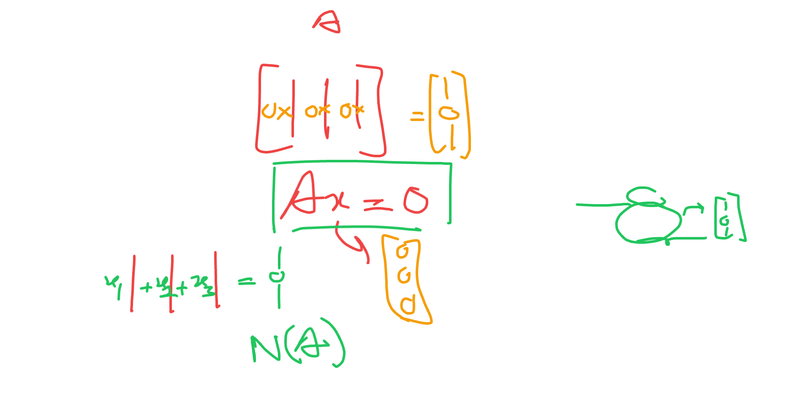
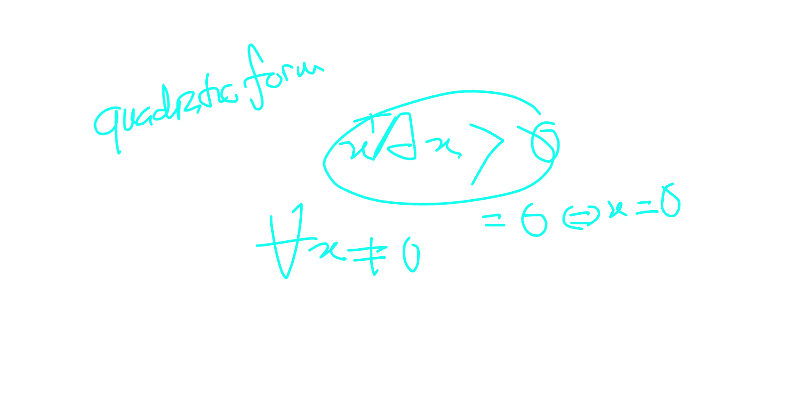
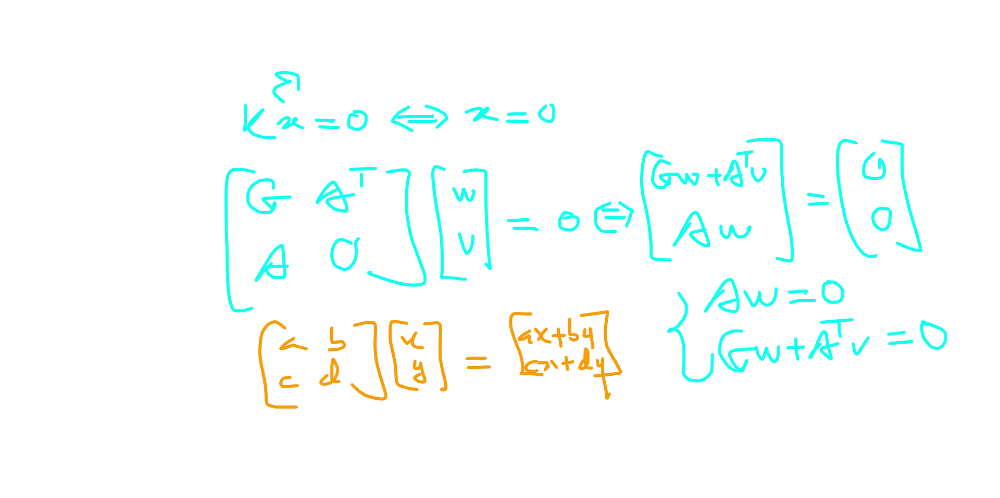
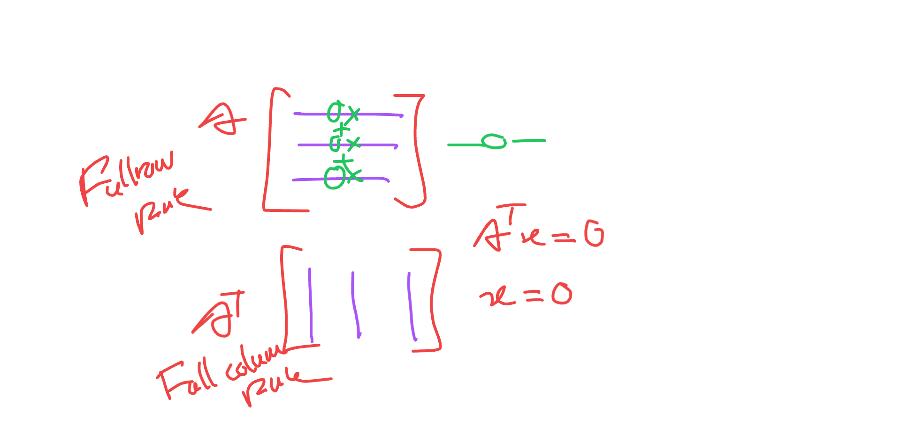
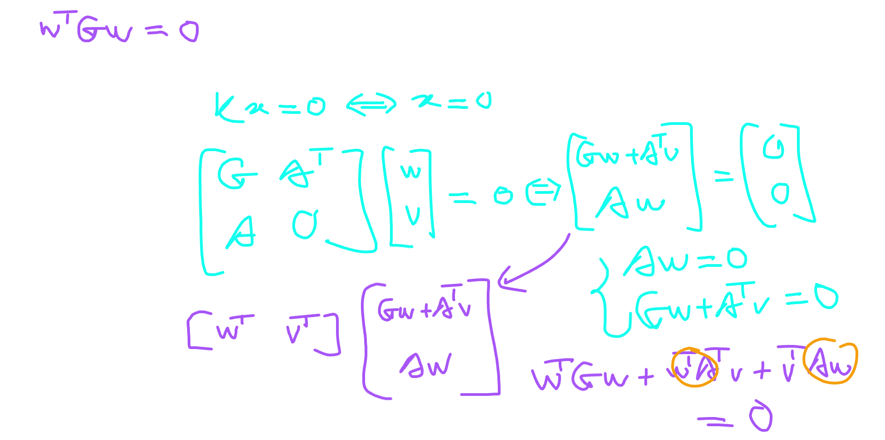
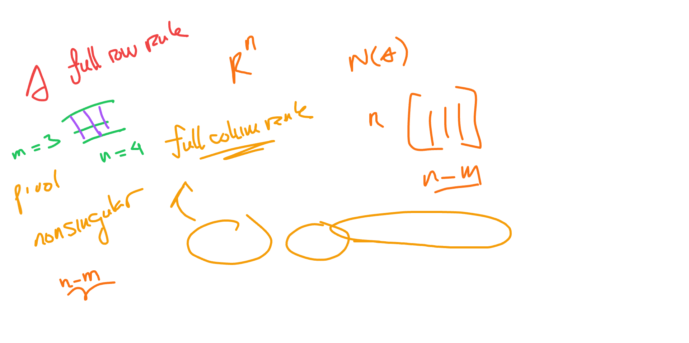
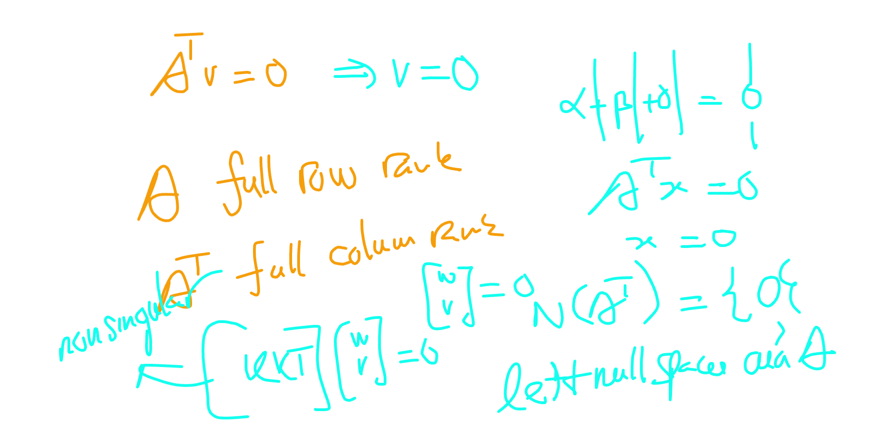

# 16.1 Equality-constrained Quadratic Programs

📊 **Progress:** `3` Notes | `19` Screenshots | `3` AI Reviews

---

 

## Equality-Constrained Quadratic Programs

<kbd></kbd>

> [!NOTE]
> Đầu tiên, ta sẽ chỉ xét bài toán QP có ràng buộc đẳng thức, vì kĩ thuật để giải bài toán dạng này sẽ áp dụng cho cả bài toán QP có tổng quát.
>
>
>
> Bài toán là: minimize q(x) = (1/2)xᵀGx + xᵀc s.t Ax = b.
>
>
>
> Vài điểm có thể làm rõ:
>
>
>
> Vì sao gọi là A là Jacobian: Hiểu như vầy: vế trái là hàm vector - vector g(x) = Ax, nên và dễ thấy d/dx g(x) chính là A, nên A là Jacobian, tức matrix đạo hàm cấp 1 là đúng rồi.
>
>
>
> dg = g(x+dx) - g(x) = A(x+dx) - Ax = Ax + Adx - Ax = Adx, là một linear operator act on dx, nên A chính là Jacobian matrix.
>
>
>
> Vì sao giả định matrix A full row rank thì Ax=b có nghiệm (consistent)?
>
>
>
> Dùng kiến thức đại số tuyến tính đã học từ 18.06:
>
>
>
> Để hệ có nghiệm thì cần b ∈ column space C(A). Nếu A full row rank, tức là mọi row vector đều độc lập, và như vậy cũng sẽ có m cột độc lập, rank sẽ = m ≤ n. Mà A có với m ≤ n, như vậy xét các vector cột, là các R^m vector, thì trong n cột, sẽ có m cột độc lập, đủ tạo một basis của R^m, nên b luôn ∈ C(A) giúp kết luận Ax=b luôn có ít nhất một nghiệm.

📹 [Xem video trên YouTube](https://www.youtube.com/watch?v=SyvGCGAjrtQ)

> [!TIP]
> 🤖 **AI Check** — 🟢 Pass — ✅ **100/100** · ✓ Move on
>
> Ghi chú rất tốt, giải thích chính xác và trực quan tại sao A là ma trận Jacobian và tại sao điều kiện full row rank đảm bảo hệ Ax = b luôn có nghiệm (consistent).
>
> **✓ Strengths**
> - Giải thích chính xác bản chất Jacobian của hàm ràng buộc tuyến tính g(x) = Ax.
> - Lập luận chặt chẽ bằng đại số tuyến tính: rank(A) = m nghĩa là không gian cột C(A) phủ toàn bộ không gian R^m, do đó luôn chứa b với mọi b thuộc R^m.
>
> **💡 Deeper notes**
> - Trong bài toán QP tiêu chuẩn, ma trận G thường được giả định là đối xứng (vì nếu không đối xứng ta luôn có thể thay bằng (G + Gᵀ)/2 mà không đổi giá trị hàm mục tiêu).

 

### Karush-Kuhn-Tucker Matrix Formulation

<kbd></kbd>

> [!NOTE]
> Với bài toán QP:
>
>
>
> Lagrangian: f(x) - Σi λi ci(x)
>
>
>
> ℒ(x, λ) = f(x) - λᵀc(x)
>
>
>
> ∇\_x ℒ(x, λ) = Gx + c - Aᵀλ (do G đối xứng)
>
>
>
> Stationary condition ∇\_x ℒ(x\*, λ\*) = 0
>
>
>
> ⇔ Gᵀx\* + c - Aᵀλ\* = 0 
>
>
>
> ⇔ Gᵀx\* - Aᵀλ\* = -c 
>
>
>
> ⇔ Gx\* - Aᵀλ\* = -c
>
>
>
> Cùng với Ax\* = b, ta thể hiện ở dạng matrix 16.4
>
>
>
> ---
>
>
>
> Đặt p = x\* - x ⇒ x\* = x + p
>
>
>
> Gx\* - Aᵀλ\* = -c ⇔ G(x + p) - Aᵀλ\* = -c 
>
>
>
> ⇔ Gx + Gp - Aᵀλ\* = -c
>
>
>
> ⇔ Gp - Aᵀλ\* = -c-Gx
>
>
>
> ⇔ G(-p) + Aᵀλ\* = c+Gx
>
>
>
> Và Ax\* = b ⇔ A(x + p) = b ⇔ Ax + Ap = b ⇔ -Ap = Ax - b 
>
>
>
> ⇔ A(-p) = Ax - b
>
>
>
> Đặt g = c+Gx, h = Ax-b
>
>
>
> ⇒ ta có 16.5, matrix \[G A; Aᵀ 0\] gọi là KKT matrix.

> [!TIP]
> 🤖 **AI Check** — 🟢 Pass — ✅ **100/100** · ✓ Move on
>
> Ghi chú rất xuất sắc, tự biến đổi và chứng minh chi tiết từng bước từ điều kiện KKT bậc nhất sang dạng ma trận (16.4) và (16.5) một cách chính xác.
>
> **✓ Strengths**
> - Thiết lập Lagrangian và đạo hàm chính xác điều kiện dừng cho bài toán QP có ràng buộc đẳng thức.
> - Từng bước biến đổi đại số tuyến tính để chuyển từ nghiệm tối ưu x* sang bước dịch chuyển p rất mạch lạc và chuẩn xác.
>
> **💡 Deeper notes**
> - Dạng hệ (16.5) đưa về ẩn (-p, λ*) thay vì (p, λ*) là một thủ thuật thường dùng trong tối ưu để giữ cho ma trận KKT có dạng đối xứng [G, A^T; A, 0].

 

#### KKT Matrix Nonsingularity Conditions

<kbd></kbd>

<kbd></kbd>

<kbd></kbd>

<kbd></kbd>

<kbd></kbd>

<kbd></kbd>

<kbd></kbd>

<kbd></kbd>

<kbd></kbd>

<kbd></kbd>

<kbd></kbd>

<kbd></kbd>

> [!NOTE]
> Bổ đề 16.1 nói đại ý rằng, nếu ta có A full row rank, và ZᵀGZ (Z là matrix basis cuả N(A) như đã biết ở chương 15, và ZᵀGZ gọi là reduced Hessian) xác định dương thì KKT matrix sẽ nonsingular, và từ đó phương trình \[matrix KKT\] \[-p, λ\*\]ᵀ = \[g, h\]ᵀ có nghiệm duy nhất, nên đồng nghĩa bài toán QP cũng có nghiệm (x\*, λ\*) duy nhất.
>
>
>
> Vì sao ZᵀGZ gọi là reduced Hessian?
>
>
>
> Để ý, G, là trong hàm mục tiêu f(x) = (1/2)xᵀGx + cᵀx, thì G chính là Hessian của f: ∇²f(x) = G.
>
>
>
> Ta sẽ nói về vụ reduced sau. Cái chính là chứng minh bổ đề này.
>
>
>
> ---
>
>
>
> Bài chứng minh này hoàn toàn là cơ hội để ôn 18.06:
>
>
>
> Trong 18.06 đã học và sẽ dùng mấy điểm sau đây: 
>
>
>
> 1) Matrix non-singular / invertible / full rank là matrix vuông: Ax = 0 khi và chỉ khi  x = 0, nullspace (và left nullspace) chỉ có {0}.
>
>
>
> 2) Matrix xác định dương là matrix mà quadratic form uᵀAu &gt; 0 với mọi u khác 0 và bằng 0 chỉ khi u  = 0. 
>
>
>
> 3) Full row rank ⇒ mọi hàng đều độc lập tuyến tính.
>
>
>
> Vậy ở đây để chứng minh KKT matrix nonsingular ta chỉ cần giả sử có vector \[w;v\] khiến \[KKT\]\[w;v\] = 0, thì nhất định \[w;v\] = 0
>
>
>
> THế thì, giả sử \[KKT\]\[w, v\]ᵀ = 0
>
>
>
> ⇔ Gw + Aᵀv = 0 (a) và Aw = 0 (b)
>
>
>
> nhân hai vế cho \[w; v\]ᵀ = \[wᵀ, vᵀ\] 
>
>
>
> \[wᵀ, vᵀ\]\[KKT\]\[w;v\] = 0 (1)
>
>
>
> \[KKT\]\[w;v\] = \[Gw + Aᵀv; Aw\]
>
>
>
> (1) ⇔ \[wᵀ, vᵀ\]\[Gw + Aᵀv; Aw\] = 0
>
>
>
> ⇔ wᵀGw + wᵀAᵀv + vᵀAw = 0 (2)
>
>
>
> Mà \[KKT\]\[w, v\]ᵀ = 0 ⇒ Aw = 0
>
>
>
> Nên (2) ⇔ wᵀGw = 0 (3)
>
>
>
> ---
>
>
>
> Tiếp, vì Aw = 0, nên nó nhất định ∈ N(A), nên với việc Z là matrix các cột là basis của N(A), đương nhiên w = Zu for some u.
>
>
>
> Nên (3) ⇔ (Zu)ᵀG(Zu) = 0
>
>
>
> ⇔ uᵀZᵀGZu = 0
>
>
>
> Tới đây dùng đề bài cho là ZᵀGZ xác định dương, thì đồng nghĩa u chắc chắn phải = 0
>
>
>
> ---
>
>
>
> Vậy u = 0 ⇒ w = Zu = 0
>
>
>
> Và như vậy (a): Gw + Aᵀv = 0 ⇔ Aᵀv = 0 
>
>
>
> Mà A full row rank, tức Aᵀ full column rank, các cột độc lập, nên Aᵀv = 0 khi và chỉ khi v = 0.
>
>
>
> Vậy ta đã chứng minh rằng giả sử có \[w; v\] khiến \[KKT\]\[w; v\] = 0 thì \[w; v\] = 0, vậy matrix KKT là non-singular, vì nó đã vuông sẵn rồi (nếu ko vuông thì chỉ kết luận full column rank)

📹 [Xem video trên YouTube](https://www.youtube.com/watch?v=TYA0HbfhlHQ)

> [!TIP]
> 🤖 **AI Check** — 🟢 Pass — ✅ **98/100** · ✓ Move on
>
> Ghi chú rất xuất sắc, tái hiện và giải thích chi tiết, chính xác từng bước chứng minh của Bổ đề 16.1 dựa trên kiến thức Đại số tuyến tính chuẩn xác.
>
> **✓ Strengths**
> - Trình bày mạch lạc và đầy đủ các bước chứng minh KKT matrix khả nghịch thông qua việc chứng minh hạch (nullspace) chỉ chứa vector 0.
> - Liên hệ và vận dụng chính xác các kiến thức đại số tuyến tính như tính xác định dương của reduced Hessian và tính full column rank của Aᵀ từ giả thiết A full row rank.
> - Lập luận chặt chẽ về tính duy nhất của nghiệm cho hệ phương trình KKT.
>
> **💡 Deeper notes**
> - Trong bài toán Quadratic Programming lồi với ràng buộc đẳng thức, điều kiện reduced Hessian xác định dương (ZᵀGZ > 0) không chỉ đảm bảo ma trận KKT khả nghịch (nghiệm KKT duy nhất), mà còn là điều kiện đủ bậc hai đảm bảo nghiệm x* là điểm cực tiểu toàn cục duy nhất.

 

<kbd></kbd>

<kbd></kbd>

<kbd></kbd>

<kbd></kbd>

<kbd></kbd>

