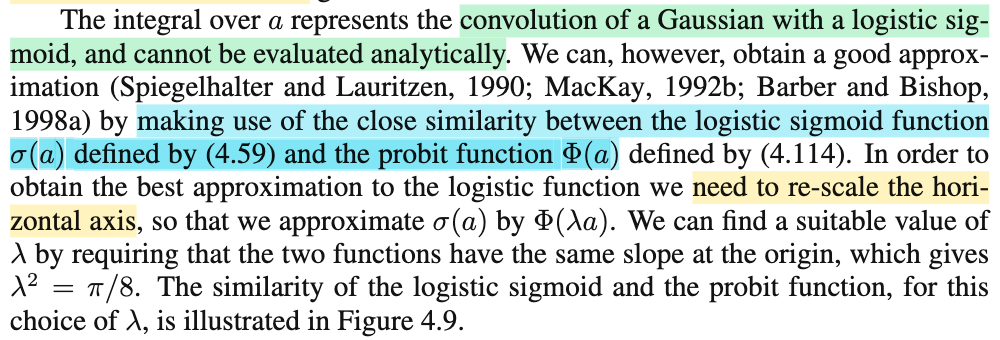
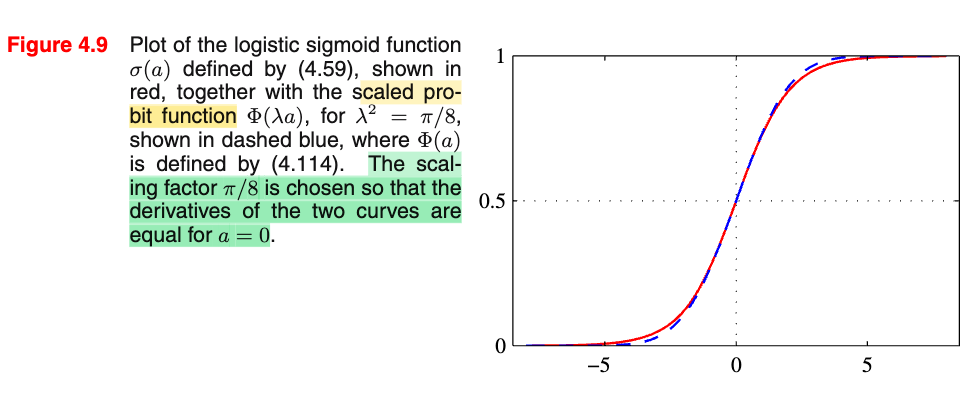
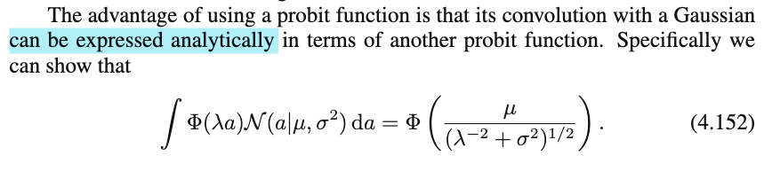
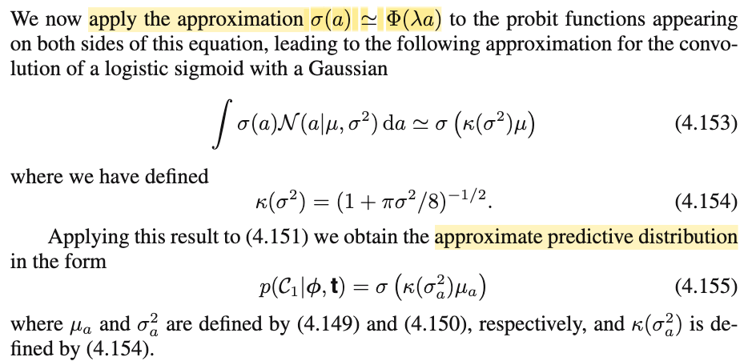
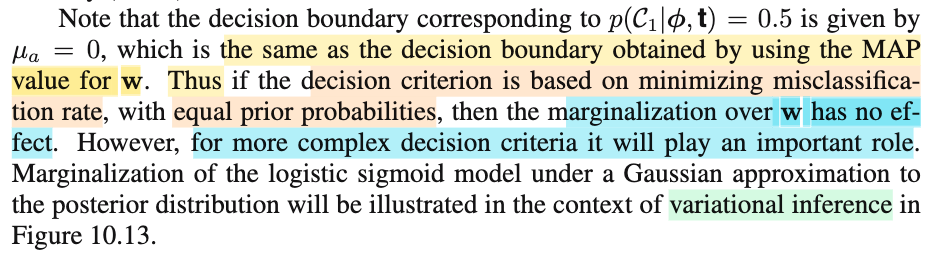

# 4.5.2 Predictive distribution

📊 **Progress:** `5` Notes | `8` Screenshots | `5` AI Reviews

---

 

## Section 4.5.2 Predictive Distribution

<kbd></kbd>

<kbd></kbd>

<kbd></kbd>

> [!NOTE]
> Phần này nói rằng, sau khi đã có Gaussian xấp xỉ của posteriori f(𝐰|𝐭), ta xây dựng predictive distribution: f(t|Φ,𝐭), tức P(T=t|Φ,𝐭)
>
>
>
> Ta có P(T=1|𝐰,Φ) (cũng là P(class = 𝒞1|𝐰,Φ)) = σ(𝐰ᵀΦ)
>
>
>
> Thế thì y như khi marginalize joint pdf của X,Y over y ta có f(x): f(x) = ∫f(x,y)dy = ∫f(x|y)f(y)dy
>
>
>
> Predictive distribution có được là do ta marginalizing P(T=1, 𝐰|Φ,𝐭) bởi f(𝐰|𝐭):
>
>
>
> P(T=1|Φ,𝐭) = ∫P(T=1, 𝐰|Φ,𝐭)d𝐰 = ∫P(T=1|𝐰,Φ)f(𝐰|𝐭)d𝐰
>
>
>
> Và với f(𝐰|𝐭) ≈ 𝒩(𝐰|𝐰MAP, 𝐒N)
>
>
>
> ⇒ P(T=1|Φ,𝐭) ≈ ∫P(T=1|𝐰Φ)𝒩(𝐰|𝐰MAP, 𝐒N)d𝐰
>
>
>
> = ∫σ(𝐰ᵀΦ)𝒩(𝐰|𝐰MAP, 𝐒N)d𝐰
>
>
>
> ---
>
>
>
> Vấn đề: Đây là tích phân theo 𝐰, một vector M chiều, nói cách khác, đây là tích M biến ∫(...)dw1dw2...dwM
>
>
>
> Thì ý tưởng để làm tiếp của ông Bishop: Ông nói hãy để ý rằng, trong cái tích phân này ∫σ(𝐰ᵀΦ)𝒩(𝐰|𝐰MAP, 𝐒N)d𝐰 thì cục σ(𝐰ᵀΦ) sẽ phụ thuộc 𝐰 thông qua a, với a = 𝐰ᵀΦ. Ý là gì? Ý là, nhắc ta để ý thế này: tuy 𝐰 là M chiều, nhưng a(𝐰) (a, với tư cách là hàm theo 𝐰) chỉ là 1 chiều.
>
>
>
> Bên cạnh đó, nhớ LOTUS không: Nó nói nếu Y = g(X) thì EY = ∫g(x)fX(x)dx.
>
>
>
> X, fX(x). EX = ∫xfX(x)dx
>
>
>
> Y, fY(y). EY = ∫g(x)fX(x)dx
>
>
>
> Và LOTUS đúng với cả case mà Y = g(𝐗), EY = ∫...∫g(𝐱)f(𝐱)d𝐱
>
>
>
> Vậy thì sao? Nó chính là nói: ∫yfY(y)dy = ∫...∫g(𝐱)f(𝐱)d𝐱
>
>
>
> Nếu ta lại có Z = h(Y), thì
>
>
>
> LOTUS cho phép tính EZ = ∫h(y)fY(y)dy
>
>
>
> Nhưng nếu coi nó như hàm của 𝐗 thì Z = h(g(𝐗)) thì sao?
>
>
>
> LOTUS lại cho phép EZ = ∫...∫h(g(𝐱))f(𝐱)d𝐱
>
>
>
> Nên EZ = ∫h(y)fY(y)dy = ∫...∫h(g(𝐱))f(𝐱)d𝐱 (1)
>
>
>
> ---
>
>
>
> Vậy ở đây, tương ứng 𝐗 chính là 𝐰, để rồi Y = g(𝐗) tương ứng a = 𝐰ᵀΦ, sau đó Z = h(Y) tương ứng S = σ(a). Vậy theo LOTUS:
>
>
>
> E\[S\] = ∫..∫h(g(𝐰))f(𝐰)d𝐰
>
>
>
> và ở đây pdf của 𝐰, f(𝐰) là 𝒩(𝐰|𝐰MAP, 𝐒N) (tức pdf 𝐰 là pdf của 𝒩(𝐰MAP, 𝐒N)
>
>
>
> cũng như thế g, h vào:
>
>
>
> E\[S\] = ∫..∫σ(𝐰ᵀΦ)𝒩(𝐰MAP, 𝐒N)d𝐰
>
>
>
> À như vậy ta thấy cái predictive distribution ta muốn tính **thực chất chính là kì vọng của một biến ngẫu nhiên S** tạo bởi S = h(a), và a là biến a = 𝐰ᵀΦ với 𝐰 theo phân phối posterior mà thôi.
>
>
>
> Tức là predictive probability thực chất là E\[σ(𝐰ᵀΦ)\] với 𝐰 \~ posterior distribution.
>
>
>
> Và cũng chính vì lẽ đó, giống như ở trên ta thấy LOTUS cho phép EZ = ∫h(y)fY(y)dy = ∫...∫h(g(𝐱))f(𝐱)d𝐱
>
>
>
> hay đổi thứ tự lại: EZ = ∫...∫h(g(𝐱))f(𝐱)d𝐱 = ∫h(y)fY(y)dy
>
>
>
> thì ở đây E\[S\] = ∫..∫σ(𝐰ᵀΦ)𝒩(𝐰MAP, 𝐒N)d𝐰 cũng có thể tính bằng:
>
>
>
> E\[S\] = ∫..∫σ(𝐰ᵀΦ)𝒩(𝐰MAP, 𝐒N)d𝐰 = ∫σ(a)f(a)da
>
>
>
> và như vậy, nếu tìm được f(a) (hay p(a) trong sách) thì ta có thể tính cái tích phân 1 chiều này thay vì tích phân M chiều kia.
>
>
>
> ---
>
>
>
> Và cái f(a) (hay p(a)) này có thể xác định như sau mà không cần dùng Dirac delta function như trong sách:
>
>
>
> Toán xác suất thống kê nói rằng: Nếu 𝐗 \~ 𝒩(𝛍, 𝚺) thì linear transformation của nó cũng sẽ cho một biến ngẫu nhiên mới cũng \~ normal, và từ đó mình chỉ việc tính luôn ra mean và variance của a (=g(𝐰)=𝐰ᵀΦ)) là sẽ có kết qủa 4.151 (nên có thể coi như đây là cách thứ 3, cách 1 là trong sách, cách 2 là bài tập 4.24 (khi ông nói dùng kết quả của Section 2.3.2 cũng ra)
>
>
>
> Vậy có thể chứng minh lại ý trên cho có cơ sở, cũng là ôn lại kiến thức xác suất, nhưng để cuối hẵng làm.
>
>
>
> Vậy cứ coi như đã chứng minh a \~ normal, tính mean và variance (chú ý, a chỉ là 1 scalar, không phải vector, nên phân phối của a chỉ là norma đơn biến):
>
>
>
> E\[a\] = E\[𝐰ᵀΦ\] = E\[𝐰\]ᵀΦ (cái này dễ thấy)
>
>
>
> (= E\[Σi wi Φi\] = Σi E\[wi Φi\] = Σi Φi E\[wi\] = E\[𝐰\]ᵀΦ
>
>
>
> mà 𝐰 \~ 𝒩(𝐰MAP, 𝐒N), nên E\[𝐰\] = 𝐰MAP
>
>
>
> ---
>
>
>
> Var\[a\] = Var\[𝐰ᵀΦ\] = Var\[Σi wi Φi\]
>
>
>
> Ôn lại tính chất variance: Var(X1+X2+...Xn) = Σi Var(Xi) + Σi≠j Cov(Xi, Xj)
>
>
>
> ⇒ Var\[Σi wi Φi\] = Σi Var(wi Φi) + Σi≠j Cov(wi Φi, wj Φj)
>
>
>
> Dùng tính chất Var(cX) = c² Var(X); Cov(aX, bY) = aCov(X,bY) = abCov(X,Y)
>
>
>
> = Σi Φi² Var(wi) + Σi≠j ΦiΦjCov(wi, wj)
>
>
>
> Nhắc lại vài công thức xác suất: Cov(X,X) = Var(X), Var(X) = E\[(X-EX)²\], Cov(X, Y) = E\[(X-EX)(Y-EY)\]
>
>
>
> = Σi Φi² Cov(wi,wi) + Σi≠j ΦiΦjCov(wi, wj)
>
>
>
> = Σi ΦiΦi Cov(wi,wi) + Σi,j,i≠j ΦiΦjCov(wi, wj)
>
>
>
> = Σi,j,i=j ΦiΦj Cov(wi,wj) + Σi,j,i≠j ΦiΦjCov(wi, wj)
>
>
>
> = Σi,j ΦiΦjCov(wi, wj)
>
>
>
> = ΣiΣj ΦiΦjCov(wi, wj)
>
>
>
> (cũng như a11 + a12 + a21 + a22 = Σi,j aij = (a11 + a12) + (a21 + a22) = Σi Σj aij)
>
>
>
> = Σi Φi \[Σj ΦjCov(wi, wj)\]
>
>
>
> ---
>
>
>
> Xét Σj ΦjCov(wi, wj): chính là vector mà phần tử i là tích vô hướng của hàng i của matrix Cov(𝐰), và Φ
>
>
>
> Σj ΦjCov(wi, wj) = Φ1Cov(wi, w1) + Φ2Cov(wi, w2) +
>
>
>
> Tích vô hướng của Φ = (Φ1,Φ2,..) với \[Cov(wi, w1), Cov(wi, w2),....\]
>
>
>
> i = 1, \[Cov(w1, w1), Cov(w1, w2),....\]
>
> i=2, \[Cov(w2, w1), Cov(w2, w2),....\]
>
> ..
>
>
>
> Như vậy đây chính là matrix Cov(𝐰)
>
>
>
> Nên Σj ΦjCov(wi, wj) chính là phần tử i của \[Cov(𝐰)Φ\]
>
>
>
> hay Σj ΦjCov(wi, wj) = \[Cov(𝐰)Φ\]\_i
>
>
>
> ---
>
>
>
> Do đó ... Σi Φi \[Σj ΦjCov(wi, wj)\]
>
>
>
> = Σi Φi \[Cov(𝐰)Φ\]i
>
>
>
> = Φᵀ \[Cov(𝐰)Φ\] = ΦᵀCov(𝐰)Φ
>
>
>
> ---
>
>
>
> Mà 𝐰 \~ posterior, 𝒩(𝐰MAP, 𝐒N) thì 𝐒N chính là gì? chính là covariance matrix, chính là Cov(𝐰) đó (cũng như 𝐰MAP chính là E\[𝐰\])
>
>
>
> Vậy Var\[a\] = Φᵀ𝐒NΦ → 4.150
>
>
>
> Như vậy a \~ 𝒩(𝐰MAPᵀΦ, Φᵀ𝐒NΦ)
>
>
>
> ---
>
>
>
> Từ đó ta có predictive probability:
>
>
>
> E\[σ(𝐰ᵀΦ)\] = ∫σ(a)f(a)da = ∫σ(a)𝒩(a|𝐰MAPᵀΦ, Φᵀ𝐒NΦ)da → 4.151
>
>
>
> ---

📹 Video 1: [Section 4.5.2 Predictive Distribution — Pattern Recognition Machine Learning_C.Bishop](https://www.youtube.com/watch?v=pYfey6Xqi14)

📹 Video 2: [Làm sao rút tích phân M chiều σ(wᵀΦ) về một biến a?](https://www.youtube.com/watch?v=Zo8OaL3lIDI)

> [!TIP]
> 🤖 **AI Check** — 🟢 Pass — ✅ **95/100** · ✓ Move on
>
> Ghi chú thể hiện sự hiểu bài rất sâu sắc và mạch lạc. Bạn đã tự diễn giải và chứng minh lại kết quả phân phối của biến $a$ bằng tính chất biến đổi tuyến tính của biến ngẫu nhiên Gaussian và định lý LOTUS thay vì phụ thuộc vào hàm Dirac delta.
>
> **🟡 Minor issues**
>
> **1.** *"P(T=1|Φ,𝐭)"*
>
> Ký hiệu $\Phi$ thường được dùng làm design matrix (ma trận thiết kế) trong PRML; còn ở đây là vector đặc trưng của điểm dữ liệu mới $\boldsymbol{\phi}(\mathbf{x})$ (vector $\boldsymbol{\phi}$). Dùng chữ in hoa $\Phi$ có thể dễ gây nhầm lẫn về mặt ký hiệu dù bản chất tính toán bạn vẫn hiểu đúng là vector.
>
>
> **✓ Strengths**
> - Nắm rất vững bản chất bài toán: chuyển tích phân $M$ chiều phức tạp thành tích phân 1 chiều thông qua biến vô hướng $a = \mathbf{w}^\top \boldsymbol{\phi}$.
> - Áp dụng trực giác xác suất rất tốt (dùng LOTUS và tính chất biến đổi tuyến tính của phân phối Gaussian) giúp đơn giản hóa và làm sáng tỏ nguồn gốc của công thức mà không bị lệ thuộc vào giải tích hàm Dirac delta.
> - Tự triển khai và chứng minh chi tiết từng bước công thức phương sai $\mathrm{Var}[a] = \boldsymbol{\phi}^\top \mathbf{S}_N \boldsymbol{\phi}$ rất chuẩn xác.
>
> **💡 Deeper notes**
> - Cách giải của Bishop dùng hàm Dirac delta thực chất chính là định nghĩa toán học chính thức của phép đổi biến / phân phối đẩy (pushforward measure) cho biến ngẫu nhiên liên tục khi chuyển từ không gian $\mathbf{w}$ sang không gian 1 chiều của $a$.

 

### Chứng minh khi linear transform một normal thì cũng được normal

> [!NOTE]
> Chứng minh nếu 𝐗 \~ 𝒩(𝛍,𝚺) thì 𝐘 = 𝐀𝐗 cũng \~ 𝒩(𝛕, 𝚲)
>
>
>
> Với X, mgf của X được định nghĩa như sau: MX(t) = E\[exp(tX)\]
>
>
>
> Với 𝐗 = (X1,X2,....), M𝐗(𝐭) = E\[exp\[Σi tiXi\]\] = E\[exp(𝐭ᵀ𝐗)\]
>
>
>
> (và cũng có nghĩa là nếu evaluate tại 𝐮, thì M𝐗(𝐭)|𝐭=𝐮 = E\[exp(𝐮ᵀ𝐗)\] (1))
>
>
>
> hay với 𝐘, M𝐘(t) = E\[exp\[Σi tiYi\]\] = E\[exp(𝐭ᵀ𝐘)\]
>
>
>
> Nhiệm vụ là: Vì 𝐗 \~ normal, nên mgf của nó có dạng mgf của Normal đa biến. Nếu chứng minh mgf của 𝐘 cũng có dạng đó là xong.
>
>
>
> M𝐘(𝐭) = E\[exp(𝐭ᵀ𝐘)\] = E\[exp(𝐭ᵀ𝐀𝐗)\] = E\[exp((𝐀ᵀ𝐭)ᵀ𝐗)\], theo (1), đây chính là M𝐗(𝐀ᵀ𝐭). Do đó, mgf của 𝐘 tại 𝐭 chỉ là mgf của 𝐗 evaluate tại 𝐀ᵀ𝐭:
>
>
>
> M𝐘(𝐭) = M𝐗(𝐀ᵀ𝐭) (2)
>
>
>
> ---
>
>
>
> Xét M𝐗(𝐭), để derive lại công thức mgf của 𝒩(𝛍, 𝚺), ta xây dựng cho 𝐙 \~ 𝒩(𝟎, 𝐈) trước:
>
>
>
> M𝐙(𝐭) = E\[exp(𝐭ᵀ𝐙)\] = E\[exp(Σi tiZi)\] = E\[Πi exp(tiZi)\]
>
>
>
> Vì Cov(𝐙) = 𝐈, và Z1,..Zn đều là normal nên Z1,Z2,...là các normal rv độc lập. ⇒ exp(t1Z1), exp(t2Z2),... cũng độc lập.
>
>
>
> Nên áp dụng tính chất: nếu X, Y độc lập thì E\[XY\] = E\[X\] E\[Y\]. Chứng minh cũng nhanh: E\[XY\] = ∫∫xyf(x,y)dxdy = ∫∫xyf(x)f(y)dxdy (do X, Y độc lập nên joint pdf tách thành tích các marginal pdf) = ∫yf(y)(∫xf(x)dx)dy = ∫yf(y)(EX)dy = EX EY
>
>
>
> Vậy .. = Πi E\[exp(tiZi)\]
>
>
>
> Tiếp, xét E\[exp(tiZi)\], = ∫exp(tizi) 𝒩(zi|0,1) dzi
>
>
>
> hay tạm bỏ i đi cho gọn E\[exp(tZ)\] (đây dĩ nhiên là mgf của Z \~ 𝒩(0,1))
>
>
>
> (again dùng LOTUS: EY = Eg(X) LOTUS cho phép = ∫g(x)fX(x)dx)
>
>
>
> = ∫exp(tz) 𝒩(z|0,1) dz = ∫exp(tz) 1/(√2π) exp(-z²/2) dz
>
>
>
> = ∫1/(√2π) exp(tz) exp(-z²/2) dz
>
>
>
> = ∫1/(√2π) exp(tz-z²/2) dz
>
>
>
> = ∫1/(√2π) exp\[-(z²-2tz)/2)\] dz
>
>
>
> = ∫1/(√2π) exp\[-(z²-2tz+t²-t²)/2)\] dz
>
>
>
> = ∫1/(√2π) exp\[-(z²-2tz+t²)/2+t²/2\] dz
>
>
>
> = ∫1/(√2π) exp\[-(z-t)²/2+t²/2\] dz
>
>
>
> = ∫1/(√2π) exp\[-(z-t)²/2\]exp(t²/2) dz
>
>
>
> = exp(t²/2) ∫1/(√2π) exp\[-(z-t)²/2\] dz
>
>
>
> Cục ∫1/(√2π) exp\[-(z-t)²/2\] dz, chính là gì, là tích phân của pdf của một 𝒩(t,1), nên bằng 1, do điều kiện valid của pdf.
>
>
>
> Vậy MZ(t) = exp(t²/2).
>
>
>
> ---
>
>
>
> Vậy Πi E\[exp(tiZi)\] = Πi exp(ti²/2) = exp\[Σi (ti²/2)\] = exp(𝐭ᵀ𝐭/2)
>
>
>
> Vậy M𝐙(𝐭) = exp(𝐭ᵀ𝐭/2)
>
>
>
> ---
>
>
>
> Tiếp, với Z \~ 𝒩(0,1) thì X = σZ + μ sẽ \~ 𝒩(μ, σ²)
>
>
>
> MX(t) = E\[exp(tX)\] = E\[exp(t(σZ + μ))\] = E\[exp(tσZ + tμ)\] = E\[exp(tσZ)exp(tμ)\]
>
>
>
> = exp(tμ) E\[exp(tσZ)\] (do linearity: E(cX) = cE(X))
>
>
>
> Mà MZ(t) = E\[exp(tZ)\] = exp(t²/2), nên E\[exp((tσ)Z)\] chính là MZ(tσ), nên = exp(t²/2)|t=tσ = exp(t²σ²/2)
>
>
>
> Vậy,.. = exp(tμ)exp(t²σ²/2) = exp(tμ+t²σ²/2).
>
>
>
> Như vậy ta đã cũng đã derive mgf của 𝒩(μ, σ²): MX(t) = exp(tμ+t²σ²/2).
>
>
>
> ---
>
>
>
> Vậy tương tự vậy, với 𝐙 \~ 𝒩(𝟎, 𝐈), thì 𝐗 = 𝐁𝐙 + 𝛍 với 𝚺 = 𝐁𝐁ᵀ, sẽ là \~ 𝒩(𝛍, 𝚺=𝐁𝐁ᵀ)
>
>
>
> mgf của 𝐗: M𝐗(𝐭) = E\[exp(𝐭ᵀ𝐗)\]
>
>
>
> = E\[exp(𝐭ᵀ(𝐁𝐙 + 𝛍))\]
>
>
>
> = E\[exp(𝐭ᵀ𝐁𝐙 + 𝐭ᵀ𝛍)\]
>
>
>
> = E\[exp(𝐭ᵀ𝐁𝐙)exp(𝐭ᵀ𝛍)\]
>
>
>
> = E\[exp(𝐭ᵀ𝐁𝐙)\] exp(𝐭ᵀ𝛍)
>
>
>
> = E\[exp(𝐁ᵀ𝐭)ᵀ𝐙)\] exp(𝐭ᵀ𝛍)
>
>
>
> Vì M𝐙(𝐭) = E\[exp(𝐭ᵀ𝐙\]) = exp(𝐭ᵀ𝐭/2),
>
>
>
> nên E\[exp(𝐁ᵀ𝐭)ᵀ𝐙)\] chính là M𝐙(𝐭)|𝐭=𝐁ᵀ𝐭, =
>
>
>
> = exp((𝐁ᵀ𝐭)ᵀ(𝐁ᵀ𝐭)/2)
>
>
>
> = exp((𝐭ᵀ𝐁𝐁ᵀ𝐭)/2)
>
>
>
> Vậy M𝐗(𝐭) = E\[exp(𝐁ᵀ𝐭)ᵀ𝐙)\] exp(𝐭ᵀ𝛍) = exp((𝐭ᵀ𝐁𝐁ᵀ𝐭)/2) exp(𝐭ᵀ𝛍)
>
>
>
> = exp((𝐭ᵀ𝐁𝐁ᵀ𝐭)/2) exp(𝐭ᵀ𝛍)
>
>
>
> = exp((𝐭ᵀ𝐁𝐁ᵀ𝐭)/2 + 𝐭ᵀ𝛍)
>
>
>
> = exp(𝐭ᵀ𝛍 + 𝐭ᵀ𝐁𝐁ᵀ𝐭/2)
>
>
>
> = exp(𝐭ᵀ𝛍 + 𝐭ᵀ𝚺𝐭/2) (𝐁𝐁ᵀ = 𝚺)
>
>
>
> Vậy mgf của 𝐗 \~ 𝒩(𝛍, 𝚺) là M𝐗(𝐭) = exp(𝐭ᵀ𝛍 + 𝐭ᵀ𝚺𝐭/2)
>
>
>
> ---
>
>
>
> Nãy giờ chỉ là thử derive lại mgf của 𝐗 \~ 𝒩(𝛍, 𝚺)
>
>
>
> Tiếp tục với ý ở trên: "mgf của 𝐘 chỉ là mgf của 𝐗 evaluate tại 𝐀ᵀ𝐭"
>
>
>
> Vậy M𝐘(𝐭) = exp(𝐭ᵀ𝛍 + 𝐭ᵀ𝚺𝐭/2)|𝐭=𝐀ᵀ𝐭
>
>
>
> = exp((𝐀ᵀ𝐭)ᵀ𝛍 + (𝐀ᵀ𝐭)ᵀ𝚺(𝐀ᵀ𝐭)/2)
>
>
>
> = exp(𝐭ᵀ𝐀𝛍 + 𝐭ᵀ𝐀𝚺𝐀ᵀ𝐭/2)
>
>
>
> = exp(𝐭ᵀ(𝐀𝛍) + 𝐭ᵀ(𝐀𝚺𝐀ᵀ)𝐭/2)
>
>
>
> So với dạng mgf của 𝐗: \~ 𝒩(𝛍, 𝚺) là M𝐗(𝐭) = exp(𝐭ᵀ𝛍 + 𝐭ᵀ𝚺𝐭/2)
>
>
>
> Ta sẽ thấy 𝐀𝛍 tương ứng với 𝛍, 𝐀𝚺𝐀ᵀ tương ứng với 𝚺
>
>
>
> Vậy dạng của mgf của 𝐘 hoàn toàn giống với dạng mgf của một 𝒩(𝐀𝛍, 𝐀𝚺𝐀ᵀ)
>
>
>
> Từ đó, do mgf, cũng như pdf, pmf, cdf đều có thể giúp xác định một distribution, do đó giúp kết luận: 𝐘 = 𝐀𝐗 chính là một random variable vector \~ 𝒩(𝐀𝛍, 𝐀𝚺𝐀ᵀ)
>
>
>
> Mà 𝐀𝐗, như MIT 1806 đã học, bất kì một phép biến đổi tuyến tính nào đều có thể được đại diện bởi một phép nhân matrix A với vector. Nên ta đã chứng minh xong, rằng khi linear transform một random variable thuộc phân phối normal thì kết quả cũng vẫn là một normal random variable.

📹 Video 1: [Untitled — Pattern Recognition Machine Learning_C.Bishop](https://www.youtube.com/watch?v=8da1j43ayzk)

📹 Video 2: [Vì sao X là normal thì Y = AX cũng vậy?](https://www.youtube.com/watch?v=8K6GOCshz9Q)

> [!TIP]
> 🤖 **AI Check** — 🟡 Minor issues — ✅ **95/100** · ✓ Move on
>
> Ghi chú rất xuất sắc, tự dẫn xuất đầy đủ từ MGF chuẩn tắc 1 chiều đến chuẩn nhiều chiều và chứng minh biến đổi tuyến tính chuẩn xác.
>
> **🟡 Minor issues**
>
> **1.** *"Từ đó, do mgf, cũng như pdf, pmf, cdf đều có thể giúp xác định một distribution, do đó giúp kết luận: 𝐘 = 𝐀𝐗 chính là một random variable vector ~ 𝒩(𝐀𝛍, 𝐀𝚺𝐀ᵀ)"*
>
> Tính xác định duy nhất của hàm sinh moment (MGF uniqueness theorem) đòi hỏi điều kiện MGF phải tồn tại trong một lân cận mở quanh gốc tọa độ 0 (điều này thỏa mãn với phân phối chuẩn). Ngoài ra, khác với pdf (vốn đòi hỏi ma trận hiệp phương sai phải khả nghịch), MGF bao quát được cả trường hợp chuẩn suy biến (degenerate multivariate normal).
>
>
> **✓ Strengths**
> - Tự thực hiện đầy đủ các bước biến đổi tích phân và kỹ thuật hoàn thành bình phương để tìm MGF của chuẩn 1 chiều.
> - Lập luận logic chặt chẽ khi đi từ biến độc lập chuẩn tắc Z đến dạng tổng quát X = BZ + μ thông qua phân rã hiệp phương sai Σ = BBᵀ.
> - Vận dụng chính xác đại số tuyến tính và tính chất của hàm sinh moment để chứng minh phân phối của biến đổi tuyến tính Y = AX.
>
> **💡 Deeper notes**
> - Sự tồn tại của ma trận B sao cho Σ = BBᵀ luôn được đảm bảo vì ma trận hiệp phương sai Σ luôn nửa xác định dương (PSD), có thể tìm bằng phân rã Cholesky hoặc phân rã phổ (spectral decomposition).
> - Nếu muốn mở rộng cho phép biến đổi affine tổng quát Y = AX + b, MGF chỉ cần bổ sung thêm thừa số exp(tᵀb).

 

#### Probit Approximation to Logistic Sigmoid

<kbd></kbd>

<kbd></kbd>

> [!NOTE]
> Tiếp, đại ý là ngay cả khi ta chuyển bài toán về tích phân một chiều (theo a) thay vì theo 𝐰 thì cái tích phân này vẫn tính không nổi.
>
>
>
> ∫σ(a) 𝒩(a|μ\_a, σ²\_a) da
>
>
>
> Mà lí do rắc rối là do hàm sigmoid.
>
>
>
> Thế thì người ta mới làm như vầy: Còn nhớ hàm probit trong phần trước, nó có cái dạng khá giống hàm sigmoid. Và bản thân nó, lại là gì? Chính là cdf của một normal(0,1):
>
>
>
> Φ(z) = F(z) = ∫-∞:z 𝒩(t|0,1)dt
>
>
>
> Nên nếu ta có thể xấp xỉ sigmoid bằng một hàm probit thì có thể cùng là normal với nhau sẽ khiến tích phân này tính được (dù gì thì ta cũng đã không thể tính chính xác từ đầu khi ta xấp xỉ posterior bởi một Gaussian rồi)
>
>
>
> Thế thì, để xấp xỉ σ(a) bởi probit, đại ý là, không thể cứ thay bởi Φ(a). Vì như vậy sẽ không khớp (xấp xỉ không tốt), mà ta phải đại ý là kéo giãn trục hoành sao cho chúng khớp nhau: Là sao?
>
>
>
> Là làm vầy nè: Nhân (scale) a bởi hệ số λ (vs với shift: là + thêm μ) Động tác này chính là ta đang kéo giãn hoặc bóp trục hoành lại.
>
>
>
> Để rồi: tìm λ sao cho σ(a) và g(a) = Φ(λa) khớp nhau tốt nhất có thể.
>
>
>
> Và để làm vậy, ta sẽ tìm λ sao cho tại a = 0, độ dốc của chúng bằng nhau. (tưởng tượng khi ta kéo giãn trục hoành thì độ dốc của đường cong hàm probit sẽ thay đổi, và ta sẽ chọn λ sao cho nó khớp với độ dốc hàm sigmoid)
>
>
>
> Vậy bài toán tìm scale factor là giải phương trình:
>
>
>
> σ'(a)|a=0 = g'(a)|a=0
>
>
>
> g'(a) = d/da g(a) = d/da Φ(λa) = \[d/d(λa) Φ(λa)\] . (d/da λa) = Φ'(λa) . λ = λ Φ'(λa)
>
>
>
> Còn nhớ: cdf chính là nguyên hàm của pdf: F'(x) = f(x), nên đạo hàm của cdf chính là pdf.
>
>
>
> Xét biến ngẫu nhiên X: 
>
>
>
> Định nghĩa của cdf F(x) = P(X ≤ x) 
>
>
>
> Định nghĩa của pdf f(x): P(X ≤ x) = ∫-∞:x f(t)dt
>
>
>
> F(x) = ∫-∞:x f(t)dt
>
>
>
> Fundamental Theorem Calculus: G , f: G(x) = ∫-inf:x f(t)dt khi đó G gọi là nguyên hàm của f (anti-derivative), G'(x) = f(x)
>
>
>
> ⇒ theo FTC thì cdf F(x) là nguyên hàm của pdf f(x): F'(x) = f(x)
>
>
>
> ---
>
>
>
> Nên hàm số Φ'(x) = 𝒩(x|0,1) = (1/√2π) exp(-x²/2)
>
>
>
> ⇒ Φ'(λa) = (1/√2π) exp(-(λa)²/2)
>
>
>
> ⇔ g'(a) = λ Φ'(λa) = λ (1/√2π) exp(-(λa)²/2)
>
>
>
> ---
>
>
>
> ⇒ g'(a)|a=0 = λ (1/√2π) exp(-(λ × 0)²/2) = λ (1/√2π)
>
>
>
> Còn σ'(a) = σ(a)\[1-σ(a)\]
>
>
>
> ⇒ σ'(a)|a=0 = σ(0)\[1-σ(0)\] = (1/2)(1/2) = 1/4
>
>
>
> ---
>
>
>
> Vậy σ'(a)|a=0 = g'(a)|a=0
>
>
>
> ⇔ 1/4 = λ (1/√2π)
>
>
>
> ⇔ √2π = 4λ ⇔ √2π/4 = λ
>
>
>
> ⇔ λ² = 2π/16 = π/8

📹 [Xem video trên YouTube](https://www.youtube.com/watch?v=pqzGU1xMTGo)

> [!TIP]
> 🤖 **AI Check** — 🟢 Pass — ✅ **100/100** · ✓ Move on
>
> Ghi chú xuất sắc! Bạn không chỉ hiểu rõ động lực trực quan của việc co giãn trục hoành mà còn tự tay giải chi tiết bước dẫn xuất tìm λ² = π/8 — phần mà giáo trình chỉ nêu sẵn kết quả.
>
> **✓ Strengths**
> - Dẫn xuất toán học hoàn chỉnh và chính xác từng bước đạo hàm hàm hợp g'(a) và đạo hàm của sigmoid tại a=0 để tìm ra λ² = π/8.
> - Nắm rất vững mối liên hệ giữa hàm probit (CDF của chuẩn tắc) và PDF chuẩn tắc thông qua phép lấy đạo hàm.
> - Trực quan hóa rất tốt ý nghĩa hình học của việc nhân hệ số λ là co giãn trục hoành để khớp độ dốc tại gốc tọa độ.
>
> **💡 Deeper notes**
> - Khớp độ dốc tại gốc tọa độ (matching slope at origin) là một tiêu chuẩn giải tích tiện lợi; trong thực tế một số tài liệu khác có thể chọn λ bằng cách tối thiểu hóa sai số toàn cục (như sai số bình phương trung bình trên toàn miền ℝ) cho ra giá trị xấp xỉ hơi khác một chút, nhưng λ² = π/8 là chuẩn tắc trong PRML.

 

##### Convolution of Probit and Gaussian

<kbd></kbd>

> [!NOTE]
> ∫ Φ(λa) 𝒩(a|μ, σ²) da
>
> ---
>
>
>
> Ôn lại hàm probit Φ(z): CDF Z \~ 𝒩(0,1)
>
>
>
> Φ(z) = P(Z ≤ z) = ∫-∞:z 𝒩(t|0,1) dt
>
>
>
> Φ(λa) = ∫-∞:λa 𝒩(t|0,1) dt
>
>
>
> ---
>
>
>
> Thay vào:
>
>
>
> ∫-∞:∞ ∫-∞:λa 𝒩(t|0,1) dt 𝒩(a|μ, σ²) da
>
>
>
> = ∫-∞:∞ ∫-∞:λa 𝒩(t|0,1) dt 𝒩(a|μ, σ²) da
>
>
>
> X \~ fX(x). P(X ∈ A) = ∫\_A fX(x)dx, ví dụ A = \[a, b\] P(a ≤ X ≤ b) = ∫a:b fX(x)dx
>
>
>
> X,Y \~ f(x,y). P((X,Y) ∈ R) = ∫∫\_R f(x,y)dxdy
>
>
>
> Áp dụng cho Z, A độc lập, f(z,a): P((Z,A) ∈ R) = ∫∫\_R f(z,a)dzda = ∫∫\_R f(z)f(a)dzda
>
>
>
> Z \~ 𝒩(0,1), A \~ 𝒩(μ, σ²)
>
>
>
> = ∫∫\_R 𝒩(z|0,1) 𝒩(a|μ, σ²) dzda
>
>
>
> Chọn R = {-∞ &lt; a &lt; ∞, -∞ &lt; z ≤ λa}
>
>
>
> P((Z,A) ∈ R)= ∫-∞:∞∫-∞:λa 𝒩(z|0,1) 𝒩(a|μ, σ²) dzda
>
>
>
> P((Z,A) ∈ R) ⇔ P(Z ≤ λA)
>
>
>
> = P(Z - λA ≤ 0)
>
>
>
> Vậy cái ta cần tính ban đầu chính là P(Z ≤ λA)
>
>
>
> Đặt W = Z - λA, đây sẽ là một \~ normal:
>
>
>
> ---
>
>
>
> Ta còn nhớ bên Casella đã học theorem này (xem link Corollary 4.6.10)
>
>
>
> Cho Xi \~ 𝒩(μi, σi²) i=1,2....n. multually independent.
>
>
>
> Và bộ constant ai, bi, i=1,2....n
>
>
>
> Thì Y = (Σi aiXi + bi) \~ 𝒩(Σi (aiμi + bi), Σi ai²σi²)
>
>
>
> ---
>
>
>
> Áp dụng vào đây:
>
>
>
> Z \~ 𝒩(0,1), A \~ 𝒩(μ, σ²)
>
>
>
> W = Z - λA = (1 × Z - λ × A) \~ 𝒩(0×1 + (-λ) × μ, 1 × 1² + (-λ)²σ²) = 𝒩(-λμ, 1+ λ²σ²)
>
>
>
> ---
>
>
>
> Vậy P(Z ≤ λA) = P(W ≤ 0) với W \~ 𝒩(-λμ, 1+λ²σ²)
>
>
>
> W ≤ 0 ⇔ W -(-λμ) ≤ 0 -(-λμ)
>
>
>
> ⇔ \[W -(-λμ)\] / √(1+λ²σ²) ≤ \[0 -(-λμ)\] / √(1+λ²σ²)
>
>
>
> ⇔ \[W -(-λμ)\] / √(1+λ²σ²) ≤ λμ / √(1+λ²σ²)
>
>
>
> ⇒ P(W ≤ 0) = P(\[W -(-λμ)\] / √(1+λ²σ²) ≤ λμ / √(1+λ²σ²))
>
>
>
> ---
>
>
>
> Ôn lại kiến thức location scale family:
>
>
>
> Gọi Z' là random variable có phân phối thuộc thành viên chuẩn trong họ, tức là thành viên có location 0, scale 1 thì:
>
>
>
> Zb + a sẽ (có phân phối) là thành viên của họ ứng với location a, scale b. 
>
>
>
> Ngược lại nếu có X có phân phối thuộc họ location scale, ứng với location a, scale b thì Z'=(X - a)/b sẽ là random variable có phân phối là thành viên chuẩn của họ đó: location 0, scale 1.
>
>
>
> Và normal(μ, σ²) với μ và σ thay đổi sẽ tạo nên một location scale family với mean = location, scale = std
>
>
>
> Do đó X \~ 𝒩(1, 5) chính là thành viên có location 1, scale √5, thì Z' = (X - 1)/√5 sẽ có phân phối là thành viên chuẩn của họ, location 0, scale 1, tức 𝒩(0,1)
>
>
>
> Như vậy W \~ 𝒩(-λμ, 1+λ²σ²) nên Z' = \[W - (-λμ)\]/√(1+λ²σ²) \~ 𝒩(0,1)
>
>
>
> ---
>
>
>
>
>
> ⇒ P(W ≤ 0) = P(Z' ≤ λμ / √(1+λ²σ²)) = là cdf của Z' tại λμ / √(1+λ²σ²), = Φ\[λμ / √(1+λ²σ²)\]
>
>
>
> = Φ\[μ / √(1/λ²+σ²)\]
>
>
>
> = Φ\[μ / √(λ⁻²+σ²)\]

📹 Video 1: [Convolution of Probit and Gaussian — Pattern Recognition Machine Learning_C.Bishop](https://www.youtube.com/watch?v=uX4Oofuqo1Y)

📹 Video 2: [Làm sao tính tích chập hàm Probit Φ(λa) và Gaussian bằng P(Z ≤ λA)?](https://www.youtube.com/watch?v=qOrOKM71YhI)

> [!TIP]
> 🤖 **AI Check** — 🟢 Pass — ✅ **100/100** · ✓ Move on
>
> Ghi chú xuất sắc! Bạn đã chứng minh công thức (4.152) một cách rất thông minh và trực quan bằng cách chuyển đổi tích phân thành xác suất đồng thời P(Z <= lambda A) của hai biến ngẫu nhiên Gauss độc lập.
>
> **✓ Strengths**
> - Ý tưởng chuyển tích phân chập thành xác suất P(Z <= lambda A) với Z và A là hai biến ngẫu nhiên Gauss độc lập rất chuẩn xác và thanh lịch.
> - Sử dụng đúng tính chất tổ hợp tuyến tính của các biến ngẫu nhiên Gauss độc lập để tìm phân phối của biến W = Z - lambda A.
> - Chuẩn hóa biến ngẫu nhiên W về dạng Gauss chuẩn (0, 1) thông qua họ vị trí - tỉ lệ (location-scale family) rất chặt chẽ và mạch lạc.
>
> **💡 Deeper notes**
> - Bước chia tử và mẫu cho lambda để đưa vào căn thức (lambda / sqrt(1 + lambda^2 sigma^2) = 1 / sqrt(lambda^-2 + sigma^2)) ngầm giả định lambda > 0 (trong PRML, hệ số lambda này thường là tham số thực dương, ví dụ lambda^2 = pi/8).

**🔗 See also:** [Chứng minh tổng biến chuẩn *(Statistical Inference - Casella)*](../statistical_inference_casella/46_multi_variate_distribution.md#node-uaywczk)

 

###### Approximate Predictive Distribution

<kbd></kbd>

<kbd></kbd>

> [!NOTE]
> ∫ Φ(λa) 𝒩(a|μ, σ²) da = Φ\[μ / √(λ⁻²+σ²)\]
>
>
>
> Φ(λa) ≈ σ(a)
>
>
>
> Φ\[μ / √(λ⁻²+σ²)\] ≈ σ\[μ / λ√(λ⁻²+σ²)\]
>
>
>
> Xét 1 / λ√(λ⁻²+σ²) = 1 / √\[λ²(λ⁻²+σ²)\] = \[λ²(λ⁻²+σ²)\]^(-1/2)
>
>
>
> = \[λ²(λ⁻²+σ²)\]^(-1/2) = (1+λ²σ²)^(-1/2)
>
>
>
> = (1+πσ²/8)^(-1/2) (thay λ² = π/8 mà ta đã hiểu ở note trước), đặt là κ(σ²)
>
>
>
> ⇒ Φ\[μ / √(λ⁻²+σ²)\] ≈ σ\[μ / λ√(λ⁻²+σ²)\]
>
>
>
> = σ(μ κ(σ²))
>
>
>
> ---
>
>
>
> Vậy ∫ σ(a) 𝒩(a|μ, σ²) da ≈ σ(μ κ(σ²))
>
>
>
> Nên ∫ σ(a) 𝒩(a|μ\_a, σ²\_a) da ≈ σ(μ\_a κ(σ²\_a))
>
>
>
> Chính là f(𝒞1|φ, 𝐭) = P(T=1|Φ, 𝐭) ≈ σ(μ\_a κ(σ²\_a))
>
>
>
> với μ\_a = 𝐰MAP ᵀφ
>
>
>
> ---
>
>
>
> Vấn đề cuối đại ý là vầy: với cái predictive probability này, thì về cơ bản decision boundary là tập các transformed feature Φ sau cho f(𝒞1|φ, 𝐭) = 0.5 (ranh giới chi không gian transformed feature làm hai: {φ: f(𝒞1|φ) &gt; 0.5} - nơi sẽ được dự đoán class 𝒞1 và {φ: f(𝒞1|φ) &lt; 0.5} là tập mà input sẽ được dự đoán class 𝒞2.
>
>
>
> f(𝒞1|φ, 𝐭) = 0.5 ⇔ σ(μ\_a κ(σ²\_a)) = 1/2 ⇔ μ\_a κ(σ²\_a) = 0 ⇔ μ\_a = 0 ⇔ 𝐰MAP ᵀφ = 0. Như vậy decision boundary chính là hyperplane 𝐰MAP ᵀφ = 0
>
>
>
> Vậy thì có vấn đề gì?
>
>
>
> Vấn đề là: Nếu ta không làm cái vụ đi tìm predictive probability này. Mà cứ dùng ước lượng điểm 𝐰MAP, và lắp vào hàm dự đoán: f(𝒞1|𝐰MAP, φ) = σ(𝐰ᵀφ) thì sao? Khi đó mô hình của ta sẽ là f(𝒞1|𝐰MAP, φ) = σ(𝐰MAPᵀφ).
>
>
>
> Và decision bounadry là: f(𝒞1|𝐰MAP, φ) = σ(𝐰MAPᵀφ) = 0.5 ⇔ 𝐰MAPᵀφ = 0. Và decision boudary cũng y chang của cái mô hình khi ta đã marginalizing over 𝐰 \~ posterior (xấp xỉ)
>
>
>
> Do đó, về cơ bản là không ích lợi gì khi phải mất công như vậy.
>
>
>
> Tuy nhiên, ông nói, đúng là khi ta chỉ dựa trên tiêu chí minimize misclassification rate với điều kiện xác xuất tiên nghiệm f(𝒞k) là như nhau (để rồi theo decision theory, ta sẽ dựa vào f(𝒞k|𝐰, φ) để đưa ra quyết định assign class nào) thì việc đi marginalizing để có predictive distribution là không cần thiết (vì nó chỉ ra kết quả tương đương như dùng 𝐰MAP)
>
>
>
> Nhưng sẽ có tình huống mà ta cần ưu tiên cái khác thay vì minimizing misclassification rate. Khi đó cách làm này sẽ phát huy tác dụng.

📹 [Xem video trên YouTube](https://www.youtube.com/watch?v=E2W9KwyCmy8)

> [!TIP]
> 🤖 **AI Check** — 🟢 Pass — ✅ **95/100** · ✓ Move on
>
> Ghi chú rất xuất sắc, tái hiện chi tiết từng bước biến đổi đại số của hệ số kappa và giải thích trực quan, chính xác ý nghĩa của decision boundary cũng như vai trò của việc marginalization.
>
> **✓ Strengths**
> - Tự triển khai tường minh phép biến đổi đại số đưa thừa số 1/lambda vào căn bậc hai để thu được hàm kappa(sigma^2).
> - Hiểu rất rõ lý do tại sao decision boundary (ngưỡng 0.5) khi marginalize lại trùng khớp với decision boundary của điểm MAP w_MAP.
> - Nắm chuẩn bản chất: việc marginalization quan trọng khi bài toán liên quan đến cost matrix bất đối xứng, ngưỡng từ chối (reject option) hoặc cần xác suất dự báo được hiệu chuẩn (calibrated uncertainty) thay vì chỉ phân loại nhị phân tối thiểu hóa lỗi cơ bản.
>
> **💡 Deeper notes**
> - Khi độ bất định sigma_a^2 lớn (ví dụ ở vùng xa dữ liệu), kappa(sigma_a^2) tiến về 0, kéo xác suất dự báo p(C1|phi, t) dạt về 0.5 (hoài nghi tối đa), trong khi mô hình MAP thuần túy sigma(w_MAP^T phi) vẫn có thể đưa ra xác suất cực đoan gần 0 hoặc 1.

 

