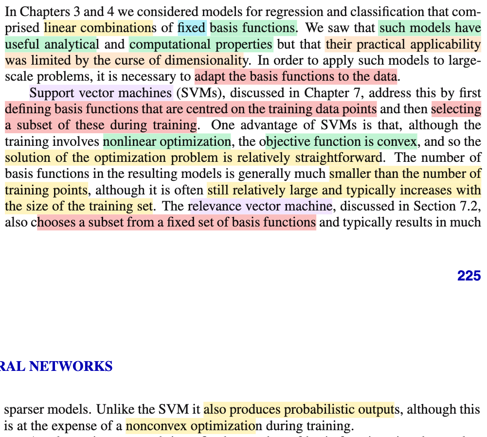
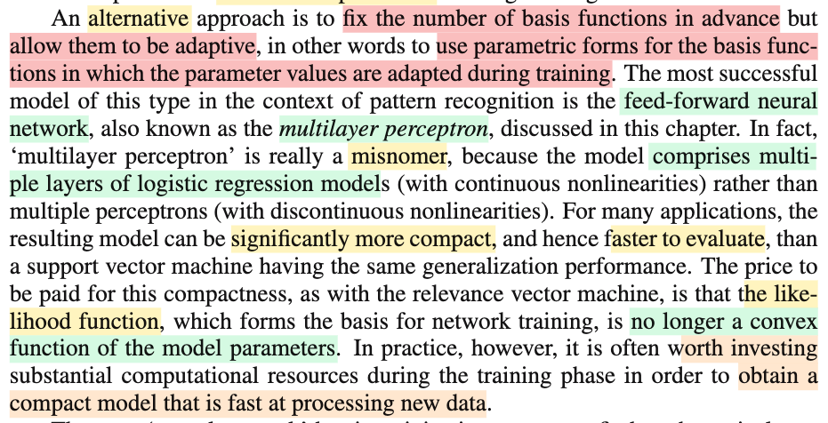
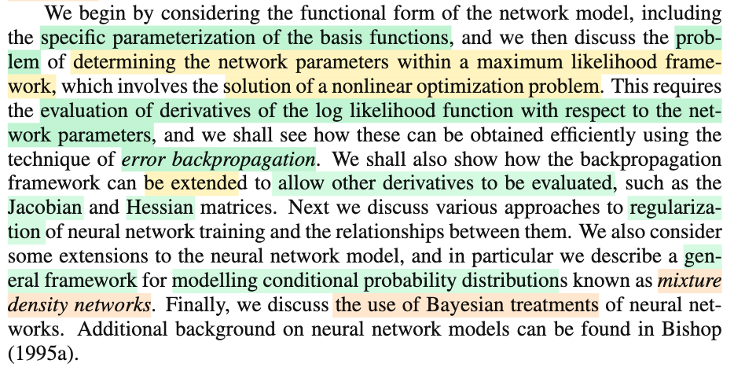

# 5.0 Neural Network

📊 **Progress:** `3` Notes | `3` Screenshots | `2` AI Reviews

---

 

## Adapting Basis Functions to Data

<kbd></kbd>

> [!NOTE]
> Đại ý là chương 3, và 4 ta đã thảo luận các mô hình dựa trên các hàm basis cố định. Và điều này đại khái là, tuy mang lại một số ưu điểm nhưng khả năng của chúng bị hạn chế trong các bài toán thực tế.
>
>
>
> Do đó, ta sẽ cần tìm cách để adapt - tự học các basis function từ data thay vì dùng basis function fixed.
>
>
>
> Ví dụ như SVM và RVM mà ta sẽ học ở chapter 7
>
>
>
> Trong SVM, có thể hiểu đại khái là ta sẽ định nghĩa basis function nằm ở trung tâm của training set (chưa hiểu lắm ý này) và lựa chọn một bộ (subset) các function này trong lúc training.
>
>
>
> Ưu điểm của cách này là, tuy bài toán trở thành tối ưu phi tuyến, nhưng hàm objective là hàm lồi, nên có những thuận lợi.
>
>
>
> Số hàm basis thường là sẽ nhỏ hơn số training data point, nhưng nói chung vẫn lớn theo kích thước training set.
>
>
>
> Bên cạnh đó, một mô hình khác - relevance vector machine, cũng chọn một subset từ một tập các basis function, giúp cho một mô hình thưa hơn.
>
>
>
> Và cái này khác với SVM ở chỗ nó cho ra output ở dạng xác suất, đổi lại, bài toán tối ưu không còn lồi nữa.

> [!TIP]
> 🤖 **AI Check** — 🟡 Minor issues — ✅ **90/100** · ✓ Move on
>
> Ghi chú tóm tắt rất tốt và chính xác nội dung so sánh giữa mô hình hàm cơ sở cố định, SVM và RVM; chỉ có một điểm hiểu nhầm nhỏ về khái niệm tâm của hàm cơ sở.
>
> **🟡 Minor issues**
>
> **1.** *"định nghĩa basis function nằm ở trung tâm của training set (chưa hiểu lắm ý này)"*
>
> Cụm 'centred on the training data points' nghĩa là mỗi hàm cơ sở được đặt tâm tại một điểm dữ liệu huấn luyện cụ thể (chẳng hạn như hàm kernel k(x, x_n) lấy x_n làm tâm), chứ không phải đặt ở vị trí trung tâm của toàn bộ tập dữ liệu (training set).
>
>
> **✓ Strengths**
> - Nắm bắt chính xác lý do cần thích ứng hàm cơ sở với dữ liệu do hạn chế về số chiều từ các chương trước.
> - Tóm lược chuẩn xác sự đánh đổi giữa SVM (hàm mục tiêu lồi nhưng mô hình còn tương đối dày và không có xác suất) và RVM (mô hình thưa hơn, có xác suất nhưng tối ưu phi lồi).
>
> **💡 Deeper notes**
> - Trong các phương pháp kernel (như SVM/RVM), mỗi điểm dữ liệu huấn luyện x_n tương ứng với một hàm cơ sở tiềm năng dạng phi_n(x) = k(x, x_n); quá trình huấn luyện SVM sẽ chọn ra các vector hỗ trợ (support vectors) - chính là tập con các hàm cơ sở này.

 

### Multilayer Perceptron and Adaptive Basis Functions

<kbd></kbd>

> [!NOTE]
> Đại khái là khác với các tiếp cận của SVM, Neural Network dùng một số lượng cố định các basis function, nhưng ta sẽ adjust basis function parameter theo data.
>
>
>
> Dạng thành công nhất của cái này là multiple layer perceptron. Vốn dĩ là một tên gọi sai vì thật ra nó dùng nhiều lớp logistic regression chứ ko phải perceptron (perceptron là mô hình dùng hàm phi tuyến là hàm switcher bật tắt)
>
>
>
> Ưu điểm là mô hình sau khi train xong sẽ compact, nên chi phí tính toán sẽ nhẹ hơn so với SVM có cùng khả năng generalize.
>
>
>
> Đánh đổi là hàm likelihood không còn là hàm lồi

> [!TIP]
> 🤖 **AI Check** — 🟢 Pass — ✅ **98/100** · ✓ Move on
>
> Ghi chú tóm tắt rất chính xác, súc tích và nắm trọn vẹn 4 ý cốt lõi từ đoạn văn bản tham khảo.
>
> **✓ Strengths**
> - Nắm rõ bản chất của neural network là cố định số lượng basis functions nhưng tham số hóa và cho phép học (adaptive) từ dữ liệu.
> - Hiểu chính xác vì sao thuật ngữ 'multilayer perceptron' là misnomer (dùng hàm phi tuyến liên tục dạng logistic regression thay vì hàm gián đoạn dạng step function của perceptron).
> - Nêu đúng ưu điểm về tính gọn nhẹ (compact), tốc độ suy luận nhanh so với SVM và sự đánh đổi về tính lồi (non-convexity) của hàm likelihood khi tối ưu.
>
> **💡 Deeper notes**
> - Hàm likelihood (hoặc loss function / negative log-likelihood) không còn lồi đồng nghĩa với việc bài toán tối ưu sẽ có nhiều cực tiểu địa phương (local minima) và phụ thuộc vào điểm khởi tạo tham số.

 

#### Neural Network Models Overview

<kbd></kbd>

> [!NOTE]
> Nói sơ những gì sẽ học chương này:
>
>
>
> Chỉ tập trung vào một loại neural network hiệu quả nhất: Multiple Layer Perceptron
>
>
>
> Ta sẽ tham số hóa hàm basis thế nào để learn giá trị của chúng từ data
>
>
>
> Những khó khăn của việc đi tính giá trị tham số thông qua MLE 
>
>
>
> Error backprobagation
>
>
>
> Misture density network
>
>
>
> Và Bayesian treatment.
>
>
>
> Nói chung là chỉ điểm qua các thứ ta sẽ học

 

