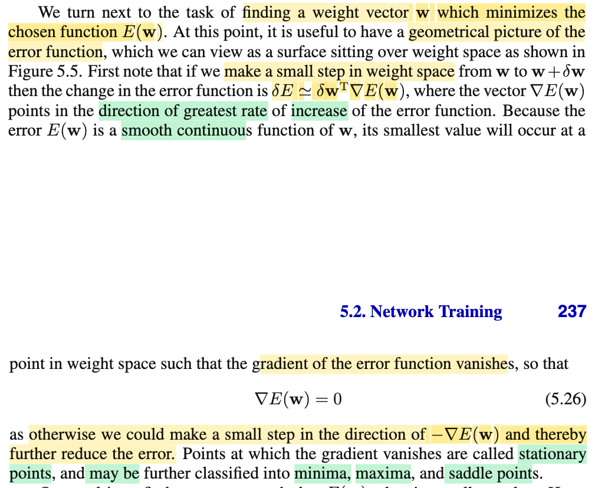
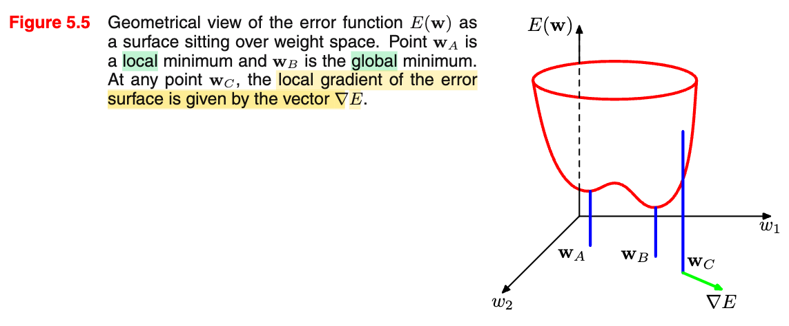
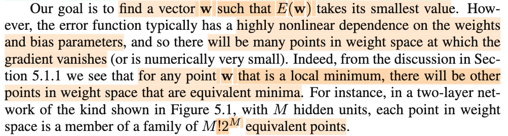
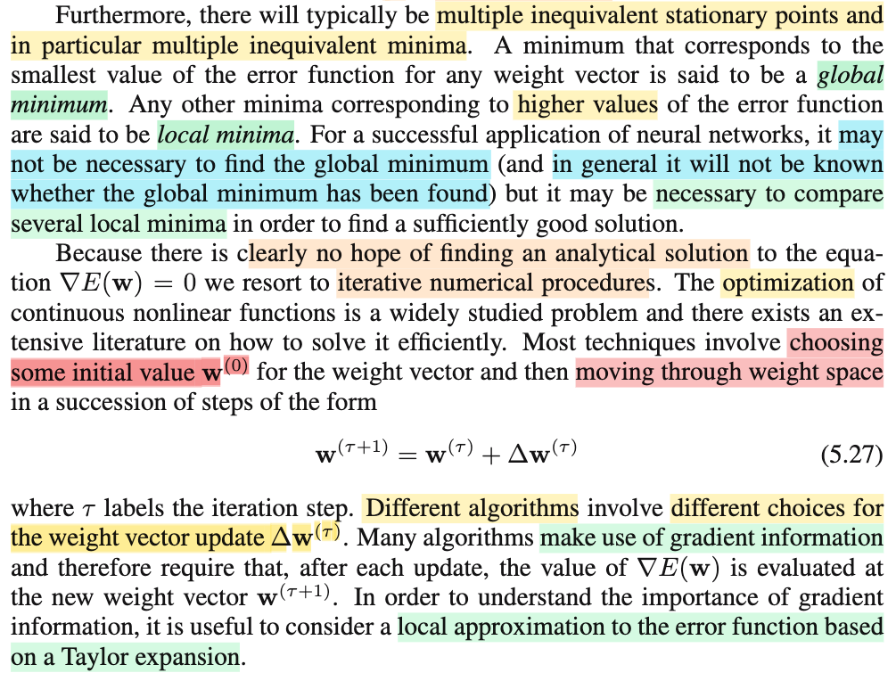

# 5.1.1 Parameter optimization

📊 **Progress:** `2` Notes | `4` Screenshots | `2` AI Reviews

---

 

## Minimizing the Error Function

<kbd></kbd>

<kbd></kbd>

> [!NOTE]
> Phần này sẽ bắt đầu nói qua việc tìm 𝐰 minimize E(𝐰) (mà đến giờ mình đã hiểu cũng là maximize log likelihood)
>
>
>
> Như đã biết, từ Nocedal hay Boyd, ∇E(𝐰) là hướng dốc lên nhất, nên -∇E(𝐰) là hướng dốc xuống nhất (steepest descent).
>
>
>
> Và tại điểm có ∇E(𝐰) = 0 (gradient vanish) gọi là điểm dừng, để rồi ta có thể check điều kiện bậc hai để xem thử đó là local minima, maxima hay saddle point (thông qua Hessian: xác định dương, âm hay không xác định.
>
>
>
> Thử lập luận lại vì sao ∇E(𝐰) là hướng dốc nhất:
>
>
>
> Xét hướng 𝐝 bất kì, directional derivative của f(𝐱): ∇f(𝐱)ᵀ𝐝, vì sao?
>
>
>
> Xét hàm g(α) định nghĩa bởi g(α)|α=2 = f(𝐱 + 2𝐝). Đạo hàm của f theo hướng 𝐝 tại 𝐰 chính là được định nghĩa bởi: Df(𝐱)|d = g'(α)|α=0
>
>
>
> (= lim\_α→0 \[g(α)-g(0)\]/α)
>
>
>
> Tính g'(α): = d/dα g(α) = d/dα f(𝐱 + α𝐝)
>
>
>
> dg = g(α + dα) - g(α)
>
>
>
> d/dα f(𝐮(α)) với 𝐮(α) = 𝐱 + α𝐝
>
>
>
> df(𝐮(α)) = f(𝐮(α) + d𝐮(α)) - f(𝐮(α)) = ∇f(𝐮(α))ᵀd𝐮(α)
>
>
>
> d𝐮(α) = 𝐮(α + dα) - 𝐮(α) = 𝐱 + (α + dα)𝐝 - 𝐱 - α𝐝 = dα 𝐝
>
>
>
> ⇒ df(𝐮(α)) = ∇f(𝐮(α))ᵀ(dα 𝐝) = ∇f(𝐮(α))ᵀ𝐝 dα
>
>
>
> ⇔ dg(α) = ∇f(𝐮(α))ᵀ𝐝 dα
>
>
>
> ⇒ g'(α) = ∇f(𝐮(α))ᵀ𝐝 = ∇f(𝐱 + α𝐝)ᵀ𝐝
>
>
>
> Như vậy Df(𝐱)|d = g'(α)|α=0 = ∇f(𝐱 + α𝐝)ᵀ𝐝|α=0 = ∇f(𝐱)ᵀ𝐝
>
>
>
> = ||∇f(𝐱)||.||𝐝||.cos(θ(∇f,𝐝))
>
>
>
> Maximize cái này theo 𝐝 có norm không đổi thì kết quả sẽ là 𝐝 có cos(θ) = 1, tức trùng hướng với ∇f(𝐱). Do đó ∇f(𝐱) là hướng dốc nhất (steepest ascent direction), và -∇f(𝐱) là steepest descent direction.
>
>
>
> ---
>
>
>
> Dùng xấp xỉ bậc nhất hàm E(𝐰) tại 𝐰:
>
>
>
> E(𝐰 + δ𝐰) ≈ E(𝐰) + ∇E(𝐰)ᵀδ𝐰 ⇔ E(𝐰 + δ𝐰) - E(𝐰) ≈ ∇E(𝐰)ᵀδ𝐰, nên di chuyển từ 𝐰 theo ∇E(𝐰) một độ lớn rất nhỏ sẽ khiến hàm tăng một khoảng xấp xỉ ∇E(𝐰)ᵀδ𝐰 là vậy.

> [!TIP]
> 🤖 **AI Check** — 🟢 Pass — ✅ **98/100** · ✓ Move on
>
> Ghi chú rất xuất sắc, không chỉ nắm đúng nội dung sách mà còn tự chứng minh lại đạo hàm theo hướng và giải thích hình học về hướng dốc nhất bằng tích vô hướng.
>
> **✓ Strengths**
> - Tự triển khai phép chứng minh đạo hàm theo hướng thông qua hàm một biến g(α) và quy tắc chuỗi rất rõ ràng và chuẩn xác.
> - Sử dụng công thức tích vô hướng và góc cos(θ) để giải thích cặn kẽ vì sao gradient là hướng tăng nhanh nhất (steepest ascent).
> - Kết nối chính xác các khái niệm từ tối ưu hóa bậc hai (Hessian, điểm dừng, saddle point) vào bài toán huấn luyện mạng nơ-ron.
>
> **💡 Deeper notes**
> - Khái niệm 'hướng dốc nhất' là ∇f(x) ngầm giả định không gian trang bị chuẩn Euclidean (L2 standard inner product). Nếu định nghĩa theo chuẩn khác (ví dụ L1, Mahalanobis) thì hướng dốc nhất có thể khác (khái niệm Steepest Descent tổng quát trong Boyd).

 

### Equivalent Minima in Weight Space

<kbd></kbd>

<kbd></kbd>

> [!NOTE]
> Đoạn này có mấy ý chính như sau:
>
>
>
> Vì hàm số là phi tuyến đối với 𝐰 nên sẽ có thể có nhiều local minimima, và thực sự thì trong bài trước ta đã biết, với mỗi vector 𝐰, luôn có M! 2^M - 1 vector khác khiến neural net biểu diễn cùng một hàm số, đồng nghĩa nếu tại 𝐰0 hàm số đạt local minima, thì nó cũng đạt local minima tại rất nhiều vector 𝐰 khác.
>
>
>
> Global minima nơi hàm E(𝐰) đạt thấp nhất hay chưa, những nơi mà minima còn lại đều được gọi là local minima nhưng ta cũng không thể biết được đã đạt global minima chưa mà cũng không nhất thiết phải đạt global minima thì mới đủ tốt để dùng (𝐰). Thành ra yêu cầu chỉ là so sánh vài local minima với nhau để xem đã đủ tốt hay chưa
>
>
>
> Cuối cùng không có closed form solution, nên ta phải tìm 𝐰 bằng thuật toán tối ưu, trong đó mỗi bước update có dạng:
>
>
>
> 𝐰\_τ+1 = 𝐰\_τ + Δ𝐰\_τ 
>
>
>
> với Δ𝐰\_τ tùy thuật toán cụ thể, ví dụ như dùng gradient hoặc dùng Newton step, ..như đã học bên Nocedal.

> [!TIP]
> 🤖 **AI Check** — 🟢 Pass — ✅ **95/100** · ✓ Move on
>
> Ghi chú tóm tắt rất chính xác và đầy đủ các luận điểm chính từ giáo trình, bao gồm tính phi tuyến, tính đối xứng sinh ra các cực tiểu tương đương, sự khác biệt giữa cực tiểu cục bộ/toàn cục, và dạng cập nhật lặp trong tối ưu hóa.
>
> **✓ Strengths**
> - Hiểu rất rõ tính đối xứng hoán vị và đảo dấu (bài toán hai lớp ẩn với hàm kích hoạt lẻ) dẫn đến họ M!2^M nghiệm tương đương.
> - Nắm chuẩn thực tế tối ưu trong deep learning: không thể biết chắc đã đạt global minimum hay chưa và trong thực hành cũng không nhất thiết phải đạt global minimum mới dùng được.
> - Liên hệ tốt dạng công thức cập nhật bước lặp w_(τ+1) = w_τ + Δw_τ với các kiến thức tối ưu hóa số (gradient, Newton).
>
> **💡 Deeper notes**
> - Con số M!2^M tương đương xuất phát từ việc hoán vị M nơ-ron (M!) kết hợp với đối xứng đổi dấu trọng số (2^M) vốn đặc trưng cho các hàm kích hoạt đối xứng qua gốc tọa độ như tanh.
> - Ngoài các cực tiểu không tương đương (inequivalent minima), điểm dừng (stationary point - nơi gradient triệt tiêu) trong không gian nhiều chiều thực tế phần lớn là các điểm yên ngựa (saddle points) chứ không chỉ riêng cực tiểu.

 

