# 5.1 Feed-forward Network Functions

📊 **Progress:** `8` Notes | `20` Screenshots | `7` AI Reviews

---

 

## Feed-forward Network Functions

<kbd>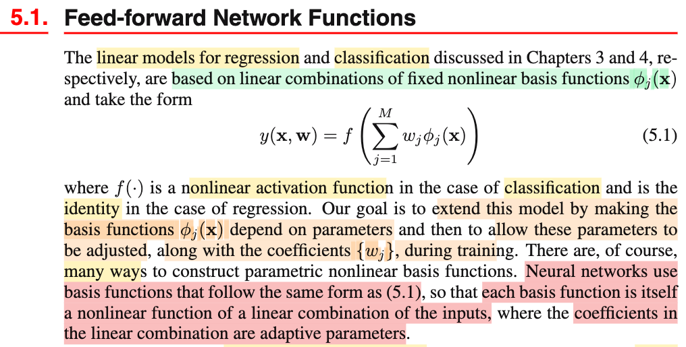</kbd>

<kbd>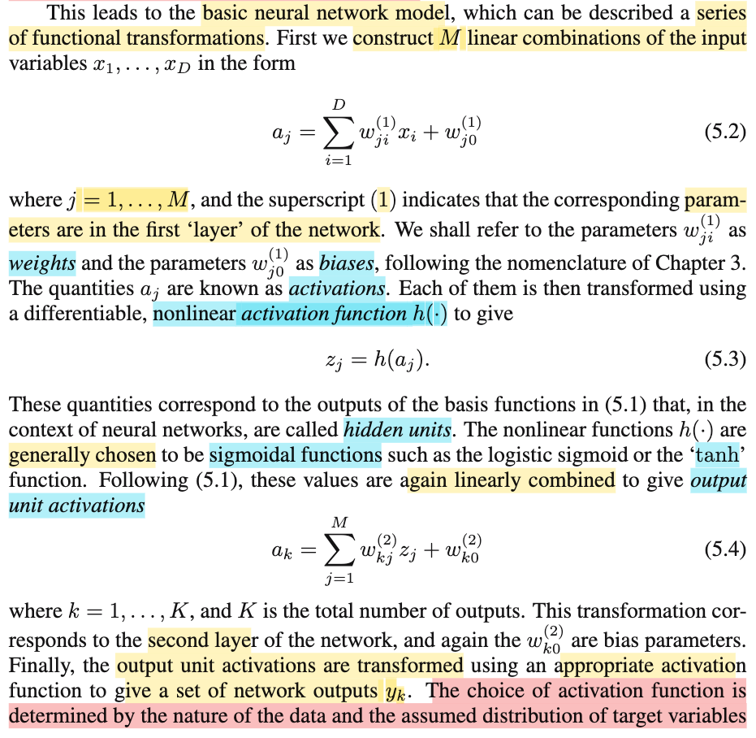</kbd>

<kbd>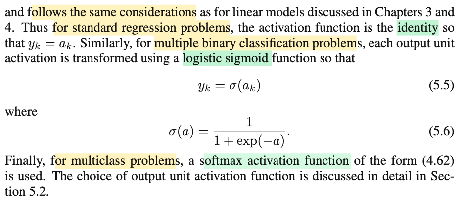</kbd>

<kbd>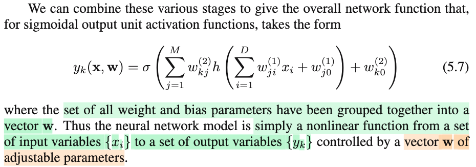</kbd>

> [!NOTE]
> Đại khái là trong chapter 3, linear model cho bài toán regression là và cho bài toán classification để có thể nói là có dạng chung là f(𝐰ᵀΦ(𝐱)) = f(Σj wj φj(𝐱)). f là non-linear activation function, với regression, f là identity function.
>
>
>
> Là sao: Nhớ lại:
>
>
>
> Trong chương 3: Ta giả định T|𝐱 \~ 𝒩(𝐰ᵀΦ(𝐱), 1/β), giả định T|𝐱 là normal có phương sai cố định và conditional expectation E\[T|𝐱\] là hàm tuyến tính theo 𝐰 (nên mới gọi là linear regression) và phi tuyến đối với 𝐱 (mà theo sách thống kê casella, cái này gọi là regression của T on 𝐱 là non-linear): f(𝐰ᵀΦ(𝐱)) với f(u) = u
>
>
>
> Chương 4 tương tự, ở binary classification, ta giả định P(𝒞=𝒞1|𝐱) = σ(𝐰ᵀΦ(𝐱))
>
>
>
> Vậy thì cả hai đều có dạng f(𝐰ᵀΦ(𝐱)) (với regression thì f là identity) 
>
>
>
> hàm f áp lên linear combination của các φ1(𝐱),φ2(𝐱),...với hệ số tổ hợp là w1,w2,...(có thêm bias w0 nữa nhưng tạm bỏ qua đi).
>
>
>
> Regression: y(𝐱, 𝐰) = f(w1 φ1(𝐱) + w2 φ2(𝐱) + ...wM φM(𝐱)) = 𝐰ᵀΦ(𝐱)
>
>
>
> hay binary class classification
>
>
>
> y(𝐱, 𝐰) = σ(w⁽²⁾1 φ1(𝐱) + w⁽²⁾2 φ2(𝐱) + ...w⁽²⁾M φM(𝐱)) = σ(𝐰ᵀΦ(𝐱))
>
>
>
> hay multiple class classification:
>
>
>
> y1 = σ(w⁽²⁾11 φ1(𝐱) + w⁽²⁾12 φ2(𝐱) + ...w⁽²⁾1M φM(𝐱)) = softmax(𝐰⁽²⁾1ᵀΦ(𝐱)) = exp(a1)/Σj=1:K exp(aj), ai = 𝐰iᵀΦ(𝐱)
>
>
>
> y2 = σ(w⁽²⁾21 φ1(𝐱) + w⁽²⁾22 φ2(𝐱) + ...w⁽²⁾2M φM(𝐱)) = softmax(𝐰⁽²⁾2ᵀΦ(𝐱))
>
>
>
> ...
>
>
>
> φ1(𝐰⁽¹⁾1,𝐱) = h(w⁽¹⁾11x1 + w⁽¹⁾12x2 + ..w⁽¹⁾1DxD + w⁽¹⁾10) = h(a1) = z1 (hidden unit)
>
>
>
> φ2(𝐰⁽¹⁾2,𝐱) =  h(w⁽¹⁾21x1 + w⁽¹⁾22x2 + ..w⁽¹⁾2DxD + w⁽¹⁾20) = h(a2) = z2
>
>
>
> ..
>
>
>
> φM(𝐰⁽¹⁾M,𝐱) =  h(w⁽¹⁾M1x1 + w⁽¹⁾M2x2 + ..w⁽¹⁾MDxD + w⁽¹⁾20)= h(aK) = zK
>
>
>
> ---
>
>
>
>
>
> Vậy qua chương này mục tiêu ở đây sẽ là: Ta tham số hóa hàm basis, ko còn dùng fixed basis function nữa, mà thay nó bằng function có tham số, và tham số này sẽ cũng được xác định (bằng Maximum Likelihood framework giống như tham số đã có)
>
>
>
> Thế thì câu này quan trọng nè: Neural network dùng hàm basis có dạng cũng là non-linear activation function áp lên một hàm tuyến tính của tham số và feature gốc (x1,x2,...).
>
>
>
> ---
>
>
>
> Basic neural network như sau:
>
>
>
> Bước mô tả việc tạo basis function:
>
>
>
> aj = Σi=1:D w⁽¹⁾ji xi + w⁽¹⁾j0, j = 1,2...M, gọi là activations
>
>
>
> zj = h(aj), với h là hàm non-linear activation function, thường dùng sigmoid hay tanh
>
>
>
> Đám z1,...zM (gọi là hidden unit) có thể thấy chính là tương ứng với M basis function φ1(𝐱), φ2(𝐱),...φM(𝐱)
>
>
>
> ---
>
>
>
> Có basis function tiếp theo là như cũ: tạo mô hình y(𝐱) = f(w1 φ1(𝐱) + w2 φ2(𝐱) + .. + w0)
>
>
>
> ak = Σj=1:M w⁽²⁾kj zj + w⁽²⁾k0, gọi là output unit activations
>
>
>
> yk = f(ak)
>
>
>
> Và y như đã nói, với regression f ta dùng hàm identity: yk = ak
>
>
>
> (tác giả không nói nhưng tự hiểu, số output có thể là 1, cho case dự đoán scalar target variable t từ input 𝐱 giống như chapter 3, hoặc cũng có thể cho k &gt; 1 nếu mô hình dự đoán ra vector 𝐭 từ 𝐱)
>
>
>
> với binary classification, ta dùng sigmoid: yk = σ(ak)
>
>
>
> với multiple-class classification, ta dùng softmax transformation: yk = exp(ak) / \[Σs=1:K exp(as)\]
>
>
>
> Như vậy có thể thấy, trước đây mình biết về neural network mình chưa được nghe nói bản chất của cái hidden layer này chính là lớp tạo ra basis function.
>
>
>
> ---
>
>
>
> Như vậy ta có:
>
>
>
> yk(𝐱, 𝐰) = f(Σj=1:M w⁽²⁾kj (h(Σi=1:D w⁽¹⁾ji xi + w⁽¹⁾j0)) + w⁽²⁾k0)
>
>
>
> để rồi neural network về bản chất là hàm phi tuyến giữa input x1,..xD và set các output {y1,y2,...} với sự kiểm soát của vector tham số 𝐰 điều chỉnh được (sẽ được learn từ data)

📹 [Xem video trên YouTube](https://www.youtube.com/watch?v=t2-pF0WzwD0)

> [!TIP]
> 🤖 **AI Check** — 🟡 Minor issues — ✅ **92/100** · ✓ Move on
>
> Ghi chú rất tốt, thể hiện sự hiểu biết sâu sắc và liền mạch từ các mô hình tuyến tính ở Chương 3, 4 sang Neural Network ở Chương 5. Bạn nắm bắt chuẩn xác bản chất: tầng ẩn thực chất là việc học các hàm cơ sở (basis functions) có tham số thay vì cố định.
>
> **🟡 Minor issues**
>
> **1.** *"y1 = σ(w⁽²⁾11 φ1(𝐱) + w⁽²⁾12 φ2(𝐱) + ...w⁽²⁾1M φM(𝐱)) = softmax(𝐰⁽²⁾1ᵀΦ(𝐱))"*
>
> Ký hiệu σ thường dành riêng cho logistic sigmoid (hàm đơn biến). Softmax là hàm đa biến nhận toàn bộ vector activations (a1,..., aK) làm đầu vào; việc viết σ(...) = softmax(...) gây nhập nhằng ký hiệu dù công thức phân thức exp phía sau bạn viết đúng.
>
> **2.** *"φM(𝐰⁽¹⁾M,𝐱) = h(w⁽¹⁾M1x1 + w⁽¹⁾M2x2 + ..w⁽¹⁾MDxD + w⁽¹⁾20)= h(aK) = zK"*
>
> Lỗi gõ nhầm chỉ số: bias phải là w⁽¹⁾M0 (không phải w⁽¹⁾20) và kết quả là h(aM) = zM thay vì h(aK) = zK, vì M là số lượng hidden units còn K là số lượng output units.
>
>
> **✓ Strengths**
> - Liên kết xuất sắc góc nhìn thống kê từ Chương 3 và 4 (tính tuyến tính theo tham số w vs phi tuyến theo x, liên hệ tới Casella-Berger).
> - Nắm bắt chính xác insight cốt lõi của Feed-forward NN: tầng ẩn chính là quá trình tham số hóa và tự thích nghi các basis functions thay cho fixed basis functions.
> - Tổng hợp đầy đủ và chính xác công thức tổng quát yk(x, w) cho mạng 2 lớp (1 hidden layer).
>
> **💡 Deeper notes**
> - Sách PRML phân biệt rõ giữa 'activation' (aj, ak - tổng tuyến tính trước phi tuyến) và 'activation function' h(.) / f(.), bạn đã lưu ý đúng thuật ngữ này.
> - Trong bài toán multiple binary classification (nhiều nhãn nhị phân độc lập), output layer dùng nhiều hàm sigmoid độc lập; còn multiclass (1 trong K lớp) mới dùng softmax liên kết tất cả output units.

 

### Figure 5.1 Two-Layer Neural Network

<kbd>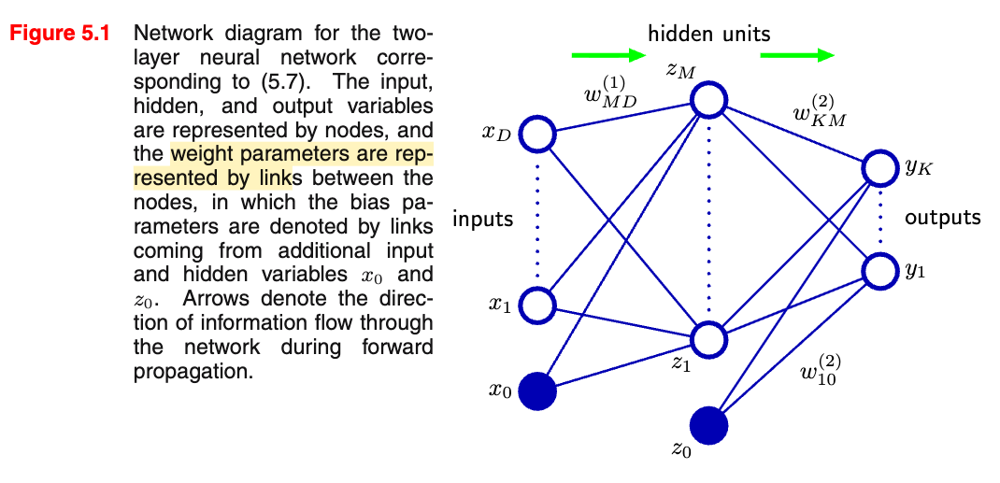</kbd>

<kbd>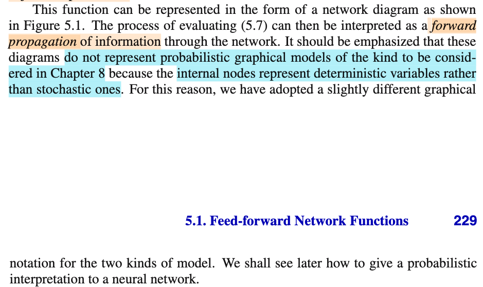</kbd>

> [!NOTE]
> Một lưu ý là hình 5.1 không thể hiện probabilistic graphical model (chapter 8 sẽ học)

> [!TIP]
> 🤖 **AI Check** — 🟢 Pass — ✅ **90/100** · ✓ Move on
>
> Ghi chú ngắn gọn và chính xác lưu ý quan trọng trong sách về việc không nhầm lẫn sơ đồ mạng nơ-ron với mô hình đồ thị xác suất.
>
> **✓ Strengths**
> - Nắm bắt chính xác cảnh báo quan trọng trong tài liệu về việc sơ đồ mạng ở Hình 5.1 không phải là mô hình đồ thị xác suất (probabilistic graphical model).
>
> **💡 Deeper notes**
> - Để hiểu sâu hơn, nguyên nhân cốt lõi khiến đây không phải là mô hình đồ thị xác suất là vì các nút bên trong (internal nodes) đại diện cho các biến tiền định (deterministic variables) thay vì các biến ngẫu nhiên (stochastic variables).

 

#### Multilayer Perceptron Network Function

<kbd>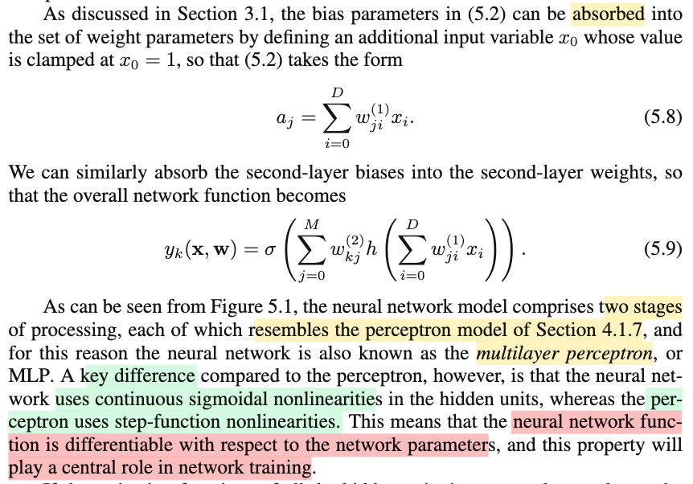</kbd>

> [!NOTE]
> yk(𝐱, 𝐰) = f(Σj=1:M w⁽²⁾kj (h(Σi=1:D w⁽¹⁾ji xi + w⁽¹⁾j0)) + w⁽²⁾k0
>
>
>
> Đoạn này không có gì, chỉ là ta có thể nhập w0 vào luôn bằng cách coi như x0 = 1:
>
>
>
> Σi=1:D w⁽¹⁾ji xi + w⁽¹⁾j0 = Σi=0:D w⁽¹⁾ji xi
>
>
>
> f(Σj=1:M w⁽²⁾kj (h(Σi=0:D w⁽¹⁾ji xi)) + w⁽²⁾k0
>
>
>
> Tương tự coi z0 = 1
>
>
>
> f(Σj=0:M w⁽²⁾kj (h(Σi=0:D w⁽¹⁾ji xi))
>
>
>
> Và từ đó nó giống như hai layer mà mỗi layer là perceptron. nên người ta gọi là multi layer perceptron
>
>
>
> Nhưng điểm khác biệt chính là ở đây xài hàm activation function phi tuyến liên tục, chứ ko phải step function, nên nó có tính defferentiable nên có thể dùng đạo hàm để learn param được.

> [!TIP]
> 🤖 **AI Check** — 🟡 Minor issues — ✅ **95/100** · ✓ Move on
>
> Ghi chú nắm rất chắc và chính xác bản chất việc hấp thụ bias vào trọng số cũng như sự khác biệt cốt lõi giữa MLP và perceptron cổ điển.
>
> **🟡 Minor issues**
>
> **1.** *"f(Σj=0:M w⁽²⁾kj (h(Σi=0:D w⁽¹⁾ji xi))"*
>
> Biểu thức thiếu một dấu ngoặc đóng cho hàm kích hoạt ngoài cùng `f(...)`. Ngoài ra, về mặt ký hiệu hình thức, khi $j=0$ thì $z_0 = 1$ là một giá trị gán trực tiếp (clamped) chứ không nhất thiết phải tính qua hàm kích hoạt $h(\cdot)$ từ tầng trước.
>
>
> **✓ Strengths**
> - Hiểu chính xác cơ chế gộp bias $w_0$ vào ma trận trọng số bằng cách bổ sung biến giả $x_0 = 1$ và $z_0 = 1$.
> - Nắm vững lý do mạng nơ-ron được gọi là MLP và phân biệt rõ vai trò của hàm kích hoạt phi tuyến liên tục (differentiable) so với step function trong việc tối ưu bằng gradient.
>
> **💡 Deeper notes**
> - Trong công thức (5.9) của sách Bishop, việc viết $h(\sum_{i=0}^D w_{ji}^{(1)} x_i)$ chạy từ $j=0$ là một dạng lạm dụng ký hiệu gọn; trên thực tế $z_0 = 1$ được định nghĩa độc lập để tạo ra bias $w_{k0}^{(2)}$ cho lớp thứ hai.

 

##### Networks of Linear Hidden Units

<kbd>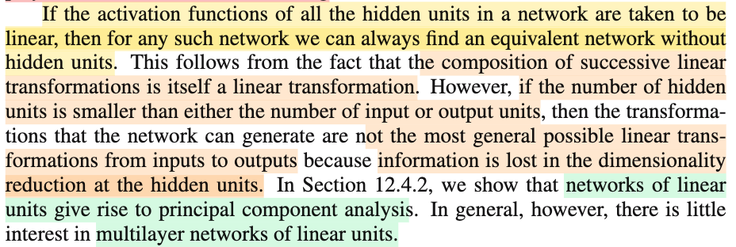</kbd>

<kbd>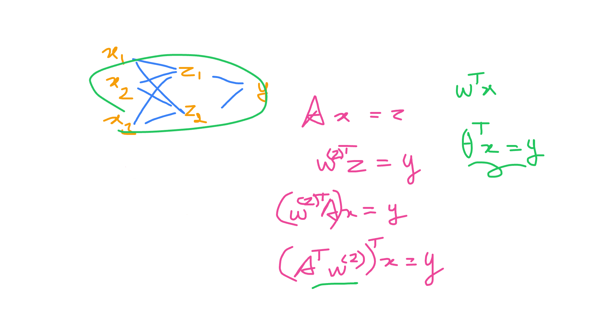</kbd>

> [!NOTE]
> Đại ý là nói nếu hidden unit không dùng activation function, thì network này có thể tương đương một network không có hidden unit. Lí do là các hợp của các linear transformation sẽ cũng tạo linear transformation
>
>
>
> Ví dụ:
>
>
>
> z1 = σ(w⁽¹⁾11 x1 + w⁽¹⁾12 x2 + w⁽¹⁾13 x3 + w⁽¹⁾10)
>
>
>
> z2 = σ(w⁽¹⁾21 x1 + w⁽¹⁾22 x2 + w⁽¹⁾23 x3 + w⁽¹⁾20)
>
>
>
> y = w⁽²⁾1 z1 + w⁽²⁾2 z2
>
>
>
> Nếu thay σ = identity function (một linear function) thì
>
>
>
> với 𝐀 là matrix các hệ số w⁽¹⁾11,w⁽¹⁾12,....
>
>
>
> và 𝐛 là bias vector
>
>
>
> 𝐳 = 𝐀 𝐱 + 𝐛
>
>
>
> y = 𝐰⁽²⁾ᵀ𝐳 
>
>
>
> = 𝐰⁽²⁾ᵀ(𝐀 𝐱 + 𝐛)
>
>
>
> = 𝐰⁽²⁾ᵀ𝐀 𝐱 + 𝐰⁽²⁾ᵀ𝐛
>
>
>
> = (𝐀ᵀ𝐰⁽²⁾)ᵀ 𝐱 + 𝐰⁽²⁾ᵀ𝐛
>
>
>
> Đặt 𝐀ᵀ𝐰⁽²⁾ = 𝛉 và 𝛉0 = 𝐰⁽²⁾ᵀ𝐛
>
>
>
> = 𝛉ᵀ𝐱 + 𝛉0
>
>
>
> Như vậy lúc này network chỉ như linear model
>
>
>
>
>
> Ý tiếp, nếu số hidden unit nhỏ hơn số input hay output thì phép biến đổi tuyến tính tạo bỏi cả network sẽ không phải là most general possible linear transformation vì thông tin bị mất do việc giảm chiều của hidden layer.
>
>
>
> Vậy đại ý là nếu số hidden unit nhỏ hơn số input hay output và không xài non-linear activation function của unit layer, cơ bản là ta sẽ có network làm việc như một hàm biến đổi tuyến tính như lại ko có được khả năng thể hiện mọi dạng linear transformation.
>
>
>
> Nên network dùng linear unit hầu như ko có ích lợi gì

📹 [Xem video trên YouTube](https://www.youtube.com/watch?v=ue09Y3gKJVI)

> [!TIP]
> 🤖 **AI Check** — 🟢 Pass — ✅ **95/100** · ✓ Move on
>
> Ghi chú rất xuất sắc, hiểu đúng bản chất lý thuyết và tự diễn giải, chứng minh lại bằng đại số tuyến tính có kèm bias một cách chuẩn xác.
>
> **✓ Strengths**
> - Diễn giải toán học rất rõ ràng và chuẩn xác khi đưa vector bias vào biến đổi tuyến tính kết hợp.
> - Nắm bắt chính xác bản chất vì sao mạng tuyến tính nhiều tầng có thể quy về mô hình tuyến tính đơn tầng.
> - Hiểu đúng tác động của nút thắt cổ chai (bottleneck) khi số hidden units nhỏ hơn số input/output dẫn đến giới hạn về hạng (rank) của phép biến đổi.
>
> **💡 Deeper notes**
> - Dù mạng tuyến tính nhiều tầng ít được ứng dụng làm bộ xấp xỉ hàm phi tuyến, trường hợp mạng có tầng ẩn thu hẹp tuyến tính (linear bottleneck / autoencoder) lại có mối liên hệ mật thiết với PCA (Phân tích thành phần chính), phục vụ việc học không gian biểu diễn tuyến tính tối ưu.

 

###### Counting Layers in Neural Networks

<kbd>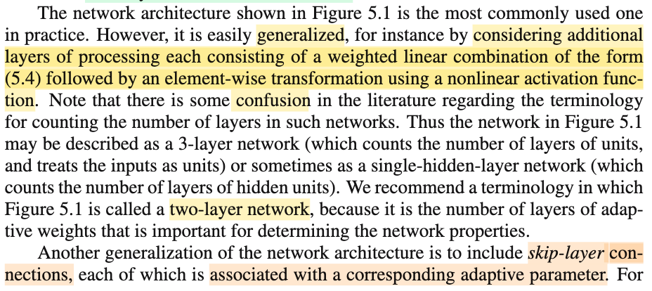</kbd>

<kbd>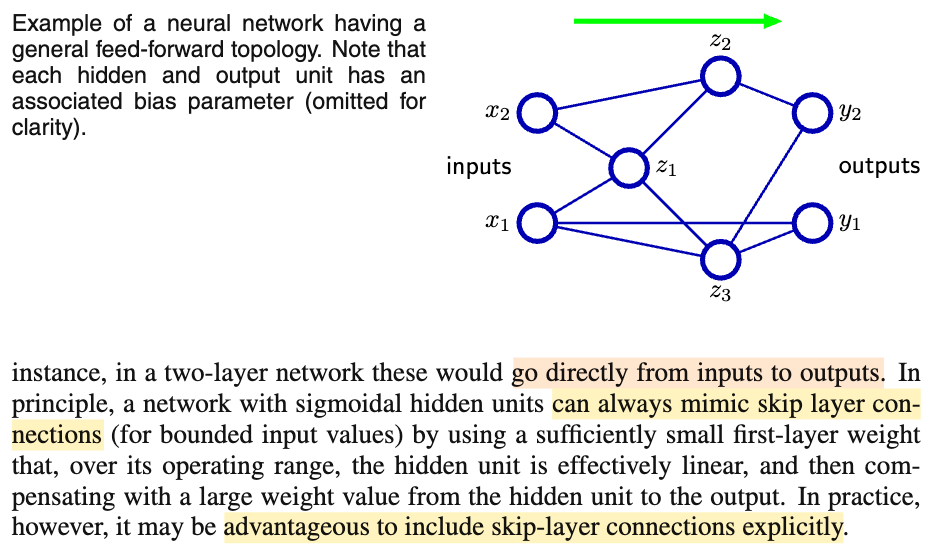</kbd>

> [!NOTE]
> Không có gì quan trọng. chỉ là nói sơ qua ràng có khi ta có thể có một skip connection - đi thẳng từ input - output như trong hình 5.2
>
>
>
> Dù thực tế có thể bắt chước hành vi của skip layer bằng cách set (learn) giá trị tham số nhưng sẽ không hiệu quả bằng dùng cách trực tiếp.
>
>
>
> Cái này chính là ý tưởng cho ra đời residual net (ResNet)

 

###### General Feed-Forward Network Architecture

<kbd>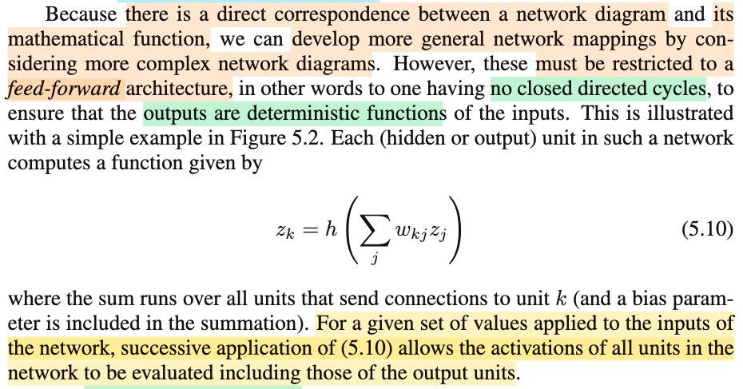</kbd>

> [!NOTE]
> đại ý là, do có sự tương ứng giữa sơ đồ network và hàm số toán học của nó. nên ta có thể phát triển các sơ đồ phức tạp hơn.
>
>
>
> Tuy nhiên, luôn phải giới hạn trong khuôn khổ feed-forward - tức là không được có cái kiểu nối vòng tròn (x - y rồi y - x)  (no closed directed cycles), vì để đảm bải tính chất deterministic - tính tất định (nhận cùng một input thì cho ra cùng output)
>
>
>
> Và hàm số khi đó có thể tính theo lối tuần tự được

> [!TIP]
> 🤖 **AI Check** — 🟢 Pass — ✅ **95/100** · ✓ Move on
>
> Ghi chú tóm tắt rất chính xác và súc tích bản chất của đoạn trích, nắm đúng cốt lõi về cấu trúc mạng feed-forward và tính chất ánh xạ hàm tất định.
>
> **✓ Strengths**
> - Nắm bắt chính xác lý do cần kiến trúc feed-forward (không có chu trình có hướng) là để đảm bảo đầu ra là hàm tất định (deterministic) của đầu vào.
> - Hiểu đúng ý nghĩa của việc áp dụng liên tiếp công thức (5.10) chính là cơ chế tính toán tuần tự từ đầu vào đến đầu ra.
>
> **💡 Deeper notes**
> - Về mặt lý thuyết đồ thị, cấu trúc feed-forward tương ứng với đồ thị có hướng không chu trình (DAG - Directed Acyclic Graph), cho phép tìm một thứ tự tô-pô (topological order) để lan truyền tiến (forward pass).
> - Nếu mạng có chu trình có hướng (directed cycles), nó sẽ trở thành mạng hồi quy (RNN), khi đó đầu ra còn phụ thuộc vào trạng thái ẩn/thời gian trước đó thay vì là một hàm số tĩnh đơn giản.

 

###### Universal Approximation of Neural Networks

<kbd>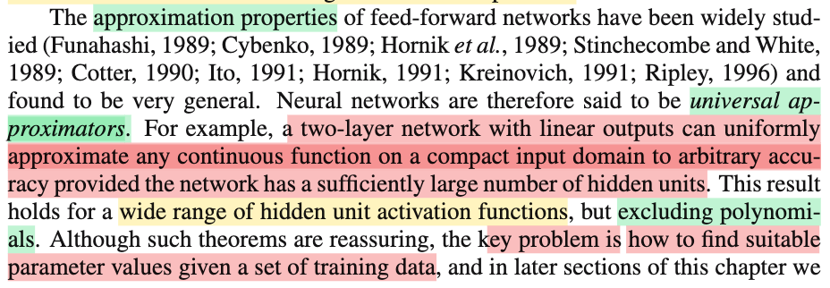</kbd>

<kbd>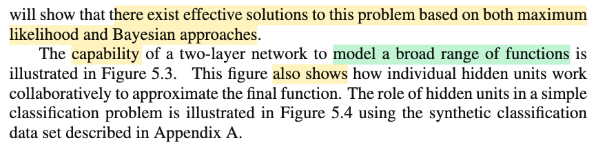</kbd>

<kbd>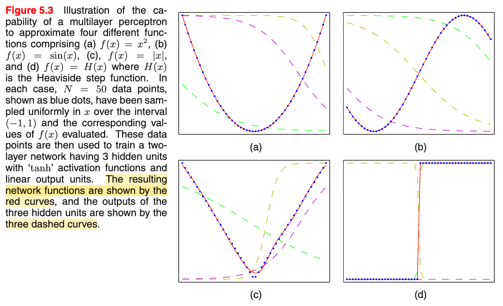</kbd>

<kbd>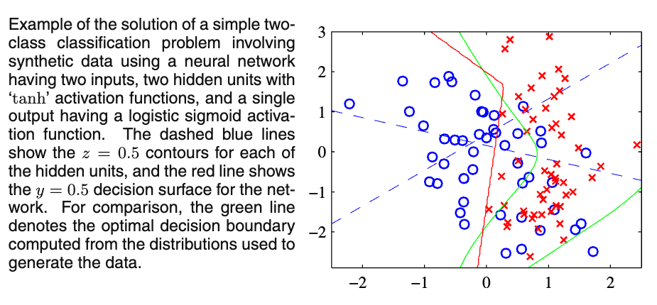</kbd>

> [!NOTE]
> Đại ý là có nhiều nghiên cứu về khả năng của neural network, với kết luận là: Đây là một universal approximator:
>
>
>
> một 2-layer network với linear ouput, nếu có đủ lớn số hidden unit thì sẽ có thể ước lượng xấp xỉ được bất kì hàm số liên tục nào.
>
>
>
> Và kết quả này vẫn đúng với nhiều loại activation function, trừ hàm đa thức.
>
>
>
> Tuy nhiên vấn đề là làm sao học được giá trị tham số từ data
>
>
>
> Cuối cùng là minh họa về khả năng bắt chước (xấp xỉ hàm) các hàm số khác nhau

> [!TIP]
> 🤖 **AI Check** — 🟡 Minor issues — ✅ **90/100** · ✓ Move on
>
> Ghi chú tóm tắt rất tốt và chính xác ý chính của đoạn văn về định lý xấp xỉ phổ quát (Universal Approximation Theorem) cũng như vấn đề học tham số từ dữ liệu.
>
> **🟡 Minor issues**
>
> **1.** *"có thể ước lượng xấp xỉ được bất kì hàm số liên tục nào"*
>
> Định lý gốc có điều kiện toán học quan trọng là hàm liên tục trên 'miền compact' (compact input domain) và xấp xỉ ở mức 'xấp xỉ đều' (uniformly approximate) đến độ chính xác tùy ý, việc lược bỏ điều kiện tập compact có thể dẫn đến hiểu nhầm là mạng luôn xấp xỉ tốt trên toàn bộ không gian vô hạn.
>
>
> **✓ Strengths**
> - Nắm bắt chính xác bản chất mạng 2 lớp (1 tầng ẩn) với đầu ra tuyến tính là bộ xấp xỉ phổ quát khi có đủ số lượng nơ-ron ẩn.
> - Ghi nhớ chính xác ngoại lệ quan trọng về hàm kích hoạt (không áp dụng cho hàm đa thức).
> - Nhận diện đúng mấu chốt thực tế: định lý chỉ chứng minh sự tồn tại, còn thách thức thực sự là thuật toán tìm tham số từ dữ liệu.
>
> **💡 Deeper notes**
> - Thuật ngữ 'two-layer network' trong sách của Bishop tính theo số lớp trọng số (tương đương mạng 1 lớp ẩn và 1 lớp đầu ra).
> - Định lý đảm bảo tính xấp xỉ (representation capability) nhưng không đảm bảo thuật toán tối ưu (như gradient descent) sẽ luôn tìm được bộ trọng số tối ưu đó một cách hiệu quả.

 

###### 5.1.1 Weight-Space Symmetries

<kbd>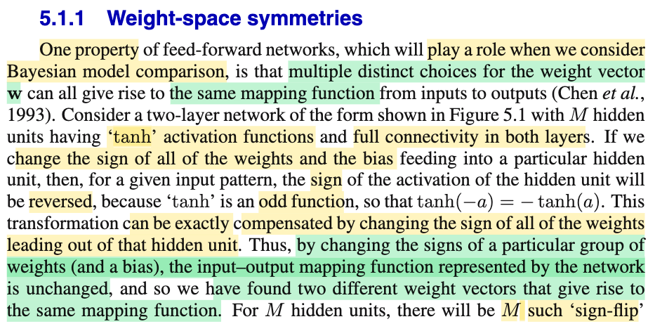</kbd>

<kbd>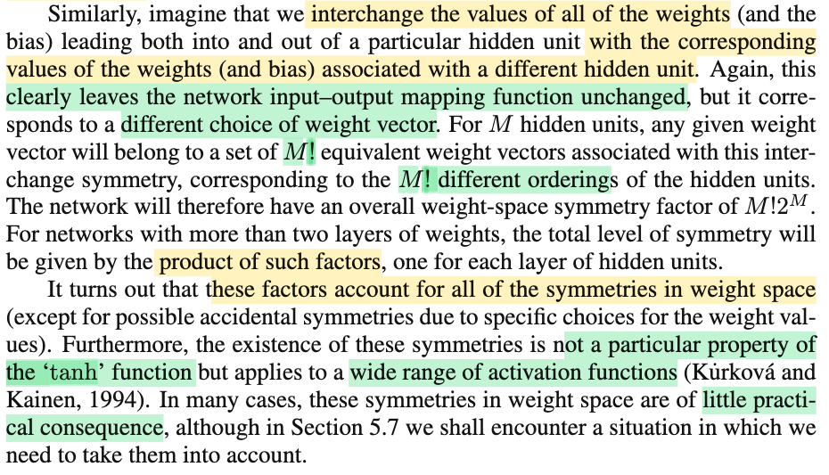</kbd>

<kbd>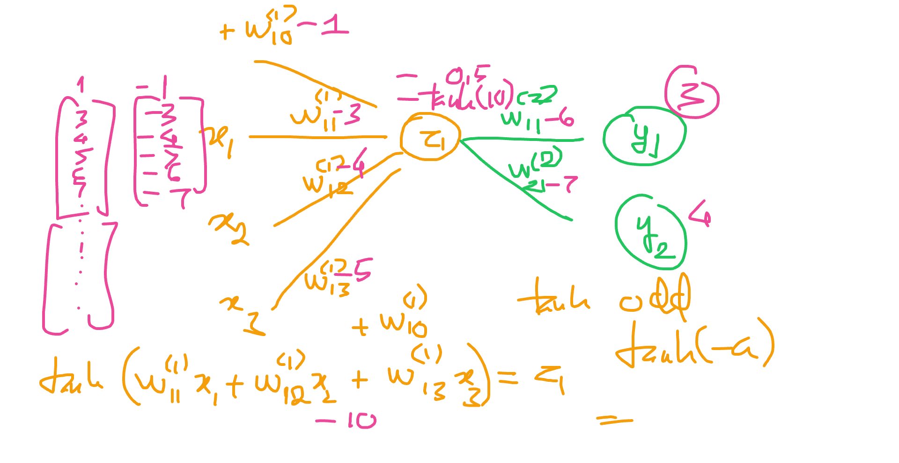</kbd>

<kbd>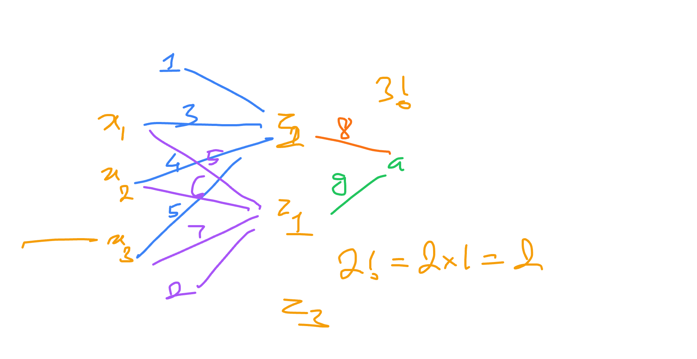</kbd>

> [!NOTE]
> Đại khái là nói về một tính chất vài bữa sẽ dùng: Đại ý là có thể có hai bộ giá trị weight khác nhau nhưng tạo ra cùng một mapping function.
>
>
>
> Ý này không khó để thấy: ví dụ một hidden unit nào đó dùng hàm tanh(): z1 = tanh(Σi w⁽¹⁾1i xi + w⁽¹⁾0), và z1 tham gia tính a1,a2,...:
>
>
>
> w⁽²⁾11 z1 + w⁽²⁾12 z2 + ..+ w⁽²⁾10 = a1
>
>
>
> w⁽²⁾21 z1 + w⁽²⁾22 z2 + ..+ w⁽²⁾20 = a2
>
>
>
> ...
>
>
>
> Vậy chỉ cần đổi dấu toàn bộ w⁽¹⁾11, w⁽¹⁾12,...w⁽¹⁾10 thì z1 sẽ đổi dấu do tanh(-u) = - tanh(u).
>
>
>
> Khi đó ta lại đổi dấu w⁽²⁾11, w⁽²⁾21,.... và thì kết quả tính a1 sẽ y nguyên (là ý exactly compensate)
>
>
>
> Do đó ta chỉ như vậy ta thấy có hai bộ weight value khác nhau mà mapping vẫn y nhau.
>
>
>
> ---
>
>
>
> Vậy với 1 hiddent unit, ta có 2^1 bộ weight value, thì M hidden unit sẽ là 2^M
>
>
>
> ---
>
>
>
> Còn ý sau đại khái vầy:
>
>
>
> Giả sử xét z1, z2:
>
>
>
> z1 = σ(Σi w⁽¹⁾1i xi + w⁽¹⁾10) = σ(2x1 + 3x2 + 4x3 + 1)
>
>
>
> z2 = σ(Σi w⁽¹⁾2i xi + w⁽¹⁾20) = σ(5x1 + 6x2 + 7x3 + 2)
>
>
>
> a1 = 8z1 + 9z2
>
>
>
> 𝐰 = \[1, 2, 2, 3, 4, 5, 6, 7, 8, 9\]
>
>
>
> Giờ đổi lại: Lấy w⁽¹⁾1i tính z2, và w⁽¹⁾2i tính z1
>
>
>
> z1 = σ(Σi w⁽¹⁾2i xi + w⁽¹⁾20) = σ(5x1 + 6x2 + 7x3 + 2)
>
>
>
> z2 = σ(Σi w⁽¹⁾1i xi + w⁽¹⁾10) = σ(2x1 + 3x2 + 4x3 + 1)
>
>
>
> Và đổi trọng số của z2 và z1 cho nhau:
>
>
>
> a = 8z2 + 9z1
>
>
>
> 𝐰 = \[2,1, 5, 6, 7, 2, 3, 4, 9, 8\]
>
>
>
> Dĩ nhiên là có cùng mapping
>
>
>
> Và có thể thấy cơ bản chỉ là ta hoán vị thứ tự các hidden unit.
>
>
>
> Vậy có M hidden unit → có M! cách hoán vị → M! vector weight khác nhau
>
>
>
> Và cùng với cái trên sẽ thành ra M! × 2^M weight vector khác nhau (vì sao nhân: vì mỗi 1 hoán vị cụ thể sẽ là có 2^M bộ giá trị vector w do cái vụ flip side)
>
>
>
> ---
>
>
>
> Cuối cùng đại ý là nếu có nhiều hơn 2 layer thì con số này nhân nhau.
>
>
>
> Và tính chất này không riêng gì cho tanh mà có nhiều hàm số activation khác.
>
>
>
> Và ta sẽ thấy tuy phần lớn trường hợp không có tác dụng gì, nhưng phần 5.7 ta sẽ thấy một case cần tính đến tính chất này.
>
> ---

📹 [Xem video trên YouTube](https://www.youtube.com/watch?v=OjExYWYwgbQ)

> [!TIP]
> 🤖 **AI Check** — 🟢 Pass — ✅ **100/100** · ✓ Move on
>
> Ghi chú rất xuất sắc, giải thích trực quan và chính xác cả hai loại đối xứng (đổi dấu và hoán vị) cùng công thức tổng quát $M!2^M$.
>
> **✓ Strengths**
> - Hiểu rõ bản chất đối xứng lật dấu (sign-flip symmetry) nhờ tính chất hàm lẻ của tanh và cách bù trừ ở tầng kế tiếp.
> - Tự xây dựng ví dụ số học rất trực quan để minh họa tính đối xứng hoán vị (permutation symmetry).
> - Giải thích chính xác vì sao nhân hai đại lượng lại thành $M! 2^M$ và nắm được quy tắc nhân cho mạng nhiều tầng ẩn.
>
> **💡 Deeper notes**
> - Đối xứng hoán vị ($M!$) áp dụng cho hầu hết mọi hàm kích hoạt, trong khi đối xứng đổi dấu ($2^M$) yêu cầu hàm kích hoạt phải là hàm lẻ (như $\tanh$) hoặc có tính đối xứng dấu cụ thể.

 

