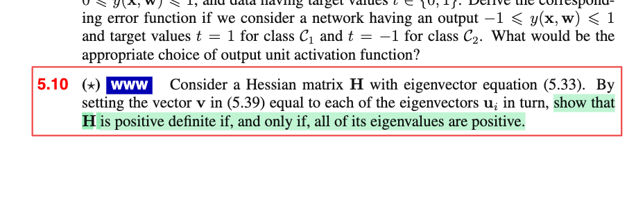
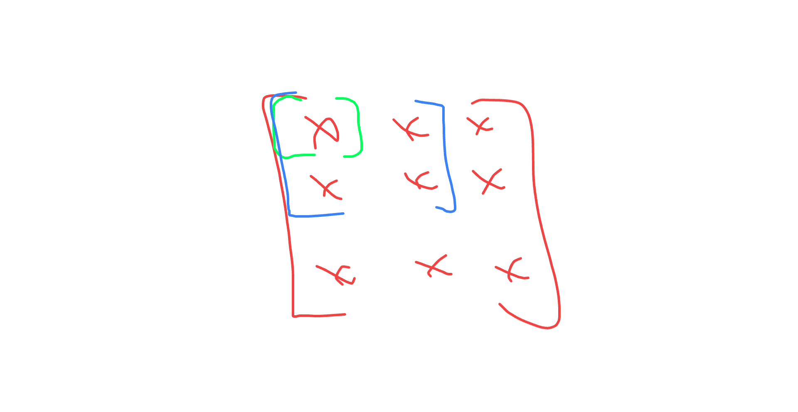
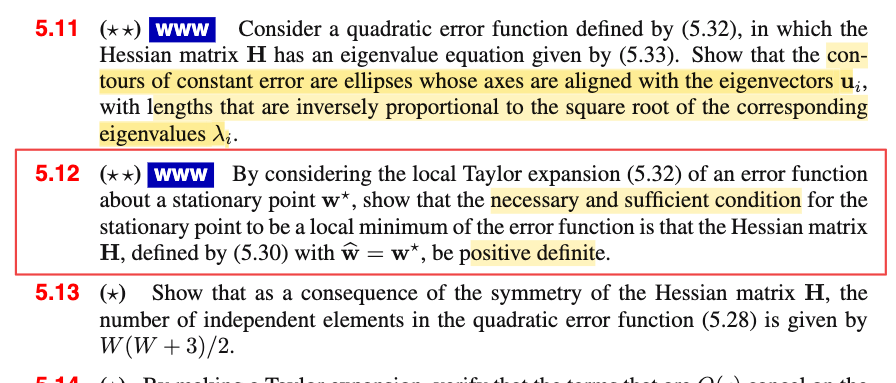

# 5.2.2 Local quadratic approximation

📊 **Progress:** `3` Notes | `14` Screenshots | `3` AI Reviews

---

 

## 5.2.2 Local Quadratic Approximation

 

### Local Quadratic Approximation

<kbd></kbd>

<kbd></kbd>

<kbd></kbd>

<kbd></kbd>

<kbd></kbd>

<kbd></kbd>

<kbd></kbd>

<kbd></kbd>

<kbd></kbd>

<kbd></kbd>

<kbd></kbd>

> [!NOTE]
> Xấp xỉ bậc hai:
>
>
>
> trong phạm vi lân cận x0
>
>
>
> f(x) ≈ f(x0) + f'(x0)(x-x0) + (1/2)f''(x0)(x-x0)²
>
>
>
> f(𝐱) ≈ f(𝐱0) + ∇f(𝐱0)ᵀ(𝐱 - 𝐱0) + (1/2)(𝐱-𝐱0)ᵀ∇²f(𝐱0)(𝐱-𝐱0)
>
>
>
> Xấp xỉ bậc hai của E(𝐰) tại 𝐰̂
>
>
>
> E(𝐰) ≈ E(𝐰̂) + ∇E(𝐰̂)ᵀ(𝐰-𝐰̂) + (1/2)(𝐰-𝐰̂)ᵀ∇²E(𝐰̂) (𝐰-𝐰̂)
>
>
>
> ∇E(𝐰̂) = 𝐛, ∇²E(𝐰̂) = 𝐇
>
>
>
> E(𝐰) ≈ E(𝐰̂) + 𝐛ᵀ(𝐰-𝐰̂) + (1/2)(𝐰-𝐰̂)ᵀ𝐇(𝐰-𝐰̂) → 5.28
>
>
>
> ---
>
>
>
> 5.28: E(𝐰) ≈ E(𝐰̂) + ∇E(𝐰̂)ᵀ(𝐰-𝐰̂) + (1/2)(𝐰-𝐰̂)ᵀ∇²E(𝐰̂) (𝐰-𝐰̂)
>
>
>
> Đạo hàm hai vế theo 𝐰, vế trái ta có ∇E(𝐰)
>
>
>
> Xét vế phải: E(𝐰̂) + 𝐇ᵀ(𝐰-𝐰̂) + (1/2)(𝐰-𝐰̂)ᵀ𝐇 (𝐰-𝐰̂)
>
>
>
> ⇔ E(𝐰̂) + 𝐛ᵀ𝐰 - 𝐛ᵀ𝐰̂ + (1/2)(𝐰ᵀ𝐇 - 𝐰̂ᵀ𝐇) (𝐰-𝐰̂) (nhân phân phối vô)
>
>
>
> ⇔ E(𝐰̂) + 𝐛ᵀ𝐰 - 𝐛ᵀ𝐰̂ + (1/2)(𝐰ᵀ𝐇𝐰 - 𝐰̂ᵀ𝐇𝐰 - 𝐰ᵀ𝐇𝐰̂ + 𝐰̂ᵀ𝐇𝐰̂)
>
>
>
> vì 𝐰̂ᵀ𝐇𝐰 là số vô hướng, nên 𝐰ᵀ𝐇𝐰 = (𝐰̂ᵀ𝐇𝐰)ᵀ = 𝐰ᵀ(𝐰̂ᵀ𝐇)ᵀ = 𝐰ᵀ𝐇ᵀ𝐰̂
>
>
>
> .. ⇔ E(𝐰̂) + 𝐛ᵀ𝐰 - 𝐛ᵀ𝐰̂ + (1/2)(𝐰ᵀ𝐇𝐰 - 2𝐰̂ᵀ𝐇𝐰 + 𝐰̂ᵀ𝐇𝐰̂)
>
>
>
> ⇔ E(𝐰̂) + 𝐛ᵀ𝐰 - 𝐛ᵀ𝐰̂ + (1/2)𝐰ᵀ𝐇𝐰 - 𝐰̂ᵀ𝐇𝐰 + (1/2)𝐰̂ᵀ𝐇𝐰̂
>
>
>
> ⇔ (1/2)𝐰ᵀ𝐇𝐰 + (𝐛 - 𝐇ᵀ𝐰̂)ᵀ𝐰 + (1/2)𝐰̂ᵀ𝐇𝐰̂ + E(𝐰̂) - 𝐛ᵀ𝐰̂
>
>
>
> Với f(𝐱) = (1/2)𝐱ᵀ𝐏𝐱 + 𝐪ᵀ𝐱 + r, ∇f(𝐱) = 𝐏𝐱 + 𝐪
>
>
>
> nên đạo hàm của vế phải theo 𝐰: 𝐇𝐰 + 𝐛 - 𝐇ᵀ𝐰̂ = 𝐇𝐰 + 𝐛 - 𝐇𝐰̂ = 𝐇(𝐰-𝐰̂) + 𝐛
>
>
>
> Do đó ∇E(𝐰) ≈ 𝐛 + 𝐇(𝐰-𝐰̂) → 5.31
>
>
>
> ---
>
>
>
> Nếu xấp xỉ bậc hai hàm E(𝐰) tại 𝐰\* là local minimum: ∇E(𝐰)|𝐰=𝐰\* = 𝟎
>
>
>
> E(𝐰) ≈ E(𝐰\*) + 𝟎ᵀ(𝐰-𝐰\*) + (1/2)(𝐰-𝐰\*)ᵀ𝐇(𝐰-𝐰\*)
>
>
>
> ⇔ E(𝐰) ≈ E(𝐰\*) + (1/2)(𝐰-𝐰\*)ᵀ𝐇(𝐰-𝐰\*), 𝐇 = ∇²E(𝐰)|𝐰=𝐰\* → 5.32
>
>
>
> ---
>
>
>
> 𝐀, λ là eigenvalue eigenvector tương ứng là 𝐮: 𝐀𝐮 = λ𝐮
>
>
>
> 𝐇𝐮i = λi𝐮i
>
>
>
> 𝐇: đối xứng
>
>
>
> Ôn lại:
>
>
>
> 𝐀 đối xứng: đủ n eigenvector độc lập 𝐀 = 𝐒 𝚲 𝐒⁻¹
>
>
>
> mà còn luôn có thể chọn được bộ eigenvector trực giao 𝐐 orthogonal matrix:
>
>
>
> 𝐐ᵀ = 𝐐⁻¹ (𝐐ᵀ𝐐 = 𝐐𝐐ᵀ = 𝐈)
>
>
>
> 𝐀 = 𝐒 𝚲 𝐒⁻¹ = 𝐐 𝚲 𝐐ᵀ
>
>
>
> 𝐮iᵀ𝐮j = 0 với i khác j
>
>
>
> 𝐮iᵀ𝐮i = ||𝐮i||² = 1
>
>
>
> 𝐮iᵀ𝐮j = δij = 𝐈\_{i=j}
>
>
>
> ⇒ {𝐮i} là một basis Rⁿ: mọi vector thuộc Rⁿ đều có thể được thể hiện bởi một linear combination của {𝐮i}
>
>
>
> 𝐰 - 𝐰\* = Σi αi 𝐮i
>
>
>
> ---
>
>
>
> Ôn lại nhanh kiến thức 18.06 liên quan:
>
>
>
> 𝐱, \[x\]\_e = (2, 3), \[x\]\_v = (x1=3, x2=4), \[x\]\_u = (5,6)
>
>
>
> 𝐱 = x1 𝐞1 + x2 𝐞2 = 3 𝐯1 + 4 𝐯2 = 5 𝐮1 + 6 𝐮2
>
>
>
> Tính chất của linear transformation: T(α𝐮 + β𝐯) = αT(𝐮) + βT(𝐯)
>
>
>
> T(𝐱) = T(x1𝐞1 + x2𝐞2) = x1T(𝐞1) + x2T(𝐞2)
>
>
>
> T(3 𝐯1 + 4 𝐯2) = 3T(𝐯1) + 4T(𝐯2)
>
>
>
> T(5 𝐮1 + 6 𝐮2) = 5T(𝐮1) + 6T(𝐮2)
>
>
>
> ---
>
>
>
> T(𝐱), \[T(𝐱)\]\_e, \[T(𝐱)\]\_v, \[T(𝐱)\]\_u
>
>
>
> A \[x\]\_v = \[T(x)\]\_u
>
>
>
> T(𝐱) = T(x1 𝐯1 + x2 𝐯2) = x1 T(𝐯1) + x2 T(𝐯2)
>
>
>
> ⇔ \[T(𝐱)\]\_u = \[x1 T(𝐯1) + x2 T(𝐯2)\]\_u
>
>
>
> A \[x\]\_v = \[x1 T(𝐯1) + x2 T(𝐯2)\]\_u
>
>
>
> ⇔ A \[x\]\_v = \[x1 T(𝐯1)\]\_u + \[x2 T(𝐯2)\]\_u
>
>
>
> ⇔ A \[x\]\_v = x1 \[T(𝐯1)\]\_u + x2 \[T(𝐯2)\]\_u
>
>
>
> ⇔ A \[x\]\_v = x1 \[T(𝐯1)\]\_u + x2 \[T(𝐯2)\]\_u
>
>
>
> ⇔ x1 𝐜1 + x2 𝐜2 = x1 \[T(𝐯1)\]\_u + x2 \[T(𝐯2)\]\_u
>
>
>
> ⇒ 𝐜1 = \[T(𝐯1)\]\_u, 𝐜2 = \[T(𝐯2)\]\_u
>
>
>
> ---
>
>
>
> T(𝐱) = 𝐱
>
>
>
> A \[x\]\_v = \[T(𝐱)\]\_u = \[x\]\_u
>
>
>
> 𝐜1 = \[𝐯1\]\_u, 𝐜2 = \[𝐯2\]\_u
>
>
>
> A \[x\]\_v = \[x\]\_e : 𝐜1 = \[𝐯1\]\_e, 𝐜2 = \[𝐯2\]\_e
>
>
>
> V \[x\]\_v = \[x\]\_e
>
>
>
> A \[x\]\_u = \[x\]\_e : 𝐜1 = \[𝐮1\]\_e, 𝐜2 = \[𝐮2\]\_e
>
>
>
> U \[x\]\_u = \[x\]\_e
>
>
>
> V \[x\]\_v = U \[x\]\_u
>
>
>
> \[x\]\_u = U⁻¹V \[x\]\_v ⇒ U⁻¹V là matrix đổi cơ sở từ basis v's sang basis u's
>
>
>
> \[x\]\_u = U⁻¹ \[x\]\_e
>
>
>
> U \[x\]\_u = \[x\]\_e
>
>
>
> ---
>
>
>
> Quay lại đây, 𝐇 có bộ eigenvector tạo một cơ sở trực chuẩn {𝐮1, 𝐮2,...} 
>
>
>
> Nên đem {𝐮i} thành các cột của 𝐔 thì ta sẽ có 𝐔 và 𝐔⁻¹ (cũng là 𝐔ᵀ) chính là matrix chuyển từ cơ sở eigenvector 𝐮i sang cơ sở 𝐞 và ngược lại.
>
>
>
> Quay lại 5.35: 𝐰 - 𝐰\* = Σi αi 𝐮i 
>
>
>
> 𝐱, \[x\]\_e
>
>
>
> ⇔ 𝐰 - 𝐰\* = 𝐔 𝛂
>
>
>
> Theo ở trên \[𝐰 - 𝐰\*\]\_e = 𝐔 \[𝐰 - 𝐰\*\]\_u
>
>
>
> do đó 𝛂 = (α1,α2..) chính là \[𝐰 - 𝐰\*\]\_u tức tọa độ của vector 𝐰 - 𝐰\* trong cơ sở 𝐮i, là các eigenvector của 𝐇
>
>
>
> Lắp vào 5.32: E(𝐰) ≈ E(𝐰\*) + (1/2)(𝐰-𝐰\*)ᵀ𝐇(𝐰-𝐰\*)
>
>
>
>  E(𝐰) ≈ E(𝐰\*) + (1/2)(Σi αi 𝐮i )ᵀ𝐇(Σi αi 𝐮i )
>
>
>
> ⇔ E(𝐰) ≈ E(𝐰\*) + (1/2)(Σi αi 𝐮i )ᵀ𝐇(Σi αi 𝐮i )
>
>
>
> ⇔ E(𝐰) ≈ E(𝐰\*) + (1/2)(Σi αi 𝐮i )ᵀ (Σi 𝐇αi𝐮i)
>
>
>
> ⇔ E(𝐰) ≈ E(𝐰\*) + (1/2)(Σi αi 𝐮i )ᵀ (Σi αi 𝐇𝐮i)
>
>
>
> ⇔ E(𝐰) ≈ E(𝐰\*) + (1/2)(Σi αi 𝐮i )ᵀ (Σi αi λi𝐮i)
>
>
>
> Xét (Σi αi 𝐮i )ᵀ (Σi αi λi𝐮i), nhân phân phối vô ta sẽ có: (1/2)(Σi αi² λi)
>
>
>
> (ví dụ (α1 𝐮1ᵀ + α2 𝐮2ᵀ)(α1 λ1 𝐮1 + α2 λ2 𝐮2) 
>
>
>
> = (α1 𝐮1ᵀα1 λ1 𝐮1 + α2 𝐮2ᵀα1 λ1 𝐮1 + α1 𝐮1ᵀα2 λ2 𝐮2 + α2 𝐮2ᵀα2 λ2 𝐮2) 
>
>
>
> = α1² λ1 𝐮1ᵀ𝐮1 + α2α1 λ1 𝐮2ᵀ𝐮1 + α1α2 λ2 𝐮1ᵀ𝐮2 + α2² λ2  𝐮2ᵀ𝐮2
>
>
>
> = α1² λ1 × 1 + α2α1 λ1 × 0 + α1α2 λ2 × 0 + α2² λ2  × 1
>
>
>
> = α1² λ1 + α2² λ2 
>
>
>
> ⇔ E(𝐰) ≈ E(𝐰\*) + (1/2)(Σi λiαi²) → 5.36
>
>
>
> Xét level set E(𝐰) = c
>
>
>
> ⇔ E(𝐰\*) + (1/2)(Σi λiαi²) = c
>
>
>
> ⇔ Σi λiαi² = 2\[c - E(𝐰\*)\], đặt = K 
>
>
>
> ⇔ λ1 α1² + λ1 α2² + ... = K
>
>
>
> Ví dụ ⇔ λ1 α1² + λ1 α2² = K
>
>
>
> Chia hai vế cho K
>
>
>
> λ1 α1²/K+ λ2 α2²/K = 1
>
>
>
> α1²/ (K/λ1) + α2² / (K/λ2) = 1
>
>
>
> và theo hệ trục 𝐮1,𝐮2 đây là phương trình ellipse có tâm tại 0 có trục là 𝐮1, 𝐮2 và chiều dài trục ellipse tỉ lệ theo λ1, λ2. Chính là cái hình 5.6
>
>
>
> Đây cũng là giải xong Ex 5.11 
>
>
>
> ---
>
>
>
> Cuối cùng, để 𝐇 xác định dương, quadratic form của nó phải không âm với mọi 𝐯 khác 𝟎:
>
>
>
> 𝐯ᵀ𝐇𝐯 &gt; 0 ⇔ (Σi λi 𝐮i)ᵀ 𝐇 (Σi λi 𝐮i) &gt; 0 
>
>
>
> ⇔ Σi αi²λi &gt; 0 ∀αi
>
>
>
> .....(note kế tiếp)
>
>
>
>
>
>
>
>
>
>
>
>
>
>
>
>
>
>
>
>
>
>
>
>
>
>
>
>
>
>
>
>
>
>
>
>
>
>
>
>
>
>
>
>
>
>
>
>
>
>
>
>
>
>
>
>
>
> ---

📹 Video 1: [Vì sao ma trận chuyển cơ sở lại có dạng U^-1 V?](https://www.youtube.com/watch?v=Rzqf70LRGXU)

📹 Video 2: [Vì sao trị riêng Hessian H quyết định trục elip hàm lỗi E(w)?](https://www.youtube.com/watch?v=Vb8O7m3jSBQ)

> [!TIP]
> 🤖 **AI Check** — 🟢 Pass — ✅ **95/100** · ✓ Move on
>
> Ghi chép rất tốt, trình bày mạch lạc và chính xác từ khai triển Taylor 1 chiều, tổng quát hóa lên hàm nhiều biến và áp dụng chuẩn xác cho hàm lỗi theo tài liệu.
>
> **✓ Strengths**
> - Xây dựng tư duy trực quan rất tốt bằng cách liên kết công thức 1 chiều với trường hợp vector nhiều chiều.
> - Biểu diễn chính xác khai triển Taylor bậc hai của hàm lỗi E(w) quanh điểm ŵ cùng định nghĩa của gradient b và ma trận Hessian H.
>
> **💡 Deeper notes**
> - Khai triển này ngầm giả định hàm lỗi liên tục và khả vi đến cấp hai (lớp C²) trong một lân cận đủ nhỏ quanh điểm ŵ, đồng thời đã bỏ qua các số hạng bậc ba và cao hơn (O(||w - ŵ||³)).

 

#### Positive Definite Hessian Matrix

<kbd></kbd>

<kbd></kbd>

> [!NOTE]
> Chứng minh để 𝐇 xác định dương thì λi &gt; 0 ∀i
>
>
>
> 𝐇 xác định dương theo định nghĩa, khi 𝐯ᵀ𝐇𝐯 &gt; 0 ∀ 𝐯 khác 0
>
>
>
> 𝐯 bất kì đều ∈ span{𝐮1,..𝐮n} nên 𝐯 = Σi αi 𝐮i for some {αi}
>
>
>
> và nếu xét 𝐯 khác 0 và 𝐯 = Σi αi 𝐮i vector 𝛂 phải có ít nhất một phần tử khác 0
>
>
>
> nên 𝐯ᵀ𝐇𝐯 &gt; 0 ∀ 𝐯 khác 0
>
>
>
> ⇔ (Σi αi 𝐮i)ᵀ𝐇 (Σi αi 𝐮i) &gt; 0 ∀𝛂 = (α1,α2...) có ít nhất một αi khác 0
>
>
>
> ---
>
>
>
> Xét 𝐇 (Σi αi 𝐮i) = Σi 𝐇 αi 𝐮i = Σi αi 𝐇𝐮i = Σi αiλi 𝐮i
>
>
>
> (Σi αi 𝐮i)ᵀ𝐇 (Σi αi 𝐮i) = (Σi αi 𝐮i)ᵀ (Σi αiλi 𝐮i) = Σi αi² λi
>
>
>
> ---
>
>
>
> ⇔ Σi αi² λi &gt; 0 ∀ 𝛂 = (α1,α2...) có ít nhất một αi khác 0
>
>
>
> Chứng minh Σi αi² λi &gt; 0 ∀ 𝛂 = (α1,α2...) thì mọi λi đều &gt; 0 (điều kiện cần):
>
>
>
> Chọn 𝛂 = (1,0,...) thì Σi αi² λi &gt; 0 (vì nó đúng với mọi α)
>
>
>
> ⇔ λ1 &gt; 0.
>
>
>
> Tương tự ta có thể chọn 𝛂 = (0,1,0...) để chỉ ra λ2 phải &gt; 0, và các λ khác cũng vậy.
>
>
>
> ---
>
>
>
> Chứng minh nếu mọi λi &gt; 0 thì Σi αi² λi &gt; 0 ∀ 𝛂 = (α1,α2...) có ít nhất một αi khác 0 (điều kiện đủ)
>
>
>
> Cái này dĩ nhiên vì λi &gt; 0 ⇔ αi² λi ≥ 0 do αi² ≥ 0
>
>
>
> ⇒ Σi αi² λi ≥ 0 với mọi 𝛂 = (α1,α2,...)
>
>
>
> Nhưng do có ít nhất một αi khác 0 nên Σi αi² λi &gt; 0
>
>
>
> Chứng minh xong.

> [!TIP]
> 🤖 **AI Check** — 🟢 Pass — ✅ **90/100** · ✓ Move on
>
> Ghi chú đã chứng minh rất rõ ràng và chính xác cả hai chiều điều kiện cần và đủ cho tính chất ma trận đối xứng xác định dương khi và chỉ khi mọi giá trị riêng đều dương.
>
> **✓ Strengths**
> - Trình bày mạch lạc cấu trúc chứng minh hai chiều (điều kiện cần và điều kiện đủ).
> - Lập luận chặt chẽ khi chỉ ra vector khác 0 tương đương với vector hệ số có ít nhất một phần tử khác 0.
>
> **💡 Deeper notes**
> - Phép biến đổi từ $(\sum_i \alpha_i \mathbf{u}_i)^T \mathbf{H} (\sum_i \alpha_i \mathbf{u}_i)$ thành $\sum_i \alpha_i^2 \lambda_i$ ngầm định cơ sở vector riêng $\{\mathbf{u}_i\}$ là trực chuẩn (orthonormal basis), điều này luôn khả thi do ma trận Hessian $\mathbf{H}$ đối xứng.

 

##### Exercise 5.12 Local Minimum Condition

<kbd></kbd>

> [!NOTE]
> Bài này yêu cầu chứng minh điều kiện cần và đủ để 𝐰\* là minimum của E(𝐰) ≈ E(𝐰\*) + (1/2)(𝐰-𝐰\*)ᵀ𝐇(𝐰-𝐰\*) là 𝐇 tại 𝐰\* xác định dương.
>
>
>
> Trong bài này cần hiểu nói 𝐰\* là local minimum tức là strict local minimum: 
>
>
>
> Taylor expand E(𝐰) tại 𝐰\* 5.32:
>
>
>
> E(𝐰) = E(𝐰\*) + ∇E(𝐰\*)(𝐰 - 𝐰\*) + (1/2)(𝐰-𝐰\*)ᵀ𝐇(𝐰\*)(𝐰-𝐰\*)
>
>
>
> Vì đề bài đã cho 𝐰\* là điểm dừng nên
>
>
>
> E(𝐰) = E(𝐰\*) + (1/2)(𝐰-𝐰\*)ᵀ𝐇(𝐰-𝐰\*)
>
>
>
>
>
> ---
>
>
>
> Chứng minh điều kiện đủ: 𝐇(𝐰\*) xác định dương thì 𝐰\* là local minimum:
>
>
>
> Đơn giản: Vì 𝐇(𝐰\*) xác định dương nên 𝐯ᵀ𝐇𝐯 &gt; 0 ∀ 𝐯 ≠ 0
>
>
>
> ⇒ (𝐰-𝐰\*)ᵀ𝐇(𝐰-𝐰\*) &gt; 0 ∀ 𝐰 ≠ 𝐰\*
>
>
>
> ⇔ E(𝐰) - E(𝐰\*) &gt; 0 ∀ 𝐰 ≠ 𝐰\* ⇒ 𝐰\* là strict local minimum ⇒ cũng là local minimum
>
>
>
> ---
>
>
>
> Chứng minh điều kiện cần: 𝐰\* là local minimum, đồng nghĩa E(𝐰) &gt; E(𝐰\*) ∀ 𝐰 lân cận
>
>
>
> Ta cần chứng minh 𝐇 xác định dương, tức 𝐯ᵀ𝐇𝐯 &gt; 0 ∀ 𝐯 ≠ 0 hoặc mọi trị riêng đều dương.
>
>
>
> Giả sử tồn tại λ1 ≤ 0:
>
>
>
> 𝐰\* = Σi α\*i 𝐮i = α\*1 𝐮1 + α\*2 𝐮2 + ...
>
>
>
> xét vector 𝐰 = (α\*1 + ε) 𝐮1 + α\*2 𝐮2 + ... = ε 𝐮1 + α\*1 𝐮1 + α\*2 𝐮2 + ... với ε &gt; 0
>
>
>
> ⇒ 𝐰 - 𝐰\* = ε 𝐮1
>
>
>
> Khi đó E(𝐰) - E(𝐰\*) = (1/2)(𝐰-𝐰\*)ᵀ𝐇(𝐰-𝐰\*)
>
>
>
> = (1/2)(ε 𝐮1)ᵀ𝐇(ε 𝐮1)
>
>
>
> = (1/2)ε² 𝐮1ᵀ𝐇𝐮1
>
>
>
> = (1/2)ε² 𝐮1ᵀλ1𝐮1
>
>
>
> = (1/2)ε²λ1 𝐮1ᵀ𝐮1
>
>
>
> = (1/2)ε²λ1 ≤ 0
>
>
>
> Vậy nếu 𝐰\* là local minimum thì mọi λi &gt; 0 ⇒ 𝐇 xác định dương.

> [!TIP]
> 🤖 **AI Check** — 🟢 Pass — ✅ **95/100** · ✓ Move on
>
> Lời giải rất tốt, nắm vững bản chất khai triển Taylor bậc hai và quan hệ giữa ma trận Hessian với tính chất cực trị. Bạn cũng rất tinh ý khi nhận ra bài toán ngầm định 'strict local minimum' để điều kiện cần là xác định dương.
>
> **✓ Strengths**
> - Hiểu và chỉ ra đúng giả định ngầm của đề bài rằng 'local minimum' ở đây là strict local minimum để Hessian phải là xác định dương thay vì chỉ nửa xác định dương.
> - Chứng minh điều kiện đủ rõ ràng thông qua định nghĩa ma trận xác định dương trên dạng toàn phương.
> - Chứng minh điều kiện cần bằng phản chứng khéo léo thông qua việc biến thiên dọc theo vector riêng ứng với trị riêng không dương.
>
> **💡 Deeper notes**
> - Về mặt giải tích chặt chẽ tổng quát, với hàm khả vi bậc hai bất kỳ, điều kiện cần cho cực tiểu địa phương (yếu) chỉ là Hessian nửa xác định dương (H >= 0). Việc đề bài Bishop 5.12 yêu cầu 'xác định dương' là điều kiện cần và đủ xuất phát từ việc xét trực tiếp trên mô hình sai số toàn phương thuần túy (5.32) và đòi hỏi cực tiểu địa phương ngặt (strict local minimum).

 

