# 5.2.2 Local quadratic approximation

📊 **Progress:** `1` Notes | `12` Screenshots | `1` AI Reviews

---

 

## 5.2.2 Local Quadratic Approximation

 

### Local Quadratic Approximation

<kbd>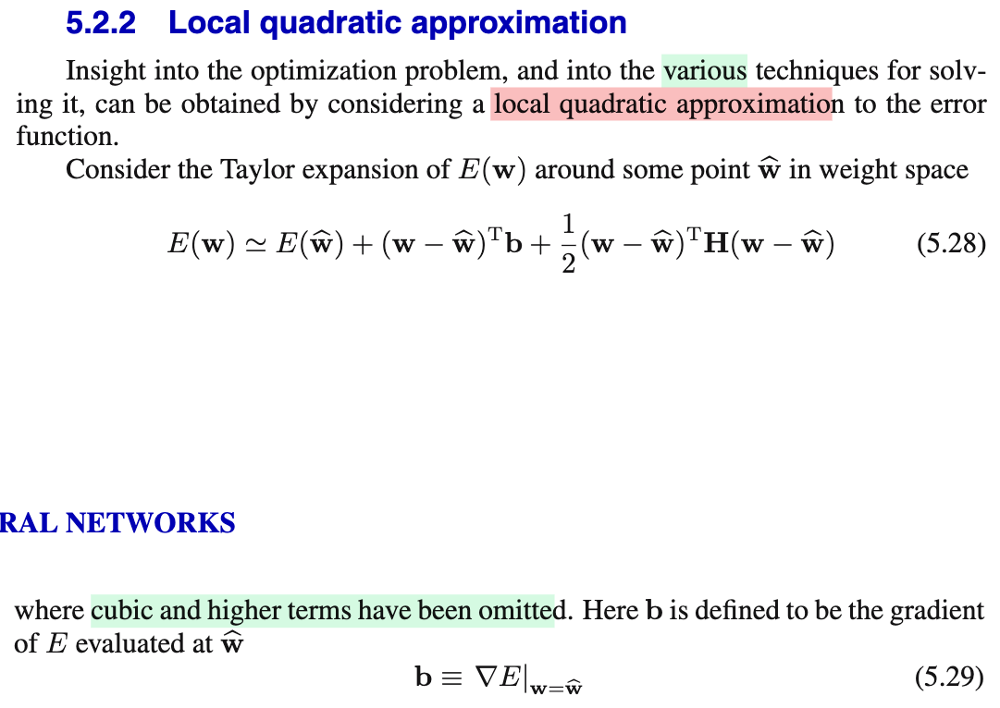</kbd>

<kbd>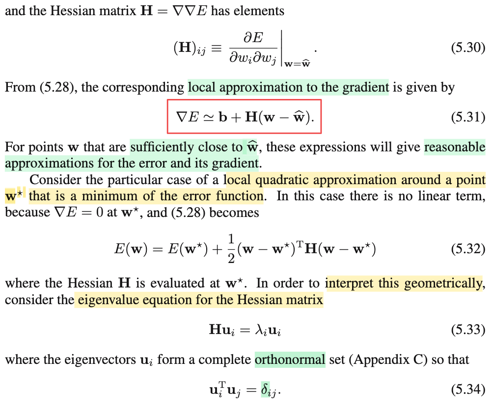</kbd>

<kbd>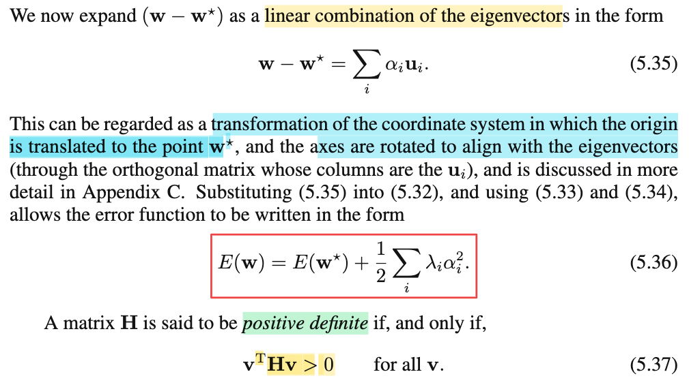</kbd>

<kbd>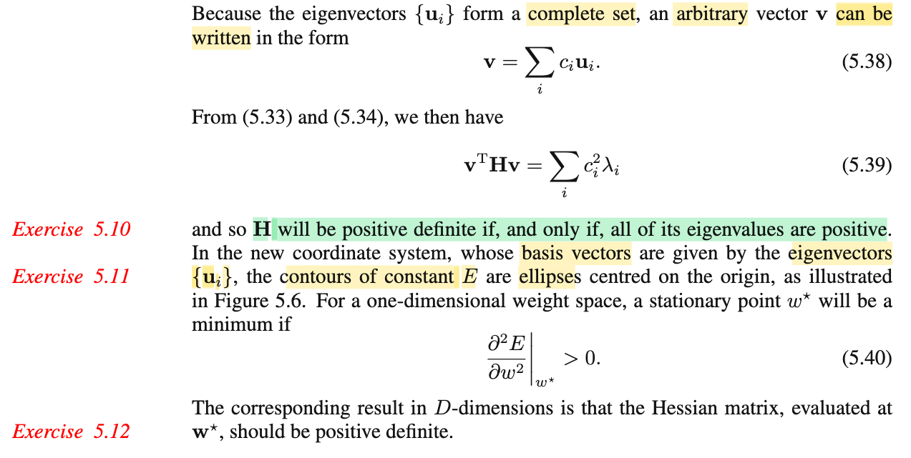</kbd>

<kbd>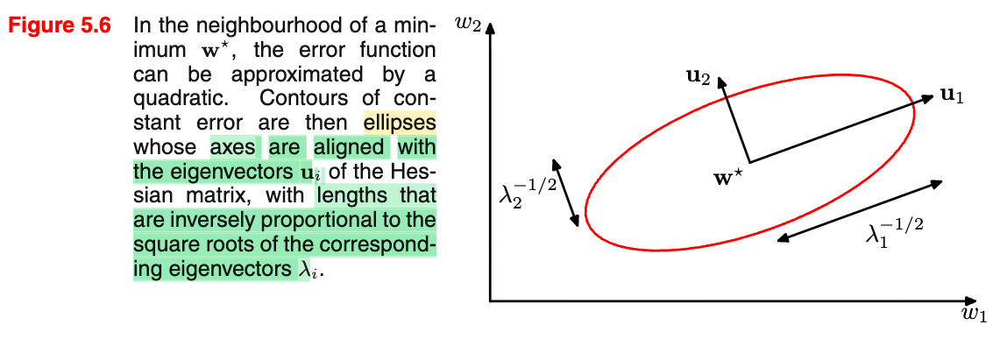</kbd>

<kbd>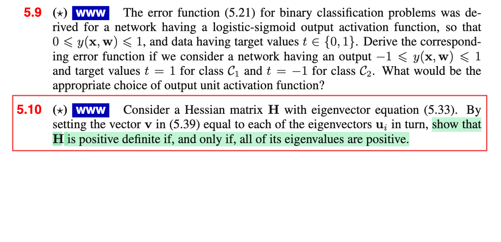</kbd>

<kbd>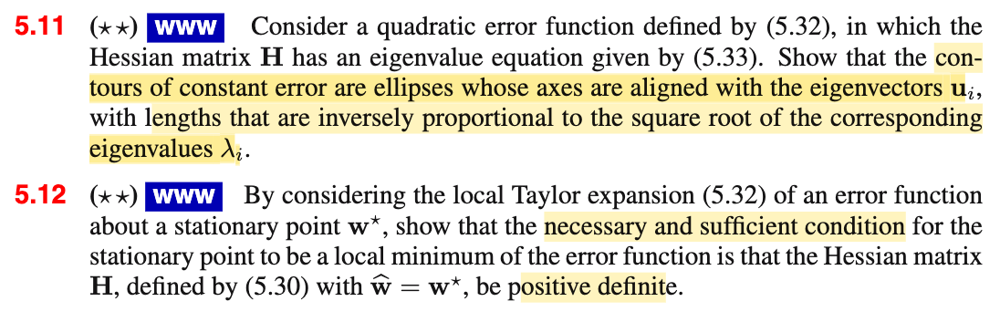</kbd>

<kbd>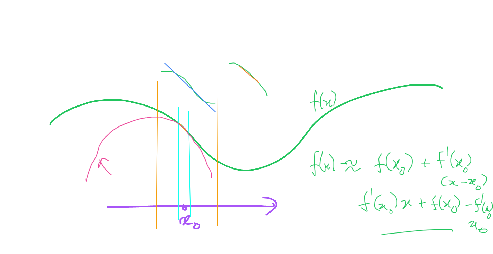</kbd>

<kbd>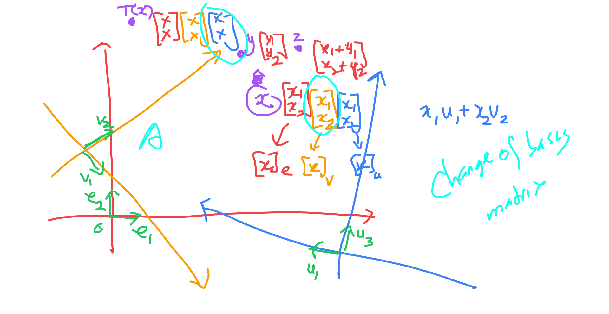</kbd>

<kbd>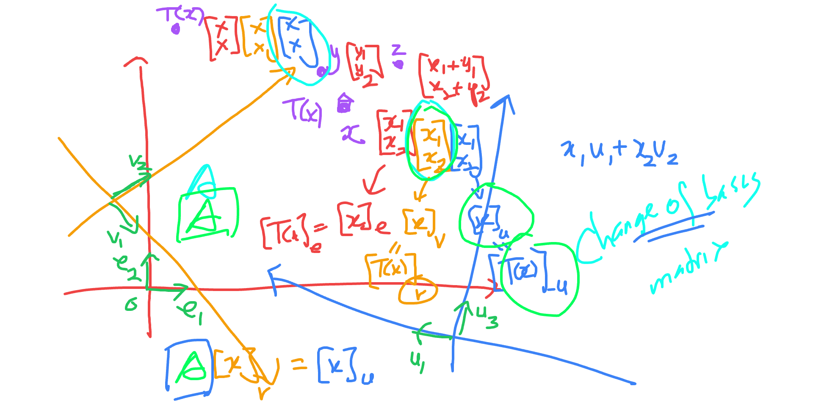</kbd>

<kbd>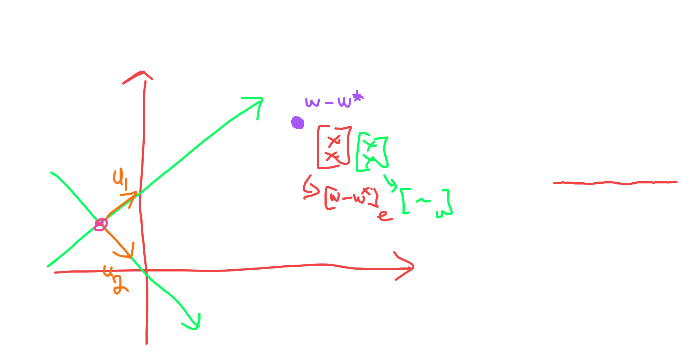</kbd>

<kbd>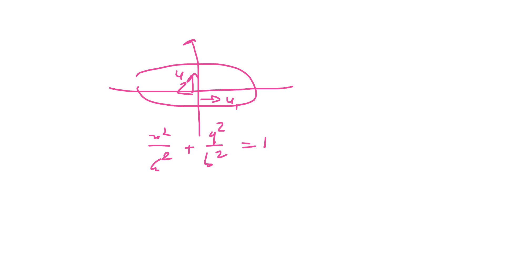</kbd>

> [!NOTE]
> Xấp xỉ bậc hai:
>
>
>
> trong phạm vi lân cận x0
>
>
>
> f(x) ≈ f(x0) + f'(x0)(x-x0) + (1/2)f''(x0)(x-x0)²
>
>
>
> f(𝐱) ≈ f(𝐱0) + ∇f(𝐱0)ᵀ(𝐱 - 𝐱0) + (1/2)(𝐱-𝐱0)ᵀ∇²f(𝐱0)(𝐱-𝐱0)
>
>
>
> Xấp xỉ bậc hai của E(𝐰) tại 𝐰̂
>
>
>
> E(𝐰) ≈ E(𝐰̂) + ∇E(𝐰̂)ᵀ(𝐰-𝐰̂) + (1/2)(𝐰-𝐰̂)ᵀ∇²E(𝐰̂) (𝐰-𝐰̂)
>
>
>
> ∇E(𝐰̂) = 𝐛, ∇²E(𝐰̂) = 𝐇
>
>
>
> E(𝐰) ≈ E(𝐰̂) + 𝐛ᵀ(𝐰-𝐰̂) + (1/2)(𝐰-𝐰̂)ᵀ𝐇(𝐰-𝐰̂) → 5.28
>
>
>
> ---
>
>
>
> 5.28: E(𝐰) ≈ E(𝐰̂) + ∇E(𝐰̂)ᵀ(𝐰-𝐰̂) + (1/2)(𝐰-𝐰̂)ᵀ∇²E(𝐰̂) (𝐰-𝐰̂)
>
>
>
> Đạo hàm hai vế theo 𝐰, vế trái ta có ∇E(𝐰)
>
>
>
> Xét vế phải: E(𝐰̂) + 𝐇ᵀ(𝐰-𝐰̂) + (1/2)(𝐰-𝐰̂)ᵀ𝐇 (𝐰-𝐰̂)
>
>
>
> ⇔ E(𝐰̂) + 𝐛ᵀ𝐰 - 𝐛ᵀ𝐰̂ + (1/2)(𝐰ᵀ𝐇 - 𝐰̂ᵀ𝐇) (𝐰-𝐰̂) (nhân phân phối vô)
>
>
>
> ⇔ E(𝐰̂) + 𝐛ᵀ𝐰 - 𝐛ᵀ𝐰̂ + (1/2)(𝐰ᵀ𝐇𝐰 - 𝐰̂ᵀ𝐇𝐰 - 𝐰ᵀ𝐇𝐰̂ + 𝐰̂ᵀ𝐇𝐰̂)
>
>
>
> vì 𝐰̂ᵀ𝐇𝐰 là số vô hướng, nên 𝐰ᵀ𝐇𝐰 = (𝐰̂ᵀ𝐇𝐰)ᵀ = 𝐰ᵀ(𝐰̂ᵀ𝐇)ᵀ = 𝐰ᵀ𝐇ᵀ𝐰̂
>
>
>
> .. ⇔ E(𝐰̂) + 𝐛ᵀ𝐰 - 𝐛ᵀ𝐰̂ + (1/2)(𝐰ᵀ𝐇𝐰 - 2𝐰̂ᵀ𝐇𝐰 + 𝐰̂ᵀ𝐇𝐰̂)
>
>
>
> ⇔ E(𝐰̂) + 𝐛ᵀ𝐰 - 𝐛ᵀ𝐰̂ + (1/2)𝐰ᵀ𝐇𝐰 - 𝐰̂ᵀ𝐇𝐰 + (1/2)𝐰̂ᵀ𝐇𝐰̂
>
>
>
> ⇔ (1/2)𝐰ᵀ𝐇𝐰 + (𝐛 - 𝐇ᵀ𝐰̂)ᵀ𝐰 + (1/2)𝐰̂ᵀ𝐇𝐰̂ + E(𝐰̂) - 𝐛ᵀ𝐰̂
>
>
>
> Với f(𝐱) = (1/2)𝐱ᵀ𝐏𝐱 + 𝐪ᵀ𝐱 + r, ∇f(𝐱) = 𝐏𝐱 + 𝐪
>
>
>
> nên đạo hàm của vế phải theo 𝐰: 𝐇𝐰 + 𝐛 - 𝐇ᵀ𝐰̂ = 𝐇𝐰 + 𝐛 - 𝐇𝐰̂ = 𝐇(𝐰-𝐰̂) + 𝐛
>
>
>
> Do đó ∇E(𝐰) ≈ 𝐛 + 𝐇(𝐰-𝐰̂) → 5.31
>
>
>
> ---
>
>
>
> Nếu xấp xỉ bậc hai hàm E(𝐰) tại 𝐰\* là local minimum: ∇E(𝐰)|𝐰=𝐰\* = 𝟎
>
>
>
> E(𝐰) ≈ E(𝐰\*) + 𝟎ᵀ(𝐰-𝐰\*) + (1/2)(𝐰-𝐰\*)ᵀ𝐇(𝐰-𝐰\*)
>
>
>
> ⇔ E(𝐰) ≈ E(𝐰\*) + (1/2)(𝐰-𝐰\*)ᵀ𝐇(𝐰-𝐰\*), 𝐇 = ∇²E(𝐰)|𝐰=𝐰\* → 5.32
>
>
>
> ---
>
>
>
> 𝐀, λ là eigenvalue eigenvector tương ứng là 𝐮: 𝐀𝐮 = λ𝐮
>
>
>
> 𝐇𝐮i = λi𝐮i
>
>
>
> 𝐇: đối xứng
>
>
>
> Ôn lại:
>
>
>
> 𝐀 đối xứng: đủ n eigenvector độc lập 𝐀 = 𝐒 𝚲 𝐒⁻¹
>
>
>
> mà còn luôn có thể chọn được bộ eigenvector trực giao 𝐐 orthogonal matrix:
>
>
>
> 𝐐ᵀ = 𝐐⁻¹ (𝐐ᵀ𝐐 = 𝐐𝐐ᵀ = 𝐈)
>
>
>
> 𝐀 = 𝐒 𝚲 𝐒⁻¹ = 𝐐 𝚲 𝐐ᵀ
>
>
>
> 𝐮iᵀ𝐮j = 0 với i khác j
>
>
>
> 𝐮iᵀ𝐮i = ||𝐮i||² = 1
>
>
>
> 𝐮iᵀ𝐮j = δij = 𝐈\_{i=j}
>
>
>
> ⇒ {𝐮i} là một basis Rⁿ: mọi vector thuộc Rⁿ đều có thể được thể hiện bởi một linear combination của {𝐮i}
>
>
>
> 𝐰 - 𝐰\* = Σi αi 𝐮i
>
>
>
> ---
>
>
>
> Ôn lại nhanh kiến thức 18.06 liên quan:
>
>
>
> 𝐱, \[x\]\_e = (2, 3), \[x\]\_v = (x1=3, x2=4), \[x\]\_u = (5,6)
>
>
>
> 𝐱 = x1 𝐞1 + x2 𝐞2 = 3 𝐯1 + 4 𝐯2 = 5 𝐮1 + 6 𝐮2
>
>
>
> Tính chất của linear transformation: T(α𝐮 + β𝐯) = αT(𝐮) + βT(𝐯)
>
>
>
> T(𝐱) = T(x1𝐞1 + x2𝐞2) = x1T(𝐞1) + x2T(𝐞2)
>
>
>
> T(3 𝐯1 + 4 𝐯2) = 3T(𝐯1) + 4T(𝐯2)
>
>
>
> T(5 𝐮1 + 6 𝐮2) = 5T(𝐮1) + 6T(𝐮2)
>
>
>
> ---
>
>
>
> T(𝐱), \[T(𝐱)\]\_e, \[T(𝐱)\]\_v, \[T(𝐱)\]\_u
>
>
>
> A \[x\]\_v = \[T(x)\]\_u
>
>
>
> T(𝐱) = T(x1 𝐯1 + x2 𝐯2) = x1 T(𝐯1) + x2 T(𝐯2)
>
>
>
> ⇔ \[T(𝐱)\]\_u = \[x1 T(𝐯1) + x2 T(𝐯2)\]\_u
>
>
>
> A \[x\]\_v = \[x1 T(𝐯1) + x2 T(𝐯2)\]\_u
>
>
>
> ⇔ A \[x\]\_v = \[x1 T(𝐯1)\]\_u + \[x2 T(𝐯2)\]\_u
>
>
>
> ⇔ A \[x\]\_v = x1 \[T(𝐯1)\]\_u + x2 \[T(𝐯2)\]\_u
>
>
>
> ⇔ A \[x\]\_v = x1 \[T(𝐯1)\]\_u + x2 \[T(𝐯2)\]\_u
>
>
>
> ⇔ x1 𝐜1 + x2 𝐜2 = x1 \[T(𝐯1)\]\_u + x2 \[T(𝐯2)\]\_u
>
>
>
> ⇒ 𝐜1 = \[T(𝐯1)\]\_u, 𝐜2 = \[T(𝐯2)\]\_u
>
>
>
> ---
>
>
>
> T(𝐱) = 𝐱
>
>
>
> A \[x\]\_v = \[T(𝐱)\]\_u = \[x\]\_u
>
>
>
> 𝐜1 = \[𝐯1\]\_u, 𝐜2 = \[𝐯2\]\_u
>
>
>
> A \[x\]\_v = \[x\]\_e : 𝐜1 = \[𝐯1\]\_e, 𝐜2 = \[𝐯2\]\_e
>
>
>
> V \[x\]\_v = \[x\]\_e
>
>
>
> A \[x\]\_u = \[x\]\_e : 𝐜1 = \[𝐮1\]\_e, 𝐜2 = \[𝐮2\]\_e
>
>
>
> U \[x\]\_u = \[x\]\_e
>
>
>
> V \[x\]\_v = U \[x\]\_u
>
>
>
> \[x\]\_u = U⁻¹V \[x\]\_v ⇒ U⁻¹V là matrix đổi cơ sở từ basis v's sang basis u's
>
>
>
> \[x\]\_u = U⁻¹ \[x\]\_e
>
>
>
> U \[x\]\_u = \[x\]\_e
>
>
>
> ---
>
>
>
> Quay lại đây, 𝐇 có bộ eigenvector tạo một cơ sở trực chuẩn {𝐮1, 𝐮2,...} 
>
>
>
> Nên đem {𝐮i} thành các cột của 𝐔 thì ta sẽ có 𝐔 và 𝐔⁻¹ (cũng là 𝐔ᵀ) chính là matrix chuyển từ cơ sở eigenvector 𝐮i sang cơ sở 𝐞 và ngược lại.
>
>
>
> Quay lại 5.35: 𝐰 - 𝐰\* = Σi αi 𝐮i 
>
>
>
> 𝐱, \[x\]\_e
>
>
>
> ⇔ 𝐰 - 𝐰\* = 𝐔 𝛂
>
>
>
> Theo ở trên \[𝐰 - 𝐰\*\]\_e = 𝐔 \[𝐰 - 𝐰\*\]\_u
>
>
>
> do đó 𝛂 = (α1,α2..) chính là \[𝐰 - 𝐰\*\]\_u tức tọa độ của vector 𝐰 - 𝐰\* trong cơ sở 𝐮i, là các eigenvector của 𝐇
>
>
>
> Lắp vào 5.32: E(𝐰) ≈ E(𝐰\*) + (1/2)(𝐰-𝐰\*)ᵀ𝐇(𝐰-𝐰\*)
>
>
>
>  E(𝐰) ≈ E(𝐰\*) + (1/2)(Σi αi 𝐮i )ᵀ𝐇(Σi αi 𝐮i )
>
>
>
> ⇔ E(𝐰) ≈ E(𝐰\*) + (1/2)(Σi αi 𝐮i )ᵀ𝐇(Σi αi 𝐮i )
>
>
>
> ⇔ E(𝐰) ≈ E(𝐰\*) + (1/2)(Σi αi 𝐮i )ᵀ (Σi 𝐇αi𝐮i)
>
>
>
> ⇔ E(𝐰) ≈ E(𝐰\*) + (1/2)(Σi αi 𝐮i )ᵀ (Σi αi 𝐇𝐮i)
>
>
>
> ⇔ E(𝐰) ≈ E(𝐰\*) + (1/2)(Σi αi 𝐮i )ᵀ (Σi αi λi𝐮i)
>
>
>
> Xét (Σi αi 𝐮i )ᵀ (Σi αi λi𝐮i), nhân phân phối vô ta sẽ có: (1/2)(Σi αi² λi)
>
>
>
> (ví dụ (α1 𝐮1ᵀ + α2 𝐮2ᵀ)(α1 λ1 𝐮1 + α2 λ2 𝐮2) 
>
>
>
> = (α1 𝐮1ᵀα1 λ1 𝐮1 + α2 𝐮2ᵀα1 λ1 𝐮1 + α1 𝐮1ᵀα2 λ2 𝐮2 + α2 𝐮2ᵀα2 λ2 𝐮2) 
>
>
>
> = α1² λ1 𝐮1ᵀ𝐮1 + α2α1 λ1 𝐮2ᵀ𝐮1 + α1α2 λ2 𝐮1ᵀ𝐮2 + α2² λ2  𝐮2ᵀ𝐮2
>
>
>
> = α1² λ1 × 1 + α2α1 λ1 × 0 + α1α2 λ2 × 0 + α2² λ2  × 1
>
>
>
> = α1² λ1 + α2² λ2 
>
>
>
> ⇔ E(𝐰) ≈ E(𝐰\*) + (1/2)(Σi λiαi²) → 5.36
>
>
>
> Xét level set E(𝐰) = c
>
>
>
> ⇔ E(𝐰\*) + (1/2)(Σi λiαi²) = c
>
>
>
> ⇔ Σi λiαi² = 2\[c - E(𝐰\*)\], đặt = K 
>
>
>
> ⇔ λ1 α1² + λ1 α2² + ... = K
>
>
>
> Ví dụ ⇔ λ1 α1² + λ1 α2² = K
>
>
>
> Chia hai vế cho K
>
>
>
> λ1 α1²/K+ λ2 α2²/K = 1
>
>
>
> α1²/ (K/λ1) + α2² / (K/λ2) = 1
>
>
>
> và theo hệ trục 𝐮1,𝐮2 đây là phương trình ellipse có tâm tại 0 có trục là 𝐮1, 𝐮2 và chiều dài trục ellipse tỉ lệ theo λ1, λ2. Chính là cái hình 5.6
>
>
>
> Đây cũng là giải xong Ex 5.11 
>
>
>
> ---
>
>
>
> Cuối cùng, để 𝐇 xác định dương, quadratic form của nó phải không âm với mọi 𝐯 khác 𝟎:
>
>
>
> 𝐯ᵀ𝐇𝐯 &gt; 0 ⇔ (Σi λi 𝐮i)ᵀ 𝐇 (Σi λi 𝐮i) &gt; 0 
>
>
>
> ⇔ Σi αi²λi &gt; 0 ∀αi
>
>
>
> .....(note kế tiếp)
>
>
>
>
>
>
>
>
>
>
>
>
>
>
>
>
>
>
>
>
>
>
>
>
>
>
>
>
>
>
>
>
>
>
>
>
>
>
>
>
>
>
>
>
>
>
>
>
>
>
>
>
>
>
>
>
>
> ---

📹 Video 1: [Vì sao ma trận chuyển cơ sở lại có dạng U^-1 V?](https://www.youtube.com/watch?v=Rzqf70LRGXU)

📹 Video 2: [Vì sao trị riêng Hessian H quyết định trục elip hàm lỗi E(w)?](https://www.youtube.com/watch?v=Vb8O7m3jSBQ)

> [!TIP]
> 🤖 **AI Check** — 🟢 Pass — ✅ **95/100** · ✓ Move on
>
> Ghi chép rất tốt, trình bày mạch lạc và chính xác từ khai triển Taylor 1 chiều, tổng quát hóa lên hàm nhiều biến và áp dụng chuẩn xác cho hàm lỗi theo tài liệu.
>
> **✓ Strengths**
> - Xây dựng tư duy trực quan rất tốt bằng cách liên kết công thức 1 chiều với trường hợp vector nhiều chiều.
> - Biểu diễn chính xác khai triển Taylor bậc hai của hàm lỗi E(w) quanh điểm ŵ cùng định nghĩa của gradient b và ma trận Hessian H.
>
> **💡 Deeper notes**
> - Khai triển này ngầm giả định hàm lỗi liên tục và khả vi đến cấp hai (lớp C²) trong một lân cận đủ nhỏ quanh điểm ŵ, đồng thời đã bỏ qua các số hạng bậc ba và cao hơn (O(||w - ŵ||³)).

 

