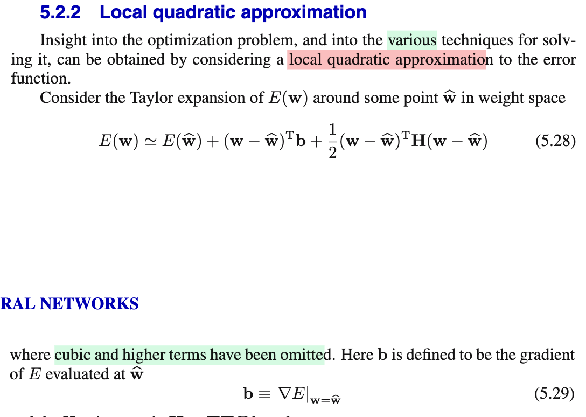

# 5.2.2 Local quadratic approximation

📊 **Progress:** `1` Notes | `10` Screenshots | `1` AI Reviews

---

 

## 5.2.2 Local Quadratic Approximation

<kbd></kbd>

 

### Local Quadratic Approximation

<kbd></kbd>

<kbd></kbd>

<kbd></kbd>

<kbd></kbd>

<kbd></kbd>

<kbd></kbd>

<kbd></kbd>

<kbd></kbd>

<kbd></kbd>

> [!NOTE]
> Xấp xỉ bậc hai:
>
>
>
> trong phạm vi lân cận x0
>
>
>
> f(x) ≈ f(x0) + f'(x0)(x-x0) + (1/2)f''(x0)(x-x0)²
>
>
>
> f(𝐱) ≈ f(𝐱0) + ∇f(𝐱0)ᵀ(𝐱 - 𝐱0) + (1/2)(𝐱-𝐱0)ᵀ∇²f(𝐱0)(𝐱-𝐱0)
>
>
>
> Xấp xỉ bậc hai của E(𝐰) tại 𝐰̂
>
>
>
> E(𝐰) ≈ E(𝐰̂) + ∇E(𝐰̂)ᵀ(𝐰-𝐰̂) + (1/2)(𝐰-𝐰̂)ᵀ∇²E(𝐰̂) (𝐰-𝐰̂)
>
>
>
> ∇E(𝐰̂) = 𝐛, ∇²E(𝐰̂) = 𝐇
>
>
>
> E(𝐰) ≈ E(𝐰̂) + 𝐛ᵀ(𝐰-𝐰̂) + (1/2)(𝐰-𝐰̂)ᵀ𝐇(𝐰-𝐰̂) → 5.28
>
>
>
> ---
>
>
>
> 5.28: E(𝐰) ≈ E(𝐰̂) + ∇E(𝐰̂)ᵀ(𝐰-𝐰̂) + (1/2)(𝐰-𝐰̂)ᵀ∇²E(𝐰̂) (𝐰-𝐰̂)
>
>
>
> Đạo hàm hai vế theo 𝐰, vế trái ta có ∇E(𝐰)
>
>
>
> Xét vế phải: E(𝐰̂) + 𝐇ᵀ(𝐰-𝐰̂) + (1/2)(𝐰-𝐰̂)ᵀ𝐇 (𝐰-𝐰̂)
>
>
>
> ⇔ E(𝐰̂) + 𝐛ᵀ𝐰 - 𝐛ᵀ𝐰̂ + (1/2)(𝐰ᵀ𝐇 - 𝐰̂ᵀ𝐇) (𝐰-𝐰̂)  (nhân phân phối vô)
>
>
>
> ⇔ E(𝐰̂) + 𝐛ᵀ𝐰 - 𝐛ᵀ𝐰̂ + (1/2)(𝐰ᵀ𝐇𝐰 - 𝐰̂ᵀ𝐇𝐰 - 𝐰ᵀ𝐇𝐰̂ + 𝐰̂ᵀ𝐇𝐰̂)
>
>
>
> vì 𝐰̂ᵀ𝐇𝐰 là số vô hướng, nên 𝐰̂ᵀ𝐇𝐰 = (𝐰̂ᵀ𝐇𝐰)ᵀ = 𝐰ᵀ(𝐰̂ᵀ𝐇)ᵀ = 𝐰ᵀ𝐇ᵀ𝐰̂
>
>
>
> .. ⇔ E(𝐰̂) + 𝐛ᵀ𝐰 - 𝐛ᵀ𝐰̂ + (1/2)(𝐰ᵀ𝐇𝐰 - 2𝐰̂ᵀ𝐇𝐰 + 𝐰̂ᵀ𝐇𝐰̂)
>
>
>
> ⇔ E(𝐰̂) + 𝐛ᵀ𝐰 - 𝐛ᵀ𝐰̂ + (1/2)𝐰ᵀ𝐇𝐰 - 𝐰̂ᵀ𝐇𝐰 + (1/2)𝐰̂ᵀ𝐇𝐰̂ 
>
>
>
> ⇔ (1/2)𝐰ᵀ𝐇𝐰 + (𝐛 - 𝐇ᵀ𝐰̂)ᵀ𝐰 + (1/2)𝐰̂ᵀ𝐇𝐰̂ + E(𝐰̂) - 𝐛ᵀ𝐰̂
>
>
>
> Với f(𝐱) = (1/2)𝐱ᵀ𝐏𝐱 + 𝐪ᵀ𝐱 + r, ∇f(𝐱) = 𝐏𝐱 + 𝐪
>
>
>
> nên đạo hàm của vế phải theo 𝐰: 𝐇𝐰 + 𝐛 - 𝐇ᵀ𝐰̂ = 𝐇𝐰 + 𝐛 - 𝐇𝐰̂ = 𝐇(𝐰-𝐰̂) + 𝐛
>
>
>
> Do đó ∇E(𝐰) ≈ 𝐛 + 𝐇(𝐰-𝐰̂) → 5.31
>
>
>
> ---
>
>
>
> Nếu xấp xỉ bậc hai hàm E(𝐰) tại 𝐰\* là local minimum: ∇E(𝐰)|𝐰=𝐰\* = 𝟎
>
>
>
> E(𝐰) ≈ E(𝐰\*) + 𝟎ᵀ(𝐰-𝐰\*) + (1/2)(𝐰-𝐰\*)ᵀ𝐇(𝐰-𝐰\*)
>
>
>
> E(𝐰) ≈ E(𝐰\*) + (1/2)(𝐰-𝐰\*)ᵀ𝐇(𝐰-𝐰\*), 𝐇 = ∇²E(𝐰)|𝐰=𝐰\*
>
>
>
> ---
>
>
>
> 𝐀, λ là eigenvalue eigenvector tương ứng là 𝐮: 𝐀𝐮 = λ𝐮
>
>
>
> 𝐇𝐮i = λi𝐮i
>
>
>
> 𝐇: đối xứng
>
>
>
> Ôn lại:
>
>
>
> 𝐀 đối xứng: đủ n eigenvector độc lập 𝐀 = 𝐒 𝚲 𝐒⁻¹ 
>
>
>
> mà còn luôn có thể chọn được bộ eigenvector trực giao 𝐐 orthogonal matrix:
>
>
>
> 𝐐ᵀ = 𝐐⁻¹ (𝐐ᵀ𝐐 = 𝐐𝐐ᵀ = 𝐈)
>
>
>
> 𝐀 = 𝐒 𝚲 𝐒⁻¹ = 𝐐 𝚲 𝐐ᵀ
>
>
>
> 𝐮iᵀ𝐮j = 0 với i khác j
>
>
>
> 𝐮iᵀ𝐮i = ||𝐮i||² = 1
>
>
>
> 𝐮iᵀ𝐮j = δij = 𝐈\_{i=j}
>
>
>
> ⇒ {𝐮i} là một basis Rⁿ: mọi vector thuộc Rⁿ đều có thể được thể hiện bởi một linear combination của {𝐮i}
>
>
>
> 𝐰 - 𝐰\* = Σi αi 𝐮i
>
>
>
> ---
>
>
>
>
>
>
>
>
>
>
>
>
>
>
>
>
>
>
>
>
>
>
>
>
>
>
>
>
>
>
>
>
>
>
>
>
>
> ---

📹 [Xem video trên YouTube](https://www.youtube.com/watch?v=x2BpZnYr7PU)

> [!TIP]
> 🤖 **AI Check** — 🟢 Pass — ✅ **95/100** · ✓ Move on
>
> Ghi chép rất tốt, trình bày mạch lạc và chính xác từ khai triển Taylor 1 chiều, tổng quát hóa lên hàm nhiều biến và áp dụng chuẩn xác cho hàm lỗi theo tài liệu.
>
> **✓ Strengths**
> - Xây dựng tư duy trực quan rất tốt bằng cách liên kết công thức 1 chiều với trường hợp vector nhiều chiều.
> - Biểu diễn chính xác khai triển Taylor bậc hai của hàm lỗi E(w) quanh điểm ŵ cùng định nghĩa của gradient b và ma trận Hessian H.
>
> **💡 Deeper notes**
> - Khai triển này ngầm giả định hàm lỗi liên tục và khả vi đến cấp hai (lớp C²) trong một lân cận đủ nhỏ quanh điểm ŵ, đồng thời đã bỏ qua các số hạng bậc ba và cao hơn (O(||w - ŵ||³)).

 

