# 5.2 Training

📊 **Progress:** `9` Notes | `20` Screenshots | `9` AI Reviews

---

 

## Section 5.2 Network Training

<kbd></kbd>

<kbd></kbd>

> [!NOTE]
> Đại khái là cho tới giờ ta chỉ đang coi neural network như một general class - một loại hàm phi tuyến chung chung map giữa input 𝐱 và output 𝐲.
>
>
>
> Thì khi xét bài toán đi xác định giá trị tham số của network, ta có thể dùng cách làm đơn giản là coi nó giống như bài toán tìm tham số của hàm đa thức để fit đường cong, như vậy với framework này, ta sẽ đi minimize hàm sum squared error: minimize 𝐰 E(𝐰) (1/2) Σn ||𝐲(𝐰, 𝐱n) - 𝐭n||²
>
>
>
> Tuy vậy, đại khái là ta nên chuẩn bị một góc nhìn khái quát hơn cho việc training neural network bằng cách cho phép output của neural net có một probabilistic interpretation. Tạm hiểu là coi output của neural net đóng vai trò là THAM SỐ của một phân phối xác suất có điều kiện. 
>
>
>
> Ví dụ như cách ta coi y(𝐰,𝐱) là mean của phân phối 𝒩(y(𝐰,𝐱), 1/β) mà ta gỉa định cho T|𝐱 trong bài toán regression vậy.
>
>
>
> Việc này mang đến nhiều lợi ích, cụ thể là sẽ giúp ta rõ hơn trong việc chọn activation function cũng như error function.

> [!TIP]
> 🤖 **AI Check** — 🟢 Pass — ✅ **95/100** · ✓ Move on
>
> Ghi chú rất chính xác, nắm bắt trọn vẹn tư tưởng chuyển tiếp từ góc nhìn hồi quy bình phương tối thiểu sang góc nhìn mô hình xác suất điều kiện.
>
> **✓ Strengths**
> - Nắm rất vững bản chất của 'probabilistic interpretation': output của mạng đóng vai trò là tham số của phân phối xác suất có điều kiện p(t|x).
> - Liên hệ chuẩn xác với ví dụ phân phối chuẩn trong bài toán hồi quy (output là mean μ = y(x, w)).
> - Hiểu đúng mục đích của góc nhìn xác suất: giải thích tự nhiên việc lựa chọn hàm kích hoạt ở tầng ra (output activation) và hàm mất mát (loss/error function) thông qua nguyên lý cực đại hợp lý (Maximum Likelihood).
>
> **💡 Deeper notes**
> - Cụm từ 'output unit nonlinearity' trong sách đề cập cụ thể đến hàm kích hoạt ở tầng đầu ra (output layer activation), ví dụ như hàm đồng nhất cho hồi quy Gauss, hàm sigmoid cho Bernoulli, hay softmax cho phân loại đa lớp, chứ không phải các hàm kích hoạt ở các tầng ẩn (hidden layers).

**🔗 See also:** [Maximum Likelihood Noise Precision](#node-8uvuv10)

 

### Error Function for Regression

<kbd></kbd>

<kbd></kbd>

<kbd></kbd>

> [!NOTE]
> Đầu tiên đại khái là ta bàn qua bài toán regression trước: ý là, training neural network cho bài toán regression. Và lấy ví dụ xét bài toán regression có output scalar: dự đoán scalar target t từ input 𝐱.
>
>
>
> Cũng y như chương 3, ta giả định T|𝐱 \~ 𝒩(μ(𝐱), β⁻¹) với mean là hàm phụ thuộc 𝐱.
>
>
>
> T|𝐱 = 𝒩(y(𝐰, 𝐱), β⁻¹)
>
>
>
> y(𝐰, 𝐱) = 𝐰ᵀΦ(𝐱)
>
>
>
> Inference:
>
>
>
> 𝐰ML, βML
>
>
>
> Predict 
>
>
>
> Và cũng giống như linear model ở chương 3: Ta giả định μ(𝐱) là hàm tuyến tính của 𝐰 và phi tuyến đối với 𝐱 (do basis function): μ(𝐱) = 𝐰ᵀΦ(𝐱) để rồi đi giải bài toán inference: tìm point estimator của μ(𝐱), cũng chính là đi point estimate cho 𝐰 (𝐰ML hay 𝐰MAP). Đồng thời, sau khi có phân phối T|𝐱, theo decision theory, dùng E\[T|𝐱\] để estimate cho gía trị của t dựa trên 𝐱 chính là tối ưu giúp minimize trung bình square loss.
>
>
>
> (mà trong thống kê, regression của T on 𝐱 được định nghĩa cũng chính là E\[T|𝐱\])
>
>
>
> Thì ở đây, hoàn toàn tương tự, ta giả định T|𝐱 \~ 𝒩(μ(𝐱), β⁻¹), và giả định μ(𝐱) là hàm số phi tuyến nào đó của cả 𝐰 và 𝐱: và hàm số này được biểu diễn bởi neural network với output là y(𝐰, 𝐱).
>
>
>
> (và ta cũng dùng E\[T|𝐱\] để predict)
>
>
>
> Như vậy: có thể tóm tắt:
>
>
>
> Linear regression: Giả định T|𝐱 \~ 𝒩(μ(𝐱), β⁻¹) với μ(𝐱) = 𝐰ᵀΦ(𝐱): giả định tâm của 𝒩 là hàm tuyến tính của 𝐰, phi tuyến với 𝐱 thông qua basis function Φ
>
>
>
> Neural net regression: Giả định T|𝐱 \~ 𝒩(μ(𝐱), β⁻¹) với μ(𝐱) = y(𝐰,𝐱): giả định tâm của 𝒩 là hàm phi tuyến của 𝐰 và 𝐱, biễu diễn bởi neural network.
>
>
>
> ---
>
>
>
> (trong 5.6 ta sẽ mở rộng giả định này ra)
>
>
>
> ---
>
>
>
> Tiếp theo một ý cũng dễ hiểu, với bài toán regression: Ta chọn output activation function là identity function là đủ, vì bản thân y = 𝐰ᵀ𝐳 với 𝐰 là tham số của layer cuối, là đủ để có thể cho ra mọi giá trị trên trục số (bài toán regression, mean của normal không bị giới hạn, có thể mang bất kì giá trị nào)
>
>
>
> ---
>
>
>
> Rồi, như vậy, cơ bản như thường lệ, ta giải bài toán inference: estimate tham số của T|𝐱 \~ 𝒩(μ(𝐱), β⁻¹):
>
>
>
> Joint conditional pdf của T1|𝐱1, T2|𝐱2,...
>
>
>
> (chương 3,4 mình luôn xài chữ f thay chữ p - lí do là vì muốn theo convention của sách Casella:Từ chương 5 này mình sẽ dùng p cho giống tác giả, vì cảm thấy sẽ gây bất tiện cho ai theo dõi ghi chú)
>
>
>
> random sample 𝐗 = (X1,X2,..Xn), 𝐱 = 1,2,3,4,5  Xi iid \~ n(μ=8, 1)
>
>
>
> W(𝐱) point estimate cho θ
>
>
>
> L(μ|𝐱) = f(𝐱|μ) = Πi f(xi|μ)
>
>
>
> maximize\_μ L(μ|𝐱) = f(𝐱|μ) = Πi f(xi|μ)
>
>
>
> equivalent maximize\_μ ln L(μ|𝐱) = ln f(𝐱|μ) = ln Πi f(xi|μ) = Σi ln f(xi|μ)
>
>
>
> ---
>
>
>
> p(t1,t2,..tN|𝐱1,𝐱2,..𝐰, β) = Πn p(tn|𝐱n, 𝐰, β)
>
>
>
> = Πn 𝒩(tn|y(𝐱n, 𝐰), β⁻¹)
>
>
>
> Như thường lệ, dùng Maximum Likelihood framework:
>
>
>
> Likelihood L(𝐰, β|data) = p(t1,t2,..tN|𝐱1,𝐱2,..𝐰, β) = Πn 𝒩(tn|y(𝐱n, 𝐰), β⁻¹)
>
>
>
> Log likelihood:
>
>
>
> ln L(𝐰, β|data) = ln Πn 𝒩(tn|y(𝐱n, 𝐰), β⁻¹)
>
>
>
> = Σn ln 𝒩(tn|y(𝐱n, 𝐰), β⁻¹)
>
>
>
> = Σn ln \[1/√(2πβ⁻¹) exp\[-(tn-y(𝐱n, 𝐰))²/2β⁻¹\]
>
>
>
> = Σn ln \[1/√(2πβ⁻¹)\] + Σn ln exp\[-(tn-y(𝐱n, 𝐰))²/2β⁻¹\]
>
>
>
> = Σn ln \[1/√(2πβ⁻¹)\] + Σn \[-(tn-y(𝐱n, 𝐰))²/2β⁻¹\]
>
>
>
> = Σn ln \[1/√(2πβ⁻¹)\] - (β/2) Σn \[(tn-y(𝐱n, 𝐰))²\]
>
>
>
> = Σn ln \[(2πβ⁻¹)^(-1/2)\] - (β/2) Σn \[(tn-y(𝐱n, 𝐰))²\]
>
>
>
> = Σn (-1/2) ln \[(2πβ⁻¹)\] - (β/2) Σn \[(tn-y(𝐱n, 𝐰))²\]
>
>
>
> = (-1/2) Σn ln (2π) + (-1/2) Σn ln(β⁻¹) - (β/2) Σn \[(tn-y(𝐱n, 𝐰))²\]
>
>
>
> = (-1/2) Σn ln (2π) + (1/2) Σn ln(β) - (β/2) Σn \[(tn-y(𝐱n, 𝐰))²\]
>
>
>
> = (-1/2) N ln (2π) + (1/2) N ln(β) - (β/2) Σn \[(tn-y(𝐱n, 𝐰))²\]
>
>
>
> (negative log likelihood: (1/2) N ln (2π) - (1/2) N ln(β) + (β/2) Σn \[(tn-y(𝐱n, 𝐰))²\])
>
>
>
> Bài toán tối ưu để tìm MLE của 𝐰 và β:
>
>
>
> maximize\_ 𝐰, β Likelihood
>
>
>
> Giải tìm 𝐰 trước, coi β fix:
>
>
>
> maximize\_ 𝐰 Likelihood
>
>
>
> bài toán tương đương: maximize\_ 𝐰 ln Likelihood
>
>
>
> tương đương tiếp bằng cách bỏ hằng số và β là scalar dương:
>
>
>
> maximize\_ 𝐰 {-(1/2) Σn \[(tn-y(𝐱n, 𝐰))²\]}
>
>
>
> minimize\_ 𝐰 {(1/2) Σn \[(tn-y(𝐱n, 𝐰))²\]} → 5.14
>
>
>
> (ở đây tác gỉa nói thêm trong neural net, ta thường minimize hàm loss thay vì maximize ln likelihood, mà về khía cạnh bài toán tối ưu thì chuyện từ maximize hàm objective thành minimize hàm negative objective là bình thường. và một lần nữa mình lại thấy: minimize sum squared error chính là maximize likelihood)
>
>
>
> Và giả cái này, ta sẽ được đương nhiên chính là MLE của 𝐰, nên kí hiệu nó là 𝐰ML.
>
>
>
> Tác giả chỉ lưu ý, không giống như linear regression, khi ta có y = 𝐰ᵀΦ(𝐱), thì khi đó error function là quadratic function của 𝐰, nên bài toán tối ưu này có closed form solution, cũng là bài toán convex
>
>
>
> còn ở đây, y là hàm phi tuyến của 𝐰, nên nó sẽ non-convex, mà như vậy, tìm ra local minimum (của error function, cũng là local maximum của likelihood) chưa chắc là global minimum

📹 [Xem video trên YouTube](https://www.youtube.com/watch?v=LfNYAOHXklE)

> [!TIP]
> 🤖 **AI Check** — 🟢 Pass — ✅ **98/100** · ✓ Move on
>
> Ghi chú xuất sắc, hiểu sâu bản chất thống kê của bài toán hồi quy dùng neural network và tự triển khai chi tiết từng bước biến đổi đại số từ likelihood sang sum-of-squares error.
>
> **✓ Strengths**
> - Liên kết rất tốt với kiến thức lý thuyết quyết định (decision theory) và hồi quy tuyến tính từ Chương 3 (sử dụng E[T|x] để tối ưu hóa kỳ vọng bình phương sai số).
> - Tự diễn giải chi tiết từng bước đại số từ hàm mật độ Gauss sang hàm hợp lý (likelihood), log-likelihood và dẫn đến hàm mục tiêu sum-of-squares (5.14).
> - Phân biệt chính xác lý do dẫn đến tính phi lồi (non-convexity) và cực trị địa phương (local minima) giữa neural network và hồi quy tuyến tính.
>
> **💡 Deeper notes**
> - Về việc chọn identity activation function cho output: Ngoài việc giúp output nhận bất kỳ giá trị thực nào trên $(-\infty, \infty)$ để làm mean cho phân phối chuẩn, sách còn nhấn mạnh tính chất mạng neural với output tuyến tính có khả năng xấp xỉ bất kỳ hàm liên tục nào từ $\mathbf{x}$ sang $y$ (theo định lý Universal Approximation).

**🔗 See also:** [Linear Regression and Conditional Expectation *(Statistical Inference - Casella)*](../statistical_inference_casella/113_simple_linear_regression.md#node-5swaigg)

 

#### Maximum Likelihood Noise Precision

<kbd>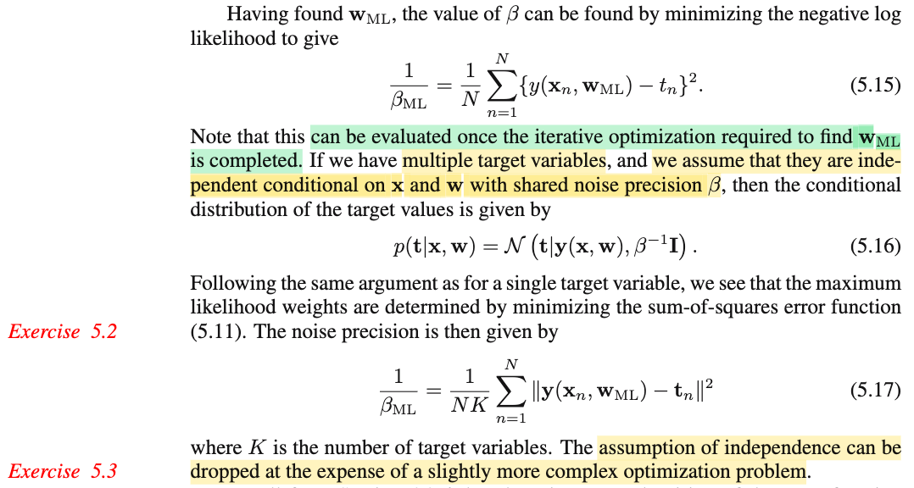</kbd>

<kbd>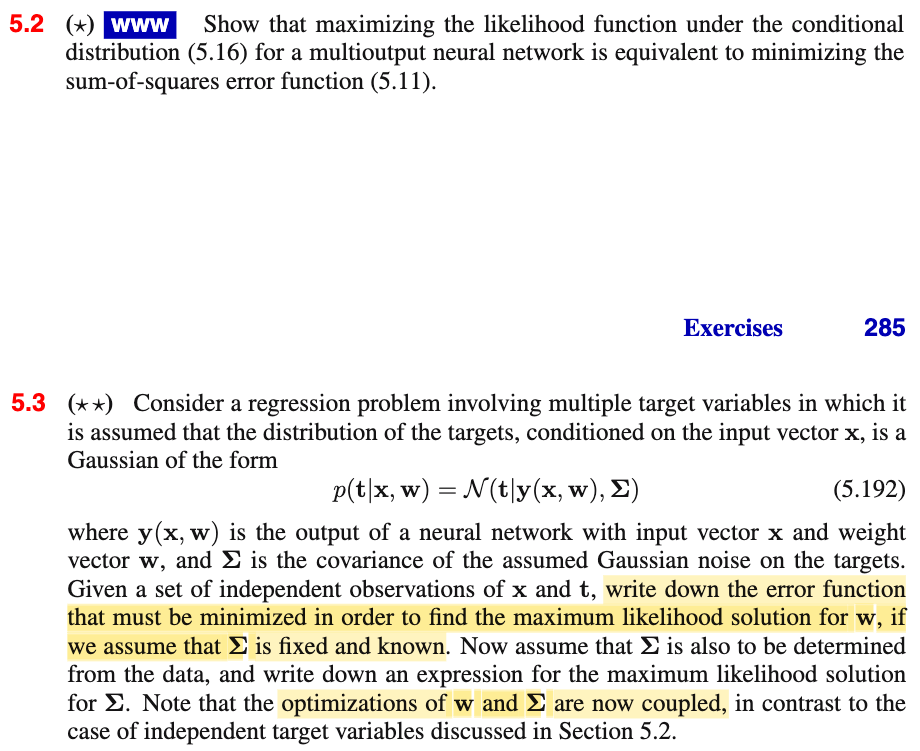</kbd>

> [!NOTE]
> Sau khi tìm được 𝐰ML, ta tìm βML:
>
>
>
> maximize over β {(-1/2) N ln (2π) + (1/2) N ln(β) - (β/2) Σn \[(tn-y(𝐱n, 𝐰ML))²\]}
>
>
>
> equivalent
>
>
>
> maximize over β {(1/2) N ln(β) - (β/2) Σn \[(tn-y(𝐱n, 𝐰ML))²\]}
>
>
>
> d/dβ {(1/2) N ln(β) - (β/2) Σn \[(tn-y(𝐱n, 𝐰ML))²\]} = d/dβ \[(1/2) N ln(β)\] - d/dβ (β/2) Σn \[(tn-y(𝐱n, 𝐰ML))²\]}
>
>
>
> = (1/2) N (1/β) - (1/2) Σn \[(tn-y(𝐱n, 𝐰ML))²\]}
>
>
>
> = N/2β - (1/2) Σn \[(tn-y(𝐱n, 𝐰ML))²\]}
>
>
>
> Cho bằng 0 tìm điểm dừng: N/2β - (1/2) Σn \[(tn-y(𝐱n, 𝐰ML))²\] = 0 ⇔ N/2β = (1/2) Σn \[(tn-y(𝐱n, 𝐰ML))²\]
>
>
>
> ⇔ 1/β = (1/N) Σn \[(tn-y(𝐱n, 𝐰ML))²\]
>
>
>
> Như vậy 1/βML (cũng là MLE của phương sai) là (1/N) Σn \[(tn-y(𝐱n, 𝐰ML))²\] → 5.15
>
>
>
> ---
>
>
>
> Nếu ta có bài toán multiple target, tức T bây giờ là vector, giả sử là R³ vector đi (tức là cho K = 3) cho dễ:
>
>
>
> 𝐓 = (T1, T2,T3)ᵀ, đồng thời ta giả định rằng: Ti|𝐱 \~ 𝒩(μi(𝐱), 1/β) và giả định 𝛍(𝐱) = (μ1(𝐱), μ2(𝐱),...)ᵀ là hàm số vector - vector phi tuyến theo 𝐰, 𝐱 biểu diễn bởi neural network có đầu ra là (vector) y(𝐰, 𝐱), và giả định thêm nữa là T1|𝐱, T2|𝐱,T3|𝐱 độc lập.
>
>
>
> Chú ý, lúc này, data set là N cặp (vector 𝐱, vector 𝐭): (𝐱1, 𝐭1),(𝐱2, 𝐭2),....(𝐱N, 𝐭N). là giá trị quan sát được của N random VECTOR 𝐓: 𝐓1|𝐱1, 𝐓2|𝐱2,...𝐓N|𝐱N. Trong đó pdf của 𝐓i|𝐱i sẽ là như sau đây (và sau đó ta mới nói về joint pdf của toàn bộ N random vector 𝐓i: 𝐓1|𝐱1, 𝐓2|𝐱2,...𝐓N|𝐱N)
>
>
>
> Nhấn mạnh ở đây nói joint pdf, nhưng là của 3 biến scalar T1,T2,T3 phần tử của random vector 𝐓 (ví dụ như cái 𝐓1|𝐱1 trong bộ dataset có N random vector nói trên, tí nữa ta mới nói joint pdf của N cái random vector 𝐓 này)
>
>
>
> Xét joint pdf của T1,T2,T3 conditioned on 𝐱:
>
>
>
> p(t1,t2,t3|𝐱,𝐰), do ta đang giả định tính độc lập của T1|𝐱, T2|𝐱, T3|𝐱 = Πi=1:3 𝒩(ti|μi(𝐱), 1/β)
>
>
>
> = Πi=1,2,3 (1/√2πβ⁻¹) exp\[-(ti-μi(𝐱))²/2β⁻¹\]
>
>
>
> = (1/√2πβ⁻¹)³ Πi=1,2,3 exp\[-(ti-μi(𝐱))²/2β⁻¹\]
>
>
>
> = (1/√2πβ⁻¹)³ exp\[-Σi=1,2,3 (ti-μi(𝐱))²/2β⁻¹\]
>
>
>
> = (1/√2πβ⁻¹)³ exp\[-(β/2) Σi=1,2,3 (ti-μi(𝐱))²\]
>
>
>
> Xét Σi=1,2,3 (ti-μi(𝐱))², nó chính là ||(𝐭-𝛍(𝐱)||², cũng là (𝐭-𝛍(𝐱))ᵀ(𝐭-𝛍(𝐱))
>
>
>
> = (1/√2πβ⁻¹)³ exp\[-(β/2) (𝐭-𝛍(𝐱)ᵀ(𝐭-𝛍(𝐱)\]
>
>
>
> = (1/√2πβ⁻¹)³ exp\[-(1/2) (𝐭-𝛍(𝐱)ᵀβ(𝐭-𝛍(𝐱)\]
>
>
>
> = (1/√2πβ⁻¹)³ exp\[-(1/2) (𝐭-𝛍(𝐱)ᵀβ𝐈(𝐭-𝛍(𝐱)\]
>
>
>
> Mà β𝐈 = \[(1/β)𝐈\]⁻¹
>
>
>
> = (1/√2πβ⁻¹)³ exp\[-(1/2) (𝐭-𝛍(𝐱)ᵀ\[(1/β)𝐈\]⁻¹(𝐭-𝛍(𝐱)\]
>
>
>
> = (1/√2π)³ 1/√(β⁻¹)³ exp\[-(1/2) (𝐭-𝛍(𝐱)ᵀ\[(1/β)𝐈\]⁻¹(𝐭-𝛍(𝐱)\]
>
>
>
> = (1/√2π)³ 1/√(β⁻¹)³ exp\[-(1/2) (𝐭-𝛍(𝐱)ᵀ\[(1/β)𝐈\]⁻¹(𝐭-𝛍(𝐱)\]
>
>
>
> Xét matrix (1/β)𝐈, có đường chéo là 1/β,1/β,1/β, det của nó chính là (1/β)³ = (β⁻¹)³
>
>
>
> = (1/√2π)³ (1/√|det ((1/β)𝐈)| exp\[-(1/2) (𝐭-𝛍(𝐱))ᵀ\[(1/β)𝐈\]⁻¹(𝐭-𝛍(𝐱)\]
>
>
>
> Xem lại link của pdf normal đa biến: 𝒩(𝐱|𝛍, 𝚺) = \[(2π)^-D/2\] \[1/|𝚺|^1/2\] exp\[-(𝐱 - **μ**)ᵀ𝚺⁻¹(𝐱 - μ)/2\]
>
>
>
> đây chính là pdf của multivariate normal 𝒩(𝛍(𝐱), (1/β)𝐈) = 𝒩(y(𝐰, 𝐱), (1/β)𝐈) → 5.16
>
>
>
> ---
>
>
>
> Như đã nói, đây mới chỉ là pdf của random vector 𝐓|𝐱 (ví dụ 𝐓1|𝐱1 trong đám 𝐓1|𝐱1, 𝐓2|𝐱2,..𝐓N|𝐱N), mà bản thân nó là joint pdf của T1|𝐱, T2|𝐱, T3|𝐱
>
>
>
> Giờ ta mới xét joint pdf của 𝐓1|𝐱1, 𝐓2|𝐱2,..𝐓N|𝐱N, để xây dựng likelihood:
>
>
>
> p(𝐭1,𝐭2,..𝐭N|𝐱1,..𝐱N,𝐰,β) = Πn=1:N p(𝐭n|𝐱n,𝐰,β) (do các data point độc lập)
>
>
>
> = Πn=1:N 𝒩(𝐭n| y(𝐰, 𝐱n), (1/β)𝐈)
>
>
>
> likelihood: L(𝐰, β|𝐭1,𝐭2,..𝐭N,𝐱1,..𝐱N) theo định nghĩa cũng chính là hàm joint pdf trên (nhưng với tư cách là hàm số của 𝐰, β)
>
>
>
> ln likelihood: ln L(𝐰, β|𝐭1,𝐭2,..𝐭N,𝐱1,..𝐱N) = ln Πn=1:N 𝒩(𝐭n | 𝛍n(𝐱)=y(𝐰, 𝐱n), (1/β)𝐈) (1)
>
>
>
> = Σn=1:N ln 𝒩(𝐭n| y(𝐰, 𝐱n), (1/β)𝐈)
>
>
>
> = Σn=1:N ln { (1/√2π)³ (1/√|det ((1/β)𝐈)| exp\[-(1/2) (𝐭n-𝛍n(𝐱))ᵀ\[(1/β)𝐈\]⁻¹(𝐭n-𝛍n(𝐱)\] }
>
>
>
> = Σn=1:N { ln (1/√2π)³ + ln (1/√|det ((1/β)𝐈)| + ln exp \[-(1/2) (𝐭n-𝛍n(𝐱))ᵀ\[(1/β)𝐈\]⁻¹(𝐭n-𝛍n(𝐱)\] }
>
>
>
> = Σn=1:N ln (1/√2π)³ + Σn=1:N ln (1/√|det ((1/β)𝐈)| + Σn=1:N { ln exp \[-(1/2) (𝐭n-𝛍n(𝐱)ᵀ\[(1/β)𝐈\]⁻¹(𝐭n-𝛍n(𝐱)\] }
>
>
>
> = const + Σn=1:N ln (1/√(β⁻¹)³ + Σn=1:N \[-(1/2) (𝐭n-𝛍n(𝐱)ᵀβ(𝐭n-𝛍n(𝐱)\]
>
>
>
> = const + Σn=1:N ln ((β⁻¹)^(-3/2)) - (β/2) Σn=1:N \[ (𝐭n-𝛍n(𝐱)ᵀ(𝐭n-𝛍n(𝐱)\]
>
>
>
> = const - (3/2) Σn=1:N ln (β⁻¹) - (β/2) Σn=1:N ||𝐭n-𝛍n(𝐱)||²
>
>
>
> = const - (3/2) Σn=1:N ln (β⁻¹) - (β/2) Σn=1:N ||𝐭n - y(𝐰, 𝐱n)||²
>
>
>
> = const + (3N/2) ln (β) - (β/2) Σn=1:N ||𝐭n - y(𝐰, 𝐱n)||²
>
>
>
> ---
>
>
>
> Tới đây có thể thấy, đi tìm 𝐰ML của bài toán regression với t là vector này: thì cũng lại chính là chuyển thành bài toán tương đương:
>
>
>
> maximize - (β/2) Σn=1:N ||𝐭n - y(𝐰, 𝐱n)||²
>
>
>
> equivalent minimize (1/2) Σn=1:N ||𝐭n - y(𝐰, 𝐱n)||² → chính là 5.11
>
>
>
> (coi như ta giải xong ex 5.2)
>
>
>
> Tương tự ta giải bài toán này có 𝐰ML, xong giải tiếp tìm βML
>
>
>
> Và lấy đạo hàm theo β để tìm βML:
>
>
>
> d/dβ ( (3N/2) ln (β) - (β/2) Σn=1:N ||𝐭n - y(𝐰ML, 𝐱n)||²)
>
>
>
> = (3N/2) (1/β) - (1/2) Σn=1:N ||𝐭n - y(𝐰ML, 𝐱n)||²
>
>
>
> cho bằng 0: (3N/2) (1/β) - (1/2) Σn=1:N ||𝐭n - y(𝐰ML, 𝐱n)||² = 0
>
>
>
> ⇔ (3N/2) (1/β) = (1/2) Σn=1:N ||𝐭n - y(𝐰ML, 𝐱n)||²
>
>
>
> ⇔ (1/β) = 1/(3N) Σn=1:N ||𝐭n - y(𝐰ML, 𝐱n)||²
>
>
>
> 3 ở đây chính là K (ở trên ta đặt K = 3)
>
>
>
> ⇔ (1/β) = 1/(NK) Σn=1:N ||𝐭n - y(𝐰ML, 𝐱n)||² → 5.17
>
>
>
> ---
>
>
>
>  Làm bài 5.3 luôn:
>
>
>
> Theo đó thay vì ta có p(𝐭|𝐱,𝐰) = 𝒩(𝐭|y(𝐰, 𝐱), (1/β)𝐈) thì nay ta có p(𝐭|𝐱,𝐰) = 𝒩(𝐭| y(𝐰, 𝐱), 𝚺)
>
>
>
> Tiếp nối luôn từ (1)
>
>
>
> ln L(𝐰, 𝚺|𝐭1,𝐭2,..𝐭N,𝐱1,..𝐱N) = ln Πn=1:N 𝒩(𝐭n | 𝛍n(𝐱)=y(𝐰, 𝐱n), 𝚺)
>
>
>
> = Σn=1:N ln 𝒩(𝐭n| y(𝐰, 𝐱n), 𝚺)
>
>
>
> Thay pdf normal đa biến ở trên vô
>
>
>
> = Σn=1:N ln {\[(2π)^-K/2\] \[1/|𝚺|^1/2\] exp\[-(𝐭n - y(𝐰, 𝐱n))ᵀ𝚺⁻¹(𝐭n - y(𝐰, 𝐱n))/2\]}
>
>
>
> = Σn=1:N ln \[(2π)^-K/2\] + Σn=1:N ln \[1/|𝚺|^1/2\] + Σn=1:N ln exp\[-(𝐭n - y(𝐰, 𝐱n))ᵀ𝚺⁻¹(𝐭n - y(𝐰, 𝐱n))/2\]
>
>
>
> = Σn=1:N (-K/2) ln (2π) + Σn=1:N (-1/2) ln |𝚺| + Σn=1:N \[-(𝐭n - y(𝐰, 𝐱n))ᵀ𝚺⁻¹(𝐭n - y(𝐰, 𝐱n))/2\]
>
>
>
> = (-NK/2) ln (2π) - (N/2) ln |𝚺| -(1/2) Σn=1:N \[(𝐭n - y(𝐰, 𝐱n))ᵀ𝚺⁻¹(𝐭n - y(𝐰, 𝐱n))\]
>
>
>
> Để tìm MLE của 𝐰: giải bài toán maximize likelihood, tương đương:
>
>
>
> maximize\_𝐰 {-(1/2) Σn=1:N \[(𝐭n - y(𝐰, 𝐱n))ᵀ𝚺⁻¹(𝐭n - y(𝐰, 𝐱n))\]}
>
>
>
> tương đương tiếp:
>
>
>
> minimize\_𝐰 {(1/2) Σn=1:N \[(𝐭n - y(𝐰, 𝐱n))ᵀ𝚺⁻¹(𝐭n - y(𝐰, 𝐱n))\]}
>
>
>
> Tạm thời thoát vai 𝐓 là random vector, mượn lại chữ 𝐓 để chỉ matrix có các cột là 𝐭1,..𝐭N, và 𝐘 là matrix có các cột là y(𝐰, 𝐱1),...y(𝐰, 𝐱N) thì objective này chính là: (1/2)tr\[(𝐓 - 𝐘)ᵀ𝚺⁻¹(𝐓 - 𝐘)\]
>
>
>
> (vì hàng n của (𝐓 - 𝐘)ᵀ𝚺⁻¹ chính là \[𝐭n - y(𝐰, 𝐱n)\]ᵀ 𝚺⁻¹
>
>
>
> nên (𝐓 - 𝐘)ᵀ𝚺⁻¹ (𝐓 - 𝐘) có phần tử nn là \[𝐭n - y(𝐰, 𝐱n)\]ᵀ 𝚺⁻¹ \[𝐭n - y(𝐰, 𝐱n)\]
>
>
>
> nên tr\[(𝐓 - 𝐘)ᵀ𝚺⁻¹ (𝐓 - 𝐘)\] chính là Σn \[𝐭n - y(𝐰, 𝐱n)\]ᵀ 𝚺⁻¹ \[𝐭n - y(𝐰, 𝐱n)\])
>
>
>
> Nếu như 𝚺 fix, bài toán là minimize (1/2)tr\[(𝐓 - 𝐘)ᵀ𝚺⁻¹(𝐓 - 𝐘)\] theo 𝐰, giải tìm 𝐰ML
>
>
>
> Nếu ngược lại, đương nhiên cần minimize 𝐰, 𝚺 {(N/2) ln |𝚺| + (1/2) Σn=1:N \[(𝐭n - y(𝐰, 𝐱n))ᵀ𝚺⁻¹(𝐭n - y(𝐰, 𝐱n))\]}, giải tìm 𝐰ML, 𝚺ML
>
>
>
> = (N/2) ln |𝚺| + (1/2) tr\[(𝐓 - 𝐘)ᵀ𝚺⁻¹(𝐓 - 𝐘)\]
>
>
>
> = (N/2) ln |𝚺| + (1/2) tr\[𝚺⁻¹(𝐓 - 𝐘)(𝐓 - 𝐘)ᵀ\]
>
>
>
> |𝚺| = 1/ |𝚺⁻¹| = (|𝚺⁻¹|)⁻¹
>
>
>
> = (N/2) ln |𝚺⁻¹|⁻¹ + (1/2) tr\[𝚺⁻¹(𝐓 - 𝐘)(𝐓 - 𝐘)ᵀ\]
>
>
>
> = (-N/2) ln |𝚺⁻¹| + (1/2) tr\[𝚺⁻¹(𝐓 - 𝐘)(𝐓 - 𝐘)ᵀ\]
>
>
>
> Và để có công thức tính 𝚺⁻¹\_ML (nghịch đảo của nó chính là 𝚺\_ML) ta lấy đạo hàm theo 𝚺⁻¹:
>
>
>
> d/d(𝚺⁻¹) ln |𝚺⁻¹| = ((𝚺⁻¹)⁻¹)ᵀ = 𝚺ᵀ = 𝚺
>
>
>
> d/d𝚺⁻¹ \[tr\[𝚺⁻¹(𝐓 - 𝐘)(𝐓 - 𝐘)ᵀ\]\]
>
>
>
> = \[(𝐓 - 𝐘)(𝐓 - 𝐘)ᵀ\]ᵀ
>
>
>
> = (𝐓 - 𝐘)(𝐓 - 𝐘)ᵀ
>
>
>
> Vậy d/d𝚺⁻¹ \[(-N/2) ln |𝚺⁻¹| + (1/2) tr\[(𝐓 - 𝐘)(𝐓 - 𝐘)ᵀ𝚺⁻¹\]\]
>
>
>
> = (-N/2) 𝚺 + (1/2) (𝐓 - 𝐘)(𝐓 - 𝐘)ᵀ
>
>
>
> Cho bằng 0: (-N/2) 𝚺 + (1/2) (𝐓 - 𝐘)(𝐓 - 𝐘)ᵀ = 0
>
>
>
> ⇔ 𝚺 = (1/N) (𝐓 - 𝐘)(𝐓 - 𝐘)ᵀ

📹 [Xem video trên YouTube](https://www.youtube.com/watch?v=COfLYidpH6w)

> [!TIP]
> 🤖 **AI Check** — 🟢 Pass — ✅ **98/100** · ✓ Move on
>
> Ghi chú xuất sắc, giải chi tiết và trọn vẹn từ việc thiết lập phân phối nhiều chiều đến đạo hàm ma trận trong Bài 5.2 và Bài 5.3.
>
> **✓ Strengths**
> - Thiết lập bài toán từ trường hợp cụ thể (K = 3) để hiểu bản chất phân phối chuẩn nhiều chiều trước khi tổng quát hóa rất rõ ràng.
> - Biến đổi và chứng minh tương đương giữa bài toán cực đại hợp lý (MLE) và hàm mất mát bình phương tối thiểu (5.11) chính xác.
> - Sử dụng khéo léo biến phụ trace và đạo hàm ma trận theo nghịch đảo ma trận hiệp phương sai để giải bài tập 5.3.
>
> **💡 Deeper notes**
> - Sự ràng buộc (coupled) giữa w và Σ trong Bài 5.3: do Σ⁻¹ nằm xen kẽ giữa sai số từng mẫu, ta không thể tách riêng bài toán tối ưu w ra độc lập với Σ như trong trường hợp nhiễu đẳng hướng (Σ = β⁻¹I). Trong thực tế, điều này đòi hỏi tối ưu luân phiên (alternating optimization) hoặc giải đồng thời.
> - Về mặt giải tích ma trận, do Σ (và Σ⁻¹) là ma trận đối xứng, khi lấy đạo hàm chuẩn tắc cần lưu ý tính đối xứng, tuy nhiên vì (𝐓 - 𝐘)(𝐓 - 𝐘)ᵀ cũng là ma trận đối xứng nên kết quả điểm dừng vẫn hoàn toàn bảo toàn.

**🔗 See also:** [PDF Gaussian Đa Biến](./124_the_gaussian_distribution.md#node-40ke7sj) · [Section 5.2 Network Training](#node-sk6e97t) · [Đạo hàm Trace Ma trận](./appendix_c_matrices.md#node-0oculhd) · [Đạo hàm hàm vết ma trận](./appendix_c_matrices.md#node-f8fc5lg)

 

##### Error Function Derivative for Regression

<kbd>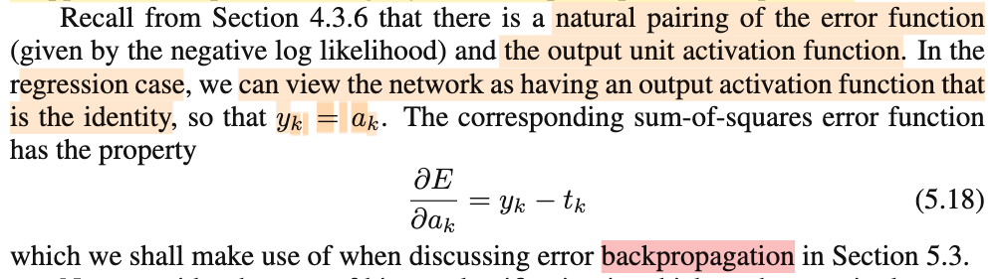</kbd>

> [!NOTE]
> (1/2) Σn=1:N ||𝐭n - y(𝐰, 𝐱n)||
>
>
>
> E(𝐰) của 1 điểm data là (1/2) ||𝐭 - y(𝐰, 𝐱)|| = (1/2) \[𝐭 - y(𝐰, 𝐱)\]ᵀ\[𝐭 - y(𝐰, 𝐱)\]
>
>
>
>  = (1/2) (𝐭 - 𝐲)ᵀ(𝐭 - 𝐲)
>
>
>
> = (1/2) Σi=1:K (ti-yi)²
>
>
>
> ∂/∂yk = ∂/∂yk \[(1/2) Σi=1:K (ti-yi)²\] 
>
>
>
> = (1/2) Σi=1:K ∂/∂yk (ti-yi)²
>
>
>
> = (1/2) Σi=1:K,i≠k ∂/∂k (ti-yi)² + (1/2) ∂/∂yk (tk-yk)²
>
>
>
> = -(1/2) 2(tk-yk)
>
>
>
> = yk - tk
>
>
>
> Và vì yk = ak do neural network dùng output activation function là identity
>
>
>
> nên ∂/∂ak E = yk - tk

> [!TIP]
> 🤖 **AI Check** — 🟡 Minor issues — ✅ **90/100** · ✓ Move on
>
> Ghi chú rất tốt, bạn đã tự suy dẫn chi tiết từng bước đạo hàm của hàm lỗi sum-of-squares theo activation $a_k$ thay vì chỉ thừa nhận công thức trong sách. Chỉ có vài lỗi ký hiệu nhỏ không làm ảnh hưởng đến bản chất.
>
> **🟡 Minor issues**
>
> **1.** *"(1/2) ||𝐭 - y(𝐰, 𝐱)|| = (1/2) [𝐭 - y(𝐰, 𝐱)]ᵀ[𝐭 - y(𝐰, 𝐱)]"*
>
> Ký hiệu chuẩn vector bị thiếu số mũ 2 (chuẩn bình phương). Ký hiệu chuẩn xác nên là ||𝐭 - y(𝐰, 𝐱)||².
>
> **2.** *"(1/2) Σi=1:K,i≠k ∂/∂k (ti-yi)²"*
>
> Gõ thiếu biến lấy đạo hàm ở mẫu số, viết đúng phải là ∂/∂yk thay vì ∂/∂k.
>
>
> **✓ Strengths**
> - Tự triển khai tường minh phép đạo hàm của hàm lỗi một mẫu theo y_k rất mạch lạc và chính xác.
> - Kết nối chính xác việc output activation function là identity (y_k = a_k) với đạo hàm cuối cùng ∂E/∂a_k = y_k - t_k.
>
> **💡 Deeper notes**
> - Cần lưu ý phân biệt giữa hàm lỗi tổng trên toàn bộ tập dữ liệu E và hàm lỗi của một điểm dữ liệu En; công thức bạn dẫn ra là cho một điểm dữ liệu, vốn thường dùng trực tiếp trong lan truyền ngược (stochastic/online backpropagation).

 

###### Binary Classification and Logistic Sigmoid

<kbd>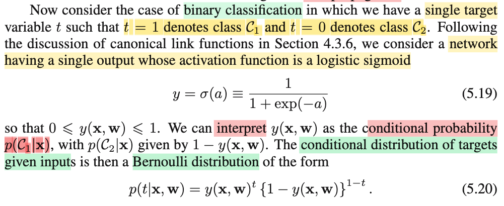</kbd>

<kbd>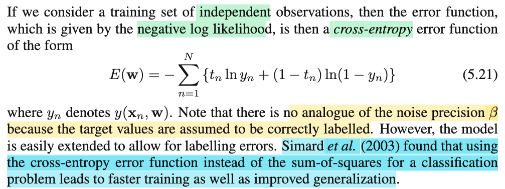</kbd>

> [!NOTE]
> Qua bài toán binary classification:
>
>
>
> Tóm tắt chút đại ý, như chapter 4 đã thấy rằng nếu như **giả định class conditional density là phân phối exponential family với cùng scale param với mọi class**. Thì khi đó: 
>
>
>
> p(𝒞|𝐱) = p(𝐱, 𝒞)/p(𝐱) = p(𝐱|𝒞)p(𝒞)/p(𝐱)
>
>
>
> **class posterior** p(𝒞|𝐱) (tức P(T=1|𝐱) sẽ **đều có dạng generalize linear model**: sigmoid của một linear function của tham số 𝐰 và transformed feature: σ(𝐰ᵀΦ(𝐱) + w0).
>
>
>
> (Mà điển hình trước đó, gỉa định class conditional density là 𝒩(𝛍k, 𝚺) tức cũng là chung scale, chỉ khác nhau location.)
>
>
>
> Thành ra qua ta qua logistic regression, ta **giả định trực tiếp class posterior pmf** là P(T=1|𝐱) = σ(𝐰ᵀΦ(𝐱)+w0).
>
>
>
> Vậy thì tiếp nối như vậy, nay ta sẽ **giả định class posterior probability** là có dạng của **logistic sigmoid áp lên một hàm phi tuyến của 𝐰 và 𝐱, ĐẠI DIỆN HÀM NÀY BỞI NEURAL NETWORK:**
>
>
>
> P(T=1|𝐱) = y(𝐰,𝐱)
>
>
>
> với  y(𝐰,𝐱) là output của neural network có output activation function là sigmoid, 
>
>
>
> Như vậy và output đóng vai trò là class posterior p(𝒞1|𝐱,𝐰) = P(T=1|𝐱,𝐰) = y = σ(a) = σ(𝐰⁽²⁾ᵀ𝐳 + w⁽²⁾0)
>
>
>
> ---
>
>
>
> Như vậy **nói đầy đủ giả định** sẽ là:
>
>
>
> Xét các data point (𝐱1, t1),...(𝐱N, tN) độc lập thì t1,t2,...tN là các observed value của T1|𝐱1, T2|𝐱2,....TN|𝐱N trong đó, Ti|𝐱i \~ Bernouilly(y(𝐰,𝐱i)) với y(𝐰,𝐱i) hàm phi tuyến của 𝐰 và 𝐱i thể hiện bởi neural network, với output activation function là sigmoid.
>
>
>
> (vs trong logistic regression, ta giả định t1,t2,...tN là các observed value của T1|𝐱1, T2|𝐱2,....TN|𝐱N trong đó Ti|𝐱i \~ Bernouilly(y(𝐰,𝐱)) và y(𝐰,𝐱) là sigmoid của hàm tuyến tính của 𝐰 và Φ(𝐱): 𝐰ᵀΦ(𝐱))
>
>
>
> ---
>
>
>
> Và ta sẽ đi giải bài toán inference: Point estimate tham số của (các) phân phối Bern (tức y(𝐰,𝐱i)) cũng là estimate tham số 𝐰 của neural net, bằng cách tíêp cận điển hình của Frequentist: Maximum Likelihood.
>
>
>
> Theo định nghĩa likelihood đã nói nhiều lần, là hàm của tham số của population, ở đây chính là xác suất Ti=1, nhưng vì ta tham số nó theo 𝐰, nên nó trở thành likelihood của 𝐰.
>
>
>
> Và định nghĩa nói rằng ý nghĩa của nó là hàm nhận 1 giá trị của tham số và trả ra mức độ hợp lí của tham số khi muốn giải thích cho dữ liệu quan sát được. Và độ lớn thì chính là bằng joint pdf/pmf của T1,...TN tại observed value.
>
>
>
> Joint pmf của T1|𝐱1,....TN|𝐱N:
>
>
>
> P(T1=t1,...TN=tn|𝐱1,..𝐱N,𝐰) = p(t1,t2,...tn|𝐱1,...𝐱N,𝐰)
>
>
>
> do tính độc lập của T1|𝐱1,T2|𝐱2,...nên
>
>
>
> .. = Πn=1:N p(tn|𝐱n,𝐰)
>
>
>
> = Πn=1:N Bern(tn|y(𝐱n,𝐰))
>
>
>
> Nhớ lại pmf của Bern(p): P(X=1) = p, P(X=0) = 1-p, P(X=x) = p^x (1-p)^(1-x)
>
>
>
> = Πn=1:N \[y(𝐱n,𝐰)^tn\]\[(1-y(𝐱n,𝐰))^(1-tn)\] → Likelihood L(𝐰|data)
>
>
>
> ---
>
>
>
> Maximize over 𝐰 Likelihood
>
>
>
> Và coi nó như hàm theo 𝐰 thì chính là likelihood của 𝐰.
>
>
>
> Như thường lệ, để maximize lielihood ta sẽ chuỷen thành bài toán tương đương với objective là ln likelihood:
>
>
>
> ln likelihood: ln {Πn=1:N \[y(𝐱n,𝐰)^tn\]\[(1-y(𝐱n,𝐰))^(1-tn)\]}
>
>
>
> (ln(ab) = ln a + ln b)
>
>
>
> = Σn=1:N ln\[y(𝐱n,𝐰)^tn\]\[(1-y(𝐱n,𝐰))^(1-tn)\]
>
>
>
> = Σn=1:N ln\[y(𝐱n,𝐰)^tn\] + ln \[(1-y(𝐱n,𝐰))^(1-tn)\]
>
>
>
> = Σn=1:N tn ln\[y(𝐱n,𝐰)\] + (1-tn) ln \[(1-y(𝐱n,𝐰)\] | ln a^x = x ln a
>
>
>
> = Σn=1:N tn ln y(𝐱n,𝐰) + (1-tn) ln \[(1-y(𝐱n,𝐰)\]
>
>
>
> = Σn=1:N tn ln(yn)+ (1-tn) ln (1-yn) (ln likelihood)
>
>
>
> Và chuyển sang bài toán tương đương lần nữa:
>
>
>
> maximize\_𝐰 ln likelihood = Σn=1:N tn ln(yn)+ (1-tn) ln (1-yn)
>
>
>
> equivalent minimize\_𝐰 negative ln likelihood: 
>
>
>
> \- Σn=1:N tn ln(yn)+ (1-tn) ln (1-yn),
>
>
>
> cũng chính là binary cross entropy loss.

📹 [Xem video trên YouTube](https://www.youtube.com/watch?v=KaRfsb0rGJA)

> [!TIP]
> 🤖 **AI Check** — 🟢 Pass — ✅ **98/100** · ✓ Move on
>
> Ghi chú xuất sắc! Bạn đã xâu chuỗi rất mạch lạc tư tưởng từ mô hình xác suất sinh (Chapter 4), qua Logistic Regression đến Neural Network, đồng thời diễn giải và biến đổi đầy đủ từ Bernoulli likelihood sang hàm mất mát binary cross-entropy.
>
> **✓ Strengths**
> - Hiểu rất rõ và hệ thống được quá trình phát triển mô hình: từ giả định phân phối sinh (exponential family chung scale) suy ra sigmoid tuyến tính, đến logistic regression và tổng quát hóa thành mạng neural phi tuyến.
> - Phân biệt chính xác giữa biến ngẫu nhiên, giá trị quan sát, tham số mô hình, và bản chất xác suất có điều kiện đối với bài toán classification.
> - Khai triển đạo hàm/biến đổi hàm log-likelihood từ phân phối Bernoulli từng bước rất rõ ràng, chuẩn xác và chặt chẽ.
>
> **💡 Deeper notes**
> - Khác với bài toán regression cần tham số độ chính xác của nhiễu (noise precision beta), trong bài toán classification chuẩn này ta giả định nhãn là hoàn toàn chính xác (không có label noise), do đó không xuất hiện tham số scale/precision tương tự.

**🔗 See also:** [4.3.2 Logistic Regression](./432_logistic_regression.md#node-oyj7m7j)

 

###### Multiple Binary Classification Error

<kbd>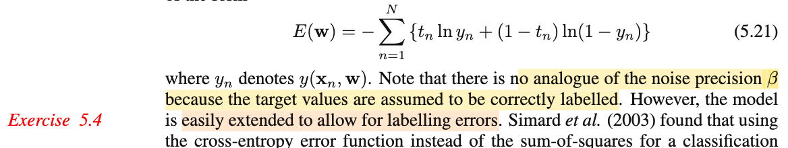</kbd>

<kbd>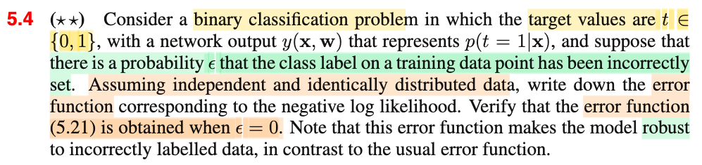</kbd>

> [!NOTE]
> Tiếp nối note trước ta đã có error function E(𝐰) = - Σn=1:N \[tn ln(yn) + (1-tn) ln (1-yn)\]
>
>
>
> Ở đây, bài tập 5.4 đặt vấn đề ta có ε là xác suất label bị gán sai. Yêu cầu viết error function.
>
>
>
> Giả định independent và identically distributed data, và xác nhận ràng khi ε = 0 thì ta lại có error function ở trên.
>
>
>
> ---
>
>
>
> Nhắc lại giả định t1|𝐱1,...tN|𝐱N là observed value của các random variable độc lập T1|𝐱1,...TN|𝐱N trong đó Ti|𝐱i \~ Bern(y(𝐰, 𝐱)), tức Bernuoilly distribution có tham số là một hàm phi tuyến của 𝐰 và 𝐱i biểu diễn bởi neural network.
>
>
>
> ---
>
>
>
> Thế thì, khi mở rộng bài toán qua việc tính thêm xác suất gán nhãn sai, gọi M (kí hiệu cho mislabel)) là biến ngẫu nhiên tuân theo phân phối Bern(ε): P(M=1) = ε, P(M=0) = 1-ε, M=1 đại diện cho event dán nhãn sai.
>
>
>
> ---
>
>
>
> Ôn nhanh nếu không có vụ nhãn sai, để thiết lập error:
>
>
>
> Ta giả định t1|𝐱1 observed value của T1|𝐱1 với T1|𝐱1 \~ Bern(y(𝐱1,𝐰)),
>
>
>
> để rồi P(T1=t1|𝐱1) = (y1^t1) (1-y1)^(1-t1)
>
>
>
> t2|𝐱2,... cũng vậy
>
>
>
> Và làm như thông thường, để thiết lập error function, ta sẽ thiết lập joint pmf của T1,..TN, để rồi có likelihood:
>
>
>
> likelihood = P(T1=t1,...TN=tn|𝐱1,..𝐱N,𝐰)
>
>
>
> = Πn=1:N P(Tn=tn|𝐱n,𝐰) 
>
>
>
> = Πn Bern(tn|yn) = Πn (yn^tn) (1-yn)^(1-tn)
>
>
>
> ⇒ negative ln likelihood = - ln Πn (yn^tn) (1-yn)^(1-tn) = công thức trên
>
>
>
> ---
>
>
>
> thì nay vì có thêm yếu tố dán nhãn sai. Có nghĩa là :
>
>
>
> Nếu nhãn của data point này sai, thì khi t1=1 thì label thật của data point này là 0 chứ không phải 1.
>
>
>
> Ngược lại nếu t1=0, thì label thật của data point là 1 chứ không phải 0.
>
>
>
> nên nếu gọi z1 là label thật của data point 1 thì: Khi gán nhãn đúng: z1 = t1, khi gán nhãn sai: z1 = 1-t1
>
>
>
> Do đó:
>
>
>
> Giả định bây giờ sẽ là:
>
>
>
> z1,z2,...zN là giá trị quan sát được của của Z1,...ZN với Zn\~ Bern(yn)
>
>
>
> còn t1,t2,...tN là giá trị quan sát được của T1, ...TN 
>
>
>
> Trong đó T1 là biến quan hệ với biến Z1 như sau:
>
>
>
> Khi M1 = 1, Z1 = 1 - T1: mistake xảy ra, giá trị label thật của data = 1 - label quan sát được
>
>
>
> Viết theo event (T1=t1|M1=1) ⇔ Z1=(1-t1)
>
>
>
> Khi M1 = 0, Z1 = T1: mistake không xảy ra, label thật của data = label quan sát được
>
>
>
> Viết theo event (T1=t1|M1=0) ⇔ (Z1=t1)
>
>
>
> Nên P(T1=t1|M1=0) = P(Z1=t1)
>
>
>
> và P(T1=t1|M1=1) = P(Z1=1-t1)
>
>
>
> ---
>
>
>
> X,Y discrete, y1,y2,y3
>
>
>
> Joint pmf X,Y,  Σi=1,2,3 P(X=x,Y=yi) = P(X=x),
>
>
>
> ∫f(x,y)dy = f(x)
>
>
>
> Σ\_m={0,1} P(T=t, M=m) = P(T=t)
>
>
>
> P(T=t) = Σ\_m={0,1} P(T=t, M=m) =  Σ\_m={0,1} P(T=t|M=m)P(M=m)
>
>
>
> Theo LOTP: P(T1=t1) = P(T1=t1|M1=0)P(M1=0) + P(T1=t1|M1=1)P(M1=1)
>
>
>
> = P(T1=t1|M1=0)(1-ε) + P(T1=t1|M1=1)ε
>
>
>
> = P(Z1=t1)(1-ε) + P(Z1=1-t1)ε
>
>
>
> = (y1^t1)(1-y1)^(1-t1)(1-ε) + (y1^(1-t1)) ((1-y1)^t1) ε
>
>
>
> ---
>
>
>
> Tương tự như vậy với T2,...TN:
>
>
>
> P(Tn=tn) = (yn^tn)((1-yn)^(1-tn)(1-ε) + (yn^(1-tn)) ((1-yn)^tn) ε
>
>
>
> ---
>
>
>
> Do đó, likelihood của bài toán này:
>
>
>
> P(T1=t1,T2=t2,...|𝐱1,..𝐱N,𝐰)
>
>
>
> = Πn P(Tn=tn|𝐱n,𝐰)
>
>
>
> = Πn \[(yn^tn)((1-yn)^(1-tn)(1-ε) + (yn^(1-tn)) ((1-yn)^tn) ε\]
>
>
>
> và negative log likelihood, tức E(𝐰):
>
>
>
> E(𝐰) = - ln { Πn {\[yn^(1-tn)\] (1-yn)^tn ε + (yn^tn) (1-yn)^(1-tn)\] (1-ε)} }
>
>
>
> = - Σn ln {\[yn^(1-tn)\] (1-yn)^tn ε + (yn^tn) (1-yn)^(1-tn)\] (1-ε)}
>
>
>
> ---
>
>
>
> Khi ε = 0 (xác suất dán nhãn sai = 0) , thì E(𝐰) trở thành:
>
>
>
> \- Σn ln {(yn^tn) (1-yn)^(1-tn)\]}
>
>
>
> = - Σn \[ln (yn^tn) + ln (1-yn)^(1-tn))\]
>
>
>
> = - Σn \[tn ln(yn) + (1-tn) ln (1-yn)\] chính là công thức 5.21

📹 [Xem video trên YouTube](https://www.youtube.com/watch?v=qBtQHf2RkQ4)

> [!TIP]
> 🤖 **AI Check** — 🟢 Pass — ✅ **98/100** · ✓ Move on
>
> Ghi chú rất xuất sắc, lập luận chặt chẽ bằng cách đặt biến ngẫu nhiên ẩn (true label) và dùng công thức xác suất toàn phần để thiết lập hàm loss một cách chính xác.
>
> **✓ Strengths**
> - Mô hình hóa bài toán rất rõ ràng bằng việc phân tách giữa nhãn quan sát được (T), nhãn thực tế (Z) và biến cố gán nhãn sai (M).
> - Áp dụng chính xác định lý xác suất toàn phần (LOTP) để suy ra phân phối biên duyên của biến quan sát Tn.
> - Chứng minh và rút gọn chính xác về dạng cross-entropy (5.21) khi xác suất nhiễu epsilon = 0.
>
> **💡 Deeper notes**
> - Vì $t_n \in \{0, 1\}$, phân phối của $T_n$ thực chất vẫn là Bernoulli với tham số điều chỉnh $\tilde{y}_n = (1-\epsilon)y_n + \epsilon(1-y_n)$. Do đó hàm lỗi có thể viết dưới dạng gọn: $E(\mathbf{w}) = -\sum_n \{ t_n \ln \tilde{y}_n + (1-t_n) \ln (1-\tilde{y}_n) \}$, tương đương hoàn toàn với biểu thức bạn đã rút ra nhưng giúp tính đạo hàm gradient thuận tiện hơn.

 

###### Multiple Binary Classification Error Function

<kbd>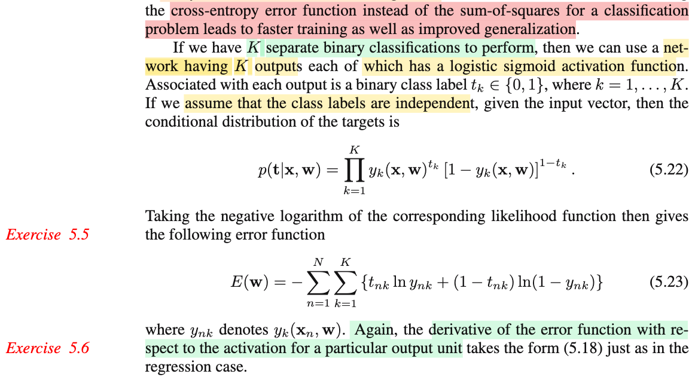</kbd>

> [!NOTE]
> Xét qua bài toán multi label classification:
>
>
>
> Data sẽ là các K-dimensional vector 𝐭 = (t1,...tK) với tk mang giá trị 1 hoặc 0, nhưng không nhất thiết chỉ có 1 thằng = 1. Vì đây là set up của bài toán phân loại mà input có thể được xếp vào nhiều class (gọi là multiple label classification: ví dụ phân loại ảnh là chó mèo thì ảnh chụp có thể có hình cả chó lẫn mèo)
>
>
>
> (𝐭1,𝐱1),...(𝐭N,𝐱N)
>
>
>
> Giả định của ta sẽ là 𝐭i là observed value của 𝐓i|𝐱i với 𝐓i = (Ti1 Ti2,...TiK), có Tik \~ Bernouilly có tham số là hàm phi tuyến đại diện bởi output thứ k của neural network:
>
>
>
> Tik \~ Bern(y(𝐰,𝐱i)\_k) = Bern(yik)
>
>
>
> yik sẽ mang ý nghĩa xác suất input 𝐱i thuộc loại k
>
>
>
> Và giả định Ti1,Ti2,...TiK là độc lập (assume class labels are independent)
>
>
>
> ---
>
>
>
> Như vậy:
>
>
>
> P(𝐓i=𝐭i|𝐱i,𝐰) = P(Ti1=ti1, Ti2=ti2,..|𝐱i,𝐰)
>
>
>
> = P(Ti1=ti1|𝐱i,𝐰)P(Ti2=ti2|𝐱i,𝐰).... (do giả định Ti1,Ti2,...TiK là độc lập nói trên)
>
>
>
> Như trên vừa nói: Tik \~ Bern(y(𝐰,𝐱i)\_k)
>
>
>
> = Bern(ti1|y(𝐰,𝐱i)\_1) Bern(ti2|y(𝐰,xi)\_2) ...
>
>
>
> = Bern(ti1|yi1) Bern(ti2|yi2) ...
>
>
>
> X \~ Bern(p) P(X=x) = p^x (1-p)^(1-x)
>
>
>
> Ti1 \~ Bern(y(𝐰,𝐱i)\_1) = P(Ti1=ti1) = yi1^ti1 \[1 - yi1\]^(1-ti1)
>
>
>
> = yi1^(ti1)\[(1-yi1)^(1-ti1)\] × yi2^(ti2)\[(1-yi2)^(1-ti2)\] × ...
>
>
>
> = Πk=1:K yik^(tik)\[(1-yik)^(1-tik)\]
>
>
>
> Viết lại: P(𝐓i=𝐭i|𝐱i,𝐰) = Πk=1:K yik^(tik)\[(1-yik)^(1-tik)\]
>
>
>
> hay dùng n thay i:
>
>
>
> P(𝐓n=𝐭n|𝐱n,𝐰) = Πk=1:K ynk^(tnk)\[(1-ynk)^(1-tnk)\]
>
>
>
> Hoặc bỏ biến chạy đi thì chính là 5.22:
>
>
>
> P(𝐓=𝐭|𝐱,𝐰) = Πk=1:K yk^(tk)\[(1-yk)^(1-tk)\]
>
>
>
> ---
>
>
>
> Likelihood, như thường lệ, là joint pmf của 𝐓1|𝐱1,...𝐓N|𝐱N
>
>
>
> P(𝐓1=𝐭1,𝐓2=𝐭2,...|𝐱1,𝐱2,...𝐰)
>
>
>
> = Πn=1:N P(𝐓n=𝐭n|𝐱n,𝐰) (do data point độc lập)
>
>
>
> = Πn=1:N Πk=1:K ynk^(tnk)\[(1-ynk)^(1-tnk)\]
>
>
>
> Ln likelihood:
>
>
>
> ln {Πn=1:N Πk=1:K ynk^(tnk)\[(1-ynk)^(1-tnk)\]}
>
>
>
> = Σn=1:N Σk=1:K ln {ynk^(tnk)\[(1-ynk)^(1-tnk)\]}
>
>
>
> = Σn=1:N Σk=1:K { ln \[ynk^(tnk)\] + ln \[(1-ynk)^(1-tnk)\]}
>
>
>
> = Σn=1:N Σk=1:K { (tnk) ln (ynk) + (1-tnk) ln (1-ynk)}
>
>
>
> Như thường lệ, maximize ln likelihood (để tìm maximum likelihood của 𝐰) tương đương đi minimize negetive ln likelihood:
>
>
>
> E(𝐰) = - Σn=1:N Σk=1:K { (tnk) ln (ynk) + (1-tnk) ln (1-ynk)}
>
>
>
> → chính là 5.23
>
>
>
> ---

📹 [Xem video trên YouTube](https://www.youtube.com/watch?v=SCVs2NRRo7s)

> [!TIP]
> 🤖 **AI Check** — 🟢 Pass — ✅ **100/100** · ✓ Move on
>
> Ghi chú rất tốt, trình bày mạch lạc và tự tay diễn giải từng bước suy dẫn toán học từ phân phối Bernoulli, tính độc lập có điều kiện đến hàm mất mát cross-entropy.
>
> **✓ Strengths**
> - Diễn giải rõ ràng bản chất bài toán phân loại nhiều nhãn (multi-label) và giải thích trực quan về vector nhãn mục tiêu.
> - Mô hình hóa chặt chẽ từng nhãn bằng biến ngẫu nhiên Bernoulli với tham số là đầu ra của mạng neural.
> - Suy dẫn công thức likelihood và negative log-likelihood từng bước rất chính xác và đầy đủ.
>
> **💡 Deeper notes**
> - Cần nhấn mạnh rõ tính độc lập ở đây là độc lập có điều kiện khi đã biết đầu vào x (conditional independence given x), không phải các nhãn độc lập tuyệt đối với nhau.
> - Lưu ý phân biệt bài toán multi-label (K bài toán nhị phân độc lập, dùng sigmoid riêng ở output dẫn đến 5.23) với bài toán multiclass (1 trong K lớp loại trừ lẫn nhau, dùng softmax dẫn đến 5.24 trong Bài tập 5.5).

 

###### Feature Sharing in Neural Networks

<kbd>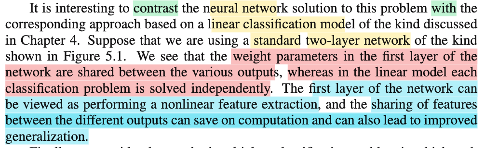</kbd>

<kbd>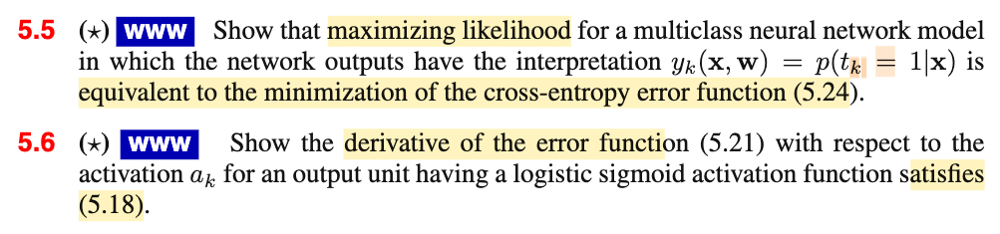</kbd>

<kbd>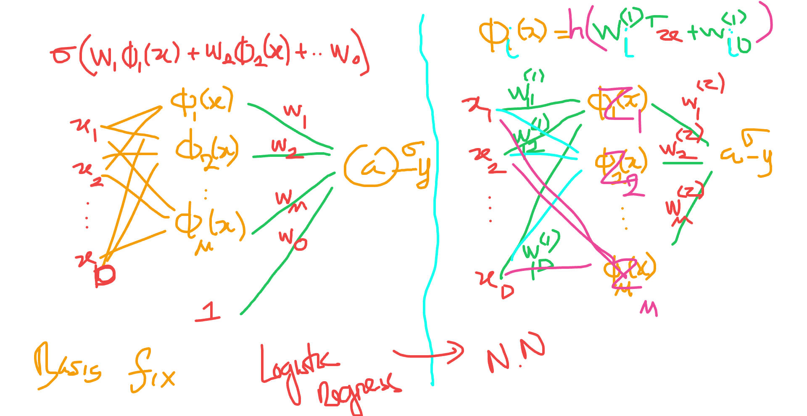</kbd>

<kbd>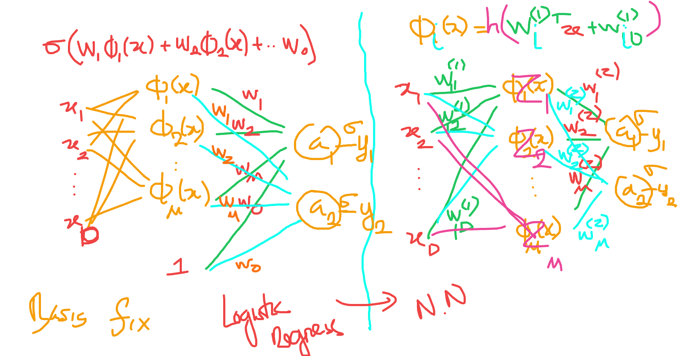</kbd>

> [!NOTE]
> E(𝐰) = - Σn=1:N Σk=1:K { (tnk) ln (ynk) + (1-tnk) ln (1-ynk)}
>
>
>
> Error function đối với 1 data point:
>
>
>
> E(𝐰) = - Σk=1:K {(tk) ln (yk) + (1-tk) ln (1-yk)}
>
>
>
>  ví dụ K = 2
>
>
>
> \- {(t1) ln (y1) + (1-t1) ln (1-y1)} - {t2 ln (y2) + (1-t2) ln (1-y2)}
>
>
>
> Tính đạo hàm đối với a1: sẽ bằng ∂/∂a1 \[- {(t1) ln (y1) + (1-t1) ln (1-y1)} \]
>
>
>
> Tương tự:
>
>
>
> Trong hàm số trên, chỉ có yk = σ(ak), còn lại yj, j khác k đều không phụ thuộc ak. Do đó
>
>
>
> ∂/∂ak E(𝐰) = - ∂/∂ak Σk=1:K { (tk) ln (yk) + (1-tk) ln (1-yk)}
>
>
>
> ∂/∂ak E(𝐰) = - ∂/∂ak {(tk) ln (yk) + (1-tk) ln (1-yk)}
>
>
>
> = - ∂/∂ak {(tk) ln (yk) + (1-tk) ln (1-yk)}
>
>
>
> = - { ∂/∂ak (tk) ln (yk) + ∂/∂ak (1-tk) ln (1-yk)}
>
>
>
> = - { tk ∂/∂ak ln (yk) + (1-tk) ∂/∂ak ln (1-yk)}
>
>
>
> Dùng chain rule:
>
>
>
> = - { tk ∂/∂yk ln (yk) . ∂/∂ak yk + (1-tk) ∂/∂(1-yk) ln (1-yk) . ∂/∂yk (1-yk) ∂/∂ak yk}
>
>
>
> yk = σ(ak), d/dak yk = σ(ak)\[1-σ(ak)\]
>
>
>
> = - { tk (1/yk) . σ(ak)(1-σ(ak) + (1-tk) \[1/(1-yk)\] . (-1) σ(ak)(1-σ(ak)}
>
>
>
> = - { tk (1/yk) . σ(ak)(1-σ(ak)) + (1-tk) \[1/(1-yk)\] . (-1) σ(ak)(1-σ(ak))}
>
>
>
> = - { tk (1/yk) . yk(1-yk) - (1-tk) \[1/(1-yk)\] yk (1-yk)}
>
>
>
> = - \[tk (1-yk) - (1-tk) yk\]
>
>
>
> = - (tk - tkyk - yk + tkyk)
>
>
>
> = - (tk - yk)
>
>
>
> = yk - tk

📹 Video 1: [Tại sao đạo hàm ∂E/∂a_k lại bằng y_k - t_k?](https://www.youtube.com/watch?v=kbQmbgK_CTY)

📹 Video 2: [So sánh logistic regression và neural network](https://www.youtube.com/watch?v=_ny2GNFdhfo)

> [!TIP]
> 🤖 **AI Check** — 🟢 Pass — ✅ **100/100** · ✓ Move on
>
> Lời giải bài tập 5.6 rất chi tiết, chuẩn xác và mạch lạc từ việc rút gọn tổng cho đến các bước đạo hàm theo quy tắc chuỗi.
>
> **✓ Strengths**
> - Nhận xét chính xác rằng các đầu ra $y_j$ với $j \neq k$ không phụ thuộc vào $a_k$, giúp rút gọn đạo hàm của tổng về đúng số hạng thứ $k$.
> - Áp dụng đạo hàm hàm hợp (chain rule) và công thức đạo hàm hàm logistic sigmoid $\sigma'(a_k) = y_k(1-y_k)$ một cách cẩn thận và ra kết quả cuối cùng $y_k - t_k$ hoàn toàn chính xác.
>
> **💡 Deeper notes**
> - Hàm lỗi cho một điểm dữ liệu thường được ký hiệu là $E_n(\mathbf{w})$ để phân biệt rõ ràng với tổng lỗi trên toàn bộ tập dữ liệu $E(\mathbf{w})$.

 

###### Multiclass Classification Error Function

<kbd>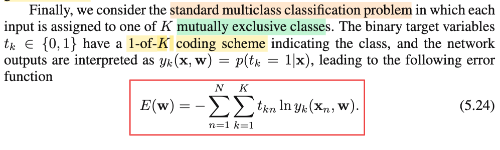</kbd>

<kbd>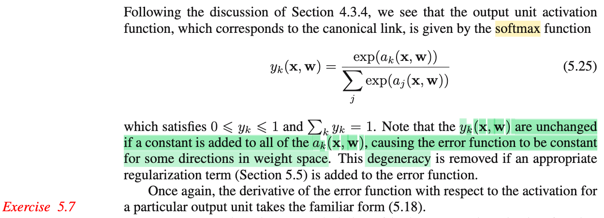</kbd>

<kbd>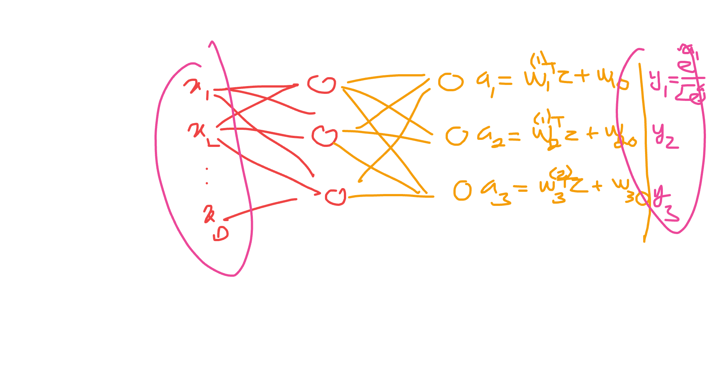</kbd>

> [!NOTE]
> Qua bài toán multi-class classification tiêu chuẩn nơi một input chỉ được gán cho một trong K class.
>
>
>
> Thiết lập Error function:
>
>
>
> Như thường lệ, để xây dựng likelihood ta cần hỏi data là gì, là observed value biến ngẫu nhiên nào, dưới giả định phân phối gì.
>
>
>
> Xét một data point (𝐱, 𝐭), target 𝐭 lúc này là one-hot vector (one-of-K coding scheme). Nên dataset (𝐱i, 𝐭i) được xem như observed value của 𝐓i|𝐱i, với 𝐓i là random vector (Ti1, Ti2,...TiK). Với:
>
>
>
> Ti1,Ti2,..đều chỉ có hai possible value {0, 1} nhưng mấu chốt là, trong đám t1, t2,..tK **chỉ có một thằng bằng 1**. Ta sẽ lập luận như sau:
>
>
>
>  P(𝐓=𝐭|𝐱) = P(T1=t1,T2=t2,...TK=tk|𝐱) 
>
>
>
> Xét joint event (T1=t1,T2=t2,..,Tk=tk)
>
>
>
>  \[1,0,...0\],  \[0,1,0,...0\],...\[0,...,1\]
>
>
>
> Xét 𝐭 = 𝐢1 = \[1,0,...0\]: event (T1=1, T2=0,..,TK=0) sẽ tương đương event T1=1 (vì khi đó T2,T3... dĩ nhiên = 0).
>
>
>
> Mà hai event tương đương nên xác suất bằng nhau P(T1=1,T2=0,..,Tk=0) = P(T1=1), và ta đặt P(T1=1) là p1
>
>
>
> P(𝐓=𝐢1) = p1
>
>
>
> Xét 𝐭 = 𝐢2 = \[0,1,0,..0\]: event (T1=0,T2=1,..,Tk=0) sẽ tương đương event T2=1 (vì khi đó T1,T3.. dĩ nhiên = 0).
>
>
>
> ⇒ P(T1=0,T2=1,..,Tk=0) = P(T2=1), ta đặt P(T2=1) là p2
>
>
>
> ⇔ P(𝐓=𝐢2) = p2
>
>
>
> Như vậy tương tự với các possible value khác có thể thấy
>
>
>
> P(𝐓 = 𝐢k) = pk
>
>
>
> ---
>
>
>
> Nhưng ta cần là cần P(𝐓 = 𝐭|𝐱)
>
>
>
> Và y như khi ta thể hiện PMF của Bern(p): P(X=1) = p, P(X=0) = 1-p bằng cách P(X=x) = p^x (1-p)^(1-x)
>
>
>
> Thì ở đây P(𝐓=𝐭|𝐱) 
>
>
>
> = p1^t1 × p2^t2 ×... × pK^tK 
>
>
>
> = Πk pk^tk 
>
>
>
> hay Πk \[P(Tk=1)\]^tk
>
>
>
> ---
>
>
>
> Và với linear model, p1,..pK được giả định là softmax transformation các hàm tuyến tính: 𝐰1ᵀΦ(𝐱), 𝐰2ᵀΦ(𝐱),...𝐰KᵀΦ(𝐱)
>
>
>
> Thì nay, ta giả định chúng là hàm phi tuyến biểu diễn bởi các output của neural net: y1(𝐱,𝐰),y2(𝐱,𝐰),...yK(𝐱,𝐰)
>
>
>
> ---
>
>
>
> Và như vậy, giả định của bài toán sẽ là: 𝐭n|𝐱n, n=1,2...N là giá trị quan sát được của 𝐓n|𝐱n với
>
>
>
> 𝐓n|𝐱n \~ phân phối có P(𝐓n=𝐭n|𝐱n) = Πk pnk^tnk , k = 1,2,..K, gọi là phân phối Multinoulli
>
>
>
> và (pn1,pn2,...pnK) là hàm vector-vector biểu diễn bởi neural network: y(𝐱n,𝐰)
>
>
>
> ---
>
>
>
> Vậy ta đã có đủ nguyên liệu để xây hàm likelihood:
>
>
>
> Joint pmf của 𝐓1|𝐱1,...TN|𝐱N:
>
>
>
> P(𝐓1=𝐭1,...,𝐓N=𝐭N|𝐱1,...𝐱N,𝐰)
>
>
>
> = Πn P(𝐓n=tn|𝐱n, 𝐰)
>
>
>
> = Πn Πk pnk^tnk
>
>
>
> = Πn Πk ynk^tnk
>
>
>
> = Πn Πk yk(𝐱n, 𝐰)^tnk
>
>
>
> Nên E(𝐰) = negative log likelihood:
>
>
>
> = - ln \[Πn Πk yk(𝐱n, 𝐰)^tnk\]
>
>
>
> = - Σn Σk ln yk(𝐱n, 𝐰)^tnk
>
>
>
> = - Σn Σk tnk ln yk(𝐱n, 𝐰) chính là 5.24

📹 [Xem video trên YouTube](https://www.youtube.com/watch?v=56_O8qpinzE)

> [!TIP]
> 🤖 **AI Check** — 🟢 Pass — ✅ **100/100** · ✓ Move on
>
> Ghi chú xuất sắc! Bạn đã xây dựng và dẫn dắt bản chất xác suất của hàm lỗi phân loại đa lớp (Categorical/Multinoulli likelihood) một cách rất trực quan, chặt chẽ và chuẩn xác.
>
> **✓ Strengths**
> - Diễn giải cực kỳ trực quan và chuẩn xác cách dạng lũy thừa tích Πk pk^tk biểu diễn phân phối Multinoulli từ vector one-hot.
> - Các bước triển khai từ likelihood sang negative log-likelihood (NLL) để thu được công thức (5.24) hoàn chỉnh, mạch lạc.
>
> **💡 Deeper notes**
> - Khi phân tách tích theo n: P(T1=t1,...,TN=tN|...) = Πn P(Tn=tn|...), bạn đang ngầm sử dụng giả định các mẫu dữ liệu độc lập có điều kiện theo x (i.i.d. assumption).
> - Để vector dự đoán y(x, w) thực sự là một phân phối xác suất hợp lệ (yk ≥ 0 và ∑k yk = 1), lớp output thường kết hợp hàm softmax như được đề cập trong công thức (5.25).

 

