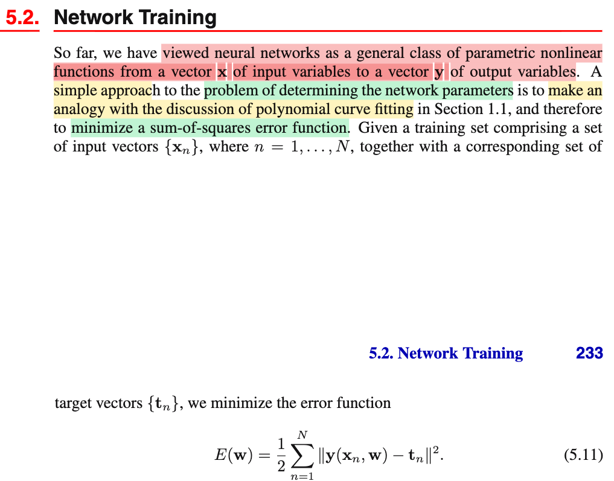
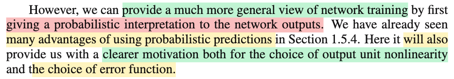
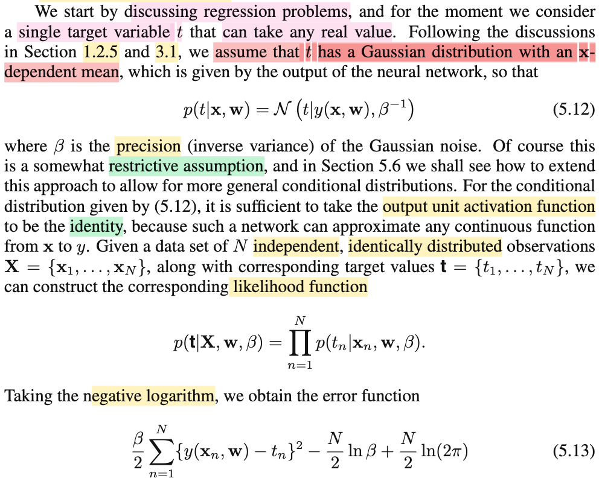
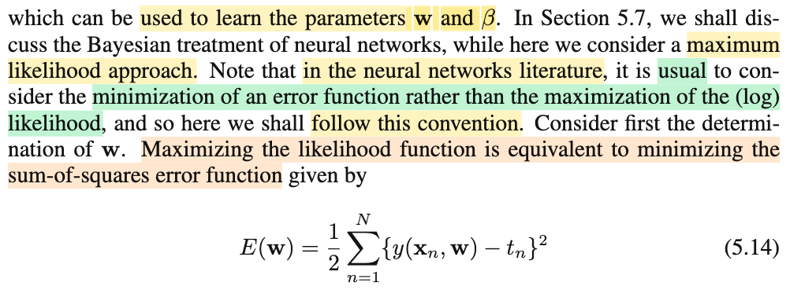
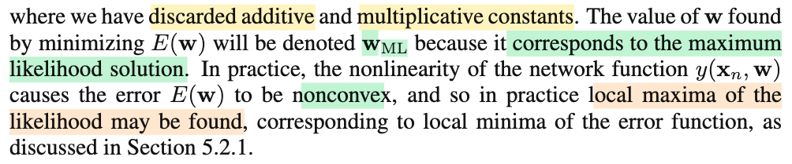

# 5.2 Training

📊 **Progress:** `2` Notes | `5` Screenshots | `2` AI Reviews

---

 

## Section 5.2 Network Training

<kbd></kbd>

<kbd></kbd>

> [!NOTE]
> Đại khái là cho tới giờ ta chỉ đang coi neural network như một general class - một loại hàm phi tuyến chung chung map giữa input 𝐱 và output 𝐲.
>
>
>
> Thì khi xét bài toán đi xác định giá trị tham số của network, ta có thể dùng cách làm đơn giản là coi nó giống như bài toán tìm tham số của hàm đa thức để fit đường cong, như vậy với framework này, ta sẽ đi minimize hàm sum squared error: minimize 𝐰 E(𝐰) (1/2) Σn ||𝐲(𝐰, 𝐱n) - 𝐭n||²
>
>
>
> Tuy vậy, đại khái là ta nên chuẩn bị một góc nhìn khái quát hơn cho việc training neural network bằng cách cho phép output của neural net có một probabilistic interpretation. Tạm hiểu là coi output của neural net đóng vai trò là THAM SỐ của một phân phối xác suất có điều kiện. 
>
>
>
> Ví dụ như cách ta coi y(𝐰,𝐱) là mean của phân phối 𝒩(y(𝐰,𝐱), 1/β) mà ta gỉa định cho T|𝐱 trong bài toán regression vậy.
>
>
>
> Việc này mang đến nhiều lợi ích, cụ thể là sẽ giúp ta rõ hơn trong việc chọn activation function cũng như error function.

> [!TIP]
> 🤖 **AI Check** — 🟢 Pass — ✅ **95/100** · ✓ Move on
>
> Ghi chú rất chính xác, nắm bắt trọn vẹn tư tưởng chuyển tiếp từ góc nhìn hồi quy bình phương tối thiểu sang góc nhìn mô hình xác suất điều kiện.
>
> **✓ Strengths**
> - Nắm rất vững bản chất của 'probabilistic interpretation': output của mạng đóng vai trò là tham số của phân phối xác suất có điều kiện p(t|x).
> - Liên hệ chuẩn xác với ví dụ phân phối chuẩn trong bài toán hồi quy (output là mean μ = y(x, w)).
> - Hiểu đúng mục đích của góc nhìn xác suất: giải thích tự nhiên việc lựa chọn hàm kích hoạt ở tầng ra (output activation) và hàm mất mát (loss/error function) thông qua nguyên lý cực đại hợp lý (Maximum Likelihood).
>
> **💡 Deeper notes**
> - Cụm từ 'output unit nonlinearity' trong sách đề cập cụ thể đến hàm kích hoạt ở tầng đầu ra (output layer activation), ví dụ như hàm đồng nhất cho hồi quy Gauss, hàm sigmoid cho Bernoulli, hay softmax cho phân loại đa lớp, chứ không phải các hàm kích hoạt ở các tầng ẩn (hidden layers).

 

### Error Function for Regression

<kbd></kbd>

<kbd></kbd>

<kbd></kbd>

> [!NOTE]
> Đầu tiên đại khái là ta bàn qua bài toán regression trước: ý là, training neural network cho bài toán regression. Và lấy ví dụ xét bài toán regression có output scalar: dự đoán scalar target t từ input 𝐱.
>
>
>
> Cũng y như chương 3, ta giả định T|𝐱 \~ 𝒩(μ(𝐱), β⁻¹) với mean là hàm phụ thuộc 𝐱.
>
>
>
> T|𝐱 = 𝒩(y(𝐰, 𝐱), β⁻¹)
>
>
>
> y(𝐰, 𝐱) = 𝐰ᵀΦ(𝐱)
>
>
>
> Inference:
>
>
>
> 𝐰ML, βML
>
>
>
> Predict 
>
>
>
> Và cũng giống như linear model ở chương 3: Ta giả định μ(𝐱) là hàm tuyến tính của 𝐰 và phi tuyến đối với 𝐱 (do basis function): μ(𝐱) = 𝐰ᵀΦ(𝐱) để rồi đi giải bài toán inference: tìm point estimator của μ(𝐱), cũng chính là đi point estimate cho 𝐰 (𝐰ML hay 𝐰MAP). Đồng thời, sau khi có phân phối T|𝐱, theo decision theory, dùng E\[T|𝐱\] để estimate cho gía trị của t dựa trên 𝐱 chính là tối ưu giúp minimize trung bình square loss.
>
>
>
> (mà trong thống kê, regression của T on 𝐱 được định nghĩa cũng chính là E\[T|𝐱\])
>
>
>
> Thì ở đây, hoàn toàn tương tự, ta giả định T|𝐱 \~ 𝒩(μ(𝐱), β⁻¹), và giả định μ(𝐱) là hàm số phi tuyến nào đó của cả 𝐰 và 𝐱: và hàm số này được biểu diễn bởi neural network với output là y(𝐰, 𝐱).
>
>
>
> (và ta cũng dùng E\[T|𝐱\] để predict)
>
>
>
> Như vậy: có thể tóm tắt:
>
>
>
> Linear regression: Giả định T|𝐱 \~ 𝒩(μ(𝐱), β⁻¹) với μ(𝐱) = 𝐰ᵀΦ(𝐱): giả định tâm của 𝒩 là hàm tuyến tính của 𝐰, phi tuyến với 𝐱 thông qua basis function Φ
>
>
>
> Neural net regression: Giả định T|𝐱 \~ 𝒩(μ(𝐱), β⁻¹) với μ(𝐱) = y(𝐰,𝐱): giả định tâm của 𝒩 là hàm phi tuyến của 𝐰 và 𝐱, biễu diễn bởi neural network.
>
>
>
> ---
>
>
>
> (trong 5.6 ta sẽ mở rộng giả định này ra)
>
>
>
> ---
>
>
>
> Tiếp theo một ý cũng dễ hiểu, với bài toán regression: Ta chọn output activation function là identity function là đủ, vì bản thân y = 𝐰ᵀ𝐳 với 𝐰 là tham số của layer cuối, là đủ để có thể cho ra mọi giá trị trên trục số (bài toán regression, mean của normal không bị giới hạn, có thể mang bất kì giá trị nào)
>
>
>
> ---
>
>
>
> Rồi, như vậy, cơ bản như thường lệ, ta giải bài toán inference: estimate tham số của T|𝐱 \~ 𝒩(μ(𝐱), β⁻¹):
>
>
>
> Joint conditional pdf của T1|𝐱1, T2|𝐱2,...
>
>
>
> (chương 3,4 mình luôn xài chữ f thay chữ p - lí do là vì muốn theo convention của sách Casella:Từ chương 5 này mình sẽ dùng p cho giống tác giả, vì cảm thấy sẽ gây bất tiện cho ai theo dõi ghi chú)
>
>
>
> random sample 𝐗 = (X1,X2,..Xn), 𝐱 = 1,2,3,4,5  Xi iid \~ n(μ=8, 1)
>
>
>
> W(𝐱) point estimate cho θ
>
>
>
> L(μ|𝐱) = f(𝐱|μ) = Πi f(xi|μ)
>
>
>
> maximize\_μ L(μ|𝐱) = f(𝐱|μ) = Πi f(xi|μ)
>
>
>
> equivalent maximize\_μ ln L(μ|𝐱) = ln f(𝐱|μ) = ln Πi f(xi|μ) = Σi ln f(xi|μ)
>
>
>
> ---
>
>
>
> p(t1,t2,..tN|𝐱1,𝐱2,..𝐰, β) = Πn p(tn|𝐱n, 𝐰, β)
>
>
>
> = Πn 𝒩(tn|y(𝐱n, 𝐰), β⁻¹)
>
>
>
> Như thường lệ, dùng Maximum Likelihood framework:
>
>
>
> Likelihood L(𝐰, β|data) = p(t1,t2,..tN|𝐱1,𝐱2,..𝐰, β) = Πn 𝒩(tn|y(𝐱n, 𝐰), β⁻¹)
>
>
>
> Log likelihood:
>
>
>
> ln L(𝐰, β|data) = ln Πn 𝒩(tn|y(𝐱n, 𝐰), β⁻¹)
>
>
>
> = Σn ln 𝒩(tn|y(𝐱n, 𝐰), β⁻¹)
>
>
>
> = Σn ln \[1/√(2πβ⁻¹) exp\[-(tn-y(𝐱n, 𝐰))²/2β⁻¹\]
>
>
>
> = Σn ln \[1/√(2πβ⁻¹)\] + Σn ln exp\[-(tn-y(𝐱n, 𝐰))²/2β⁻¹\]
>
>
>
> = Σn ln \[1/√(2πβ⁻¹)\] + Σn \[-(tn-y(𝐱n, 𝐰))²/2β⁻¹\]
>
>
>
> = Σn ln \[1/√(2πβ⁻¹)\] - (β/2) Σn \[(tn-y(𝐱n, 𝐰))²\]
>
>
>
> = Σn ln \[(2πβ⁻¹)^(-1/2)\] - (β/2) Σn \[(tn-y(𝐱n, 𝐰))²\]
>
>
>
> = Σn (-1/2) ln \[(2πβ⁻¹)\] - (β/2) Σn \[(tn-y(𝐱n, 𝐰))²\]
>
>
>
> = (-1/2) Σn ln (2π) + (-1/2) Σn ln(β⁻¹) - (β/2) Σn \[(tn-y(𝐱n, 𝐰))²\]
>
>
>
> = (-1/2) Σn ln (2π) + (1/2) Σn ln(β) - (β/2) Σn \[(tn-y(𝐱n, 𝐰))²\]
>
>
>
> = (-1/2) N ln (2π) + (1/2) N ln(β) - (β/2) Σn \[(tn-y(𝐱n, 𝐰))²\]
>
>
>
> (negative log likelihood: (1/2) N ln (2π) - (1/2) N ln(β) + (β/2) Σn \[(tn-y(𝐱n, 𝐰))²\])
>
>
>
> Bài toán tối ưu để tìm MLE của 𝐰 và β:
>
>
>
> maximize\_ 𝐰, β Likelihood
>
>
>
> Giải tìm 𝐰 trước, coi β fix:
>
>
>
> maximize\_ 𝐰 Likelihood
>
>
>
> bài toán tương đương: maximize\_ 𝐰 ln Likelihood
>
>
>
> tương đương tiếp bằng cách bỏ hằng số và β là scalar dương:
>
>
>
> maximize\_ 𝐰 {-(1/2) Σn \[(tn-y(𝐱n, 𝐰))²\]}
>
>
>
> minimize\_ 𝐰 {(1/2) Σn \[(tn-y(𝐱n, 𝐰))²\]} → 5.14
>
>
>
> (ở đây tác gỉa nói thêm trong neural net, ta thường minimize hàm loss thay vì maximize ln likelihood, mà về khía cạnh bài toán tối ưu thì chuyện từ maximize hàm objective thành minimize hàm negative objective là bình thường. và một lần nữa mình lại thấy: minimize sum squared error chính là maximize likelihood)
>
>
>
> Và giả cái này, ta sẽ được đương nhiên chính là MLE của 𝐰, nên kí hiệu nó là 𝐰ML.
>
>
>
> Tác giả chỉ lưu ý, không giống như linear regression, khi ta có y = 𝐰ᵀΦ(𝐱), thì khi đó error function là quadratic function của 𝐰, nên bài toán tối ưu này có closed form solution, cũng là bài toán convex
>
>
>
> còn ở đây, y là hàm phi tuyến của 𝐰, nên nó sẽ non-convex, mà như vậy, tìm ra local minimum (của error function, cũng là local maximum của likelihood) chưa chắc là global minimum

📹 [Xem video trên YouTube](https://www.youtube.com/watch?v=LfNYAOHXklE)

> [!TIP]
> 🤖 **AI Check** — 🟢 Pass — ✅ **98/100** · ✓ Move on
>
> Ghi chú xuất sắc, hiểu sâu bản chất thống kê của bài toán hồi quy dùng neural network và tự triển khai chi tiết từng bước biến đổi đại số từ likelihood sang sum-of-squares error.
>
> **✓ Strengths**
> - Liên kết rất tốt với kiến thức lý thuyết quyết định (decision theory) và hồi quy tuyến tính từ Chương 3 (sử dụng E[T|x] để tối ưu hóa kỳ vọng bình phương sai số).
> - Tự diễn giải chi tiết từng bước đại số từ hàm mật độ Gauss sang hàm hợp lý (likelihood), log-likelihood và dẫn đến hàm mục tiêu sum-of-squares (5.14).
> - Phân biệt chính xác lý do dẫn đến tính phi lồi (non-convexity) và cực trị địa phương (local minima) giữa neural network và hồi quy tuyến tính.
>
> **💡 Deeper notes**
> - Về việc chọn identity activation function cho output: Ngoài việc giúp output nhận bất kỳ giá trị thực nào trên $(-\infty, \infty)$ để làm mean cho phân phối chuẩn, sách còn nhấn mạnh tính chất mạng neural với output tuyến tính có khả năng xấp xỉ bất kỳ hàm liên tục nào từ $\mathbf{x}$ sang $y$ (theo định lý Universal Approximation).

**🔗 See also:** [Linear Regression and Conditional Expectation *(Statistical Inference - Casella)*](../statistical_inference_casella/113_simple_linear_regression.md#node-5swaigg)

 

