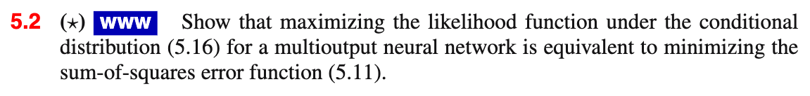
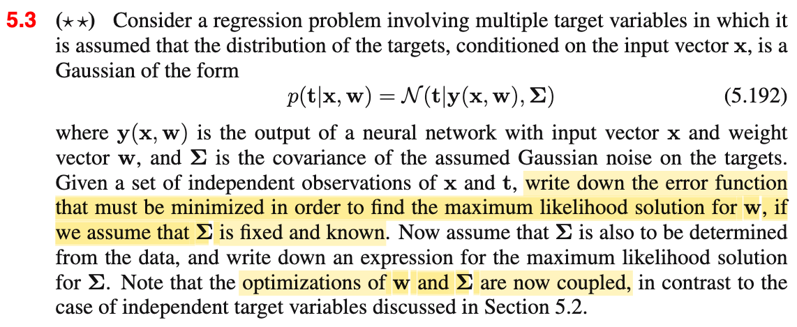
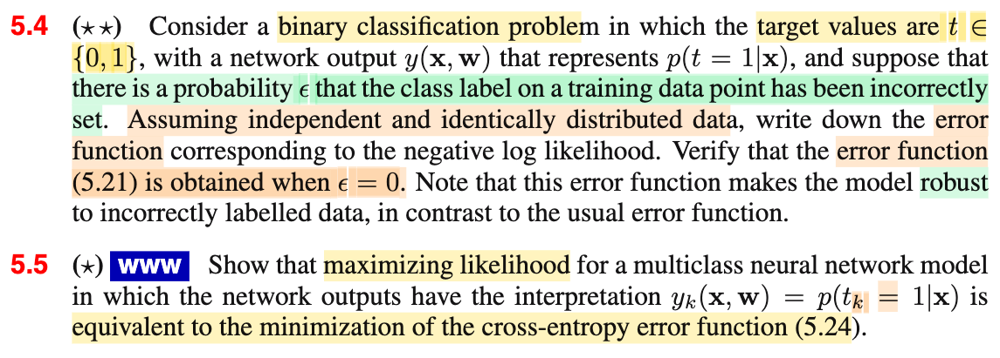
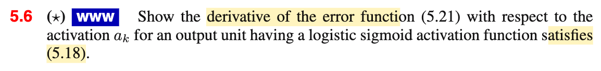
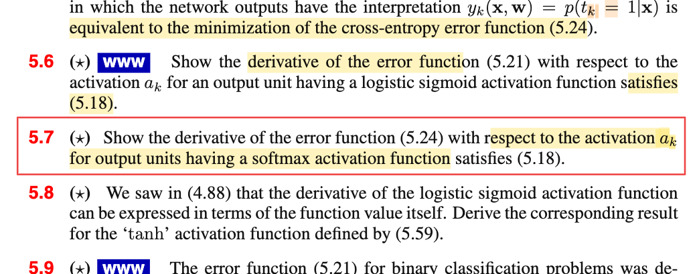

# 5.7 Ex

📊 **Progress:** `1` Notes | `5` Screenshots

---

 

## Exercise 5.2 Likelihood and Sum-of-Squares Error

<kbd></kbd>

<kbd></kbd>

<kbd></kbd>

 

### Logistic Sigmoid Error Derivative

<kbd></kbd>

**🔗 See also:** [Exercise 5.7 Softmax Derivative](./52_training.md#node-5kuxlzr)

 

#### Error Function Derivatives Exercises

<kbd></kbd>

> [!NOTE]
> (Xem link)

**🔗 See also:** [Exercise 5.7 Softmax Derivative](./52_training.md#node-5kuxlzr)

 

