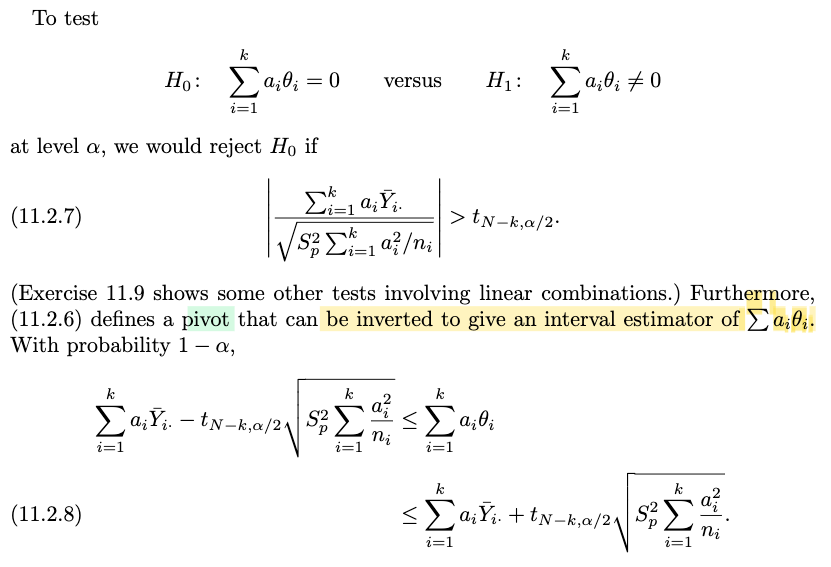
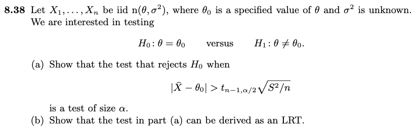
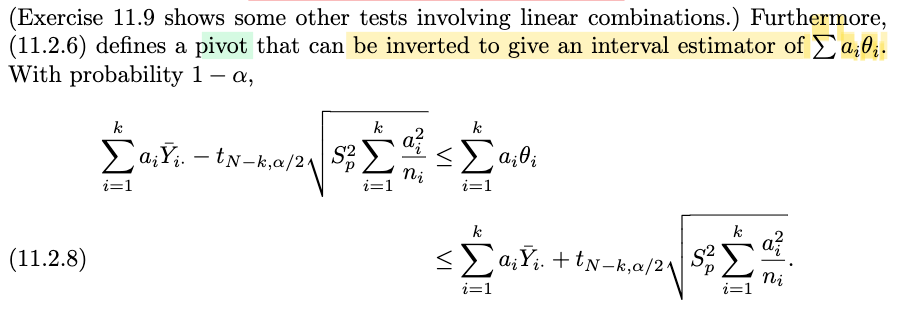

# 11.1 & 2  introduction, One-way Anova

📊 **Progress:** `21` Notes | `27` Screenshots | `18` AI Reviews

---

 

## Section 11.1 Introduction

<kbd></kbd>

> [!NOTE]
> Đại ý là, cho đến giờ, ta chỉ đều mô hình một random variable thông qua pdf/pmf phụ thuộc vào tham số nào đó cần estimate. Nhưng trong nhiều trường hợp, một random variable có thể được mô hình không chỉ bởi những parameter chưa biết, mà còn có thể bởi những covariate
>
>
>
> Do đó, chương này sẽ nói về những phân tích về variance và regression, dựa trên giả định quan hệ tuyến tính, và từ đó hình thành các phương pháp thống kê dùng trong thực tế.
>
>
>
> Nói chung mình chưa hiểu lắm, nhưng có vẻ như nó liên quan trực tiếp đến machine learning.
>
>
>
> Nói thêm cái tên, thật ra ko phải là phân tích variance, mà là sự biến thiên / chênh lệch giữa các giá trị trung bình

> [!TIP]
> 🤖 **AI Check** — 🟢 Pass — ✅ **95/100** · ✓ Move on
>
> Ghi chú tóm tắt rất chính xác và nắm trọn vẹn các ý chính của đoạn giới thiệu, đặc biệt là bản chất thật sự của ANOVA (phân tích sự biến thiên giữa các kỳ vọng/means).
>
> **✓ Strengths**
> - Tóm tắt chuẩn xác sự chuyển dịch từ việc mô hình hóa phân phối chỉ dựa trên tham số sang việc kết hợp thêm các biến phụ thuộc (covariates).
> - Nắm bắt chính xác điểm mấu chốt thú vị về mặt thuật ngữ: ANOVA thực chất là kiểm định sự khác biệt giữa các giá trị trung bình (means) thay vì bản thân các phương sai.
>
> **💡 Deeper notes**
> - Về mặt kỹ thuật, lý do phương pháp này vẫn mang tên là 'Analysis of Variance' (ANOVA) vì nó phân tách tổng biến thiên (partitioning variation / sum of squares) thành các nguồn khác nhau để từ đó so sánh và đưa ra kết luận về các giá trị trung bình (means).

 

### Simple Linear Regression Overview

<kbd></kbd>

> [!NOTE]
> Đoạn này nói sơ về việc chương này ta cũng sẽ thảo luận về bài toán regression, cụ thể là tập trung vào simple regression trong đó ta mô hình hóa mean của một random variable Y bởi hàm số của x: EY = α + βx

 

#### Oneway Analysis of Variance

<kbd></kbd>

> [!NOTE]
> Cần chú ý định nghĩa này: ANOVA là phương pháp ta **estimate mean của các population**, và các population này **thường có giả định là normal**.
>
>
>
> Lại nói tiếp, trọng tâm của ANOVA xoay quanh nhiệm vụ **statistical design**: làm thế nào để khai thác nhiều nhất hiểu biết về population trong khi **dùng ít quan sát nhất có thể**.
>
>
>
> Nhưng ở đây ta sẽ không đặt chú ý vào tác vụ này mà quan tâm đến bài toán inference: Estimation và testing.
>
>
>
> Nói đại ý là với ANOVA cổ điển thì mục đích chính của nó là xoay quanh phép kiểm định giả thiết (với null hypothesis là gọi là ANOVA null) nhưnng ngày nay thì phép inference quan trọng lại là estimation (point và interval)
>
>
>
> Nói chung là chỉ là nói sơ, ta sẽ hiểu rõ hơn ở phần sau.
>
>
>
> Tuy nhiên cần biết **oneway ANOVA** dựa trên **giả định** là Yij = θi + εij với θi là tham số chưa biết, và εij là error random variable.

> [!TIP]
> 🤖 **AI Check** — 🟢 Pass — ✅ **95/100** · ✓ Move on
>
> Ghi chú tóm tắt rất tốt và chính xác nội dung giới thiệu về ANOVA một yếu tố (oneway ANOVA), từ sự dịch chuyển mục tiêu từ kiểm định sang ước lượng cho đến mô hình cơ sở.
>
> **✓ Strengths**
> - Nắm bắt chính xác sự khác biệt giữa quan điểm ANOVA cổ điển (tập trung kiểm định giả thiết null) và quan điểm hiện đại (chú trọng ước lượng điểm và khoảng).
> - Ghi lại đúng dạng mô hình tổng quát của oneway ANOVA cùng ý nghĩa của các thành phần theta_i và sai số ngẫu nhiên epsilon_ij.
>
> **💡 Deeper notes**
> - Về mặt giả định mô hình, các quần thể thường được giả định tuân theo phân phối chuẩn (normal distribution).
> - Trong suy diễn thống kê hiện đại cho ANOVA, bài giảng đặc biệt nhấn mạnh tầm quan trọng của suy diễn dựa trên các tương phản (contrasts).

**🔗 See also:** [Oneway ANOVA Assumptions](#node-2zo08q5)

 

##### Example 11.2.1 Oneway ANOVA

<kbd></kbd>

<kbd></kbd>

> [!NOTE]
> Đại ý là phần này cho ta thấy một bộ dữ liệu cho Oneway ANOVA sẽ trông như thế này, và lưu ý rằng ta không assume số quan sát của mỗi nhóm điều trị là bằng nhau.
>
>
>
> Ta có thể giả định E(εij) = 0 mà không làm mất tính tổng quát. Do đó E\[Yij\] = E\[θi + εij\] = E\[θi\] + E\[εij\] (do linearity) = E\[θi\] = θi
>
>
>
> Cuối cùng, là người ta gọi θi là treatment mean = tạm dịch là trung bình của một loại điều trị / thử nghiệm (chữ treatment có có thể hiểu là lọai - class, để rồi ta có nhiều loại khác nhau, và θi là trung bình của lọai i)
>
>
>
> Ví dụ: Thử nhiều loại thuốc khác nhau, thì θi là giá trị trung bình môt (chỉ số nào đó) của class i
>
>
>
> Hoặc dùng thuốc với nhiều loại liều lượng khác nhau

> [!TIP]
> 🤖 **AI Check** — 🟡 Minor issues — ✅ **95/100** · ✓ Move on
>
> Ghi chú tóm tắt rất tốt và chính xác nội dung cơ bản của bảng dữ liệu Oneway ANOVA cũng như ý nghĩa của treatment mean.
>
> **🟡 Minor issues**
>
> **1.** *"E[Yij] = E[θi + εij] = E[θi] + E[εij] (do linearity) = E[θi]"*
>
> Trong mô hình fixed-effects ANOVA thông thường, θi là một tham số hằng số (fixed parameter), không phải biến ngẫu nhiên, nên kỳ vọng của nó bằng chính nó: E[θi] = θi. Bạn nên viết bước cuối là = θi để chuẩn xác về mặt toán học.
>
>
> **✓ Strengths**
> - Nắm rõ lưu ý quan trọng rằng số lượng quan sát ở các nhóm không nhất thiết phải bằng nhau (unbalanced design).
> - Hiểu đúng bản chất của θi là treatment mean và liên hệ thực tế tốt với các mức liều lượng hoặc phân loại điều trị.
>
> **💡 Deeper notes**
> - Việc giả định E[εij] = 0 'without loss of generality' dựa trên việc nếu sai số có kỳ vọng khác 0, giá trị kỳ vọng đó hoàn toàn có thể được gộp (absorb) vào tham số trung bình nhóm θi.

 

###### The Overparameterized Model

<kbd></kbd>

> [!NOTE]
> Một dạng khác, được gọi là overparameterized model: Yij = μ + τi + εij
>
>
>
> Với μ gọi là grand mean
>
>
>
> τi là hiệu ứng duy nhất của mỗi treatment i

 

###### Definition 11.2.2 Identifiability

<kbd></kbd>

> [!NOTE]
> Định nghĩa về cái gọi là identifiable - là một tính chất của một họ các distribution. Nói ngắn gọn là, nếu họ các distribution có tính chất này, thì với các θ khác nhau thì f(x|θ) sẽ khác nhau. Và từ đó giúp cho bài toán inference có thể thuận lợi.
>
>
>
> Ngược lại, nếu không có tính identifiable, thì có thể với θ và θ' khác nhau nhưng f(x|θ) và f(x|θ') giống nhau. Khi đó, việc quan sát được data, sẽ khó có thể suy luận ra nó đến từ f(x|θ) hay f(x|θ').
>
>
>
> Và ta nhớ khái niệm likelihood, L(θ|x) là hàm theo θ, define bởi f(x|θ), thì cái vừa nói chính là L(θ'|x) = L(θ|x), tức là cả hai θ và θ' đều có độ hợp lý như nhau
>
>
>
> Và trước giờ ta chưa bàn đến khái niệm này vì đều chọn mô hình identifiable. Nhưng sắp tới thì sẽ gặp những mô hình không identifiable.

> [!TIP]
> 🤖 **AI Check** — 🟡 Minor issues — ✅ **90/100** · ✓ Move on
>
> Ghi chú nắm rất tốt bản chất trực giác của tính định danh (identifiability) và mối liên hệ với hàm likelihood trong bài toán thống kê suy luận.
>
> **🟡 Minor issues**
>
> **1.** *"với các θ khác nhau thì f(x|θ) sẽ khác nhau"*
>
> Về mặt hình thức, hai phân phối khác nhau nghĩa là hai hàm số f(·|θ) và f(·|θ') khác nhau (tức tồn tại x để giá trị khác nhau, hoặc khác nhau trên một tập có xác suất dương), chứ không nhất thiết f(x|θ) phải khác f(x|θ') tại mọi điểm x.
>
>
> **✓ Strengths**
> - Hiểu chính xác bản chất của mô hình có tính định danh: các tham số khác nhau phải tương ứng với các phân phối xác suất khác nhau.
> - Liên hệ rất trực quan giữa việc bất định danh với hàm likelihood: khi hai tham số sinh ra cùng một phân phối, likelihood của chúng bằng nhau với mọi dữ liệu x, khiến không thể phân biệt nghiệm tốt nhất.
>
> **💡 Deeper notes**
> - Với biến liên tục, tính đồng nhất của hai phân phối f(·|θ) = f(·|θ') được xét theo nghĩa bằng nhau hầu khắp nơi (almost everywhere) theo độ đo chuẩn, do giá trị hàm mật độ tại một vài điểm rời rạc có thể thay đổi mà không làm thay đổi bản chất phân phối xác suất.

 

###### Identifiability in ANOVA Models

<kbd></kbd>

> [!NOTE]
> Cuối cùng đại ý là nói rằng cái mô hình thứ hai, sẽ không identifiable, trừ khi ta add thêm vài ràng buộc.
>
>
>
> Nhưng đại ý vẫn là, ta sẽ ưu tiên dùng cái mô hình thứ nhất hơn (Yij = θi + εij), cái này gọi là cell means model.

> [!TIP]
> 🤖 **AI Check** — 🟢 Pass — ✅ **95/100** · ✓ Move on
>
> Ghi chú tóm tắt rất chính xác ý chính của đoạn văn: mô hình tham số thứ hai (effects model) bị thiếu tính định danh nếu không có ràng buộc, và trong ANOVA một yếu tố thì mô hình trung bình ô (cell means model) được ưu tiên sử dụng hơn.
>
> **✓ Strengths**
> - Nắm đúng vấn đề then chốt về tính không định danh (identifiability) của mô hình nếu không áp thêm ràng buộc.
> - Hiểu rõ sự ưu tiên dành cho mô hình cell means trong bài toán phân tích phương sai một yếu tố (oneway ANOVA).
>
> **💡 Deeper notes**
> - Đoạn văn có nêu thêm một lưu ý: việc ưu tiên 'cell means model' áp dụng cụ thể cho oneway ANOVA; đối với các mô hình ANOVA phức tạp hơn (nhiều yếu tố, tương tác), mô hình thứ hai (effects model) đôi khi lại mang lại lợi thế về mặt diễn giải ý nghĩa.

 

###### Oneway ANOVA Assumptions

<kbd></kbd>

> [!NOTE]
> Đại khái là, để mà có thể thực hiện cả point + interval estimation và testing (tức là cả ba dạng inference) thì ta cần một giả định gọi là giả định ANOVA:
>
>
>
> Cụ thể ở đây là Oneway ANOVA assumption như sau:
>
>
>
> i) E\[εij\] = 0, Var(εij) = σi² &lt; ∞ với mọi i,j. Và Cov(εij, εi'j') = 0 với mọi i,j,i',j' trừ khi i=i', j=j'
>
>
>
> Là sao: Là error random variable là zero mean, variance finite, và uncorrelate (covariance) giữa hai error khác nhau là bằng 0.
>
>
>
> ii) Các error random variable εij độc lập và có phân phối NormalL εij
>
>
>
> iii) Variance của chúng bằng nhau σi² bằng nhau với mọi i
>
>
>
> Như vậy có nghĩa là εij đều iid với mọi i,j (independent do ý (ii) và có cùng \~ n(0, σ²) do ý (ii)(iii)
>
>
>
> Nói chung đại ý đoạn cuối là để có point estimation ta chỉ cần ý i) là đủ, nhưng để có đủ bộ interval estimation và testing thì cần cả 3 ý.
>
>
>
> Thêm nữa, nếu ta ko thể giả định normal, mà dùng một distribution khác, thì về toán sẽ khá khó, tuy nhiên nếu có sample size phù hợp, thì CLT sẽ có thể được áp dụng.

> [!TIP]
> 🤖 **AI Check** — 🟢 Pass — ✅ **95/100** · ✓ Move on
>
> Ghi chú tóm tắt rất chính xác và súc tích các giả định của Oneway ANOVA, đồng thời tổng hợp chuẩn xác việc các sai số là i.i.d. theo phân phối chuẩn N(0, σ²).
>
> **✓ Strengths**
> - Hiểu đúng mục đích: để thực hiện được kiểm định và ước lượng khoảng (interval estimation & testing) thì bắt buộc cần thêm các giả định phân phối thay vì chỉ ước lượng điểm.
> - Tổng hợp chính xác cả 3 điều kiện thành kết luận then chốt: các sai số ε_ij độc lập cùng phân phối chuẩn i.i.d. N(0, σ²).
>
> **💡 Deeper notes**
> - Về mặt kỹ thuật, ước lượng điểm (point estimation) chỉ cần giả định tối thiểu là E[ε_ij] = 0 và phương sai hữu hạn, không nhất thiết phải cần phân phối chuẩn.
> - Đoạn cuối giáo trình có mở rộng: khi không có giả định phân phối chuẩn hoàn hảo, Định lý Giới hạn Trung tâm (CLT) vẫn cho phép suy diễn xấp xỉ nếu cỡ mẫu đủ lớn và phân phối không quá lệch.

**🔗 See also:** [Oneway Analysis of Variance](#node-bbj2x4f) · [Oneway ANOVA Assumptions](#node-tp60spi)

 

###### Section 11.2 Oneway Analysis of Variance

<kbd></kbd>

> [!NOTE]
> Rồi, đại khái á là cái giả định mà variance nó giống nhau á thì là cái giả định quan trọng nhất. Okay. Thế thì đại ý là nói chung á, nếu như mà mình thấy dữ liệu nó vi phạm cái giả định ANOVA đó thì cái hành động đầu tiên đó là mình sẽ biến đổi dữ liệu phi tuyến. Đó, để cho nó khiến cho dữ liệu nó trở nên gần với ANOVA assumption hơn, phải không? Thì cái này nó dễ hơn là so với việc đi kiếm một cái mô hình khác. 
>
>
>
> Rồi, có đề cập tới một cái nghiên cứu của ông Box năm 1954 đại ý rằng á là nói về cái tính chất robustness của ANOVA đó đối với cái giả định dữ liệu theo phân phối chuẩn á, nó sẽ tùy theo là cái phương sai thực tế nó có bằng nhau thật hay không. 
>
>
>
> Và trong cái phần còn lại của cái chương này là mình sẽ luôn luôn là dùng cái giả định đầy đủ, phải không? Dùng cái giả định ANOVA đầy đủ.

> [!TIP]
> 🤖 **AI Check** — 🟡 Minor issues — ⚠️ **88/100** · ✓ Move on
>
> Ghi chú nắm rất tốt các ý chính về cách xử lý khi vi phạm giả định ANOVA, biến đổi phi tuyến và nghiên cứu của Box (1954). Có một điểm chưa chuẩn xác nhỏ khi bạn phóng đại tầm quan trọng của giả định đẳng phương sai thành 'quan trọng nhất'.
>
> **🟡 Minor issues**
>
> **1.** *"cái giả định mà variance nó giống nhau á thì là cái giả định quan trọng nhất"*
>
> Sách chỉ viết 'is also quite important' (cũng khá quan trọng) chứ không nói đây là giả định 'quan trọng nhất'. Trên thực tế, trong các phân tích ANOVA, giả định về tính độc lập thường nhạy cảm và nghiêm ngặt nhất.
>
>
> **✓ Strengths**
> - Hiểu đúng giải pháp đầu tiên khi vi phạm giả định ANOVA là thực hiện biến đổi dữ liệu phi tuyến (nonlinear transformation) thay vì vội tìm mô hình khác phức tạp hơn.
> - Tóm tắt chính xác kết luận từ bài báo của Box (1954) về mối liên hệ giữa tính vững (robustness) đối với phân phối chuẩn và mức độ bằng nhau của các phương sai.
>
> **💡 Deeper notes**
> - Ba giả định cổ điển (three classic assumptions) của ANOVA gồm: tính độc lập (independence), phân phối chuẩn (normality), và phương sai bằng nhau (homogeneity of variances).
> - Trường hợp phương sai không bằng nhau khi so sánh trung bình giữa các nhóm dẫn đến bài toán nổi tiếng trong thống kê gọi là bài toán Behrens–Fisher.

 

###### The Classic ANOVA Hypothesis

<kbd></kbd>

<kbd></kbd>

<kbd></kbd>

> [!NOTE]
> Đại khái, ở đây, tác giả giới thiệu cho ta cái gọi là phép kiểm định ANOVA cổ điển (the classic ANOVA test), và nó là phép kiểm định cho bài tóan hypothesis testing với null hypothesis sau: H0: θ1 = θ2 = ...= θk
>
>
>
> Ông cho biết, trong phần nhiều trường hợp thì cái null hypothesis này nó rất silly (ngớ ngẩn), vì một experimenter thường sẽ không tin rằng các loại treatment khác nhau lại có chung mean, mà cái mà người ta quan tâm thường là đi tìm xem cái nào tốt hơn. Do đó, bài toán inference mà người ta muốn làm hơn là estimation, chứ không phải testing.
>
>
>
> Lấy ví dụ này, tác giả cho biết thật ra thì ANOVA được phát triển nhằm tạo một công cụ để phân tích các thử nghiệm nông nghiệp. Ví dụ như xem thử các loại phân bón khác nhau có hiệu quả thế nào. Cho nên thật sự thì đại khái là người ta không ai quan tâm đến việc kiểm tra xem ANOVA null hypothesis có đúng hay không, vì hầu hết đều tin chắc là các loại phân bón khác nhau (hỗn hợp các thành phần khác nhau) đều sẽ có các hiệu qủa khác nhau (đồng nghĩa rằng họ biết thừa null hypothesis là sai. Mà cái họ quan tâm là làm sao để định lượng được những sự khác nhau này.

> [!TIP]
> 🤖 **AI Check** — 🟢 Pass — ✅ **95/100** · ✓ Move on
>
> Ghi chú tóm tắt rất chính xác tinh thần và ý tưởng cốt lõi của tác giả về giả thuyết null trong ANOVA cổ điển cũng như sự chuyển hướng từ kiểm định sang ước lượng định lượng hiệu ứng.
>
> **✓ Strengths**
> - Hiểu đúng bản chất của giả thuyết null trong ANOVA cổ điển ($H_0: \theta_1 = \theta_2 = \dots = \theta_k$) và lý do thực tế khiến nó thường không hấp dẫn đối với các nhà thực nghiệm.
> - Nắm rõ trọng tâm thực sự của ANOVA trong hầu hết các ứng dụng thực tế là bài toán ước lượng và định lượng mức độ sai khác (estimation/quantification) thay vì chỉ kiểm định bác bỏ $H_0$.
>
> **💡 Deeper notes**
> - Tác giả có lưu ý một ngoại lệ nhỏ trong ngoặc đơn: vẫn tồn tại một số ngữ cảnh chuyên biệt (specialized situations) mà người ta thực sự quan tâm đến bản thân giả thuyết null của ANOVA.

 

###### Inverting Tests for Confidence Regions

<kbd></kbd>

> [!NOTE]
> Đây là dịp để active recall về quan hệ giữa hypothesis testing và interval estimation
>
>
>
> Đại khái là, giả sử ta có một bài toán hypothesis testing: H0: θ=θ0 vs H1: θ≠ θ0. Và ta đã có một phép thử có level α. Ta có thể invert nó để tạo một interval estimation.
>
>
>
> Phép thử, thể hiện bởi rejection region R, là tập {𝐱 ∈ 𝓧: reject H0} 
>
>
>
> một phép kiểm định giải thuyết về cơ bản chỉ là một hàm phân loại: f(𝐱) reject H0 or not reject H0 
>
>
>
> thì acceptance region Rc = A(θ0) = {𝐱 ∈ 𝓧: accept θ=θ0} 
>
>
>
> ví von tập các chàng trai 𝐱 thích cô gái θ0
>
>
>
> đặt tập C(𝐱) = {θ: 𝐱 ∈ A(θ)}
>
>
>
> giống như là tập hợp các cô gái θ mà anh 𝐱 thích.
>
>
>
> thì do định nghĩa này, dĩ nhiên 𝐱 ∈ A(θ) ⇔ θ ∈ C(𝐱)
>
>
>
> Ví dụ nếu anh chàng 𝐱 thích cô θ (thể hiện bởi 𝐱 ∈ A(θ)) thì dĩ nhiên cô đó (θ) phải nằm trong list các cô mà anh 𝐱 thích (thể hiện bởi θ ∈ C(𝐱)). Và ngược lại, nếu có cô θ nằm trong list các cô mà anh 𝐱 thích (θ ∈ C(𝐱)) thì đương nhiên anh chàng 𝐱 phải nằm trong số những anh thích cô 𝐱 (𝐱 ∈ A(θ))
>
>
>
> ---
>
>
>
> C(𝐗) random set
>
>
>
> Level α test
>
>
>
> Type I error: θ ∈ Θ0, mà mình lại reject H0
>
>
>
> P\_θ(𝐗 ∈ R) và θ ∈ Θ0 (𝐗 = X1,X2,... \~ f(x|θ)
>
>
>
> P\_θ0(𝐗 ∈ R) ≤ α
>
>
>
> ⇔ 1 - P\_θ0(𝐗 ∈ Rc) ≤ α
>
>
>
> ⇔  P\_θ0(𝐗 ∈ Rc) ≥ 1 - α
>
>
>
> ⇔  P\_θ0(𝐗 ∈ A(θ0)) ≥ 1 - α
>
>
>
> 𝐱 ∈ A(θ) ⇔ θ ∈ C(𝐱) 
>
>
>
> Về bản chất 𝐗 ∈ A(θ0) = {s ∈ S: 𝐗(s) = 𝐱, 𝐱 ∈ A(θ0)}
>
>
>
> = {s ∈ S: 𝐗(s) = 𝐱, θ0 ∈ C(𝐱)}
>
>
>
> = θ0 ∈ C(𝐗)
>
>
>
> ⇒ P\_θ0(𝐗 ∈ A(θ0)) = P\_θ0(θ0 ∈ C(𝐗))
>
>
>
> ⇔  P\_θ0(θ0 ∈ C(𝐗)) ≥ 1 - α
>
>
>
> ⇔  P\_θ(θ ∈ C(𝐗)) ≥ 1 - α
>
>
>
> Coverage probability P\_θ(C(𝐗) chứa θ)
>
>
>
> Confidence coefficient inf\_θ P\_θ(C(𝐗) = 1-α
>
>
>
> Nên C(𝐗) gọi là 1-α confidence interval

📹 [Xem video trên YouTube](https://www.youtube.com/watch?v=iyUvmtl4bpg)

> [!TIP]
> 🤖 **AI Check** — 🟢 Pass — ✅ **95/100** · ✓ Move on
>
> Ghi chú thể hiện sự hiểu biết rất xuất sắc và chính xác về mối liên hệ đối ngẫu giữa kiểm định giả thuyết và khoảng tin cậy (test inversion), với trực giác và các bước biến đổi xác suất chặt chẽ.
>
> **🟡 Minor issues**
>
> **1.** *"Confidence coefficient inf_θ P_θ(C(𝐗) = 1-α"*
>
> Lỗi nhỏ về ký hiệu: thiếu dấu ngoặc và 'chứa θ', đúng ra là inf_θ P_θ(θ ∈ C(𝐗)) ≥ 1 - α.
>
> **2.** *"những anh thích cô 𝐱 (𝐱 ∈ A(θ))"*
>
> Typo nhỏ ở câu ví von: 'cô 𝐱' thay vì 'cô θ'.
>
>
> **✓ Strengths**
> - Diễn giải trực quan sinh động và chính xác về quan hệ đối ngẫu x ∈ A(θ) ⇔ θ ∈ C(x).
> - Trình bày chi tiết và chuẩn xác derivation toán học chứng minh xác suất bao phủ P_θ(θ ∈ C(X)) ≥ 1 - α từ mức ý nghĩa kiểm định α.
>
> **💡 Deeper notes**
> - C(X) tổng quát là confidence region (miền tin cậy), không nhất thiết luôn là một khoảng liên tục (interval) trừ khi acceptance region thỏa mãn một số tính chất hình học nhất định.

 

###### Breaking Down ANOVA Hypotheses

<kbd></kbd>

> [!NOTE]
> Đại ý là với H0 của classic ANOVA hypothesis test: θis bằng nhau hết thì H1 (alternative hypothesis) sẽ là: chúng không bằng nhau, hay, có sự khác nhau nào đó giữa các θis.
>
>
>
> Thế thì ý chính muốn nói, một vấn đề của các giả thuyết ANOVA là rất khó diễn giải, ví dụ nói rằng các θis khác nhau chẳng ích lợi gì. 
>
>
>
> Do đó, người ta muốn bẻ nhỏ cái hypothesis này ra thành các hypothesis con dễ giải thích hơn, và công cụ phù hợp là union-intersection.
>
>
>
> Lí do là bởi ANOVA null hypothesis là intersection của các hypothesis con dễ hiểu hơn, mà có thể được biểu thị bởi khái niệm contrasts
>
>
>
> Hơn nữa, ta sẽ thấy trong test có được dựa theo phương pháp này sẽ chính là LRTs, nên sẽ thừa hưởng mọi tính chất tốt của LRT.

> [!TIP]
> 🤖 **AI Check** — 🟢 Pass — ✅ **100/100** · ✓ Move on
>
> Ghi chú tóm tắt rất chính xác và súc tích nội dung cốt lõi của đoạn văn bản về hạn chế của giả thuyết ANOVA truyền thống và động lực áp dụng phương pháp union-intersection.
>
> **✓ Strengths**
> - Hiểu chính xác bản chất của giả thuyết đối H1 trong ANOVA là chỉ cần tồn tại ít nhất một cặp khác nhau chứ không nhất thiết tất cả phải khác nhau.
> - Nắm bắt đúng vấn đề cốt lõi về mặt thực hành: bác bỏ H0 chỉ cho biết có sự khác biệt nhưng không chỉ ra được khác biệt nằm ở đâu.
> - Xác định đúng giải pháp được đề xuất là phân rã giả thuyết phức tạp thành các thành phần nhỏ hơn thông qua phương pháp union-intersection.
>
> **💡 Deeper notes**
> - Trong văn bản gốc, các giả thuyết con được phân rã cụ thể thông qua khái niệm 'contrasts' (đối chứng tuyến tính), và kiểm định theo phương pháp union-intersection ở đây tương đương với kiểm định tỷ số hợp lý (LRT).

 

###### Definition 11.2.4 Contrasts and Linear Combinations

<kbd></kbd>

> [!NOTE]
> Tiếp theo là định nghĩa của khái niệm contrast, cũng dễ hiểu, đại ý nó là một tổ hợp tuyến tính có tổng hệ số bằng 0. tác dụng của nó là có thể dùng để so sánh.
>
>
>
> Ví dụ ta có bộ θ1,θ2,...θk
>
>
>
> thì dùng contrast 𝐚 = (1,-1,0,..0) thì Σi ai θi = θ1-θ2 sẽ có thể dùng để so sánh θ1 và θ2 (bằng cách xem Σi ai θi dương hay âm)

> [!TIP]
> 🤖 **AI Check** — 🟢 Pass — ✅ **100/100** · ✓ Move on
>
> Ghi chú nắm rất chính xác định nghĩa contrast (tổ hợp tuyến tính có tổng hệ số bằng 0) và hiểu rõ trực giác ứng dụng để so sánh các giá trị trung bình.
>
> **✓ Strengths**
> - Nắm chuẩn xác định nghĩa toán học của contrast là tổ hợp tuyến tính với tổng hệ số triệt tiêu (sum of coefficients = 0).
> - Hiểu đúng bản chất ứng dụng so sánh thông qua việc lấy hiệu giữa hai tham số cụ thể.
>
> **💡 Deeper notes**
> - Trong thống kê suy luận (như phân tích sau ANOVA), contrast thường được dùng để kiểm định giả thuyết H0: sum(a_i * theta_i) = 0 hoặc dựng khoảng tin cậy, thay vì chỉ xét dấu trực tiếp, nhằm kiểm soát sai số ngẫu nhiên từ mẫu.

 

###### Theorem 11.2.5 Parameter Contrasts

<kbd></kbd>

<kbd></kbd>

> [!NOTE]
> Theorem này, nói rằng cho θ = (θ1,...θk) thì θis bằng nhau hết khi và chỉ khi mọi contrast bất kì (tức tổ hợp tuyến tính Σi aiθi với bộ hệ số ai có tổng bằng 0 bất kì) đều bằng 0.
>
>
>
> Chứng minh đại ý là vầy:
>
>
>
> Chứng minh chiều đi: θ = (θ1,...θk) thì θis bằng nhau ⇒ mọi contrast bất kì đều bằng 0
>
>
>
> Vì θ1=θ2=...=θk (đặt là giá trị chung này là θ), thì dĩ nhiên contrast bất kì Σi aiθi sẽ bằng θ Σi ai, và cái này bằng 0 do Σi ai theo định nghĩa contrast.
>
>
>
> Chứng minh chiều ngược lại: mọi contrast bất kì đều bằng 0 ⇒ θis bằng nhau
>
>
>
> Ta có với mọi 𝐚 ∈ 𝒜 thì 𝐚ᵀ𝛉 đều bằng 0 nên nó đúng với cả các vector 𝐚1, 𝐚2,...𝐚k sau đây:
>
>
>
> 𝐚1 = (1,-1,0,0...0), 𝐚2 = (0,1,-1,0...0),..., 𝐚k-1 = (0,0,0...1,-1)
>
>
>
> nên 𝐚1ᵀ𝛉 = 0 ⇒ θ1 = θ2
>
>
>
> 𝐚2ᵀ𝛉 = 0 ⇒ θ2 = θ3,
>
>
>
> ...
>
>
>
>
>
> Vậy suy ra mọi θis đều bằng nhau.

> [!TIP]
> 🤖 **AI Check** — 🟡 Minor issues — ✅ **95/100** · ✓ Move on
>
> Ghi chú nắm rất chắc nội dung định lý và ý tưởng chứng minh hai chiều một cách ngắn gọn, chính xác.
>
> **🟡 Minor issues**
>
> **1.** *"nó đúng với cả các vector 𝐚1, 𝐚2,...𝐚k sau đây"*
>
> Có một lỗi đánh máy nhỏ: chỉ có k - 1 vector cơ sở dạng này (từ a1 đến a_{k-1}) như bạn đã liệt kê đúng ở ngay dòng phía dưới.
>
>
> **✓ Strengths**
> - Nắm chuẩn định nghĩa contrast và phát biểu tương đương của định lý.
> - Trình bày mạch lạc, chính xác cả hai chiều chứng minh của định lý.
>
> **💡 Deeper notes**
> - Trong chứng minh gốc, tập hợp {a1, ..., a_{k-1}} tạo thành một cơ sở sinh ra toàn bộ không gian contrast A (có số chiều k - 1), giải thích vì sao chỉ cần kiểm tra k - 1 vector này là đủ bao quát.

 

###### ANOVA Hypotheses via Contrasts

<kbd></kbd>

> [!NOTE]
> Và nhờ theorem này, đại khái là ta có thể thể hiện cái null hypothesis ANOVA theo cách tương đương: thông qua constrast:
>
>
>
> H0: θis đều bằng nhau trở thành H0: 𝐚ᵀ𝛉 = 0 với mọi 𝐚 ∈ 𝒜 (bộ hệ số tổ hợp tuyến tính tổng bằng không)
>
>
>
> và tương tự H1 trở thành:
>
>
>
> H1: θis không bằng nhau, trở thành H1: ít nhất tồn tại 𝐚 ∈ 𝒜 sao cho 𝐚ᵀ𝛉 ≠ 0
>
>
>
> Và ông nói, cách thể hiện tương đương này giúp dể hiểu hơn và dễ giải thích hơn một chút

> [!TIP]
> 🤖 **AI Check** — 🟢 Pass — ✅ **95/100** · ✓ Move on
>
> Ghi chú tóm tắt rất chính xác bản chất của việc chuyển đổi giả thuyết ANOVA ($H_0$ và $H_1$) sang ngôn ngữ của các phép tương phản (contrasts) bằng biểu diễn véc-tơ gọn gàng.
>
> **✓ Strengths**
> - Diễn đạt lại công thức tổng $\sum a_i \theta_i$ dưới dạng tích vô hướng $\mathbf{a}^T\boldsymbol{\theta}$ rất chuẩn xác và súc tích.
> - Nắm đúng điều kiện tương đương logic giữa $H_0$ (với mọi $\mathbf{a} \in \mathcal{A}$) và $H_1$ (tồn tại ít nhất một $\mathbf{a} \in \mathcal{A}$).
>
> **💡 Deeper notes**
> - Đoạn cuối của sách nhấn mạnh một lợi ích cốt lõi lớn hơn ('The real gain') là việc dùng contrasts cho phép chúng ta tư duy và thao tác theo hướng đơn biến (univariate manner) thay vì đa biến phức tạp.

 

###### Section 11.2.3 Linear Combinations of Means

<kbd></kbd>

> [!NOTE]
> Đại khái là, mở đầu tác giả cho biết về tầm quan trọng của contrast (còn nhớ, là linear combination với hệ số có tổng bằng 0). Nó giúp ta có những suy luận hữu ích về giá trị các θis.
>
>
>
> Trong phần trước, mình cũng đã thấy rằng null hypothesis của ANOVA hypothesis testing (H0: θis bằng nhau ∀i) có thể thể hiện bởi H0: 𝐚ᵀ𝛉 = 0 ∀ 𝐚 ∈ 𝒜. 
>
>
>
> Và sự thật rằng những suy luận thú vị nhất trong bài toán ANOVA có thể được thể hiện bởi một hoặc một tập các contrast.

 

###### Oneway ANOVA Assumptions

<kbd></kbd>

<kbd></kbd>

> [!NOTE]
> Khúc này chỉ nhắc lại trong ANOVA, ta giả định:
>
>
>
> Yij = θi + εij, trong đó εij độc lập, \~ n(0, σ²).
>
>
>
> Ôn nhanh theo location scale theorem:
>
>
>
> ---
>
>
>
> Nếu Z theo phân phối là thành viên của chuẩn của một location scale family, tức có location 0, scale 1 thì σZ + μ sẽ là thành viên có location μ, scale σ
>
>
>
> Và ngược lại nếu X là thành viên có location và scale là μ, σ thì Z = (X-μ)/σ sẽ là thành viên chuẩn (có location 0 scale 1)
>
>
>
> ---
>
>
>
> Mà normal thuộc loại location scale family có location = mean, scale = std, nên với εij \~ n(0, σ²) (tức có location 0, scale σ) thì θi + εij sẽ là thành viên có location θi, scale vẫn là σ. Nên Yij \~ n(θi, σ²) là vậy.
>
>
>
> Và vì εij với i=1,2...l, j=1,..n, độc lập nên Yij cũng độc lập nhau.
>
>
>
> Các kết quả sau đều dùng bổ đề 4.6.10 nói nếu ta có Xi \~ n(μi, σi²) và a1,a2,...an và b1,b2,...bn fixed constant thì Z = Σi (aiXi + bi) \~ n(Σi (aiμi + bi), Σi ai²σi²)
>
>
>
> ---
>
>
>
> Ȳi. = (1/ni) \[Σj=1:ni Yij\], sẽ là biến \~ n(θi, σ²/ni)
>
>
>
> Tiếp, xét tổng Σj Yij/ni, Yij/ni là các normal n(θi/ni, σ²/ni²) thì cũng sẽ là normal:
>
>
>
> nên Σj Yij/ni \~ n(ni × (θi/ni), ni σ²/ni²) = n(θi, σ²/ni)
>
>
>
> Với Ȳi là Σj Yij/ni, là n(θi, σ²/ni), thì (Σi=1:k aiȲi) cũng lại là normal có..:
>
>
>
> mean = Σi=1:k ai θi
>
>
>
> variance = Σi=1:k ai² σ²/ni = σ² Σi=1:k ai²/ni
>
>
>
> Và cuối cùng, theo location scale theorem mà ta đã nhắc lại ở trên: (ý sau: X là thành viên có location và scale là μ, σ thì Z = (X-μ)/σ sẽ là thành viên chuẩn (có location 0 scale 1))
>
>
>
> Thì \[(Σi=1:k aiȲi) - mean\]/√variance sẽ là n(0,1)
>
>
>
> ---

📹 [Xem video trên YouTube](https://www.youtube.com/watch?v=LLi-ShGm1AI)

> [!TIP]
> 🤖 **AI Check** — 🟢 Pass — ✅ **95/100** · ✓ Move on
>
> Ghi chú rất tốt, giải thích chi tiết và chặt chẽ nguồn gốc các phân phối từ giả định ANOVA thông qua họ vị trí - tỉ lệ (location-scale family) và tính chất tổ hợp tuyến tính của các biến ngẫu nhiên chuẩn độc lập.
>
> **✓ Strengths**
> - Hiểu rõ bản chất ANOVA với các giả định biến ngẫu nhiên chuẩn độc lập có cùng phương sai.
> - Tự suy luận chi tiết phân phối của trung bình mẫu nhóm và tổ hợp tuyến tính thay vì chỉ chép lại công thức.
> - Vận dụng chính xác định lý họ vị trí - tỉ lệ (location-scale family) để chuẩn hóa về phân phối chuẩn chuẩn tắc n(0,1).
>
> **💡 Deeper notes**
> - Khi chia cho hằng số a trong họ vị trí - tỉ lệ (scale σ/a), cần ngầm hiểu a > 0 vì tham số tỉ lệ (scale) luôn mang giá trị dương; với cỡ mẫu n_i thì điều này luôn thỏa mãn.
> - Việc tính tổng phương sai Var(Σ Y_ij/n_i) = Σ Var(Y_ij/n_i) đòi hỏi tính độc lập giữa các quan sát Y_ij trong cùng một nhóm và giữa các nhóm, một giả định cốt lõi của one-way ANOVA.

**🔗 See also:** [Chứng minh tổng biến chuẩn](./46_multi_variate_distribution.md#node-uaywczk) · [Oneway ANOVA Assumptions](#node-2zo08q5)

 

###### Pooled Estimator and Student t Distribution

<kbd></kbd>

> [!NOTE]
> \[(Σi=1:k aiȲi) - mean\]/√variance sẽ là n(0,1)
>
>
>
> Với: mean = Σi=1:k ai θi, variance = Σi=1:k ai² σ²/ni = σ² Σi=1:k ai²/ni
>
>
>
> Vì sao 11.2.6: \[(Σi=1:k aiȲi) - Σi aiθi\]/√\[S²\_p Σi ai²/ni\] \~ student t bậc tự do N-k
>
>
>
> Vì student t bậc tự do n-1 theo định nghĩa là phân phối của (X̄ - μ) / (S/√n) với random sample \~ normal.
>
>
>
> Hoặc là Z/√χ²\_p/p với Z, χ²\_p độc lập với Z \~ n(0,1), có nghĩa là:
>
>
>
> khi lấy một biến normal(0,1) chia cho (căn bậc hai của một biến χ²\_p chia cho bậc tự do p của nó), và tử số độc lập mẫu số, thì ta sẽ có một biến ngẫu nhiên theo phân phối student t có bậc tự do p
>
>
>
> Mà ở đây ta có:
>
>
>
> \[(Σi=1:k aiȲi) - Σi aiθi\]/√Σi ai²σ²/ni\] \~ n(0,1)
>
>
>
> Trong một theorem trước đây - 5.3.1 (xem link) ta đã chứng minh: (n-1) S²\_n / σ² \~ χ²\_n-1
>
>
>
> Nên (ni-1) Si²/σ² \~ χ²\_ni-1
>
>
>
> và Si độc lập, nên các (ni-1)Si²/σ² cũng độc lập.
>
>
>
> Nên Σi (ni-1)Si²/σ² = tổng các χ²\_ni-1 độc lập
>
>
>
> Mà χ² là một loại Gamma đặc biệt (β=1/2, α = p/2), mà tổng các Gamma độc lập (có chung rate param) cũng là Gamma với param alpha bằng tổng alpha (xem link).
>
>
>
> Cho nên tổng các Chi-square độc lập, cũng là Chi-square bậc tự do = tổng bậc tự do: χ²\_Σini - k = χ²\_N-k
>
>
>
> ... ⇔ Σi (ni-1)Si²/σ² \~ χ²\_N-k
>
>
>
> Đặt S²\_p = \[Σi (ni-1)Si²\]/(N-k)
>
>
>
> ⇒ S²\_p / σ² = \[Σi (ni-1)Si²/σ²\]/(N-k)
>
>
>
> thì nó chính là một biến ngẫu nhiên χ²\_N-k chia bậc tự do của nó: χ²\_N-k / (N-k)
>
>
>
> Vậy nên \[(Σi=1:k aiȲi) - Σi aiθi\]/√Σi ai²σ²/ni\] / √(S²\_p/σ²) chính là:
>
>
>
> một biến Z \~ n(0,1) / √(biến χ²\_p/p),
>
>
>
> Bên cạnh đó, S²\_p độc lập với mỗi Ȳi (tạm chấp nhận cái này, đây là bài tập 11.6)
>
>
>
> nên nó chính là student t bậc tự do p = N-k
>
>
>
> Rút gọn σ ta có:
>
>
>
> \[(Σi=1:k aiȲi) - Σi aiθi\]/√Σi ai²/ni\] / √(S²\_p) \~ t_N-k

📹 [Xem video trên YouTube](https://www.youtube.com/watch?v=ecVQI3CJzPc)

> [!TIP]
> 🤖 **AI Check** — 🟢 Pass — ✅ **98/100** · ✓ Move on
>
> Ghi chú xuất sắc! Bạn đã tự diễn giải và chứng minh lại công thức (11.2.6) một cách rất logic, đi từ định nghĩa phân phối t-Student, tính chất cộng của phân phối Chi-bình phương (qua Gamma) cho đến việc triệt tiêu σ.
>
> **🟡 Minor issues**
>
> **1.** *"và Si độc lập, nên các (ni-1)Si²/σ² cũng độc lập."*
>
> Cách viết tắt 'Si độc lập' hơi giản lược một chút (chính xác hơn là do các mẫu quan sát từ k tổng thể/nhóm độc lập nhau, kéo theo các phương sai mẫu $S_i^2$ độc lập nhau).
>
>
> **✓ Strengths**
> - Nắm rất vững định nghĩa gốc của phân phối t-Student là tỉ số giữa biến chuẩn tắc chuẩn hóa và căn bậc hai của một biến Chi-bình phương chia cho bậc tự do tương ứng.
> - Hiểu sâu nguồn gốc của tính chất cộng bậc tự do của các biến Chi-bình phương độc lập thông qua họ phân phối Gamma.
> - Các bước biến đổi đại số để triệt tiêu độ lệch chuẩn tổng thể σ ở cả tử và mẫu rất rõ ràng và chuẩn xác.
>
> **💡 Deeper notes**
> - Để $Z = \frac{\sum a_i \bar{Y}_i - \sum a_i \theta_i}{\sigma \sqrt{\sum a_i^2/n_i}} \sim N(0,1)$ và độc lập với $S_p^2$, giả định nền tảng của mô hình ANOVA là sai số phân phối chuẩn $Y_{ij} \sim N(\theta_i, \sigma^2)$ và phương sai đồng nhất giữa các nhóm (homoscedasticity).

**🔗 See also:** [Tính chất Trung bình & Phương sai mẫu](./53_sampling_from_the_normal_distribution.md#node-aytwme7) · [Bổ đề Chi-square](./53_sampling_from_the_normal_distribution.md#node-udtt0nq) · [Phân phối và biến động trung bình mẫu](./53_sampling_from_the_normal_distribution.md#node-153vzn2) · [Tổng biến ngẫu nhiên Gamma](./46_multi_variate_distribution.md#node-08ciur5)

🔗 **Video liên quan:** [Làm sao suy ra pdf Student's t từ tỉ số U/√(V/p) (cont)?](https://www.youtube.com/watch?v=MRIIRaMOWAs) · [Đọc ghi chú: "Derive pdf của phân phối t-Student"](./53_sampling_from_the_normal_distribution.md#node-5eltn4g)

🔗 **Video liên quan:** [Chứng minh S² Chi-square — Statistical Inference - Casella](https://www.youtube.com/watch?v=V4s75gq78PI) · [Đọc ghi chú: "Chứng minh S² Chi-square"](./53_sampling_from_the_normal_distribution.md#node-nh8m52t)

 

###### Testing Linear Combinations of Means

<kbd></kbd>

<kbd></kbd>

> [!NOTE]
> Để hiểu chỗ này tốt nhất là đi từ bài tập 8.38: Cho X1,..Xn iid n(θ, σ²). Muốn test: H0: θ = θ0 (θ ∈ Θ0={θ0}) vs H1: θ ≠ θ0 (θ ∈ Θ0c)
>
>
>
> Chứng minh rằng phép thử reject H0 khi |X̄ - θ0| &gt; t_n-1, α/2 √(S²/n) là size α test và test rule này có thể được derived từ LRT.
>
>
>
> Làm ý sau trước:
>
>
>
> Ôn nhanh về Likelihood Ratio Test: λ(𝐱) &lt; c mang ý nghĩa: Bác bỏ H0 nếu độ hợp lí lớn nhất trên không gian Θ0 chênh lệch đáng kể với độ hợp lí lớn nhất trên không gian Θ
>
>
>
> λ(𝐱) = sup\_Θ0 L(θ|𝐱) / sup\_Θ L(θ|𝐱) &lt; c
>
>
>
> ---
>
>
>
> Ở bài toán này:
>
>
>
> λ(𝐱) = sup\_{θ=θ0, σ²&gt;0} L((θ, σ²)|𝐱) / sup\_{θ, σ²&gt;0} L((θ, σ²)|𝐱) &lt; c
>
>
>
> sup\_{θ, σ²&gt;0} L((θ, σ²)|𝐱) = L((θ^, (σ²)^)|𝐱), tức likelihood tại MLE của θ, σ²
>
>
>
> Xét likelihood function L((θ, σ²)|𝐱) = f(𝐱|θ, σ²)
>
>
>
> = Πi f(xi|θ, σ²) (do iid)
>
>
>
> = Πi=1:n \[1/√(2πσ²)\] exp\[-(xi-θ)²/2σ²\]
>
>
>
> = \[1/√(2πσ²)\]ⁿ Πi exp\[-(xi-θ)²/2σ²\]
>
>
>
> ---
>
>
>
> Dùng kết quả chương 7 (xem link) ta đã có mle của θ và σ²:
>
>
>
> θ̂ (𝐗) = X̄
>
>
>
> σ̂ ²(𝐱) = \[1/n\] Σi (Xi - X̄)² = \[(n-1)/n(n-1)\] Σi (Xi - X̄)²
>
>
>
> = \[(n-1)/n\] S², với S² là unbiased sample variance = \[1/(n-1)\] Σi (Xi - X̄)²
>
>
>
> Nên L((θ, σ²)|𝐱)|θ=θ̂,σ²=σ̂ ² = \[1/√(2πσ̂ ²)\]ⁿ Πi exp\[-(xi-θ̂ )²/2σ̂ ²\]
>
>
>
> = \[1/√(2πσ̂ ²)\]ⁿ exp\[-Σi(xi-θ̂ )²/2σ̂ ²\] | (e^a)(e^b) = e^(a+b)
>
>
>
> σ̂ ² = (1/n) Σi (xi - θ̂ )² ⇔ Σi (xi - θ̂ )² = n σ̂ ²
>
>
>
> .. = \[1/√(2πσ̂ ²)\]ⁿ exp\[-nσ̂ ²/2σ̂ ²\]
>
>
>
> = \[1/√(2πσ̂ ²)\]ⁿ exp(-n/2)
>
>
>
> ---
>
>
>
> Xét tử số: sup\_{θ=θ0, σ²&gt;0} L((θ, σ²)|𝐱) = sup\_{σ²&gt;0} L((θ0, σ²)|𝐱)
>
>
>
> L((θ0, σ²)|𝐱) = \[1/√(2πσ²)\]ⁿ Πi exp\[-(xi-θ0)²/2σ²\]
>
>
>
> maximize\_σ² {\[1/√(2πσ²)\]ⁿ Πi exp\[-(xi-θ0)²/2σ²\]} s.t σ²&gt;0
>
>
>
> equivalent problem:
>
>
>
> maximize\_σ² log {\[1/√(2πσ²)\]ⁿ Πi exp\[-(xi-θ0)²/2σ²\]} s.t σ²&gt;0
>
>
>
> Biến đổi tí xíu: log {\[1/√(2πσ²)\]ⁿ Πi exp\[-(xi-θ0)²/2σ²\]}
>
>
>
> = log \[1/√(2πσ²)\]ⁿ + log {Πi exp\[-(xi-θ0)²/2σ²\]}
>
>
>
> = n log \[1/√(2πσ²)\] + log exp\[-Σi (xi-θ0)²/2σ²\]
>
>
>
> = n log \[(2πσ²)^(-1/2)\] - Σi (xi-θ0)²/2σ²
>
>
>
> = (-n/2) log (2πσ²) - Σi (xi-θ0)²/2σ²
>
>
>
> = (-n/2) log (2π) - (n/2) log(σ²) - Σi (xi-θ0)²/2σ²
>
>
>
> d/dσ² \[(-n/2) log (2π) - (n/2) log(σ²) - Σi (xi-θ0)²/2σ²\]
>
>
>
> = d/dσ² \[(-n/2) log (2π)\] - d/dσ²\[(n/2) log(σ²)\] - d/dσ²\[Σi (xi-θ0)²/2σ²\]
>
>
>
> = 0 - (n/2) d/dσ²\[ log(σ²)\] - \[Σi (xi-θ0)²/2\] d/dσ² (1/σ²)
>
>
>
> d/dσ²\[ log(σ²)\] = 1/σ²
>
>
>
> d/dσ² (1/σ²) = -1/(σ²)²
>
>
>
> .. = - (n/2) (1/σ²) - \[Σi (xi-θ0)²/2\] (-1/(σ²)²)
>
>
>
> = - (n/2σ²) - \[Σi (xi-θ0)²/2\] (-1/(σ²)²)
>
>
>
> Dùng điều kiện cần tối ưu bậc nhất (first neccessary optimality condition):
>
>
>
> \- (n/2σ²) - \[Σi (xi-θ0)²/2\] (-1/(σ²)²) = 0
>
>
>
> ⇔ \[Σi (xi-θ0)²\] / 2(σ²)²) = n/2σ²
>
>
>
> ⇔ \[Σi (xi-θ0)²\] /σ² = n
>
>
>
> ⇔ \[Σi (xi-θ0)²\] / n = σ²
>
>
>
> ⇔ σ² = Σi (xi-θ0)² / n → stationary point
>
>
>
> d/dσ² \[- (n/2σ²) - \[Σi (xi-θ0)²/2\] (-1/(σ²)²)\]
>
>
>
> = - (n/2) d/dσ² (1/σ²) + \[Σi (xi-θ0)²/2\] d/dσ² (1/(σ²)²)
>
>
>
> ---
>
>
>
> d/dσ² (1/σ²) = - 1/(σ²)²
>
>
>
> d/dσ² (1/(σ²)²) = d/d\[(1/(σ²)\] (1/(σ²)²) . d/dσ² \[(1/(σ²)α \]
>
>
>
> = (2/σ²) . \[- 1/(σ²)²\]
>
>
>
> = -2/(σ²)³
>
>
>
> ---
>
>
>
> Vậy đạo hàm cấp 2 là: - (n/2) \[- 1/(σ²)²\] - \[Σi (xi-θ0)²/2\] (2/(σ²)^3)
>
>
>
> = n/2(σ²)²\] - 2 \[Σi (xi-θ0)²/2\]/(σ²)^3
>
>
>
> (trong video mình quá sớn xác mà kết luận ngay), phải lắp vào, tức tính cái đạo hàm cấp 2 này tại σ² = Σi (xi-θ0)² / n, ta sẽ thấy nó âm, nên theo secondary test, σ² = Σi (xi-θ0)² / n chính là local maximizer
>
>
>
> ---
>
>
>
> (σ̂ ²)\_0: restricted MLE của σ², đặt ε² cho gọn.
>
>
>
> σ̂ ²: unrestricted MLE của σ²
>
>
>
> ---
>
>
>
> λ(𝐱) = L(θ0, (σ̂ ²)\_0|𝐱) / L(θ̂, σ̂ ²|𝐱): LRT test statistic.
>
>
>
> test rule: reject H0 khi λ(𝐱) ≤ c
>
>
>
> L(θ0, (σ̂ ²)\_0|𝐱) = \[1/√(2πε²)\]ⁿ Πi exp\[-(xi-θ0)²/2ε²\]
>
>
>
> L(θ̂, σ̂ ²|𝐱) = \[1/√(2πσ̂ ²)\]ⁿ exp(-n/2)
>
>
>
> λ(𝐱) = { \[1/√(2πε²)\]ⁿ Πi exp\[-(xi-θ0)²/2ε²\] } / { \[1/√(2πσ̂ ²)\]ⁿ exp(-n/2) }
>
>
>
> = { \[1/√(ε²)\]ⁿ Πi exp\[-(xi-θ0)²/2ε²\] } / { \[1/√(σ̂ ²)\]ⁿ exp(-n/2) }
>
>
>
> = {(ε²)^(-n/2)\] Πi exp\[-(xi-θ0)²/2ε²\] } / { \[(σ̂ ²)^(-n/2)\] exp(-n/2) }
>
>
>
> = \[(ε²/σ̂ ²)^(-n/2)\] × Πi exp\[-(xi-θ0)²/2ε²\] } / exp(-n/2)
>
>
>
> = \[(ε²/σ̂ ²)^(-n/2)\] × exp\[-Σi(xi-θ0)²/2ε²\] } / exp(-n/2)
>
>
>
> ε² = Σi (xi-θ0)² / n ⇔ Σi (xi-θ0)² = n ε²
>
>
>
> = \[(ε²/σ̂ ²)^(-n/2)\] × exp\[-nε²/2ε²\] / exp(-n/2)
>
>
>
> = \[(ε²/σ̂ ²)^(-n/2)\] × exp\[-n/2\] / exp(-n/2)
>
>
>
> = (ε²/σ̂ ²)^(-n/2)
>
>
>
> ---
>
>
>
> Thay ε² = Σi (xi-θ0)² / n, σ̂ ² = (1/n) Σi (xi - θ̂ )²
>
>
>
> = \[Σi (xi-θ0)² / Σi (xi-θ̂ )²\]^(-n/2)
>
>
>
> = \[Σi (xi-x̄+x̄-θ0)² / Σi (xi-θ̂ )²\]^(-n/2)
>
>
>
> = { Σi \[(xi-x̄)² +2(xi-x̄)(x̄-θ0) + (x̄-θ0)²\] / Σi (xi-θ̂ )² }^(-n/2)
>
>
>
> = { \[Σi (xi-x̄)² +2Σi(xi-x̄)(x̄-θ0) + Σi(x̄-θ0)²\] / Σi (xi-θ̂ )² }^(-n/2)
>
>
>
> = { \[Σi (xi-x̄)² +2\[Σi(xi-x̄)\](x̄-θ0) +n(x̄-θ0)²\] / Σi (xi-θ̂ )² }^(-n/2)
>
>
>
> = { \[Σi (xi-x̄)² +2(nx̄-nx̄ )(x̄-θ0) +n(x̄-θ0)²\] / Σi (xi-θ̂ )² }^(-n/2)
>
>
>
> = { \[Σi (xi-x̄)² + n(x̄-θ0)²\] / Σi (xi-x̄)² }^(-n/2)
>
>
>
> = \[ 1 + n(x̄-θ0)²/Σi (xi-x̄)² \]^(-n/2)
>
>
>
> s² = \[1/(n-1)\] Σi (xi-x̄)² ⇒ Σi (xi-x̄)² = (n-1)s²
>
>
>
> .. = \[ 1 + n(x̄-θ0)²/(n-1)s² \]^(-n/2)
>
>
>
> = \[ 1 + (x̄-θ0)²/((n-1)s²/n) \]^(-n/2)
>
>
>
> (x̄-θ0)² / ((n-1)s²/n) = \[(x̄-θ0)/(s/√n)\]² / (n-1)
>
>
>
> = \[ 1 + \[(x̄-θ0)/(s/√n)\]² / (n-1) \]^(-n/2)
>
>
>
> Đặt t(𝐱) = (x̄-θ0)/(s/√n)
>
>
>
> x̄ (𝐱) = (Σi xi)/n, s² = s²(𝐱) = \[1/(n-1)\] Σi (xi - x̄)²
>
>
>
> = \[ 1 + t² / (n-1) \]^(-n/2)
>
>
>
> Viết lại: λ(𝐱) = \[ 1 + t² / (n-1) \]^(-n/2)
>
>
>
> LRT test rule: reject H0 nếu λ(𝐱) ≤ c
>
>
>
> ⇔ \[ 1 + t² / (n-1) \]^(-n/2) ≤ c
>
>
>
> ⇔ \[\[ 1 + t² / (n-1) \]^(-n/2)\]^(-2/n) ≥ c^(-2/n)
>
>
>
> ⇔ 1 + t² / (n-1) ≥ c^(-2/n)
>
>
>
> ⇔ t² ≥ \[c^(-2/n) - 1\](n-1)
>
>
>
> t(𝐱) = (x̄-θ0)/(s/√n)
>
>
>
> T(𝐗) = (X̄ -θ0)/(S/√n)
>
>
>
> ---
>
>
>
> μ, σ²: (X̄ -μ)/(S/√n) \~ t_n-1
>
>
>
> ---
>
>
>
> Dưới giả định H0: θ = θ0, thì (X̄ -θ0)/(S/√n) chính là một random variable \~ t_n-1
>
>
>
> Nên test rule: reject H0 khi t² ≥ \[c^(-2/n) - 1\](n-1)
>
>
>
> ---
>
>
>
> Size α test: sup\_Θ0 P\_θ(𝐗 ∈ R) = α
>
>
>
> Type I error: Reject H0 khi θ ∈ Θ0
>
>
>
> P\_θ(T² ≥ \[c^(-2/n) - 1\](n-1)) = α
>
>
>
> ⇔ P\_θ(|T| ≥ √\[\[c^(-2/n) - 1\](n-1)\]) = α
>
>
>
> ⇔ P\_θ(T≥ √\[\[c^(-2/n) - 1\](n-1)\] or T ≤ -√\[\[c^(-2/n) - 1\](n-1)\]) = α
>
>
>
> ⇔ P\_θ(T≥ √\[\[c^(-2/n) - 1\](n-1)\]) + P(T ≤ -√\[\[c^(-2/n) - 1\](n-1)\]) = α
>
>
>
> ⇔ 2P\_θ(T≥ √\[\[c^(-2/n) - 1\](n-1)\]) = α
>
>
>
> ⇔ P\_θ(T ≥ √\[\[c^(-2/n) - 1\](n-1)\]) = α/2
>
>
>
> ⇔ √\[\[c^(-2/n) - 1\](n-1)\] = t_n-1, α/2
>
>
>
> LRT size α test: reject H0 khi |T| ≥ t_n-1, α/2
>
>
>
> ⇔ |(X̄ -θ0)/(S/√n)| ≥ t_n-1, α/2
>
>
>
> ⇔ |(X̄ -θ0)| ≥ (t_n-1, α/2) |S/√n|
>
>
>
> ⇔ |(X̄ -θ0)| ≥ (t_n-1, α/2) √(S²/n)

📹 [Xem video trên YouTube](https://www.youtube.com/watch?v=7zjlggrD-iQ)

> [!TIP]
> 🤖 **AI Check** — 🟢 Pass — ✅ **98/100** · ✓ Move on
>
> Ghi chú xuất sắc, trình bày chi tiết và hoàn chỉnh từng bước suy dẫn kiểm định LRT cho phân phối chuẩn và tìm miền bác bỏ tương đương với phân phối Student t.
>
> **✓ Strengths**
> - Thực hiện đầy đủ và chính xác toàn bộ quá trình tìm MLE tự do (unrestricted) và MLE ràng buộc (restricted).
> - Khai triển đại số tách tổng bình phương sai lệch rất chuẩn xác để đưa tỉ số hợp lý về dạng hàm số của thống kê t.
> - Chứng minh rõ ràng tính tương đương giữa quy tắc bác bỏ LRT và quy tắc kiểm định giả thuyết mức ý nghĩa alpha.
>
> **💡 Deeper notes**
> - Do biến ngẫu nhiên T có phân phối liên tục (Student t) nên việc lấy dấu lớn hơn hoặc bằng (>=) hay dấu lớn hơn hẳn (>) không làm thay đổi xác suất sai lầm loại I (size alpha).

**🔗 See also:** [Kiểm định LRT cho trung bình](./82_method_of_finding_tests.md#node-ouhenhy) · [LRT với tham số gây nhiễu](./82_method_of_finding_tests.md#node-elajwsz) · [MLEs phân phối chuẩn](./72_method_of_finding_estimators.md#node-6nhtwtp)

 

###### Kiểm định ANOVA size α

<kbd></kbd>

> [!NOTE]
> Ở note trước ta có \[(Σi=1:k aiȲi) - Σi aiθi\]/√Σi ai²/ni\] / √(S²\_p) \~ t_N-k
>
>
>
> và note trước gần nhất ta cũng chứng minh cái test reject H0: θ = θ0 vs H1 có rule sau đây sẽ là size α test:\
> \
> Reject H0 khi |(X̄ -θ0)| ≥ (t_n-1, α/2) √(S²/n)
>
>
>
> ---
>
>
>
> Xét cái ANOVA hypothesis testing: H0: Σi aiθi = 0 vs H1: Σi aiθi ≠ 0 thì tác giả cho rằng cái test 11.2.7 sẽ là level alpha test.
>
>
>
> Ít nhất ta có thể hiểu cái test 11.2.7 là ở đâu mọc ra, nó chính là có xuất phát từ LRT method mà thôi. 
>
>
>
> Giờ thử xem vì sao nó là level α test:
>
>
>
> Tính sup\_Θ0 P\_θ(reject H0)
>
>
>
> = P\_θ(|Σi aiȲi / √\[S²\_pΣi ai²/ni\]| &gt; t_N-k,α/2 | Σi aiθi = 0)
>
>
>
> = P\_θ(|Σi aiȲi / √\[S²\_pΣi ai²/ni\]| &gt; t_N-k,α/2 | Σi aiθi = 0)
>
>
>
> Mà như ở trên đã nói \[(Σi=1:k aiȲi) - Σi aiθi\]/√Σi ai²/ni\] / √(S²\_p) \~ t_N-k,
>
>
>
> nên xác suất này chính là:
>
>
>
> = P\_θ(|\[(Σi=1:k aiȲi) - Σi aiθi\]/√Σi ai²/ni\] / √(S²\_p)| &gt; t_N-k,α/2)
>
>
>
> = P\_θ(|T_N-k| &gt; t_N-k,α/2)
>
>
>
> = P\_θ(T_N-k &gt; t_N-k,α/2 or T_N-k &lt; -t_N-k,α/2)
>
>
>
> = P\_θ(T_N-k &gt; t_N-k,α/2) + P(T_N-k &lt; -t_N-k,α/2)
>
>
>
> = P\_θ(T_N-k &gt; t_N-k,α/2) + P(T_N-k &lt; -t_N-k,α/2)
>
>
>
> = 2P\_θ(T_N-k &gt; t_N-k,α/2) (do tính đối xứng của student t)
>
>
>
> và theo định nghĩa của t_N-k, α/2, đương nhiên P\_θ(T_N-k &gt; t_N-k,α/2) = α/2
>
>
>
> ..= 2 α/2 = α
>
>
>
> Vậy đây là size α test.

> [!TIP]
> 🤖 **AI Check** — 🟢 Pass — ✅ **100/100** · ✓ Move on
>
> Ghi chú rất tốt, tự dẫn xuất và giải thích tường tận vì sao quy tắc bác bỏ (11.2.7) cho ra một kiểm định có kích thước (size) chính xác bằng α dựa trên pivot của phân phối t-Student.
>
> **✓ Strengths**
> - Hiểu đúng bản chất của pivot từ phương trình (11.2.6) và cách thay giả thuyết H0 (tổng aiθi = 0) vào để suy ra phân phối t_N-k của thống kê kiểm định dưới H0.
> - Chứng minh xác suất sai lầm loại I (size của kiểm định) bằng đúng α một cách mạch lạc thông qua tính đối xứng của phân phối Student-t.
> - Liên hệ tốt nguồn gốc của thống kê kiểm định với phương pháp kiểm định tỷ số khả tạo (LRT).
>
> **💡 Deeper notes**
> - Dưới không gian giả thuyết H0, thống kê kiểm định t hoàn toàn không phụ thuộc vào tham số gây phiền (nuisance parameter) là phương sai sai số σ², do đó P_θ(reject H0) là hằng số bằng α trên toàn bộ Θ0, biến đây thành kiểm định kích thước chính xác (exact size α test).
> - Có một lỗi nhỏ về trình bày (lặp lại 2 dòng công thức liên tiếp do copy-paste) nhưng hoàn toàn không ảnh hưởng đến logic toán học.

 

###### Confidence Interval for Linear Combinations

<kbd></kbd>

> [!NOTE]
> \[(Σi=1:k aiȲi) - Σi aiθi\]/√Σi ai²/ni\] / √(S²\_p) \~ t_N-k cũng là một pivot - là random variable có dính tới tham số chưa biết nhưng ta lại biết nó có phân phối không phụ thuộc tham số đó.
>
>
>
> Cụ thể ở đây dù chưa biết Σi aiθi (do chưa biết θi) nhưng ta biết cục này là \~ t_N-k
>
>
>
> Nhắc lại bài toán kiểm định H0: Σi aiθi = 0 vs H1 Σi aiθi ≠ 0.
>
>
>
> Đặt Σi aiθi là γ, và γ0 = 0, H0 viết lại thành: γ = γ0, vs H1: γ ≠ γ0
>
>
>
> Và note trước ta đã chứng minh rằng với bài toán kiểm định trên thì cái test có rule sau đây được chứng minh là size α test
>
>
>
> reject H0 khi |\[(Σi=1:k aiȲi)\]/√Σi ai²/ni\] / √(S²\_p)| &gt; t_N-k,α/2
>
>
>
> Tuy nhiên có một sự thật là:
>
>
>
> Với dù Σi aiθi mang giá trị thật γ\* nào thì khi đặt ra bài toán kiểm định: H0: Σi aiθi = γ\* vs H1: Σi aiθi khác γ thì phép kiểm định sau đây vẫn luôn là size alpha test:
>
>
>
> reject H0 khi |\[(Σi=1:k aiȲi) - γ\]/√Σi ai²/ni\] / √(S²\_p)| &gt; t_N-k,α/2
>
>
>
> Vì sao? Vì test rule dựa trên một biến ngẫu nhiên tuy dính đến giá trị thật γ của của Σi aiθi nhưng nó luôn là một t_N-k random variable.
>
>
>
> Nên VỚI MỌI γ\*: sup\_γ∈{γ\*}  P\_γ(|\[(Σi=1:k aiȲi) - γ\]/√Σi ai²/ni\] / √(S²\_p)| &gt; t_N-k,α/2)
>
>
>
> = P(|\[(Σi=1:k aiȲi) - γ\*\]/√Σi ai²/ni\] / √(S²\_p)| &gt; t_N-k,α/2)
>
>
>
> = P(|T_N-k| &gt; t_N-k,α/2)
>
>
>
> = P(-t_N-k,α/2 &lt; T_N-k or T_N-k &gt; t_N-k,α/2)
>
>
>
> = P(T_N-k &lt; -t_N-k,α/2 ) + P(T_N-k &gt; t_N-k,α/2)
>
>
>
> = α/2 + α/2 = α
>
>
>
> Nên ta nên hiểu rằng:
>
>
>
> Với bài toán kiểm định H0: Σi aiθi = 0 (γ0) vs H1: Σi aiθi ≠ 0 thì test rule reject H0 khi |(Σi=1:k aiȲi)/√Σi ai²/ni\] / √(S²\_p)| &gt; t_N-k,α/2 là level alpha test (1)
>
>
>
> nhưng với các bài toán khác, tạo thành vô số bài toán H0: Σi aiθi = γ vs H1: Σi aiθi ≠ γ, với bất kì γ nào, thì test rule reject H0 khi |\[(Σi=1:k aiȲi) - γ\] / √Σi ai²/ni\] / √(S²\_p)| &gt; t_N-k,α/2 CŨNG ĐỀU level alpha test (2)
>
>
>
> Do đó, khi nói invert cái level α test để có 1-α confidence interval cho Σi aiθi thì phải hiểu là ta sẽ invert cái TEST RULE CỦA BÀI TOÁN KIỂM ĐỊNH VỚI γ BẤT KÌ CHỨ KO PHẢI LÀ CÁI TEST RULE CHO BÀI TOÁN (1) ẤY.
>
>
>
> ---
>
>
>
> Và ta làm như sau
>
>
>
> Rejection region: {𝐱: |(Σi aiȲi - γ)/ √\[S²\_pΣi ai²/ni\]| &gt; t_N-k,α/2} 
>
>
>
> Acceptance region: {𝐱: |(Σi aiȲi - Σi aiθi) / √\[S²\_pΣi ai²/ni\]| ≤ t_N-k,α/2}
>
>
>
> Đặt là A(γ) (γ = Σi aiθi)
>
>
>
> |(Σi aiȲi - Σi aiθi) / √\[S²\_pΣi ai²/ni\]| ≤ t_N-k,α/2
>
>
>
> (biến đổi đại số tí xíu)
>
>
>
> ⇔ Σi aiȲi - (t_N-k,α/2) √\[S²\_pΣi ai²/ni\] ≤ Σi aiθi ≤ Σi aiȲi + (t_N-k,α/2) √\[S²\_pΣi ai²/ni\]
>
>
>
> Đặt C(𝐱) = {γ: Σi aiȲi - (t_N-k,α/2) √\[S²\_pΣi ai²/ni\] ≤ γ ≤ Σi aiȲi + (t_N-k,α/2) √\[S²\_pΣi ai²/ni\] }
>
>
>
> Thế thì 𝐱 ∈ A(γ) ⇔ γ ∈ C(𝐱)
>
>
>
> Nên P\_γ(𝐗 ∈ A(γ)) = P\_γ(γ ∈ C(𝐗))
>
>
>
> Mà như đã nói, với mọi γ, bài toán kiểm định H0: Σi aiθi = γ vs H1 thì test rule này (|(Σi aiȲi - γ)/ √\[S²\_pΣi ai²/ni\]| &gt; t_N-k,α/2) sẽ đều là size α test,
>
>
>
> nên với mọi giá trị thật γ của Σi aiθi thì P\_γ(𝐗 ∈ A(γ)) luôn = 1-α.
>
>
>
> Vậy mọi giá trị thật γ P\_γ(γ ∈ C(𝐗)) = 1-α, mang ý nghĩa dù γ là gì thì C(𝐗) luôn có xác suất coverage 1-α
>
>
>
> Vậy P\_γ(γ ∈ C(𝐗)) = P\_γ(𝐗 ∈ A(γ)) = 1 - α ∀γ. Do đó C(𝐗) là interval estimation có coverage probability 1-α, và confidence coefficient cũng là 1-α
>
>
>
> ---
>
>
>
> Active recall nhanh vì sao invert 1 level α test sẽ được 1-α confidence interval
>
>
>
> Lập luận khái quát là:
>
>
>
> Cho bài toán kiểm định: H0: θ=θ0 vs H1: θ ≠ θ0, và cho rằng ta đang có level α test, tức là test có:
>
>
>
> sup\_θ∈{θ0} P\_θ(𝐗 ∈ R) = P\_θ0(𝐗 ∈ R) ≤ α
>
>
>
> **NHƯNG MỘT ĐIỂM CỰC QUAN TRỌNG ĐÓ LÀ**: Ta phải có điều này với mọi giá trị θ0 bất kì nào.
>
>
>
> Ví dụ 
>
>
>
> θ0 = 1, thì P\_θ(𝐗 ∈ R|θ=1) ≤ α,
>
>
>
> θ0 = 2, thì P\_θ(𝐗 ∈ R|θ=2) ≤ α,
>
>
>
> VỚI MỌI θ0, thì P\_θ(𝐗 ∈ R|θ=θ0) ≤ α
>
>
>
> Trước tiên nên hiểu rõ cái này nghĩa là gì:
>
>
>
> i) Với mọi θ
>
>
>
> ⇒ 1 - P\_θ0(𝐗 ∈ R) ≥ 1 - α
>
>
>
> ⇔ P\_θ0(𝐗 ∈ Rc) ≥ 1 - α
>
>
>
> ⇔ P\_θ0(𝐗 ∈ A(θ0)) ≥ 1 - α
>
>
>
> Đặt C(𝐱) = {θ: 𝐱 ∈ A(θ)}
>
>
>
> ⇒ 𝐱 ∈ A(θ) ⇔ θ ∈ C(𝐱)
>
>
>
> ⇒ 𝐗 ∈ A(θ) ⇔ θ ∈ C(𝐗)
>
>
>
> nên tiếp nối (1): ta đang có P\_θ0(𝐗 ∈ A(θ0)) ≥ 1 - α thì do 𝐗 ∈ A(θ0) ⇔ θ0 ∈ C(𝐗) thành ra
>
>
>
> P\_θ0(θ0 ∈ C(𝐗)) cũng ≥ 1 - α
>
>
>
> Như vậy xác suất C(𝐗) bắt được θ0 là 1 - α
>
>
>
> Mà θ0 này, có thể là bất cứ giá trị cụ thể nào của θ như đã nhấn mạnh ban đầu.
>
>
>
> Do đó, với mọi giá trị thật sự θ0 của θ thì P\_θ0(θ0 ∈ C(𝐗)) cũng ≥ 1 - α, do đó, đây là 1-α confidence interval.
>
>
>
> Khi mình có test rule dựa trên một pivot quantity, thì tự nhiên ta sẽ thỏa điều kiện nhấn mạnh ở trên, đó là vì pivot dù là random quantity phụ thuộc tham số nhưng phân phối của nó thì xác định, không phụ thuộc tham số đó. Do đó, nếu ta có phép kiểm định có level alpha mà dựa trên pivot quantity, thì đương nhiên nó sẽ thỏa điều kiện.

> [!TIP]
> 🤖 **AI Check** — 🟢 Pass — ✅ **98/100** · ✓ Move on
>
> Ghi chú xuất sắc! Bạn đã hiểu rất sâu sắc và diễn giải cực kỳ chính xác bản chất của việc đảo phép kiểm định (test inversion) cũng như vai trò của pivotal quantity trong việc xây dựng khoảng tin cậy.
>
> **🟡 Minor issues**
>
> **1.** *"reject H0 khi |[(Σi=1:k aiȲi) - γ]/√Σi ai²/ni] / √(S²_p)| > t_N-k,α/2"*
>
> Cách đóng mở ngoặc ở mẫu số hơi lỏng lẻo một chút về mặt ký hiệu (thừa ngoặc vuông), dù về mặt ngữ cảnh người đọc vẫn hiểu mẫu số là √(S²_p * Σ a_i²/n_i).
>
>
> **✓ Strengths**
> - Nhận thức rất sắc bén và chính xác: đảo kiểm định để tìm khoảng tin cậy là đảo một họ các bài toán kiểm định với mọi tham số γ* chứ không phải chỉ đảo riêng kiểm định với γ = 0.
> - Chứng minh tường minh mối quan hệ đối ngẫu x ∈ A(γ) ⇔ γ ∈ C(x) và xác suất phủ (coverage probability) chặt chẽ.
> - Liên hệ rất tốt giữa khái niệm pivotal quantity và việc các kiểm định thành phần luôn giữ đúng mức ý nghĩa α với mọi giá trị của tham số.
>
> **💡 Deeper notes**
> - Việc đảo test tổng quát có thể cho ra tập tin cậy (confidence set) không nhất thiết là một khoảng (interval) liên tục nếu rejection region có hình dạng phức tạp; tuy nhiên ở đây do thống kê t đơn điệu theo γ nên tập tin cậy luôn là một khoảng bị chặn hai đầu.

 

