# 11.3 Simple Linear Regression

📊 **Progress:** `14` Notes | `27` Screenshots | `14` AI Reviews

---

 

## Simple Linear Regression

<kbd>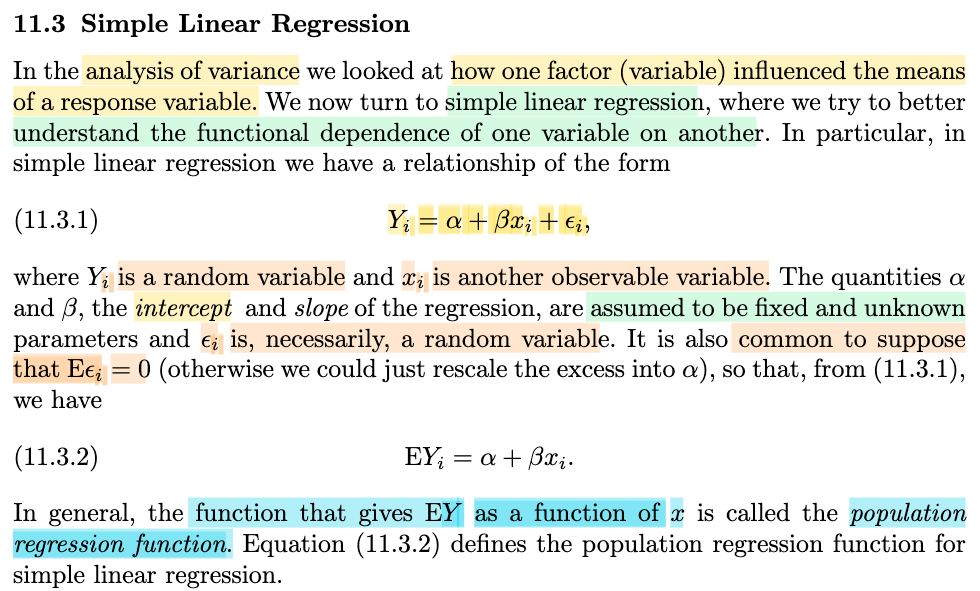</kbd>

> [!NOTE]
> Đại ý là, phần trước, với ANOVA, ta học cách phân tích tác động của các yếu tố lên mean của response variable.
>
>
>
> Phần này ta sẽ học về simple linear regression - để hiểu sự phụ thuộc của một variable lên variable khác.
>
>
>
> Cụ thể thể, ta có quan hệ: Yi = α + βxi + εi
>
>
>
> Với Yi và εi là random variable. Với E\[εi\] thường được assume = 0
>
>
>
> α, β là fixed và unknown parameter (gọi là intercept và slope)
>
>
>
> còn xi là observable variable (có thể hiểu là đây là giá trị sẽ quan sát được, không coi là random varible)
>
>
>
> Khi đó, E\[Y\] với tư cách là hàm số của x được gọi là population regression function.
>
>
>
> ---
>
>
>
> Liên hệ chút với chương 3 sách Bishop, trong đó ta giả định T|𝐱 \~ 𝒩(𝐰ᵀΦ(𝐱), 1/β), để rồi theo decision theory, ta dùng y(𝐱) = 𝐰ᵀΦ(𝐱) để dự đoán target cho input 𝐱. Đương nhiên y(𝐱) chính là E\[T|𝐱\], nên ở đây có thể hiểu thêm cái này chính là population regression function.

> [!TIP]
> 🤖 **AI Check** — 🟢 Pass — ✅ **100/100** · ✓ Move on
>
> Ghi chú tóm tắt rất chính xác các khái niệm mở đầu của hồi quy tuyến tính đơn và có liên hệ sâu sắc, chuẩn xác với hàm hồi quy kỳ vọng có điều kiện E[T|x] trong sách Bishop.
>
> **✓ Strengths**
> - Nắm bắt chính xác vai trò của các thành phần trong mô hình hồi quy (biến ngẫu nhiên Y và sai số, tham số cố định alpha, beta, và biến giải thích x).
> - Liên hệ rất tốt với góc nhìn xác suất và Decision Theory trong machine learning (sách Bishop), nhận diện đúng population regression function chính là hàm kỳ vọng có điều kiện.
>
> **💡 Deeper notes**
> - Trong thống kê cổ điển (fixed design), x_i thường được xem là các giá trị cố định được chọn trước thay vì biến ngẫu nhiên. Khi chuyển sang góc nhìn tổng quát hơn (random design như trong Bishop), ta viết rõ là kỳ vọng có điều kiện E[Y|X=x].

**🔗 See also:** [Best Linear Unbiased Estimators](#node-l6jbbvb)

 

### Population Regression Function and Variables

<kbd>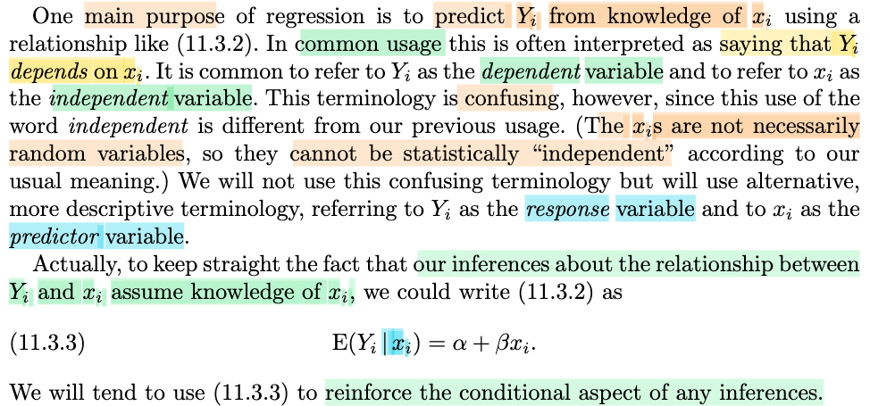</kbd>

> [!NOTE]
> Đại khái là với bài toán regression, mục đích chính là dự đoán Yi từ input xi.
>
>
>
> Thế thì người ta gọi Yi là dependent variable, còn xi là independent variable ám chỉ trong quan hệ Yi = α + βxi + εi ở trên, Yi phụ thuộc xi.
>
>
>
> Có điều tác giả cho rằng, cách gọi này gây khó hiểu, vì TA THƯỜNG KHÔNG COI x LÀ RANDOM VARIBLE. Thành ra như vậy thì sẽ không mắc mớ gì dùng chữ independent (kiểu như hai random variable independent)
>
>
>
> Do đó ta sẽ dùng reponse variable và predictor variable (giống trong ISL)
>
>
>
> ---
>
>
>
> Và ta sẽ ghi E\[Yi|xi\] để nhấn mạnh sự phụ thuộc vào xi
>
>
>
> Đây cũng chính là cái mình thấy trong Bishop, y(𝐱) = E\[T|𝐱\] = 𝐰ᵀ𝐱 chính là cách ghi để nhấn mạnh rằng, ta lấy kì vọng của conditional distribution của T|𝐱 \~ 𝒩(𝐰ᵀ𝐱, 1/β) để dự đoán.

> [!TIP]
> 🤖 **AI Check** — 🟢 Pass — ✅ **98/100** · ✓ Move on
>
> Ghi chú tóm tắt rất tốt, nắm bắt chính xác lý do tác giả đề xuất tránh dùng thuật ngữ 'independent variable' để không nhầm lẫn với tính độc lập trong xác suất thống kê.
>
> **✓ Strengths**
> - Hiểu chính xác lý do cốt lõi: x_i thường được xem là các giá trị cố định (không nhất thiết là biến ngẫu nhiên), nên việc dùng từ 'independent' dễ gây hiểu nhầm sang khái niệm biến ngẫu nhiên độc lập.
> - Nắm trọn vẹn thuật ngữ chuẩn thay thế được khuyên dùng là 'response variable' và 'predictor variable', có liên hệ tốt với kiến thức sách ISL.
>
> **💡 Deeper notes**
> - Trong kinh tế lượng hoặc hồi quy cổ điển, mô hình thường giả định 'fixed design' (x là hằng số cố định được chọn trước). Dù trong một số bài toán hiện đại (random design) x cũng có thể là biến ngẫu nhiên, việc dùng cặp từ 'predictor - response' vẫn giúp phân biệt rõ vai trò dự báo thay vì ngụ ý tính độc lập xác suất.

 

#### Linear Regression and Conditional Expectation

<kbd>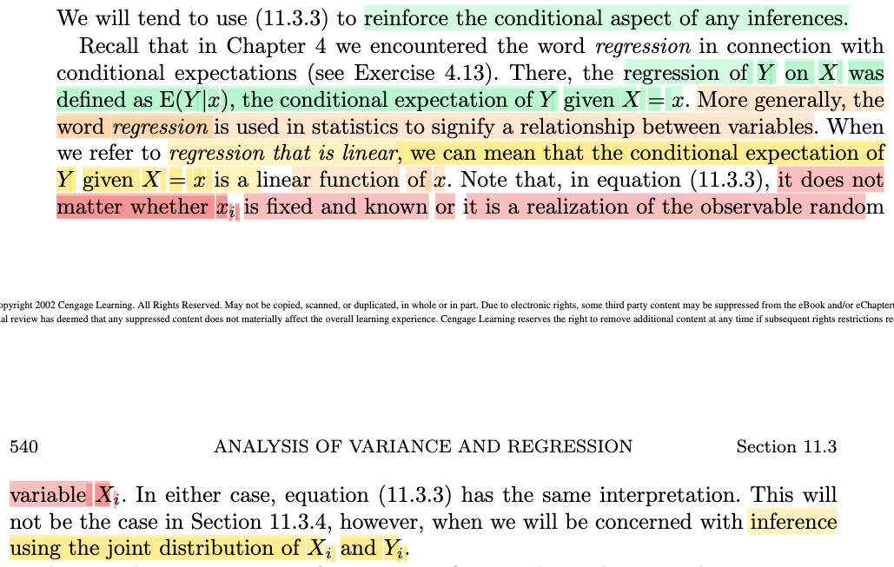</kbd>

<kbd>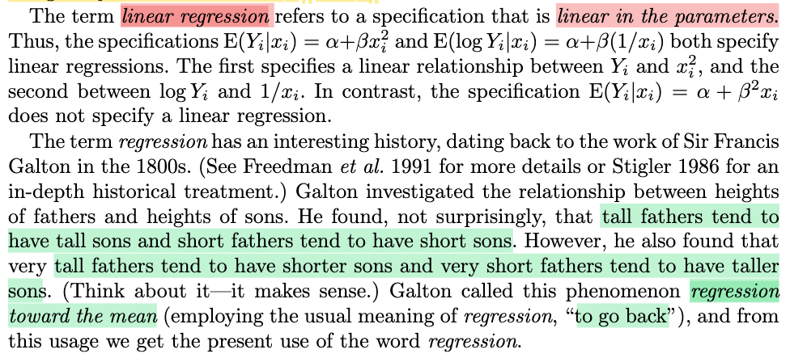</kbd>

> [!NOTE]
> Đoạn này tác giả nhấn mạnh cách ta nên hiểu về chữ regression: Có thể hiểu cụm "regression của Y on X" là E\[Y|X=x\]. Nhưng khái quát hơn, chữ regression của Y on X thể hiện quan hệ của Y đối với giá trị x của X.
>
>
>
> Nên nói "regression của Y on X là linear function" thì hiểu là: quan hệ giữa giá trị của Y đối với giá trị x của X là hàm tuyến tính, hay E\[Y|X=x\] là một hàm tuyến tính f(x) nào đó.
>
>
>
> Và E\[Yi|xi\] = α + βxi có thể dùng cho cả hai case: xi là giá trị cố định nào đó, hoặc xi là giá trị cụ thể của một random variable Xi nào đó.
>
>
>
> ---
>
>
>
> Một ý quan trọng:
>
>
>
> Nói regression is linear thì như đã nói, ám chỉ E\[Y|X=x\] = α + βx là hàm tuyến tính đối với x
>
>
>
> Còn **linear regression** thì lại chỉ E\[Y|X=x\] là **hàm tuyến tính đối với tham số α và β**. Do đó
>
>
>
> E\[Y|X=x\] = α + βx² là LINEAR REGRESSION nhưng REGRESSION CỦA Y ON X KHÔNG LINEAR.
>
>
>
> Cuối cùng, là chữ regression ra đời khi đại ý là ông nhà sinh vật học Galton quan sát thấy hiện tượng cha lùn thì sin con lùn như có xu hướng cao lên còn cha cao sinh con cao như có khuynh hướng lùn đi. Ông gọi là "quay về với trung bình" thì chữ regression chính là mang ý "quay về" - "hồi quy"

📹 [Xem video trên YouTube](https://www.youtube.com/watch?v=26Q9kLHdbkc)

> [!TIP]
> 🤖 **AI Check** — 🟢 Pass — ✅ **100/100** · ✓ Move on
>
> Ghi chú rất xuất sắc, nắm bắt trọn vẹn và chính xác các điểm cốt lõi trong đoạn văn bản, đặc biệt là sự phân biệt giữa 'regression that is linear' (tuyến tính theo biến độc lập) và 'linear regression' (tuyến tính theo tham số).
>
> **✓ Strengths**
> - Phân biệt chính xác giữa khái niệm hàm hồi quy tuyến tính theo x và mô hình hồi quy tuyến tính theo tham số (linear in parameters).
> - Hiểu đúng bản chất của x_i dù là giá trị thiết kế cố định (fixed) hay là quan sát từ biến ngẫu nhiên X_i.
> - Nắm rõ nguồn gốc lịch sử và ý nghĩa của thuật ngữ 'hồi quy về giá trị trung bình' (regression toward the mean) của Galton.
>
> **💡 Deeper notes**
> - Dù phương trình điều kiện E(Y|x) có cùng dạng giải thích khi x_i cố định hay ngẫu nhiên, việc suy diễn thống kê (inference) sẽ có sự khác biệt khi xét đến phân phối đồng thời của (X, Y) thay vì chỉ phân phối có điều kiện của Y|X.

**🔗 See also:** [Error Function for Regression *(Pattern Recognition Machine Learning_C.Bishop)*](../pattern_recognition_machine_learning_cbishop/52_training.md#node-y877d09)

 

##### Example 11.3.1 Predicting Grape Crops

<kbd>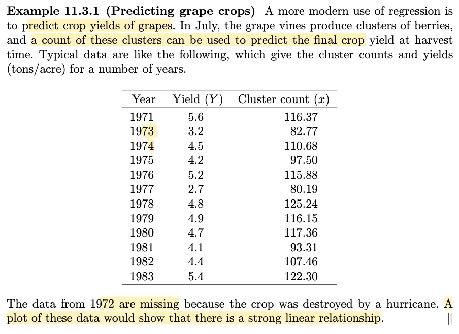</kbd>

> [!NOTE]
> Một ví dụ về một bộ data: x là số chùm nho, và Y là kết quả thu hoạch của mùa nho. Năm 1972 bị thiếu do bão. Đại khái là nếu vẽ ra, ta sẽ thấy regression của Y on x (E\[Y|x\]) rõ ràng là tuyến tính.

> [!TIP]
> 🤖 **AI Check** — 🟢 Pass — ✅ **95/100** · ✓ Move on
>
> Ghi chú tóm tắt rất tốt và chính xác nội dung ví dụ từ sách, đồng thời liên hệ trực tiếp mối quan hệ tuyến tính với hàm hồi quy $E[Y|x]$.
>
> **✓ Strengths**
> - Xác định đúng các biến số: biến dự báo $x$ (số chùm) và biến mục tiêu $Y$ (sản lượng).
> - Ghi nhận chính xác chi tiết dữ liệu khuyết thiếu của năm 1972.
> - Liên hệ tốt giữa việc trực quan hóa dữ liệu (scatter plot) với giả định hàm hồi quy tuyến tính $E[Y|x]$.
>
> **💡 Deeper notes**
> - Trên thực tế, đồ thị phân tán quan sát được (scatter plot) chỉ thể hiện mối quan hệ tuyến tính mạnh giữa các điểm mẫu; việc kết luận $E[Y|x]$ là tuyến tính là một giả định mô hình hồi quy (linear regression model) được hỗ trợ bởi dữ liệu đó.

 

###### Section 11.3 Simple Linear Regression

<kbd>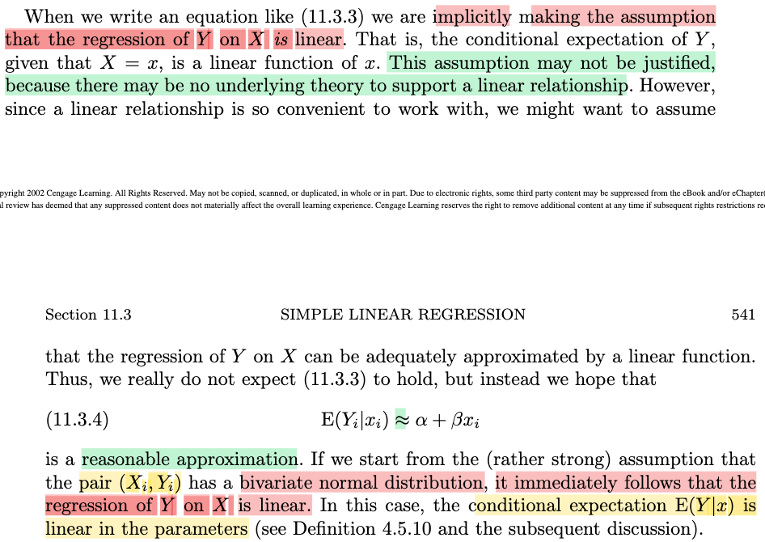</kbd>

<kbd>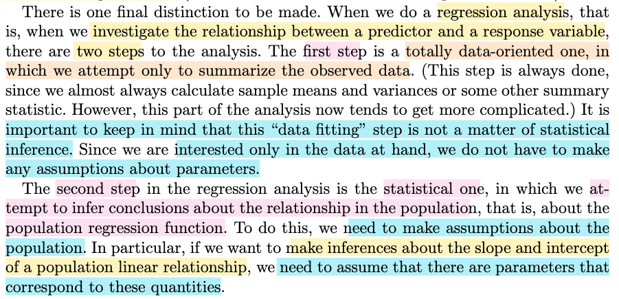</kbd>

> [!NOTE]
> Đại khái là, khi ta dùng phương trình E\[Yi|xi\] = α + βxi thì ta đã **NGẦM GIẢ ĐỊNH** REGRESSION CỦA Y ON X LINEAR.
>
>
>
> hoặc ít nhất, ta **ĐANG HI VỌNG / GIẢ ĐỊNH** rằng E\[Yi|xi\] ≈ α + βxi CÓ THỂ LÀ **MỘT PHÉP XẤP XỈ TỐT**
>
>
>
> Và nếu ta bắt đầu với giả định mạnh là: (X,Y) \~ bivariate normal, thì khi đó đương nhiên E\[Y|X=x\] chính là linear function theo x: xem link, tới note chương 4, nói rằng nếu ta có X, Y có joint pdf là bivariate normal với mean (μX,μY), variance σ²X,σ²Y và correlation ρ, thì given X = x, conditional distribution của Y là n(μY + ρ(σY/σX)(x - μX), σ²Y(1-ρ²))
>
>
>
> ---
>
>
>
> Tiếp theo
>
>
>
>  Rằng khi làm regression analysis - chính là mô tả việc nghiên cứu quan hệ giữa predictor và response ta sẽ thấy có hai bước:
>
>
>
> Bước 1 thuần túy là data-oriented, đại khái là ta sẽ tính toán gì đó, nhưng ý chính nhấn mạnh là bước này không phải là bước inference, do đó, chưa giả định gì về tham số cả.
>
>
>
> Bước 2 mới là inference. Và ta sẽ giả định rằng slope và intercept (α và β trong E\[Y|x\] = α + βx) là thứ có tồn tại trong quan hệ của response và predictor. Tức là, ta giả định rằng quả thật quan hệ của E\[Y|x\] và x có thể được ước lượng bởi hàm tuyến tính: E\[Y|x\] ≈ α + βx mà hàm số này bị chi phối bởi hai tham số α và β (chính là giả định ở trên)
>
>
>
> Dựa trên giả định đó, ta mới đi inference hai tham số này

📹 [Xem video trên YouTube](https://www.youtube.com/watch?v=V-6BNavEGgU)

> [!TIP]
> 🤖 **AI Check** — 🟢 Pass — ✅ **98/100** · ✓ Move on
>
> Ghi chú nắm bắt rất chính xác và sâu sắc toàn bộ nội dung trong tài liệu, từ bản chất giả định tuyến tính đến sự phân biệt giữa bước tóm tắt dữ liệu (data fitting) và suy diễn thống kê (inference).
>
> **✓ Strengths**
> - Hiểu chính xác rằng mô hình hồi quy tuyến tính ngầm giả định kỳ vọng có điều kiện E[Y|X] là tuyến tính hoặc ít nhất xấp xỉ tuyến tính đủ tốt.
> - Liên kết xuất sắc kiến thức từ phân phối chuẩn hai biến (bivariate normal) để chỉ ra nguồn gốc lý thuyết của hàm hồi quy tuyến tính.
> - Phân biệt rành mạch giữa bước mô tả dữ liệu thuần túy (không cần giả định tham số) và bước suy diễn thống kê cho tổng thể (cần giả định về sự tồn tại của các tham số).
>
> **💡 Deeper notes**
> - Ở bước suy diễn thống kê (bước 2), để thiết lập các kiểm định và khoảng tin cậy chính xác cho các tham số tổng thể α và β, ta thường giả định quan hệ kỳ vọng trong tổng thể thỏa mãn chính xác E[Y|X=x] = α + βx (đi kèm giả định về sai số) thay vì chỉ là xấp xỉ.

**🔗 See also:** [Phân phối chuẩn hai biến](./45_covariance_correlation.md#node-ljt1bsi) · [Hội tụ phân phối có điều kiện](./45_covariance_correlation.md#node-g2hs1nk)

 

###### Two Steps of Regression Analysis

<kbd>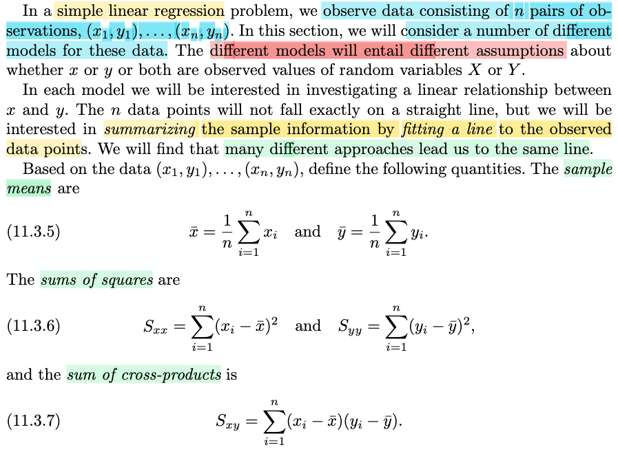</kbd>

<kbd>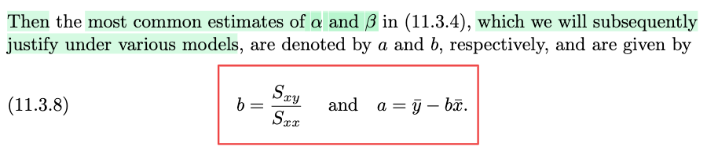</kbd>

> [!NOTE]
> đại khái là dữ liệu quan sát được sẽ bao gồm n cặp giá trị (x1,y1),....(xn,yn)
>
>
>
> Đoạn này sẽ lược dịch ý vì cơ bản là tác giả đang mô tả những gì sẽ làm (nên chả có gì mà phải suy nghĩ, đọc và biết vậy thôi)
>
>
>
> và trong phần này ta sẽ xem xét qua vài **mô hình** của dữ liệu này, mà mỗi mô hình sẽ mang trong mình **những giả định khác nhau** về việc x hay y hay cả hai là giá trị quan sát của biến ngẫu nhiên X,Y (chưa hiểu lắm ý này, nhưng mình đoán là: có thể trong các mô hình khác nhau này, ta có thể chỉ coi X hoặc chỉ Y hoặc cả hai X,Y đều là biến ngẫu nhiên.
>
>
>
> Rồi, kế tới nói n data point này ko mằm chính xác trên đường thẳng, nhưng mình muốn summarizing sample information bằng cách khớp một đường thẳng vào chúng. Và ta sẽ thấy các approach khác nhau dẫn ta tới cùng 1 đường thẳng.
>
>
>
> tính toán vài thứ, như sample mean, x̄, ȳ
>
>
>
> sum of squares Sxx = Σi (xi - x̄)², Syy = Σi (yi - ȳ)²
>
>
>
> sum of cross-products: Sxy = Σi (xi - x̄)(yi - ȳ)
>
>
>
> Và đây là estimate phổ biến nhất cho α và β (mà ta sẽ lần lượt biện minh dưới các mô hình khác nhau):
>
>
>
> b = Sxy/Sxx; a = ȳ - bx̄

> [!TIP]
> 🤖 **AI Check** — 🟢 Pass — ✅ **98/100** · ✓ Move on
>
> Ghi chú tóm tắt rất chính xác và đầy đủ nội dung đoạn mở đầu, nắm bắt trọn vẹn cả công thức lẫn các ý định tiếp cận của tác giả.
>
> **✓ Strengths**
> - Dự đoán trực giác rất chính xác về việc x, y có thể là biến ngẫu nhiên hoặc giá trị cố định (fixed design vs random predictor).
> - Ghi chép lại chính xác và cô đọng các công thức định nghĩa trung bình mẫu, tổng bình phương sai lệch và ước lượng tham số a, b.
>
> **💡 Deeper notes**
> - Công thức hệ số góc $b = S_{xy} / S_{xx}$ ngầm giả định $S_{xx} > 0$, tức các điểm dữ liệu $x_i$ không hoàn toàn trùng nhau (ít nhất có hai giá trị $x$ khác nhau).

**🔗 See also:** [BLUE of Linear Estimators](#node-s1vw0l4)

 

###### Figure 11.3.1 Vertical Distances for RSS

<kbd>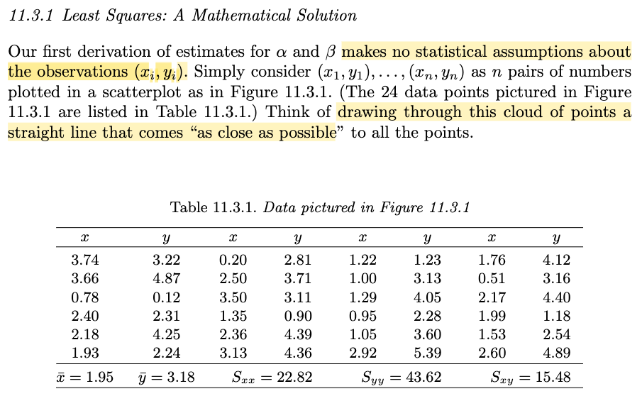</kbd>

<kbd>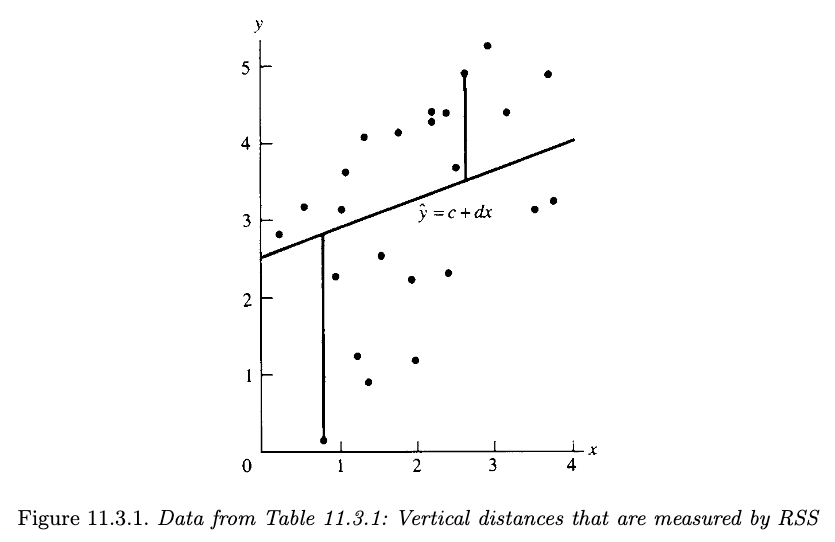</kbd>

<kbd>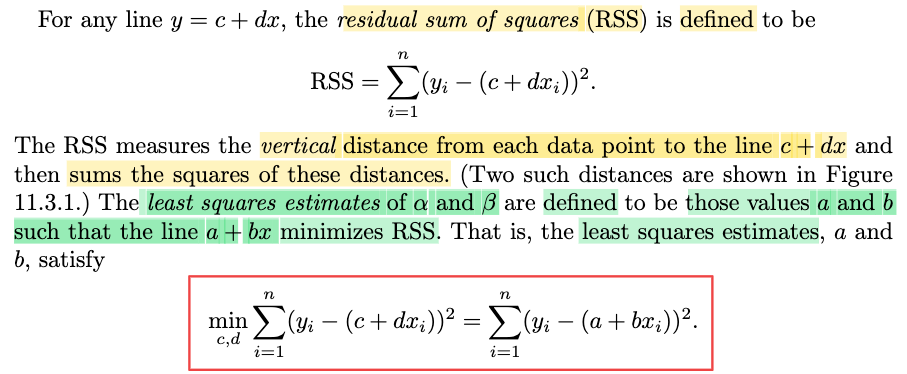</kbd>

<kbd>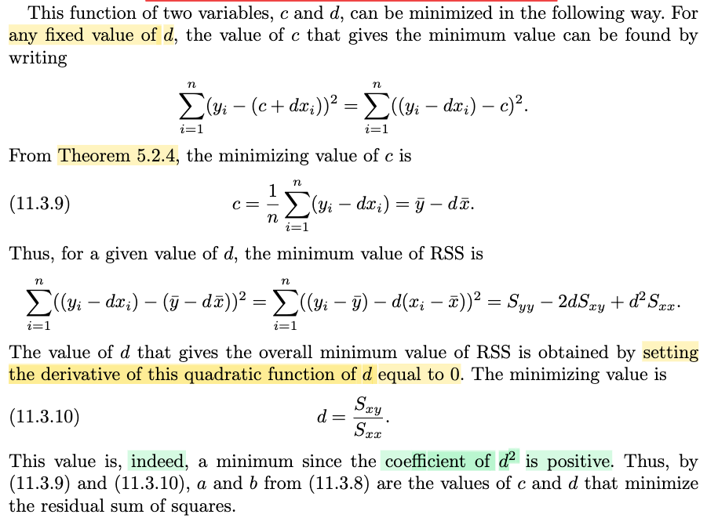</kbd>

> [!NOTE]
> Đại khái nói là, quá trình ta **tìm ra estimate đầu tiên** cho α và β hoàn toàn **không cần giả định nào về distribution của data (xi, yi)**, i=1,2,...n
>
>
>
> Cách làm như sau: Tìm cách vẽ đường thẳng đi xuyên qua đám mây dữ liệu sao cho "as close as possible" - theo vertical distance
>
>
>
> Và để làm cái vụ as close as possible này, ta mới định nghĩa ra cái gọi là RSS: Residual Sum of Squares, có thể hiểu là hàm số của các đường thẳng: c + dx, tức với c, d khác nhau, RSS sẽ khác nhau.
>
>
>
> RSS = Σi (yi - (c + dxi))²
>
>
>
> Và từ đó c,d giúp minimize RSS được gọi là **LEAST SQUARE ESTIMATE** CHO α, β:
>
>
>
> α̂, β̂ = argmin_c,d Σi (yi - (c + dxi))²
>
>
>
> cũng là Σi (yi - (α̂ + β̂ xi))² = min_c,d Σi (yi - (c + dxi))²
>
>
>
> ---
>
>
>
> Để giải bài toán tối ưu này (minimize c,d Σi (yi - (c + dxi))², như đã biết, có thể giải theo từng biến giải theo c trước (giữ d fix):
>
>
>
> Biến đổi tí: Σi (yi - (c + dxi))² = Σi ((yi - dxi) - c)²
>
>
>
> Đạo hàm theo c: d/dc \[Σi ((yi - dxi) - c)²\] = Σi d/dc \[((yi - dxi) - c)²\] = Σi \[2((yi - dxi) - c) . d/dc ((yi - dxi) - c)\]
>
>
>
> = Σi \[2((yi - dxi) - c) . (-1)\] = -2 Σi ((yi - dxi) - c)
>
>
>
> Cho đạo hàm bằng 0 tìm điểm dừng: -2 Σi ((yi - dxi) - c) = 0 ⇔ Σi ((yi - dxi) - c) = 0 ⇔ c = (1/n) Σi (yi - dxi)
>
>
>
> ⇔ c = (Σi yi)/n - d(Σi xi)/n = ȳ - d x̄
>
>
>
> Đạo hàm cấp 2: d/dc \[-2 Σi ((yi - dxi) - c) \] = 2n &gt; 0 ⇒ điểm dừng chính là cực tiểu.
>
>
>
> ---
>
>
>
> Lắp c\* vào và giải tìm d:
>
>
>
> Σi \[(yi - dxi) - ȳ + dx̄ \]² = Σi \[yi - dxi - ȳ + dx̄ \]² = Σi \[(yi - ȳ) - d(xi - x̄ )\]²
>
>
>
> = Σi \[(yi - ȳ)² - 2d(yi - ȳ)(xi - x̄ ) + d²(xi - x̄ )²\]
>
>
>
> = Σi(yi - ȳ)² - 2d Σi(yi - ȳ)(xi - x̄ ) + d² Σi(xi - x̄ )²
>
>
>
> = Syy - 2d Sxy + d² Sxx
>
>
>
> d/dd (Syy - 2d Sxy + d² Sxx) = - 2Sxy + 2d Sxx
>
>
>
> d/dd (Syy - 2d Sxy + d² Sxx) = 0
>
>
>
> ⇔ - 2Sxy + 2d Sxx = 0
>
>
>
> ⇔ d = Sxy/Sxx
>
>
>
> Đạo hàm cấp 2: 2Sxx &gt; 0 nên điểm dừng là minimizer
>
>
>
> Vậy α̂ (hay a) = ȳ - β̂ x̄ và β̂ (hay b) = Sxy/Sxx chính là LEAST-SQUARE ESTIMATE của α và β

> [!TIP]
> 🤖 **AI Check** — 🟢 Pass — ✅ **100/100** · ✓ Move on
>
> Ghi chú rất xuất sắc, hiểu đúng bản chất không tham số/phân phối của phương pháp bình phương tối thiểu và tự thực hiện chi tiết từng bước đạo hàm tối ưu hóa đầy đủ, chính xác.
>
> **✓ Strengths**
> - Nắm vững bản chất phương pháp bình phương tối thiểu thuần túy về mặt hình học/đại số mà không cần giả định phân phối xác suất.
> - Tự triển khai chi tiết các bước đạo hàm riêng và kiểm tra đạo hàm bậc hai để xác nhận cực tiểu thay vì chỉ chấp nhận công thức có sẵn.
>
> **💡 Deeper notes**
> - Điều kiện $2S_{xx} > 0$ để đạo hàm bậc hai dương và chia được cho $S_{xx}$ ngầm đòi hỏi các giá trị $x_i$ không hoàn toàn bằng nhau (tức có ít nhất hai điểm dữ liệu có hoành độ khác nhau).

 

###### Horizontal Distance Least Squares Line

<kbd>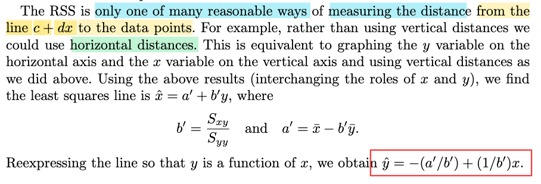</kbd>

<kbd>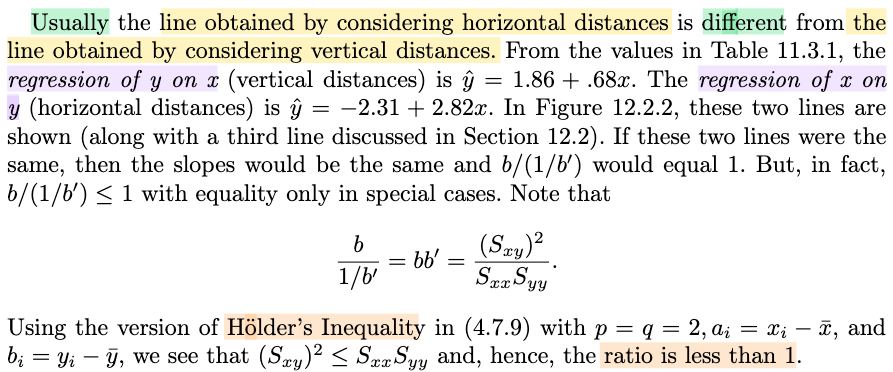</kbd>

<kbd>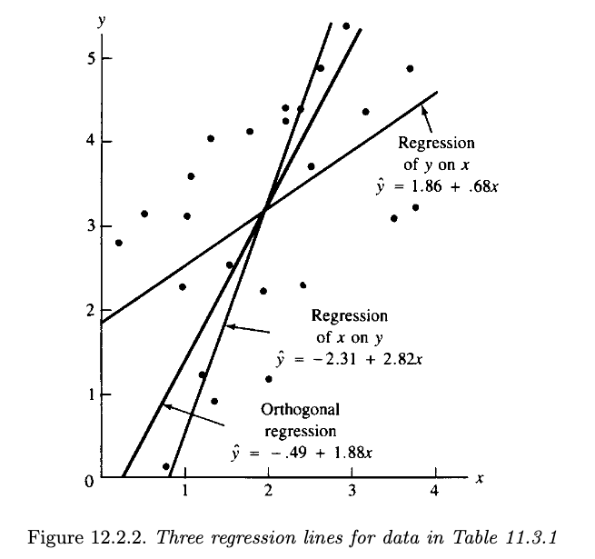</kbd>

> [!NOTE]
> Đại ý đoạn này là: nếu ta đổi sang dùng thước đo distance RSS trong đó residual là ri = xi - (c + dyi) (tức là đường thẳng bây giờ là x = c + dy, và dùng horizontal distance.
>
>
>
> Thì giả sử gọi c,d minimize RSS lúc này là a', b'. Ta sẽ có đường x = a' + b'y ⇔ y = x/b' - a'/b'. Đây gọi là regression của x on y. Và nó thường sẽ khác với đường y = a + bx (với a,b là least square estimate của α, β)
>
>
>
> Tác giả đại khái là viện tới bất đẳng thức Holder's Inequality để chứng minh điều này:
>
>
>
> Nếu muốn hai đường trùng nhau thì ta cần hệ số góc bằng nhau cái đã:
>
>
>
> 1/b' = b ⇔ b / (1/b') = 1 ⇔ bb' = 1
>
>
>
> Mà b = Sxy/Sxx, b' (gỉai tương tự như note trước, ta sẽ có Sxy/Syy)
>
>
>
> ⇔ Sxy² / SxxSyy
>
>
>
> và bất đẳng thức Holder đại ý là chứng minh Sxy² / SxxSyy ≤ 1 nên trừ trường hợp đặc biệt khi bất đẳng thức bằng, còn lại là nó sẽ &lt; 1 đồng nghĩa hai đường regression trên sẽ khác nhau.

> [!TIP]
> 🤖 **AI Check** — 🟢 Pass — ✅ **98/100** · ✓ Move on
>
> Ghi chú tóm tắt rất chính xác và mạch lạc bản chất của hồi quy x theo y, việc so sánh hai đường hồi quy qua hệ số góc và ứng dụng bất đẳng thức Hölder (Cauchy-Schwarz) để chỉ ra hai đường này thường không trùng nhau.
>
> **✓ Strengths**
> - Hiểu đúng bản chất residual theo khoảng cách ngang và cách biểu diễn lại đường hồi quy x theo y dưới dạng y = f(x).
> - Chỉ ra chính xác điều kiện bằng nhau của hai hệ số góc dẫn tới tích bb' = (Sxy)² / (Sxx Syy).
> - Nắm rõ vai trò của bất đẳng thức Hölder/Cauchy-Schwarz khi chỉ ra (Sxy)² / (Sxx Syy) ≤ 1 và kết luận hai đường nói chung là khác nhau.
>
> **💡 Deeper notes**
> - Trường hợp đặc biệt xảy ra dấu bằng chính là khi toàn bộ các điểm dữ liệu nằm chính xác trên một đường thẳng (tương quan tuyến tính tuyệt đối |r| = 1).
> - Cả hai đường hồi quy (y theo x và x theo y) đều luôn đi qua điểm trung bình mẫu (x̄, ȳ), do đó khi hệ số góc khác nhau thì chúng cắt nhau ngay tại điểm trọng tâm này.

 

###### Least Squares Solutions vs Estimates

<kbd>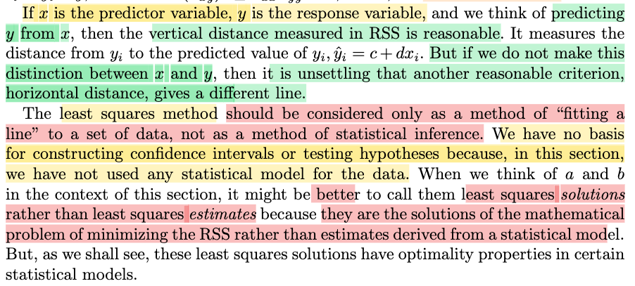</kbd>

> [!NOTE]
> Rồi, đại ý đoạn này là: nếu ta nói x là predictor variable, và y là response variable, thì mong muốn dự đoán y từ x sẽ khiến việc dùng RSS với vertical distance trở nên hợp lí, vì rõ ràng là nó đo sai khác giữa dự đoán (ŷi = c + dxi) và target yi.
>
>
>
> Tuy nhiên, nếu như TA HOÀN TOÀN KHÔNG CÓ NHU CẦU DỰ ĐOÁN y TỪ x, thì ta sẽ không có gì để biện minh cho việc nên dùng vertical distance hay horizontal distance, mà hai cái này lại cho ra hai regression line khác nhau. Đại khái là đây là một bất cập.
>
>
>
> Thêm nữa, tác giả nói rất rõ: Trong việc đưa đến estiamate cho α β bằng least square như vừa rồi, rõ ràng là ta không dựa trên bất cứ giả định nào của distribution của data. Do đó, đây không phải là STATISTICAL INFERENCE, do đó, chỉ nên gọi chúng là LEAST SQUARE SOLUTION, KHÔNG NÊN GỌI LÀ LEAST SQUARE ESTIMATE. Vì estimate ám chỉ kết quả có được từ bài toán statistical inference (ví dụ maximum likelihood estimate)
>
>
>
> Tuy vậy, ta sẽ thấy least square solution có vài đặc điểm tối ưu

> [!TIP]
> 🤖 **AI Check** — 🟢 Pass — ✅ **95/100** · ✓ Move on
>
> Ghi chú tóm tắt rất chính xác và nắm bắt trọn vẹn bản chất các luận điểm của tác giả về vai trò của biến, sự khác biệt giữa bài toán tối ưu hình học thuần túy và suy diễn thống kê.
>
> **✓ Strengths**
> - Hiểu chính xác lý do tại sao RSS đo khoảng cách thẳng đứng lại hợp lý khi dự đoán y từ x, và tại sao việc không phân định biến lại dẫn đến sự mơ hồ giữa khoảng cách ngang và dọc.
> - Nắm rất vững sự phân biệt tinh tế giữa 'least squares solution' (nghiệm của bài toán tối ưu hình học thuần túy) và 'least squares estimate' (ước lượng bắt nguồn từ một mô hình thống kê có suy diễn).
>
> **💡 Deeper notes**
> - Khi không phân biệt vai trò giữa x và y (cả hai đều có sai số ngẫu nhiên đối xứng), phương pháp bình phương tối thiểu toàn phần (Total Least Squares / Orthogonal Regression) hoặc PCA thường được dùng để tối thiểu hóa khoảng cách vuông góc (perpendicular distance).
> - Khái niệm 'statistical model' ở đây bao hàm việc đặt ra cấu trúc xác suất $Y = eta_0 + eta_1 X + \varepsilon$ cùng các giả định về sai số (ví dụ: kỳ vọng bằng 0, không đổi phương sai, độc lập), điều kiện cần thiết để xây dựng khoảng tin cậy và kiểm định giả thuyết thay vì chỉ khớp đường thẳng.

 

###### Best Linear Unbiased Estimators

<kbd>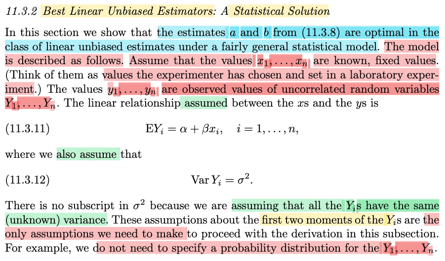</kbd>

<kbd>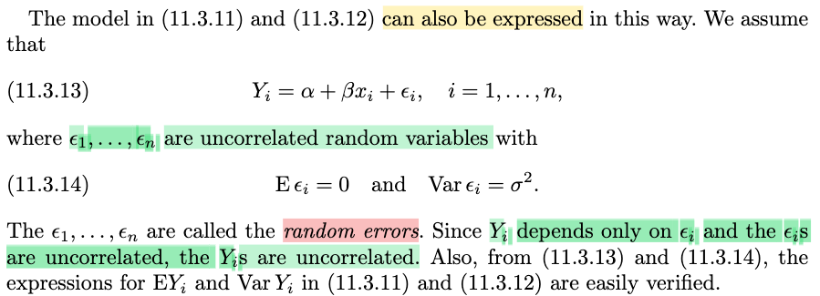</kbd>

> [!NOTE]
> Đại khái là, qua phần này, ta sẽ tiếp tục biện minh cho giá trị estimate cho α và β với công thức 11.3.8 theo một mô hình khác. còn nhớ, phần trước ta đã thấy đó chính là giá trị của c, d giúp minimize SSE - tạo ra đường thẳng đi sát nhất với data theo tiêu chí vertical distance. Và còn nhớ tác giả nói, kết quả đó hoàn toàn chưa phải là một statistical inference, vì ta chưa dựa trên giả định gì về phân phối của data.
>
>
>
> Còn ở đây, đại ý là ta sẽ làm statistical inference thật sự, và cũng cho ra công thức đó.
>
>
>
> Thế thì giả định về phân phối của data như sau, mà theo tác giả là một giả định rất khiêm tốn:
>
>
>
> Đối chiếu với một bài toán point estimation điển hình, nơi đề bài cho:
>
>
>
> Các random varible X1, X2,....Xn \~ n(μ, σ²) iid, và quan sát được giá trị của chúng: x1,x2,...xn. Thì đây chính là nói ta giả định x1,x2,...xn là giá trị quan sát được của đám biến ngẫu nhiên X1,...Xn độc lập và có cùng phân phối là n(μ, σ²)
>
>
>
> Thì ở đây, đề bài là ta có:
>
>
>
> Random variable Y1, Y2,....Yn, có giá trị quan sát y1, y2,...yn.
>
>
>
> Và không như giả định X1,X2,....\~ n(μ, σ²), ở đây ta chỉ giả định E\[Yi\] = α + βxi, và Y1,....Yn uncorrelate và Var(Yi) = σ² ∀i.
>
>
>
> Nói vậy để thấy, giả định của ta rất khiêm tốn, khi ko giả định dạng của phân phối, mà chỉ là dạng của hai moment đầu tiên.
>
>
>
> Và cái giả định này hoàn toàn có thể thể hiện bởi kiểu khác:
>
>
>
> y1,...yn là giá trị quan sát của Y1,...Yn với 
>
>
>
> Yi = α + βxi + εi, εi uncorrelate
>
>
>
> và E\[εi\] = 0, Var(εi) = σ²
>
>
>
> Thêm nữa, trong mô hình (giả định) này, x1,x2,...xn không phải là giá trị quan sát của biến ngẫu nhiên X gì hết, nó chỉ là giá trị fix có sẵn. Còn y1,y2,...mới là observed value của biến ngẫu nhiên Y
>
>
>
>
>
> ---
>
>
>
> Dừng lại tí xíu, có thể sẽ lú, vì hình như mình đã gặp cái này rồi, chẳng phải là ở phần đầu khi nói về simple linear regression đã nói rồi sao?
>
>
>
> Thì đúng là như vậy, đây chính là nhắc lại chuyện đó: có nghĩa là trong simple linear regression, ta giả định regression của Y on X, tức E\[Y|X=x\] là hàm tuyến tính theo x và theo tham số: E\[Y|x\] = α + βx, bên cạnh đó còn giả định ràng Var(Y|x) là σ², cố định, không phụ thuộc x. Nhưng ở đây, có thêm giả định: y1, y2,...là gía trị quan sát của Y1, Y2,....và đám này uncorrelate.
>
>
>
> Nói cách khác, simple linear regression vốn đã giả định Y = α + βx + ε với E\[ε\] = 0, Var(ε) = σ². Thì qua đây, ta CÓ THÊM GIẢ ĐỊNH NỮA: y1,y2,...là gía trị quan sát của Y1, Y2,....và đám Yi này uncorrelate.
>
>
>
> ---

> [!TIP]
> 🤖 **AI Check** — 🟢 Pass — ✅ **95/100** · ✓ Move on
>
> Ghi chú nắm rất chắc và chính xác bản chất thống kê của mô hình: phân biệt rõ giữa bình phương tối thiểu thuần túy (hình học) và suy diễn thống kê, hiểu đúng vai trò của các biến $x_i$ (giá trị cố định) so với $Y_i$ (biến ngẫu nhiên), cũng như nhận thức sâu sắc việc mô hình Gauss-Markov chỉ yêu cầu hai moment đầu tiên mà không cần giả định phân phối cụ thể.
>
> **✓ Strengths**
> - Phân biệt rất rõ ràng giữa tối thiểu hóa SSE thuần túy hình học ở phần trước và mô hình suy diễn thống kê ở phần này.
> - Hiểu chính xác rằng $x_1, \dots, x_n$ là các giá trị cố định (fixed design) được chọn trước chứ không phải biến ngẫu nhiên.
> - Nắm được tính 'khiêm tốn' nhưng mạnh mẽ của giả định Gauss-Markov: chỉ cần giả định về hai moment đầu (kỳ vọng tuyến tính, phương sai không đổi và không tương quan) mà không cần phân phối chuẩn.
>
> **💡 Deeper notes**
> - Trong thiết kế thực nghiệm với $x_i$ cố định (fixed-X design), việc các sai số $\epsilon_i$ không tương quan dẫn trực tiếp đến các $Y_i$ không tương quan; nếu mở rộng sang mô hình $X$ ngẫu nhiên (random design), ta thường cần điều kiện kỳ vọng có điều kiện $E[\epsilon|X]=0$ và các cặp $(X_i, Y_i)$ độc lập.

**🔗 See also:** [Simple Linear Regression](#node-0xbdf1h)

 

###### Linear Unbiased Estimator for Slope

<kbd>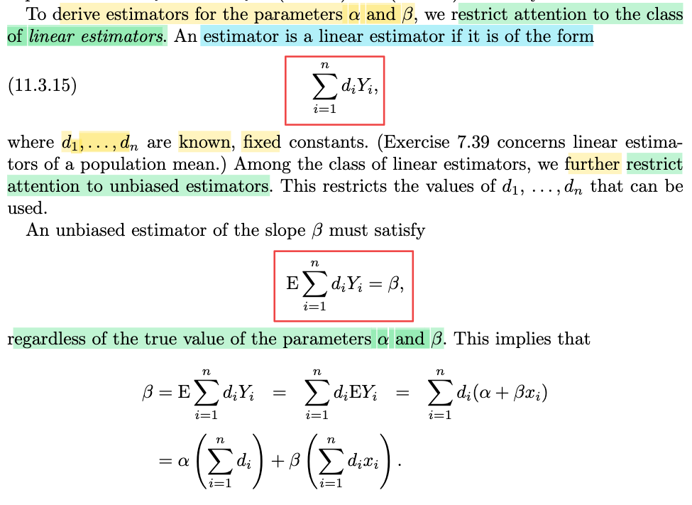</kbd>

<kbd>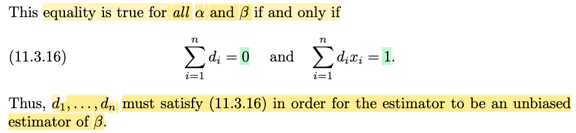</kbd>

> [!NOTE]
> Tiếp, đại khái là ta sẽ học một class / lớp / loại estimator gọi là estimator tuyến tính (linear estimator). được định nghĩa là estimator (của β) có dạng:
>
>
>
> W(𝐘) = Σi di Yi
>
>
>
> vì sao ghi W(𝐘), vì estimator về bản chất chỉ là hàm số của sample, sample ở đây chính là Y1,...Yn, y như tìm point estimator của θ trong bài toán point estimator là đi tìm hàm W(𝐗), để khi lắp observed value 𝐱 vào, 𝐖(𝐱) sẽ có một point estimate cho θ.
>
>
>
> Rồi, ta sẽ lại chỉ giới hạn tìm kiếm trong những unbiased estimator. Nhớ lại trong chương 7, nếu E\[W(𝐗)\] = θ, thì đó gọi là unbiased estimator của θ.
>
>
>
> Vậy thì ở đây, unbised linear estimator, chính là W(𝐘) có: E\[W(𝐘)\] = β với mọi giá trị của β và α
>
>
>
> ⇔ E\[Σi di Yi\] = β
>
>
>
> ⇔ Σi di EYi = β
>
>
>
> ⇔ Σi di (α + βxi) = β
>
>
>
> ⇔ Σi di α + Σi di βxi = β
>
>
>
> ⇔ α Σi di  + β Σi di xi = β
>
>
>
> Và như vậy Σi di phải bằng 0 và Σi di xi phải bằng 1 để E\[W(𝐘)\] = β với mọi giá trị của β và α
>
>
>
> Do đó công thức của unbiased linear estimator là W(𝐘) = Σi di Yi, Σi di = 0 và Σi di xi = 1

> [!TIP]
> 🤖 **AI Check** — 🟢 Pass — ✅ **100/100** · ✓ Move on
>
> Ghi chú rất tốt, trình bày chuẩn xác và tường minh từng bước biến đổi đại số cũng như liên kết rất tốt với bản chất của ước lượng điểm đã học ở chương trước.
>
> **✓ Strengths**
> - Hiểu rất rõ bản chất của một estimator là hàm của mẫu số liệu và liên hệ chính xác với khái niệm W(X) ở chương ước lượng điểm.
> - Tự diễn giải và triển khai đầy đủ, mạch lạc từng bước biến đổi đại số từ kỳ vọng đến hệ điều kiện của d_i.
>
> **💡 Deeper notes**
> - Trong mô hình hồi quy tuyến tính cổ điển, các giá trị x_i được xem là các hằng số đã biết (fixed constants), tương tự như các hệ số d_i, do đó chúng không bị ảnh hưởng bởi toán tử lấy kỳ vọng E.

 

###### Best Linear Unbiased Estimator (BLUE)

<kbd>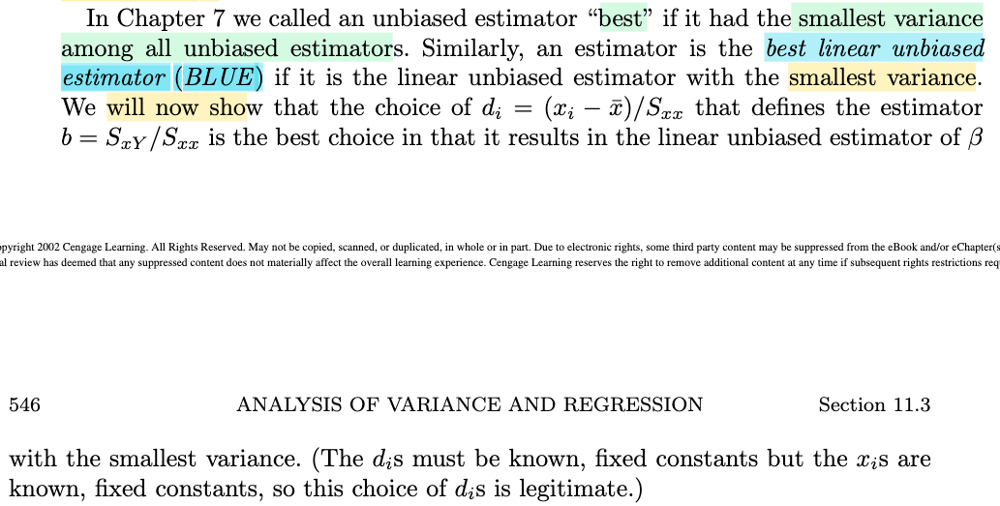</kbd>

> [!NOTE]
> Active recall tí xíu về best unbiased estimator:
>
>
>
> Bài toán point estimation đại khái là có đề bài như sau:
>
>
>
> Cho random sample 𝐗 = X1,...Xn có giá trị quan sát được là 𝐱 = (x1,...xn) iid \~ f(x|θ), ví dụ n(μ, 1). Nhiệm vụ là đi tìm good estimator của θ, tức μ.
>
>
>
> Point estimator của θ được định nghĩa là: hàm số của sample W(𝐗), để khi lắp 𝐱 vào, ta có point estimate cho θ
>
>
>
> W(𝐱) = argmax\_θ L(θ|𝐱)
>
>
>
> W(𝐗) = argmax\_θ L(θ|𝐗)
>
>
>
> Bias(W) = E\[W(𝐗)\] - θ
>
>
>
> Bias(W) = 0 ⇔ E\_θ\[W(𝐗)\] = θ, thì W(𝐗) được gọi là unbiased estimator của θ.
>
>
>
> Square Loss L(W(𝐗),θ) = \[W(𝐗) - θ\]²
>
>
>
> MSE: E\_θ\[L(W(𝐗),θ)\] = E\_θ\[(W(𝐗) - θ)²\]
>
>
>
> Xét (W(𝐗) - θ)² = W(𝐗)² - 2W(𝐗)θ + θ²
>
>
>
> E\_θ\[(W(𝐗) - θ)²\] = E\_θ\[W(𝐗)² - 2W(𝐗)θ + θ²\]
>
>
>
> = E\_θ\[W(𝐗)²\] - E\_θ\[2W(𝐗)θ\] + E\_θ\[θ²\] 
>
>
>
> (linearity của kì vọng: E(aX + bY + c) = aEX + bEY + c)
>
>
>
> = E\_θ\[W(𝐗)²\] - 2θ E\_θ\[W(𝐗)\] + θ² + (E\_θ\[W(𝐗)\])² - (E\_θ\[W(𝐗)\])²
>
>
>
> = E\_θ\[W(𝐗)²\] - (E\_θ\[W(𝐗)\])² + (E\_θ\[W(𝐗)\])²  - 2θ E\_θ\[W(𝐗)\] + θ² 
>
>
>
> ---
>
>
>
> Xét (E\_θ\[W(𝐗)\])²  - 2θ E\_θ\[W(𝐗)\] + θ²
>
>
>
> = {E\_θ\[W(𝐗)\] - θ}²
>
>
>
> = Bias(W(𝐗))²
>
>
>
> ---
>
>
>
> E\_θ\[W(𝐗)²\] - (E\_θ\[W(𝐗)\])²
>
>
>
> Nhớ lại công thức Var(X) = E\[(X-EX)²\]
>
>
>
> = E\[(X²-2X(EX) + (EX)²\]
>
>
>
> = E\[X²\]-E\[2X(EX)\] + E\[(EX)²\]
>
>
>
> = E(X²) - (EX)²
>
>
>
> ---
>
>
>
> E\_θ\[W(𝐗)²\] - (E\_θ\[W(𝐗)\])² chính là Var\[W(𝐗)\] 
>
>
>
> Như vậy MSE(W(𝐗)) =  Var\[W(𝐗)\] + Bias(W(𝐗))²
>
>
>
> Bây giờ nếu như mình có unbiased estimator của θ: Bias(W(𝐗)) = 0
>
>
>
> Khi đó MSE(W(𝐗)) = Var\[W(𝐗)\]
>
>
>
> Best unbiased estimator của θ: có variance nhỏ nhất.

📹 [Xem video trên YouTube](https://www.youtube.com/watch?v=0QxT5Qi1RfE)

> [!TIP]
> 🤖 **AI Check** — 🟡 Minor issues — ✅ **92/100** · ✓ Move on
>
> Ghi chú rất tốt, tự suy dẫn trọn vẹn phân rã MSE = Var + Bias² để làm sáng tỏ lý do vì sao ước lượng không chệch tốt nhất (best) lại tương đương với phương sai nhỏ nhất. Có một điểm nhỏ cần lưu ý là không nên đồng nhất ước lượng điểm nói chung với công thức của MLE.
>
> **🟡 Minor issues**
>
> **1.** *"Point estimator của θ được định nghĩa là: hàm số của sample W(𝐗), để khi lắp 𝐱 vào, ta có point estimate cho θ

W(𝐱) = argmax_θ L(θ|𝐱)"*
>
> Đoạn này dễ gây nhầm lẫn: hàm cực đại hóa likelihood (MLE) chỉ là một phương pháp tìm ước lượng cụ thể, không phải là định nghĩa tổng quát của mọi ước lượng điểm W(X).
>
>
> **✓ Strengths**
> - Tự chứng minh đầy đủ, chính xác từng bước phân rã MSE thành tổng của Variance và Bias².
> - Hiểu rõ bản chất vì sao khi một ước lượng là không chệch (Bias = 0) thì tiêu chí tối thiểu hóa MSE đồng nhất với việc tìm ước lượng có phương sai nhỏ nhất (Best Unbiased Estimator).
>
> **💡 Deeper notes**
> - Trong bối cảnh bài học ở sách giáo khoa (BLUE - Gauss-Markov Theorem), chữ 'Linear' (tuyến tính) giới hạn không gian tìm kiếm chỉ trong các hàm tuyến tính của biến phản hồi Y; do đó BLUE là ước lượng có phương sai nhỏ nhất trong lớp ước lượng tuyến tính không chệch, chứ không nhất thiết là nhỏ nhất trên toàn bộ không gian ước lượng phi tuyến (UMVUE).

 

###### BLUE of Linear Estimators

<kbd></kbd>

<kbd>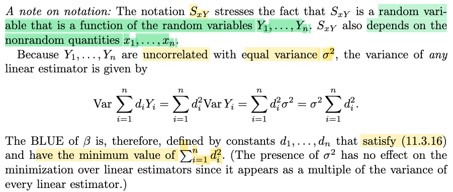</kbd>

> [!NOTE]
> b = Sxy / Sxx
>
>
>
> a = ȳ - bx̄
>
>
>
> Ok, đại khái ta đã biết để có một unbiased linear estimator, thì W(𝐘) = Σi diYi phải có kì vọng bằng β với mọi α,β. Dẫn tới hai ràng buộc là Σi di = 0 và Σi di xi = 1
>
>
>
> Thế thì như note trước vừa ôn lại, với point estimator của θ, để có cái gọi là the best unbiased estimator của θ thì Var(W(𝐗)) phải nhỏ nhất trong đám các unbiased estimator.
>
>
>
> Tương tự như vậy, để gọi là the best unbiased estimator của β thì Var(W(𝐘)) phải nhỏ nhất.
>
>
>
> ---
>
>
>
> Xét Var(W(𝐘)) = Var(Σi diYi)
>
>
>
> Áp dụng công thức Var(X1+X2+...Xn) = Var(X1) + ..Var(Xn) + 2Cov(X1,X2) + 2Cov(X1,X3)....
>
>
>
> = Σi Var(Xi) + Σi,j,i≠j 2Cov(Xi,Xj)
>
>
>
> Nếu Xi, Xj uncorrelate, tức Cov(Xi,Xj)/STD(Xi)STD(Xj) = 0 ⇔ Cov(Xi,Xj) = 0
>
>
>
> Do đó, vì Yi uncorrelate nên Var(Σi diYi) = Σi Var(diYi)
>
>
>
> = Σi di² Var(Yi) (tính chất variance: Var(cX) =  c²Var(X))
>
>
>
> = Σi di² σ² (Var(Yi) = σ² ∀i, đây là giả định của simple linear regression)
>
>
>
> = σ² Σi di² 
>
>
>
> ---
>
>
>
> Như vậy, để Var(W(𝐘)) nhỏ nhất thì Σi di²  phải nhỏ nhất.

> [!TIP]
> 🤖 **AI Check** — 🟢 Pass — ✅ **90/100** · ✓ Move on
>
> Ghi chú đã ghi lại chính xác công thức tính hệ số góc $b$ và hệ số chặn $a$ trong hồi quy tuyến tính đơn giản. Tuy nhiên, ghi chú khá ngắn gọn và chưa đề cập đến bản chất BLUE (ước lượng tuyến tính không chệch tốt nhất) được trình bày trong tài liệu.
>
> **✓ Strengths**
> - Ghi lại chính xác công thức chuẩn cho ước lượng hệ số góc b = Sxy / Sxx và hệ số chặn a = ȳ - bx̄.
>
> **💡 Deeper notes**
> - Tài liệu gốc sử dụng ký hiệu S_{xY} (với Y viết hoa) để nhấn mạnh đây là biến ngẫu nhiên / ước lượng (estimator), phụ thuộc vào các biến ngẫu nhiên Y_i, khác với giá trị mẫu cụ thể S_{xy}.
> - Đoạn văn bản chủ yếu tập trung chứng minh b là ước lượng tuyến tính không chệch tốt nhất (BLUE) của β dựa trên việc tối thiểu hóa tổng d_i^2.

**🔗 See also:** [Two Steps of Regression Analysis](#node-7ilb1oo)

 

###### Lemma 11.2.7 Contrast Maximization

<kbd>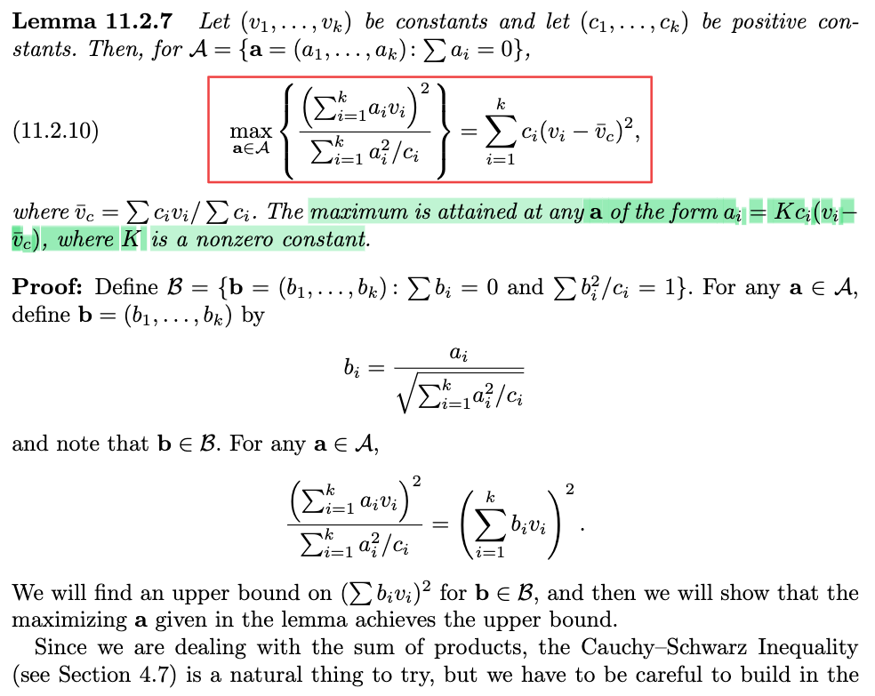</kbd>

<kbd>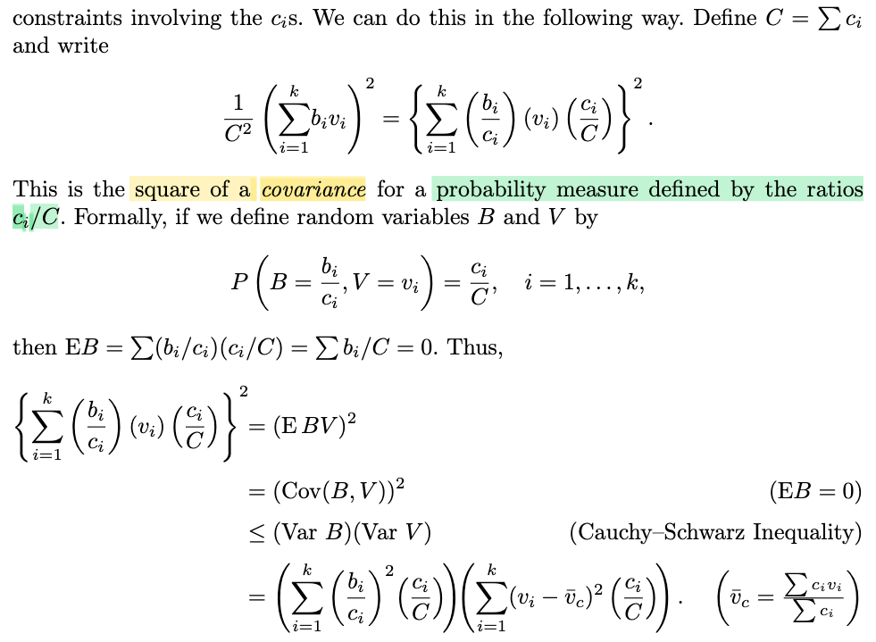</kbd>

<kbd>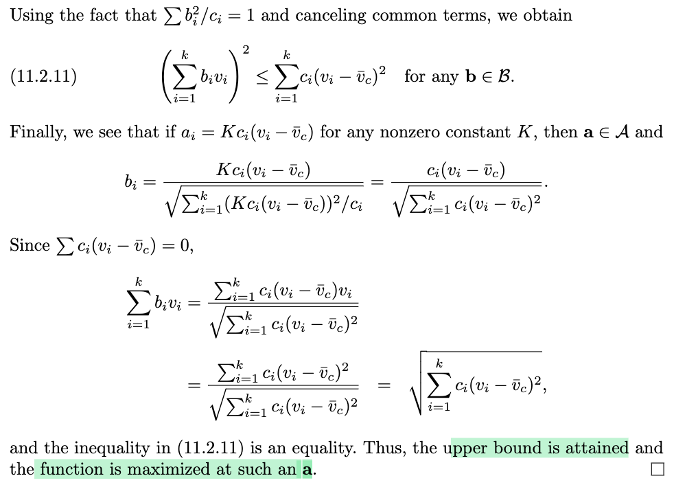</kbd>

> [!NOTE]
> Cov(X,Y) = E\[(X-EX)(Y-EY)\]
>
>
>
> = E\[XY-(EX)Y-X(EY)+(EX)(EY)\]
>
>
>
> = E(XY) - (EX)(EY) - (EX)(EY) + (EX)(EY)
>
>
>
> = E(XY) - (EX)(EY)
>
>
>
> ---
>
>
>
> Bất đẳng thức Cauchy-Schwarz:
>
>
>
> E\[(U-tV)²\] ≥ 0 ∀t
>
>
>
> ⇔ E\[U² - 2U(tV) + (tV)²\] ≥ 0
>
>
>
> ⇔ E\[U²\] - E\[2U(tV)\] + E\[(tV)²\] ≥ 0
>
>
>
> ⇔ E\[U²\] - 2tE\[UV\] + t²E\[V²\] ≥ 0
>
>
>
> ⇔ E\[V²\]t² - 2E\[UV\]t + E\[U²\] ≥ 0 ∀t (1)
>
>
>
> Xét hàm f(t) = E\[V²\]t² - 2E\[UV\]t + E\[U²\]
>
>
>
> d/dt f(t) = 2E\[V²\]t - 2E\[UV\]
>
>
>
> Điều kiện tối ưu cần bậc nhất: d/dt f(t) = 0 ⇔ 2E\[V²\]t - 2E\[UV\] = 0 
>
>
>
> ⇔ t = E\[UV\]/ E\[V²\]
>
>
>
> d/dt \[2E\[V²\]t - 2E\[UV\]\] = 2E\[V²\] ≥ 0 với t
>
>
>
> Suy ra hàm số đạt cực tiểu tại t0 = E\[UV\] / E\[V²\]
>
>
>
> (1) ⇔ f(t0) ≥ 0
>
>
>
> E\[V²\](E\[UV\]/ E\[V²\])² - 2E\[UV\](E\[UV\]/ E\[V²\]) + E\[U²\] ≥ 0
>
>
>
> ⇔ (E\[UV\])²/ E\[V²\] - 2(E\[UV\])²/ E\[V²\] + E\[U²\] ≥ 0
>
>
>
> ⇔ -(E\[UV\])²/ E\[V²\] + E\[U²\] ≥ 0
>
>
>
> ⇔  E\[U²\] ≥ (E\[UV\])²/ E\[V²\]
>
>
>
> ⇔ E\[U²\]E\[V²\] ≥ (E\[UV\])²
>
>
>
>  đây chính là bất đẳng thức Cauchy-Schwarz:
>
>
>
> (E\[UV\])² ≤ E\[U²\]E\[V²\] 
>
>
>
> ---
>
>
>
> Áp dụng cho U = (X - EX), V = (Y - EY)
>
>
>
> (E\[(X - EX)(Y - EY)\])² ≤ E\[(X - EX)²\]E\[(Y - EY)²\] 
>
>
>
> (Cov(X,Y))² ≤ Var(X)Var(Y)
>
>
>
> ⇔ -STD(X)STD(Y) ≤ (Cov(X,Y)) ≤ STD(X)STD(Y)
>
>
>
> ⇔ -1 ≤ Cov(X,Y) / STD(X)STD(Y) ≤ 1
>
>
>
> ⇔ -1 ≤ Corr(X,Y) ≤ 1
>
>
>
> ---
>
>
>
>
>
>
>
>
>
>
>
> ---
>
>
>
>
>
>
>
>
>
>
>
>
>
>
>
>
>
>
>
>
>
>
>
>
>
>
>
>
>
>
>
>
>
>
>
>
>
>
>
>
>
>
>
>
>
>
>
>
>
> ---
>
>
>
> Rồi, chứng minh đại khái như sau:
>
>
>
> Bổ đề nói rằng cho (v1,...vk) là constant và (c1,...ck) là constant dương. Và 𝒜 = {𝐚=(a1,...ak): Σiai = 0} thì khi đó:
>
>
>
> max\_𝐚∈𝒜 {(Σi aivi)² / (Σi ai²/ci)} = Σi ci(vi - v̄c)² với v̄c = Σi civi / Σici 
>
>
>
> Và maximum sẽ đạt tại 𝐚 có dạng ai = Kci(vi-v̄c) với K là constant khác 0
>
>
>
> ---
>
>
>
> Chứng minh đại khái như sau:

📹 [Xem video trên YouTube](https://www.youtube.com/watch?v=gpURGn0c_74)

> [!TIP]
> 🤖 **AI Check** — 🔴 Critical issues — ❌ **35/100** · ✗ Fix first
>
> Ghi chú chưa thực hiện phần chứng minh bổ đề như đã nêu ('Chứng minh đại khái như sau:' nhưng để trống), đồng thời mắc lỗi nghiêm trọng khi đưa biến ngẫu nhiên sign(UV) ra ngoài kỳ vọng.
>
> **🔴 Critical issues**
>
> **1.** *"Chứng minh đại khái như sau:"*
>
> Kiểm tra tiến độ (Progress Check): Ghi chú đặt ra mục tiêu chứng minh bổ đề nhưng chỉ chép lại phát biểu của Bổ đề 11.2.7 và để trống toàn bộ phần chứng minh theo gợi ý phân phối xác suất và bất đẳng thức Cauchy-Schwarz từ tài liệu.
>
> **2.** *"E[sign(UV) |UV|] = sign(UV) E[|UV|]"*
>
> Sai bản chất toán học: sign(UV) là một đại lượng ngẫu nhiên phụ thuộc vào mẫu, không phải là hằng số nên không thể tùy tiện đưa ra ngoài dấu kỳ vọng E[·].
>
>
> **🟡 Minor issues**
>
> **1.** *"t = E[UV]/ E[V²]"*
>
> Chưa xét trường hợp mẫu số bằng 0 (E[V²] = 0 hay V = 0 hầu chắc chắn) khi chia cho E[V²].
>
> **2.** *"(2) |E[UV]| ⇔ ≤ E[|UV|] ≤ √E[|U|²] √E[|V|²]"*
>
> Ký hiệu bị lỗi cú pháp ('⇔ ≤') gây khó hiểu cho biểu thức so sánh.
>
>
> **✓ Strengths**
> - Khai triển và biến đổi công thức tính hiệp biến Cov(X, Y) = E[XY] - E[X]E[Y] chính xác.
> - Ý tưởng chứng minh bất đẳng thức Cauchy-Schwarz qua việc tối thiểu hóa tam thức bậc hai f(t) = E[(U - tV)²] rất rõ ràng và mạch lạc.
>
> **💡 Deeper notes**
> - Để chứng minh Bổ đề 11.2.7 theo tài liệu, cần áp dụng Cauchy-Schwarz cho Cov(B, V)² ≤ Var(B)Var(V) với phân phối xác suất rời rạc P(B = b_i/c_i, V = v_i) = c_i / C thay vì chỉ dừng lại ở việc chứng minh lại bất đẳng thức Cauchy-Schwarz tổng quát.
> - Bất đẳng thức |E[UV]| ≤ E[|UV|] suy ra trực tiếp từ tính chất kỳ vọng của hàm lồi / bất đẳng thức tam giác cho tích phân, không cần thông qua biến đổi sign(UV).

 

